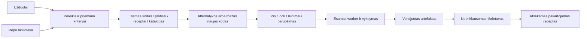

# RepositoryZero įgyvendinimo planas

Atnaujinta 2026-10-17 po nepriklausomo Astra audito ir abipusės sprendimų peržiūros. Tai priimta kryptis; funkcijų užbaigimą rodo [būsena](docs/IMPLEMENTATION.md) ir [ROADMAP](ROADMAP.md).

**Vienas Rakazo pagrindas, vienas užduoties autoritetas, plonas reuse sluoksnis esamame worker.** React ir bendri UI paketai, esamas Graphile/PostgreSQL vykdymas. CLI lieka eksperimento ar backend adapteriu. Naujas scheduler, universalus kontraktų variklis ir mikroservisų tinklas šiuo metu nepagrįsti.

Du produkto įėjimai: **New task** ir savarankiška **Library**. Bibliotekoje žmogus ieško, filtruoja, išsaugo ir perduoda pasirinktą repo į projekto kūrimą be pradinio AI pokalbio. Paieška ir populiarumo rūšiavimas nenaudoja mokamo LLM.

1. Pirma įrodyti vieną mažą tikro worker kelią su realiu komponentu ir atskiru tikrintoju; modelį galima emuliuoti, aiškiai tai pažymint.
2. Atskirai sutvarkyti request-scoped observer, tą patį call ID ir patikimą connection/account rezoliuciją. Offline vertikalė bei Library nelaukia viso mokamo brokerio.
3. Gerinti poreikių paiešką su LT/EN užklausų rinkiniu, no-fit atvejais ir hard constraints; tik tada lyginti baseline ir Jev sprendimus.
4. Kvalifikuoti vieną gyvą pagrindinio modelio profilį ir naudotojo pasirinktą Jev ToolSelector. Fallback/paid child keliai išjungti, kol atskirai kvalifikuoti. Viename mokėtojo account visi keliai dalijasi account cap, routing turi savo ribą.
5. Užbaigti browser/research, PDF ir coding MVP bei Library. CSV vertikalė nėra viso MVP pakaitalas. Išsaugoti 30 užduočių ir kitus esamus priėmimo vartus.
6. Pagal faktinius rezultatus plėsti REA static, Treg read-only, bendrą gerinimą, signed updates ir viešą beta. Native desktop ir platesnis portfelis turi atskirus profilius.

Jev nėra pagrindinis coding modelis ir netaiso tuščio/neteisingo kandidatų katalogo. Pirmas matavimas — vienas pasirinkimas arba abstain iš mažo tinkamų tools rinkinio. [Adapteris, gyvas profilis, conformance ir papildoma nauda](docs/JEV-APPLICATIONS.md) turi skirtingus vartus. Jeigu pridėtinės naudos nėra, ją taip ir užrašome.

Paruošimas, panaudojimas ir nauda įrodomi atskirai. `provided → used → verified → beneficial` nėra automatinė seka. Patikimų runner/verifier receipts kilmė svarbesnė už modelio pateiktą PASS ar savarankiškai įrašytą hash. Bibliotekos nauda turi būti matoma build/resolution ar nuo jos priklausančiame teste; vien importo eilutės neužtenka.

[Priimti sprendimai](docs/DECISIONS.md) · [pilnas roadmapas](ROADMAP.md) · [MVP](MVP-ROADMAP.md) · [Astra auditas](docs/audits/2026-10-17-astra/AUDIT.md) · [patikslinti atsakymai](docs/audits/2026-10-17-astra/REVIEW-REPLIES.md).

Ankstesnis visas planas išsaugotas [karantine](docs/quarantine/README.md). Atidėtos produktų specifikacijos lieka [indekse](docs/README.md); jų perkėlimas į vėlesnį etapą nepanaikina reikalavimų.
