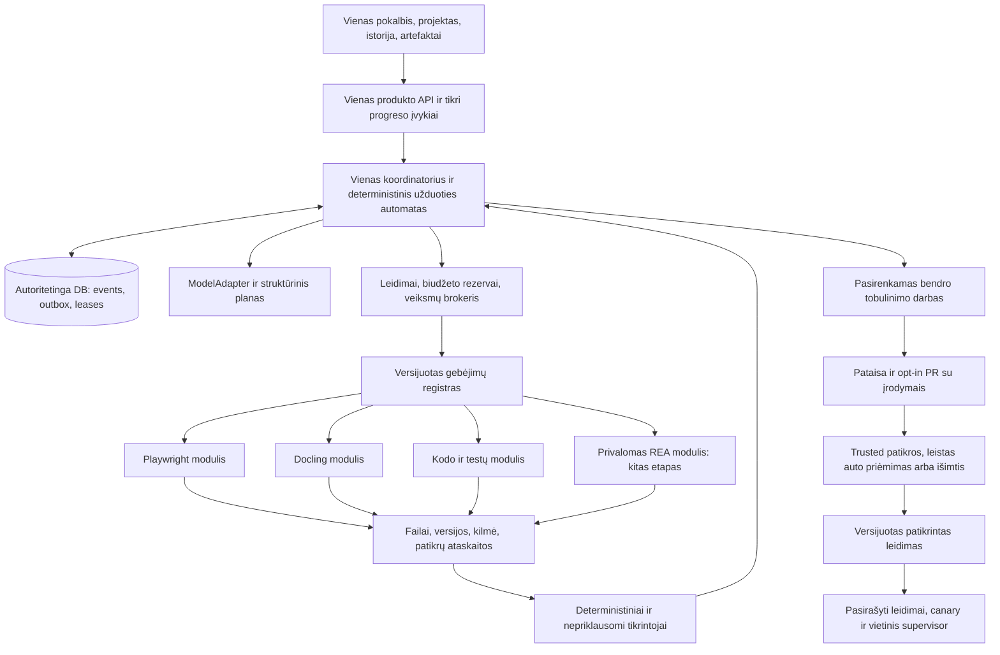

# Projekto planas

Pirmas bendras produkto paaiškinimas: [projekto V1 dokumentacija](docs/PROJECT-V1.md). Mažo veikiančio pjūvio eiga: [MVP roadmapas](MVP-ROADMAP.md). Šis failas detalizuoja architektūrą ir sprendimus; [visas roadmapas](ROADMAP.md) išlaiko darbų bei priėmimo vartų seką.

Tyrimo ir plano data: **2026-10-16, Europe/Kiev**. Tai dviejų kartu dirbusių Codex agentų pasiūlymas po tarpusavio kritikos. Integracijos, kandidatų programų paleidimas, mokami bandymai ir GitHub publikavimas šiame etape neatlikti. Dviejų agentų kritika nėra nepriklausomas saugumo auditas ar runtime testas.

**Plano papildymas 0.2:** autonominis PR ir modulių priėmimas pagal vieną kartą pasirinktą politiką, pradinis localhost produktas, vėlesni Windows/macOS/Linux paketai ir automatiniai patikrintų leidimų atnaujinimai. Norminė eiga aprašyta [autonomijos ir atnaujinimų specifikacijoje](docs/AUTONOMY-AND-UPDATES.md); jos ribos patikslina ankstesnes MVP peržiūros rekomendacijas.

Kandidatų skaičiaus lubų atsisakyta: dabartiniame [atvirame registre](docs/research/CANDIDATE-POOL.md) yra **757 unikalūs prieinami repo iš 806 adresų patikrų**, 796 įrašai kartu su neišspręstais adresais. [197 media kandidatų](docs/research/MEDIA-CANDIDATES.md) programa apima TTS, STT, realtime voice, kinematografinį video, kamerą, avatarus ir montažą. Pradinis TOP100 išsaugotas kaip istorinė dokumentinė imtis; vėlesnė griežta atranka nėra apribota šimtu. Naujų kandidatų kokybės balai dar neskiriami.

## 1. Kryptis ir projekto pranašumo hipotezė

Naudotojo patikslinta projekto vizija: **vienas atviras branduolys pasaulio AI įrankiams**. Bendras modelių/įrankių prijungimas, užduočių vykdymas, patikra, artefaktai ir autonominis priimamų patobulinimų platinimas turi vienyti plečiamą ekosistemą. Viešo pristatymo kryptis: **“One open core. A world of AI tools.”** Tai produkto siekis; realią aprėptį rodo gyvas modulių katalogas ir parengties įrodymai.

Kuriame universalią agentų platformą: žmogus viename pokalbyje apibūdina rezultatą, sistema suplanuoja darbą, panaudoja pasirinktas galimybes, patikrina artefaktus ir parodo, kas pavyko, kas nepavyko ir kokių įrodymų trūksta. Ilgainiui jos naudotojai galės savanoriškai prisidėti prie bendro produkto patobulinimų, kuriuos priima atskira patikros ir leidimų politika.

Tikslinis naudojimas yra autonominis: po pradinio modelio, leidimų ir resursų profilio pasirinkimo įprastos užduotys, leidžiamų kategorijų patobulinimai, reikalingų patikrintų modulių įdiegimas ir stabilūs atnaujinimai vyksta be nuolatinio žmogaus įsikišimo. Neperduotų teisių, neaiškių išorinių efektų ir kritinės pasitikėjimo politikos pakeitimai turi aiškų išimties kelią. Autonomija nereiškia neapriboto kredito, naujų prieigų ar automatinio privataus darbo publikavimo.

Pranašumo hipotezė: **patikimas užduoties užbaigimas + vienodas modulių kontraktas + įrodymais pagrįstas bendras tobulinimas**. Hipotezę tikrinsime su užduotimis ir tais pačiais modeliais, biudžetais bei įrankiais lyginamais produktais. Daug integracijų, didelis kontekstas ar daug agentų patys savaime neįrodo aukštesnio intelekto.

Per atliktus šaltinių analizės ciklus neradome bandymais patvirtinto recepto, kuris garantuotų „superintelektą“. Radome vertingus jo ilgalaikei tyrimų krypčiai komponentus: įrankių vykdymą, patvarumą, būsenos tikrinimą, modelių aptarnavimą, programų analizę, izoliavimą ir mokslinį vertinimą. Šių komponentų sujungimas yra produkto ir sistemų inžinerijos užduotis, kurios rezultatą dar reikia įrodyti.

## 2. Kam skirtas pirmas produktas

| Vartotojas | Pirmas užbaigiamas darbas | Matomas rezultatas |
|---|---|---|
| Kūrėjas | Iš aprašymo sukurti mažą programą arba pataisyti izoliuotą testinę klaidą | Failai, diff, testų ataskaita, paleidimo įrodymas |
| Tyrėjas / analitikas | Surinkti ribotą šaltinių rinkinį ir pagrįsti išvadą | Šaltinių registras, citatos, ataskaita, neapibrėžtumai |
| Dokumentų naudotojas | Iš PDF parengti patikrintą lentelę | Originalas, CSV/JSON, puslapių nuorodos, patikrų ataskaita |
| Programų analitikas | Su REA suprasti savo JS programos struktūrą | Struktūrinis žemėlapis, failų/eilučių įrodymai, ribų paaiškinimas |

REA yra **vartotojo pasirinktas privalomas planuojamas modulis**, kuriam skiriamas atskiras etapas ir demonstracija. Pirmas mažas vertikalus pjūvis lieka su trimis moduliais; REA įjungiamas jam parengus bendrą kontraktą ir tinkamą vykdymo ribą.

## 3. Sutarti reikalavimai ir platformos bazės pasirinkimas

**Pagrindinė produkto taisyklė:** prieš naują įgyvendinimą ieškoti žmonių jau sukurtų ir išbandytų tinkamų sprendimų. Pasirinkti vieną pagrindą ir papildančius komponentus, pagrįsti suderinamumą/licencijas ir kurti tik reikalingą naują dalį. [Naujo projekto reuse eiga](docs/PROJECT-CREATION.md).

**Saugojimo taisyklė:** branduolys koordinuoja, katalogas saugo nuorodas/metadata/įrodymus, o tik reikalingas source ar paketas gaunamas pagal konkretaus darbo poreikį ir užfiksuojamas projekto aplinkoje. Visų atrinktų repo nesiunčiame į kiekvieną instaliaciją ir nesujungiame į vieną programą. API gali būti kviečiamas per adapterį be jo source clone. [Sluoksniai, cache ir naujinimas](docs/PROJECT-CREATION.md#0-katalogas-nėra-visų-repo-atsisiuntimas).

**C5 pakeistas bendras sprendimas:** vartotojo pateiktas [Rakazo](https://github.com/elie222/rakazo) yra pakankamai plati esama platforma, kad prieš greenfield įgyvendinimą būtų privalomas build-vs-adapt vertinimas. Pirmiausia tikrinsime Rakazo pritaikymą/fork kaip reference-produkto bazę. Mažas Python variantas lieka aiškia alternatyva, jei dydžio, politikos, tęstinumo arba priežiūros vartai neatitiks. Po naudotojo leidimo pradėti MVP įgyvendinimui pasirinkta tiksliai užfiksuota Rakazo adaptacija `platform/`. P0.0 kokybės/patvarumo/resursų įrodymai lieka atviri; [įgyvendinimo būsena](docs/IMPLEMENTATION.md) skiria realias patikras nuo ankstesnės hipotezės.

| Įgyvendinimo bazė | Kas jau yra / ką siūlome | Ką būtina patikrinti |
|---|---|---|
| A. Rakazo ADAPT/FORK, pirmas vertinamas pretendentas | Pi, Hono/oRPC, React, PostgreSQL/Prisma, Graphile Worker, esami agentai ir computer/provider adapteriai; atskiri Python specialistų workeriai | Faktinis dydis, patvarūs limitai, approval/grant politika, tenant ir hostile-code ribos, artifact/effect/lease atkūrimas, SAI papildymo kaina |
| B. Minimalus Python branduolys | FastAPI/Pydantic, React/assistant-ui, vienas scheduler, vietinė SQLite; tik būtini adapteriai | Ar kuriamas darbas tikrai mažesnis už Rakazo adaptation, cold size, patvarumo ir UI įgyvendinimo kaina |

Rakazo kode jau yra Artifact versijos, ExternalEffect idempotency įrašai ir ComputerExecutionLease su fence/expiry; nepriskiriame jam šių galimybių nebuvimo. Kartu rastas procesinis tool-call limitas ir priklausanti nuo taisyklių approvals semantika dar neįrodo mūsų patvarių biudžetų bei grant reikalavimų. Tai source-level suitability klausimai, ne pažeidžiamumo įrodymas. [Tiksli peržiūra](docs/reviews/architecture-independent.md#19-c5-rakazo-ir-iš-naujo-atvertas-build-vs-adapt-sprendimas).

Pasirenkame **vieną** bazę ir vieną autoritetingą scheduler/UI; FastAPI neprikabiname kaip antro vykdiklio prie Rakazo Hono. Kanoninis JSON Schema kontraktas, SAI priėmimo taisyklės ir produkto užduotys yra reikalavimai abiem pasirinkimams.

Privalomas P0.0 palyginimas papildytas localhost ir desktop platinimu: būtinas aiškus launcher/supervisor, OS runtime/bootstrap, update ir duomenų katalogų planas. Rakazo Electron klientas yra pernaudojimo kandidatas, o jo `.exe` dar neįrodo veikimo be Docker ar kitų prerequisites. Tikslas – įprastam naudotojui paleisti core be rankinio Python/Node konfigūravimo; engine/VM būtinybė, dydis ir OS leidimai deklaruojami, jei tokia bazė pasirenkama.

**B varianto kontrolės plokštuma:** Python 3.12 + FastAPI/Pydantic; TypeScript/React sąsaja; vienas kanoninis JSON Schema 2020-12 kontraktas. Būsimų priklausomybių versijos ir transityviniai paketai užrakinami po pirmųjų suderinamumo bandymų. Dabartiniai upstream SHA kataloge yra šaltinių snapshotai, o ne patikrintas bendras dependency lock.

**B varianto būsena:** vienas autoritetingas scheduler, SQLite vietiniame diske, trumpi atominių state/event/outbox pakeitimų sandoriai. Du workeriai gali veikti vienu metu. PostgreSQL būtinas prieš kelis aktyvius schedulerius, bendrus nuotolinius workerius, multi-tenant arba HA režimą; reikės migracijos, concurrency ir ACL bandymų. ORM pats neįgyvendina šių garantijų.

**Modeliai:** vienas platformai priklausantis modelių kontraktas (Rakazo Pi adaptavimas A variante arba mažas ModelAdapter B variante), pradžioje vienas naudotojo pasirinktas provideris arba jau turimas lokalus endpoint. Atskiras routing serveris nėra bazinė priklausomybė. Užduoties planas yra tipizuotas ir riboto žingsnių skaičiaus; jį vykdo branduolys. Modelis neredaguoja leidimų ar verifikavimo politikos. Maršrutizavimas pagal kainą ir kokybę įjungiamas tik po lyginamųjų bandymų.

**Atmintis:** projekto pastabos, leidžiami faktai, pilno teksto paieška ir artefaktų kilmė. Vektorinė paieška pasirenkama pagal retrieval užduočių poreikį. Naudotojo atmintis, modelio svorių mokymas ir viešas bendro kodo tobulinimas turi atskiras duomenų ribas.

**Įrankių ir skills atranka:** žmogaus kategorijų/task katalogas ir mašininis capability registras remiasi tais pačiais versioned faktais. Agentas gauna mažą tinkamų profilių sąrašą, lazily įkelia pasirinkto tool schemą, o brokeris prieš vykdymą iš naujo tikrina schema/pin/grant/budget/revocation. Skill yra patikrintas darbo receptas, ne naujas scheduler ar teisių suteikimo šaltinis; nested skills ir child tools dalijasi bendru cap. Missing capability nesukelia išgalvoto kvietimo ar atsitiktinio repo install. [Tiksli agentų atrankos eiga](docs/AGENT-CAPABILITIES.md).

Galutinis MVP selector pasirinkimas – **Jev per naudotojo OpenRouter API paskyrą**, deterministinį hard-filter/index baseline paliekant prieš modelį. Secret dar nepateiktas; actual endpoint/model/rates, baigtinis cap ir kokybė patvirtinami P0.26. Laya lieka vėlesnis vietinis alternatyvus profilis, ne pirmo MVP blocker. Mokamas interaktyvus MVP routing nepraplečia viešos masinės repo/video atrankos biudžeto0. Įrankių pasirinkimas nėra naujas scheduler, o OpenCode nėra automatiškai privaloma bazė. [Šaltiniai ir konkreti integravimo eiga](docs/ROUTER-EVALUATION.md).

**Atstatymas:** read-only žingsnių kartojimas pagal limitą, stabilūs idempotency raktai, lease su fencing token. Timeout po išorinio veiksmo veda į `unknown_after_timeout` ir reconciler. Universalios exactly-once ar išorinio pasaulio rollback garantijos nesiūlome. Detalus protokolas pateiktas [architektūros peržiūroje](docs/reviews/architecture-independent.md#4-patvari-būsena-lease-ir-išoriniai-šalutiniai-veiksmai).

## 4. Lengvo branduolio ribos

| Branduolio prievolė | Kodėl bendra | Modulio atsakomybė |
|---|---|---|
| Užduotys, žingsniai, attempts, patvarūs įvykiai | Tęsiamas darbas ir suprantamas UI | Domeno algoritmas |
| Įrankių kontraktas ir atranka | Schemos, versijos, suderinamumas | Bibliotekos, CLI, HTTP/MCP įgyvendinimas |
| Leidimai ir resursų rezervavimas | Viena veiksmų kontrolė | Deklaruoti tikslų poreikį |
| Artefaktai, kilmė ir versijos | Rezultatas neprapuola su proceso atmintimi | Eksportuoti tinkamą formatą ir įrodymus |
| Rezultato patikros būsena | Užbaigimas pagrįstas tikrais tikrintojais | Domeno verifikatorius atskirame kontekste |
| Modulių lifecycle | Patikrintas diegimas, health, update, remove | Tiksli izoliuota aplinka |
| SAI kontrolė ir update klientas | Viena priėmimo ir pasitikėjimo politika | Pataisos rengimas ir upstream adapteris |

Biblioteka tinka mažam stabiliai komponuojamam komponentui, importuojamam tinkamoje aplinkoje. CLI tinka baigtiniam įrankiui su struktūrine išvestimi. Atskiras servisas tinka sunkiai šylančiam modeliui ar tenant ribas turinčiai bendrai paslaugai. Plonas adapteris susieja visus juos su vienu Tool RPC. Specializuoto modulio kodas nekraunamas į kontrolės procesą.

## 5. Pradiniai 13 projektų ir trys gebėjimai

| Grupė | Projektai | Diegimo sprendimas |
|---|---|---|
| API ir kontraktai | FastAPI, Pydantic, SQLAlchemy | Baziniai kandidatai; fiksuoti versijas po suderinamumo bandymo |
| UI | React, assistant-ui | Build metu, galutiniame baziniame pakete statiniai failai |
| Aplinkos ir instrumentavimas | uv, OpenTelemetry Python, oficialus MCP Python SDK | Mažas bendras rinkinys, MCP adapterio sluoksnyje |
| Pirmi 3 moduliai | Playwright, Docling, pytest su ribotu kodo/Git adapteriu | Įdiegiami pasirinkus, laikomi atskirose aplinkose |
| Pirmo platesnio MVP papildymai | DuckDB, tree-sitter | Tik įrodžius pagrindinį ciklą; nėra papildomi nuolat veikiantys servisai |

Tai B varianto13 repo pasirinkimų pradinei produkto šeimai ir3 pirmi vartotojo gebėjimų moduliai. Pasirinkus Rakazo, bendri Hono/React/Pi/Postgres komponentai pernaudojami, o FastAPI/SQLAlchemy/assistant-ui nepridedami vien dėl šio sąrašo. Git ir SQLite yra aplinkos / standartinio runtime prielaidos, o ne dar du agentų frameworkai. Ruff galimas kaip papildomas kodo tikrintuvas kataloge, jo įtraukimas užrakinamas atskirai.

REA yra kitas privalomas papildymas: tikslus repo snapshot ir CLI kelias aprašyti [REA mini-plane](docs/reviews/architecture-independent.md#17-rea-privalomas-planuojamas-reverse-engineering-modulis). Pirmas profilis – statinė savo JS analizė; Ghidra/native ir process capture įjungiami atskirais profiliais. Mokamų IDA/Hopper licencijų nereikia pirmai demonstracijai. Paketo npm vientisumas ir jo atitiktis source SHA dar nepatikrinti.

## 6. Autonominis projekto augimas ir modulių priėmimas

Tikslinis ciklas: **radinys arba pasiūlytas repo → triage → laikina darbo rezervacija → izoliuota pataisa/adapteris → trusted patikros → politikos leistas auto priėmimas → versijuotas pasirašytas leidimas → canary → automatinis suderinamas vietinis atnaujinimas → rezultato stebėjimas**.

Vietinio produkto darbas atskirtas nuo bendros PR/registry/release infrastruktūros, kuri gali veikti net išjungus naudotojo kompiuterį. GitHub PR atidarymas ar papildymas paleidžia atranką ir peržiūrą; kasdienis reconciler suranda praleistus įvykius, užstrigusius darbus, expiry ir dublius. Atskirai veikia discovery, adapterio/pataisos, peržiūros, evaluator ir release rolės. Jos naudoja ribotus atskirus kontekstus ir patvarų biudžetą; modeliai nesaugo merge ar signing raktų.

Numatytas centrinis profilis: **nuolatinis VPS coordinator + atskira centrinė PostgreSQL + pagal poreikį paleidžiami izoliuoti CI/workeriai + pasirašytas registry/release kanalas**. VPS palaiko darbo eilę ir schedules, LLM kviečia tik konkrečioms užduotims. Svetimas build nevykdomas pagrindiniame VPS su jo paslaptimis. GitHub `main` lieka kodo šaka; local klientas saugo savo duomenis ir nėra privalomai nuolat prijungtas prie centro. [Konkreti centro architektūra ir kaštų ribos](docs/AUTONOMY-AND-UPDATES.md#centrinio-vps-diegimo-profilis).

Siauras D režimo auto priėmimas įtrauktas į **P3C prieš platesnį modulių diegimą**: pirma shadow ir neigiamų atvejų pilotas, tada unattended priėmimas leidžiamoms kategorijoms. Jis remiasi trusted-base policy/suite SHA, environment digest ir merge-tree patikromis. Kritinės neperduotos kategorijos lieka išimties eilėje; PR autorius negali sau pakeisti acceptance taisyklių. Detalus [PR ciklas ir rolės](docs/AUTONOMY-AND-UPDATES.md#5-autonominė-pr-atranka-merge-ir-release).

| Režimas | Kas leidžiama | Etapas |
|---|---|---|
| A | Aptikti ir parodyti radinį | Vietinis režimas be publikavimo |
| B | Parengti vietinę pataisą pagal biudžetą | Pirmas pasirenkamas contribution profilis |
| C | Pateikti PR į tikslinį repo | Po vienkartinio submission teisių ir biudžeto suteikimo |
| D | Automatiškai priimti ir išleisti iš anksto apibrėžtų kategorijų pakeitimus | Siauras P3C pilotas; tolesnė plėtra tik pagal įrodymus |

Kiekvienas gali pasiūlyti viešą GitHub repo; discovery agentas taip pat ieško pagal trendus, naujus gebėjimus ir naudotojų poreikį. Populiarumas nėra priėmimo vartai. Automatinė eiga tikrina realią užduotį, licencijas, source/package pin, install hooks, priklausomybes, permissions ir faktinius resursus; sukuria ploną adapterį, vykdo izoliuotus domeno/conformance testus, tada canary ir pasirašytą registry įrašą. Private repo lieka autorizuotame vietiniame projekte. Inbox Zero tipo licencijos blokas palieka reference-only būseną. [Visas naujo modulio kelias](docs/AUTONOMY-AND-UPDATES.md#6-kas-gali-siūlyti-repo-ir-kaip-prijungiamas-modulis).

**Dublių ir panašių modulių politika:** tas pats repo/alias turi vieną kanoninį įrašą; panašūs įgyvendinimai grupuojami pagal bendrą capability kontraktą. Naujas adapteris turi parodyti naudą konkrečiam profiliui (kokybė, kaina, greitis, LT, CPU/offline, permissions/licencija ar tikras nepriklausomas fallback). Vienur silpnesnis, kitur stipresnis gali likti specialistu; neįrodytas skirtumas lieka experimental/inconclusive, o įrodymais dominuojamas kandidatas išsaugomas registre be aktyvios rekomendacijos. Default keičiamas tik palyginus, per canary ir pagal esamus grants; vykstantys darbai išlaiko pin. [Konkreti atrankos eiga ir pavyzdžiai](docs/MODULE-SELECTION.md).

Registry priėmimas automatiškai neįdiegia modulio visiems. Vietinis agentas pasirenka ir įdiegia užduočiai reikalingą patikrintą leidimą tik iš anksto suteiktų teisių, kainos, disko ir OS profilio ribose. Atviras kandidatų baseinas lieka lengvu katalogu, o modelių svoriai ir sunkūs runtime diegiami pagal poreikį.

Pagal nutylėjimą naudotojo viešas prisidėjimas išjungtas, produkto stable atnaujinimai įjungti. Projekto operatorius vieną kartą sukonfigūruoja bendro auto-review/merge/release politiką ir siauras GitHub App teises. Naudotojas atskirai pasirenka C/D prisidėjimo profilį ir baigtinį biudžetą. Pagrindinė užduotis gauna prioritetą. Pilotinis limitas: 1 aktyvi pataisa, iki 30 min., 2 nesėkmingų bandymų ir 1 PR per dieną; po restart limitai neišnyksta.

GitHub issues nėra atominės globalios leases. Vietiniam MVP vienas coordinator, paskirstytam viešam SAI – bendras patikimas transakcinis coordinator. Naujos scopes/credentials nepaveldimos iš bendro autonomijos jungiklio. P2P platinimas lieka atidėtas iki pasirašyto registry ir pamatuoto egress poreikio; modelių mokymas ir naudotojų atmintis lieka atskiros sritys.

## 6A. Localhost, desktop ir automatiniai atnaujinimai

Pirmiausia valdomas vietinis leidimas su loopback UI ir atskiru launcher/supervisor, vėliau tas pats branduolys Windows, macOS ir Linux paketuose. Pirminė desktop matrica: Windows 11 x64, macOS Apple Silicon, Linux x86_64; kitos architektūros reklamuojamos tik po realių bandymų. Vystymo checkout atskirtas nuo managed release, todėl updater neperrašo žmogaus source pakeitimų.

Numatytasis produkto režimas: stable, automatinė patikra paleidimo metu ir kas 6 h veikiant; pause/manual/preview pasirinkimai. Parengtas pasirašytas paketas atsisiunčiamas fone ir aktyvuojamas tik saugiame taške. Scheduler išsaugo darbų, budgets, outbox ir effects būseną; naujas leidimas nekeičia veikiančios užduoties module/model pin viduryje. Naudotojo raktai ir failai laikomi atskirai nuo app failų.

Supervisor tikrina naujo leidimo startą ir sveikatą; prireikus atkuria ankstesnį patikimą, DB schemai tinkantį leidimą net tada, kai pati nauja programa nepasileidžia. Neaiškus išorinis efektas reconciliuojamas, ne aklai kartojamas. Nesuderinama migracija arba snapshot restore, prarandantis naujus įrašus, nėra automatinio rollback kelias. TUF tipo metadata, target parašai, platforminiai code signatures, revocation, atskira trust recovery ir canary yra išleidimo vartai.

App/core, module ir modelių atnaujinimai turi atskiras gyvavimo eigas bei vieną suderinamumo planą. Linux paketų valdytojas ir Windows/macOS diegikliai turi skirtingus update adapterius. Desktop paketas nepakeičia pasirenkamam hostile-code moduliui reikalingos VM. [Konkreti update eiga ir OS matrica](docs/AUTONOMY-AND-UPDATES.md#8-automatinio-vietinio-atnaujinimo-eiga).

**Kai keičiasi prijungtas GitHub repo:** atskiras upstream watcher aptinka release / saugumo pataisą, įvertina diff ir licencijas, prireikus atnaujina adapterį, izoliuotai palygina seną ir naują kombinaciją, tada per canary išleidžia pasirašytą modulio atnaujinimą. Nei `git pull`, nei semver patch nesuteikia automatinio patikimumo. Nesėkmės, atsilikimas ir blokavimo priežastys matomi; atšauktas pažeidžiamas leidimas nepaliekamas neribotam naudojimui. Fork sync ir hosted API schema drift turi atskirus kelius. [Pilnas upstream lifecycle](docs/AUTONOMY-AND-UPDATES.md#11a-kai-atsinaujina-integruoto-projekto-upstream).

## 6B. Modeliai, OAuth ir treg.to

Viename providerių vaizde prijungiami OpenAI API, Anthropic API, OpenRouter, lokalūs ir kiti per oficialius adapterius pasiekiami modeliai. OAuth rodomas tik ten, kur tiekėjas oficialiai leidžia mūsų programos metodą; ChatGPT / Claude prenumerata nėra bendras API kreditas. OpenCode tiriamas kaip provider/plugin ir agento tool-loop pavyzdys. Pradžioje vienas veikiantis modelis, po to providerių capability, auth, data-flow, billing ir failover matrica.

**treg.to yra privaloma planuojama integracija** per dokumentuotą MCP / HTTP gateway ir mūsų grant / budget brokerį. Naudotojo paminėti 2800+ tools dar nepatvirtinti gyvame kataloge; perskaitytas skill mini apie2600 endpointų. Agentas ieško ir įkelia tik užduočiai reikalingas schemas. Visų katalogo įrankių prijungimas nereiškia visų paskyrų / write teisių suteikimo. Raktai lieka credential brokerio viduje. [Konkreti modelių, OpenCode ir Treg specifikacija](docs/MODELS-AND-TOOLS.md).

## 7. UI/UX, kuriame aišku, kas iš tiesų vyksta

Pagrindinis vaizdas: kairėje projektai ir istorija, centre pokalbis su tikru užduoties planu, dešinėje pasirinktas artefaktas ir jo versijos. Mažame ekrane tai tie patys trys perjungiami vaizdai. Vartotojas mato būsenas „laukiama leidimo“, „vykdoma“, „tikrinama“, „užblokuota“ ir aiškią nesėkmės priežastį. Procentas rodomas tik turint suskaičiuojamą vardiklį.

**UI pernaudojimo kryptis:** Rakazo React darbo erdvė kaip pirmas adaptacijos kandidatas, OpenCode UX principai; alternatyvus OpenCode Solid UI fork matuojamas tuo pačiu P0 bandymu. Tikras React/OpenCode adapteris rastas, tačiau jis nėra Rakazo bridge ar antras privalomas agentų runtime. [Šešių pagrindų palyginimas ir kodo inventorius](docs/UI-FOUNDATIONS.md). Numatytasis dizainas juoda/salotinė; temos keičiamos per bendrus semantinius tokens ir išsaugomą pasirinkimą, daugiau temų vėliau.

Naudotojo Codex screenshot pagrindu detalizuota [darbo erdvės UI kryptis](docs/UI-WORKSPACE.md): pažįstama project/history juosta, pokalbis/progresas, prireikus išskleidžiamas artefaktas/diff/tests ir composer. Public augančio pasaulinio tinklo vaizdas priklauso svetainės pristatymui; workspace rodo tikrą darbą, parengtį ir user sprendimui reikalingus faktus.

**Daugiakalbis UI nuo MVP:** EN/RU/ES/zh-Hans/LT/DE/FR/pt-BR pagrindiniai UI/login/forms/status/error srautai, EN/RU technical docs ir kitiems trumpas quickstart. Translation keys/i18n paruošti ir tolimesniems locale; kodo/API/capability IDs stabilūs English, pokalbio su AI kalba atskira. Routerio/search deklaruojamų input kalbų ir Unicode/formatavimo testai atskiri; multilingual autorių teiginiai nėra faktinis palaikymo įrodymas. [Kalbų planas](docs/LANGUAGES.md).

Modulio kortelė rodo paskirtį, papildomą faktinį dydį, pirmo paleidimo download, CPU/RAM/GPU, tinklo/failų leidimus, autentifikavimo ir kainos šaltinį, patikros lygį. Nežinomi dydžiai žymimi nežinomais. Prieš veiksmą žmogus mato paskyrą, tikslinį objektą, keičiamus duomenis ir veiksmų apimtį.

Naujo repo vedlys: adresas → oficialios kilmės ir licencijos patikra → pasirenkamas tikslus gebėjimas → kontrakto ruošinys → pin ir paketo kilmė → izoliuota conformance patikra → dydžio ir kainos matavimas → kandidatūra registry. Vedlys nesuteikia „patikrinta“ žymos vien iš README ar sugeneruoto adapterio.

**Prisijungimas prie svetainės per GitHub:** vienas account repo paraiškoms, video submission ir balsavimui; public katalogas matomas be login. Žmogus renkasi savo/įgaliotą org public repo arba pateikia URL, aprašo vieną darbą/delta ir mato tikrą triage/test/admission būseną. Community pasiūlymas atskirtas nuo owner įgaliojimo; login nesuteikia repo write/PR/merge, modelių ar YouTube paskyrų teisių. [Contributor portalas](docs/CONTRIBUTOR-PORTAL.md).

**Didelio srauto atranka ir tokenai:**100/1000/2000URL negauna tiek pat AI analizių. Pirma schema/rate/URL/dedup/cache ir riboti oficialūs metadata be LLM; tik prioritetiniams atvejams modelis. Pilotinis bendras repo/video/discovery triage cap iki10faktinių dispatch attempts per24h, kartu su užfiksuotu viso centro pinigų/token/compute rezervu, retry/repair ir pagalbinių modelių apskaita. Globalus rezervavimas atominis; išnaudojus cap darbai atidedami, o ne sugeneruojami nauji worker limitai. Aktyvi eilė ir storage riboti, overflow gauna deferred-capacity; no-budget0 mokamų kvietimų režimas galimas. [Konkreti filtrų, cache, fairness ir biudžeto kaskada](docs/INTAKE-AND-BUDGETS.md).

SAI vaizde atskirai rodoma: pataisa parengta, patikros atliktos, PR pateiktas, priimta, išleista, įdiegta, pagerėjimas patvirtintas naudojant. Yra kanalas, atnaujinimo peržiūra, rollback ir prisidėjimo išjungimas.

Autonomijos vaizdas papildomai rodo vieną kartą pasirinktą veiksmų profilį, likusį biudžetą, automatinių darbų istoriją, tik būtinas išimtis, modulio discovery/admission būseną, update atsisiuntimą/atidėjimą/recovery ir fono režimą. Naujas naudotojas neturi kasdien skaityti bendro projekto PR eilės.

**Usage ir vieši populiarumo rodikliai:** vietinė apskaita rodo module/tool/model kvietimus, atskirus retries, baigtis, laiką ir žinomą kainą. Atskirai pasirinkus dalijimąsi, į bendrą stats servisą siunčiami dienos agregatai be prompts/failų/raktų. Oficialioje svetainėje rodomi platformos populiariausi moduliai ir Treg endpointai su imtimi, laikotarpiu, duomenų kilme ir min sample ribomis. Operator CI, contribution ir real user task atskiriami. [Konkretūs skaitikliai ir privatumą išlaikantis srautas](docs/USAGE-STATISTICS.md).

**Kategorijos ir paieška pagal darbą:** visas viešas katalogas turi plečiamą sritis→gebėjimas→receptas navigaciją ir OS/hardware/local/hosted/licencijos/readiness/kainos/permissions filtrus. Pvz., „crypto bot“ išskleidžia market data, strategy/backtest, paper trading, exchange API ir monitoring; realūs pavedimai nėra numanomas read/test profilio leidimas. Tinkamiausi profiliai parenkami pagal konkretaus darbo įrodymus, source-only kandidatai atskirai nuo AI jau galimų vykdyti modulių. Įprastas browse/search/filter nekviečia mokamo LLM. [Katalogo karkasas ir paieška](docs/TOOL-DIRECTORY.md).

## 8. Dydis ir resursai

Tikslai: Git turinys iki **100 MB (100 000 000 B)**, bazinis runtime iki **2 GB (2 000 000 000 B)** be pasirenkamų modulių, modelių, naršyklės ir kūrimo cache. Reikalaujame matuoti abi reikšmes: produkto paskirstymo dydį ir tikrą šalto švaraus host įdiegimo delta, su kiekviena išimtimi. Nepaslėpsime konteinerio image, browser download ar bendro host runtime kašto. Atskiriami nusistovėjusio įdiegimo dydis ir pikinis laikinas diskas diegimo, atnaujinimo ir rollback metu; abi reikšmės skelbiamos.

| Profilis | Sudėtis | Ką matuoti prieš teigiant dydį |
|---|---|---|
| Minimalus | Pasirinkta viena bazė, web UI ir būtina DB (A PostgreSQL; B SQLite); 0 ML svorių | Užrakintus paketus, statinius assets, runtime ir tuščią DB; ≤2 GB vartai |
| Darbinis | Minimalus + pasirenkami Playwright, Docling, kodo ir REA static profiliai | Kiekvieno modulio aplinką, Chromium, parserius, pirmus modelius, bendrą cache; sumos dar nežinomos |
| Platus | Atviras katalogas be skaičiaus lubų, pasirinktas CAD/media/voice/local-LLM rinkinys | Atskiras kiekvieno pasirinkto modelio, konteinerio, GPU paketo ir workspace dydis; viso katalogo diegimo sumos be konkretaus profilio nėra |

Kiekvienam profiliui fiksuojame `code + dependencies + runtime + images + weights + cache + workspace`, taip pat shared-versus-exclusive baitus, peak RSS, VRAM ir laikiną diską. Suderinamos aplinkos gali dalytis immutable cache; konfliktuojančios izoliuojamos. Modeliai ir artefaktai saugomi už Git ribų. Cache turi limitą ir TTL. Pašalinus modulį naudotojo darbai ir dokumentai išlieka; garbage collection taikoma tik be nuorodų likusiems paketams po rollback grace periodo.

## 9. Pasaulinio projekto augimo planas

**Oficiali svetainė kuriama nuo pradžios, lygiagrečiai P0/P1, nelaukiant beta.** Joje bus projekto paaiškinimas, architektūra/roadmap, atviras katalogas, kas patobulinta/pridėta/išleista, demonstracijos, contribution ir donate/skaidrumo skiltis. Agentai atnaujins rutininius įrašus iš GitHub/registry/eval/release faktų per automatinį patikrintą public-export ir publish procesą. Planned, merged, released ir validated rodomi atskirai; private vartotojų duomenys neperkeliami. Paramai pradžioje savininko patvirtinta hosted payment nuoroda; gavėjo/payout agentai nekeičia. [Konkreti svetainės architektūra](docs/PUBLIC-WEBSITE.md), ankstyvi checkbox etapai P0W/P1W.

GitHub repo pavadinimas lieka `superintelligence`. Naudotojas naujausiai vartoja **RepositoryZero** – tai darbinė viešo produkto pavadinimo kryptis. Ankstesnis `repositionzero.com` pasiūlymas išsaugomas istorijoje; domenų prieinamumas, nuosavybė ir prekių ženklai netikrinti. Prieš viešą pristatymą branding/domain pasirinkimas užfiksuojamas atskiru ADR. Plitimo metafora yra pasakojimo dalis; vieši pajėgumo teiginiai remiasi realiais rezultatais.

Pirmas produkto pažadas: pakartojamas nedidelis darbas, jo įrodymai ir suprantama nesėkmė. Ankstyva svetainė sąžiningai pradeda nuo research/planning faktų. V0.1 papildysime EN/RU quickstart, trimis tikromis trumpomis demonstracijomis, kainų/latency matavimo metodu ir benchmark rezultatų failais su versijomis. Demo turi veikti naujam nepriklausomam žmogui.

Po patvirtinto MVP: lengvas adapterio SDK, modulio ruošinys, nedideli pažymėti issues, RFC procesas, CODEOWNERS, elgesio taisyklės, saugumo kontaktas, aiški licencija ir trademark politika. Siūloma nuosavo branduolio licencija – Apache-2.0; savininko sprendimas ir platinamų priklausomybių analizė lieka prieš pirmą code release. Šiame etape LICENSE failu teisių neperrašome.

Prisidėjimo kelias skirtas ir „vibe coding“ kūrėjams: žmogus pateikia repo / norimą rezultatą / atkūrimą, agentas parengia mažą adapterio ar bugfix PR ir įrodymus, nepriklausomas evaluator jį patikrina, o leistino profilio priėmimas bei release vyksta automatiškai. Pasiūlytojo autorystė ir upstream notices išlaikomi; dubliuotos užduotys dedupinamos ir turi leases. Contribution vedlys neslepia skirtumo tarp pasiūlyto kodo ir realiai patikrinto pagerėjimo.

**Autonominis marketingo ciklas:** tikra verified integracija → vieša autoriaus ir įrodymų kortelė/receptas/demo → tikslingas maintainer kvietimas → jo pasirinktas README integration badge/PR ir partnerio pranešimas → auditorijai tinkamas YouTube bandymas → nauji naudotojai/contributors → išmatuoti patobulinimai. „RepositoryZero integration verified“ patvirtina tik aprašytą mūsų integracijos scope, ne viso upstream repo kokybę ar jo autoriaus bendrą endorsement. Technical acceptance nuo badge, donorystės ir reklamos nepriklauso.

Creator programa parengia30–60s teaser,3–6min atkuriamą demonstraciją, pinned receptą, tikrus rezultatus/ribas ir rights-cleared medžiagą konkrečiai auditorijai. Pirmas gavėjo kontaktas vienu leistinu kanalu; PR ir email pora galima pagal jo pasirinktą partnerio eigą. Outreach turi atskirą tapatybę, suppression, patvarų send/effect ledger, pending/reply/cost ribas ir vieną operatoriaus pasirinktą politiką; įprasti leistini veiksmai po piloto gali vykti be kiekvienos žinutės rankinio tvirtinimo. [Visas augimo ir90dienų planas](docs/GROWTH-AND-OUTREACH.md), [parengti PR/email/creator šablonai](docs/OUTREACH-TEMPLATES.md).

**Video Hub:** GitHub prisijungęs žmogus pateikia YouTube nuorodą; serveris tikrina kanoninį ID/dublius, leistinus metaduomenis ir temos atitikimą, o pagal patikrintą politiką publikuoja arba siunčia į review. Kategorijos Use cases, Tutorials, RepoZero explained, Integration stories, Build with us ir Reviews. Vien keywords neužtenka; metadata-only peržiūra nevadinama viso video patikrinimu. Viešas katalogas turi vieną account/video upvote+undo, top/newest, report/appeal ir recheck. Tai dinaminė svetainės dalis su API, ne paslėpti LLM kvietimai po kiekvieno click. [Visa Video Hub specifikacija](docs/VIDEO-HUB.md).

Augimo matas: kiek naujų žmonių savarankiškai užbaigia užduotį ir grįžta, kiek modulių turi atkartojamą acceptance paketą, kiek užtrunka kokybiška peržiūra. Žvaigždutės, žinučių skaičius ir reach yra papildomi signalai. Šiame darbe parengti planas ir draft šablonai; realus outreach, publikavimas ir mokami placement neatlikti.

## 10. Sprendimai, rizikos ir artimiausi patikrinimai

Didžiausi neapibrėžtumai: trijų modulių realus dydis, Docling lentelių tikslumas mūsų corpus, REA npm paketo ir source atitikimas, galimybė gauti tinkamą izoliuotą kodo VM, modelio užduoties sėkmė ribotame biudžete, būsenos atsparumas crash/disk-full, nepriklausomos peržiūros pajėgumas ir beta vartotojų tikroji vertė.

Kiekvienam yra bandymas [roadmape](ROADMAP.md). Neatsakytas klausimas nepaslepiamas balu. Prieš įgyvendinimą užfiksuosime pirmos platformos Linux x86_64 palaikymą, pirmą modelio pasirinkimą ir jau turimų raktų būseną, repo leidimų modelį, duomenų saugojimo ribas ir maintainer atsakomybę. Tai netrukdė parengti šio plano; dabar nesikreipiame dėl paslapčių ir nieko neperkame.

Detalūs šaltiniai ir patikrintos kodo įėjimo vietos: [pradinė bendra kritika](docs/reviews/architecture-independent.md), [autonomijos review](docs/reviews/autonomy-updates-review.md), [provider/auth review](docs/reviews/provider-auth-review.md). Kandidatai: [visas baseinas](docs/research/CANDIDATE-POOL.md), [media](docs/research/MEDIA-CANDIDATES.md), [istorinė TOP100 imtis](docs/research/TOP100.md). Įgyvendinimo tvarka: [ROADMAP.md](ROADMAP.md).

Papildomas reikalavimas: [cloud darbo aplinkos ir Google Drive](docs/CLOUD-WORKSPACES.md). Vykdymo vieta atskirta nuo failų saugojimo; pradinis veikiantis profilis vietinis, remote/Drive konformansas P0.30/P5.14.
