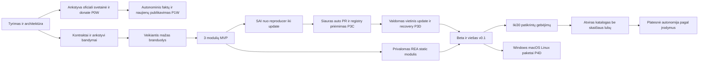

# RepositoryZero pilnas roadmapas

**Atnaujinta 2026-10-17.** Vienintelis checkboxų ir norminių vartų autoritetas. [MVP-ROADMAP](MVP-ROADMAP.md) yra generuojama tų pačių užduočių ištrauka. `[x]` reiškia konkrečiai atliktą darbą jo nurodytoje apimtyje; dokumentas, mockup ir foundation PASS neuždaro gyvo produkto acceptance.

Priimta bazė — Rakazo, ne naujas Python/CLI produktas. [Sprendimai](docs/DECISIONS.md), [dabartiniai faktai](docs/IMPLEMENTATION.md), [pilnas dokumentų indeksas](docs/README.md). Terminų savaitėmis atsisakyta, kol nėra įgyvendinimo matavimų. Originalūs R0/P0–P7/P1E ID išsaugoti; nauji darbai detalizuoja, o ne ištrina ankstesnius vartus.

| Stadija | Priėmimas |
|---|---|
| Techninis preview | TP0/TP1/TP2; leidžiamas aiškiai pažymėtas emuliuotas modelis |
| MCP discovery preview | P1X.2/P1X.3; tikras host ryšys, dar ne reuse E2E |
| Native deterministic pilotas | P1X.4–P1X.8 + Codex P1X.10 + P1E.10/P1E.11; pilna viena vertikalė, ne visas MVP |
| Techninis MVP | G0/G1 + pasirinkto profilio OBS2/J0–J2 (OBS3, jei Zero fallback/child įjungti) + L1–L5 + browser/PDF/coding ir P2.14 + G2 30 užduočių + UI/locale/MVP1 + vietinis MCP E2E ir platinamo plugin P1X.9/P1X.11/P1X.12; native host mapping pagal A15 |
| Vieša beta | MVP ir visi taikomi platesni G2, REA G3B, Treg P2.11–P2.13, G3A/G3C/G3D/G4; tikra supported matrica |
| Zero desktop OS paketai / portfelis / plati autonomija | P4D, P5, P6, P7 atskiri vartai |

MVP apimtis neatšaukia platesnių P2/beta reikalavimų. Jev J3 matavimas ir naudos įrodymas atskiri; fiksuoto 50% ar pasaulio geriausio produkto teiginio be palyginamų įrodymų nėra.

## Artimiausia įgyvendinimo seka

Checkboxai čia ir likusiuose skyriuose yra vienas norminis backlogas. TP darbai detalizuoja mažą pirmą pjūvį; nepakeičia P0/P1/G1. OBS ir J darbai detalizuoja P0.23/P0.26/P1.8/P1D.7. L darbai papildo žmogaus Library pagal naudotojo patikslinimą.

- [x] DOC.1 Priimtas Astra auditas, aptartos ir susiaurintos rekomendacijos, sutvarkytas dabarties indeksas ir karantinas; tai dokumentų, ne produkto kokybės rezultatas.
- [x] TP0 Root CI vykdo pasirinktus Zero offline/type/regression check be upstream publish/deploy ir be credentials. Offline ir tikro PostgreSQL/Graphile/auth API jobs PASS [run 39040117652](https://github.com/christianza1989/superintelligence/actions/runs/39040117652), commit 3aeec19. Dokumentų CI vienas to neuždaro.
- [x] OBS1 Request-scoped observer per AgentRunRequest; tas pats callId beforeCall/usage/reservation. Du lygiagretūs runs nesumaišo observer, atsisakymas duoda 0 dispatch. 125 offline regresijos; onUsage lieka apskaitos autoritetas. OBS2 account/cap integracija atskirai atvira; DB migracija nepridėta.
- [x] TP1 Vienas tikras esamo worker scenarijus: kontroliuojamas CSV input → tikras paruoštas komponentas → vykdymas → versijuotas artefaktas → atskiras validator. Deterministiniame profilyje modelio kvietimų 0; tikras PostgreSQL/Graphile ir MCP proceso proof PASS. [Įrodymai](docs/experiments/MCP-PREVIEW-2026-10-17.md).
- [x] TP2 TP1 cancel/restart/timeout/duplicate atvejai nedubliuoja efekto, failed/blocked/unknown išsaugoti. API/MCP proceso restart, Graphile host stop/start, timeout ir vieno terminal receipt kontrolės PASS. Tai siaura aprėptis, ne visas G1 ar worker SIGKILL kvalifikacija.
- [ ] NEED1 Poreikių ir fit/no-fit retrieval rinkinys su hard constraints bei LT/EN sinonimais. Užfiksuoti dev/holdout atskyrimą; 48 užklausos (24/24) pradinis pasiūlymas, o ne įrodytas optimumas. Singleton netinkamas source negali būti rekomenduotas vien dėl to, kad vienintelis.
- [x] PREP1 Vienas ribotas source/package preparer su exact pin/lock, source kilme, tikru entrypoint/runtime/license/permissions patikrinimu ir reuse receipt. d3-dsv3.0.1 / ISC profilis tikrina tikslius failų hash ir lock, perduoda notices, vykdo ribotą parserį ir nepriklausomą reference; projekto actual use patikra atskira. Tai ne viso katalogo runtime approval.
- [ ] TRACE1 Backend runner ir verifier susieja poreikio/atrankos/paruošimo/invocation/artifact revision/verification receipts; pradžiai bounded JSON artefaktai. Nepriklausomas panaudojimo ir outcome įrodymas, modelio PASS nepakanka.
- [x] OBS2 Vieno live profilio trusted connection/account mapping ir atominis account + routing lane rezervas. Jev kvalifikacijoje tas pats callId sieja DB rezervą, originalų cumulative ledger, awaited recordUsage ir receipt; unknown hold / cap0 / replay kontrolės PASS. [Profilio ribos ir sąnaudos](docs/experiments/JEV-WORKER-2026-10-17.md). Tai nėra visų provider/model/host išlaidų enforcement; fallback/child išjungti iki OBS3.
- [ ] OBS3 Jei profilis leidžia fallback/paid child, kiekvienas actual target turi teisingą account/model/callID ir rezervą, įskaitant helpers/repair. Iki kvalifikacijos šie keliai turi būti išjungti, o ne tyliai paveldėti primary account.
- [x] J0 Pasirinkto ToolSelector adapterio offline conformance ir esamo worker kontraktas: strict shortlist/abstain/schema/timeout/grant, usage sink failure, private-byte authorization ir budget/replay patikros PASS; atskiras tikras PostgreSQL/Graphile kelias.
- [x] J1 Užrakintas ir realiai pasiekiamas typesafe/jev-1.13 System One profilis, stored encrypted credential, trusted payer/routing cap ir originalus cumulative ledger. Faktinis reported model typesafe/jev-1.13-20260917. 2026-10-17 live PASS; originalus 1 USD dabar pilnai rezervuotas, nauji mokami dispatch blocked iki reconciliacijos ar papildomo leidimo.
- [x] J2 Gyvas Jev per esamą worker teisingai parinko ir realiai panaudojo CSV bei JSON tools ir atsisakė 3D no-fit: 3/3 PASS, trys provider usage receipts. Schema/timeout/grant/cap neigiamos kontrolės emuliuotos ir aiškiai atskirtos. [Rezultatai ir ribos](docs/experiments/JEV-WORKER-2026-10-17.md); tai ne J3 naudos ar visų kalbų kokybės įrodymas.
- [ ] J3 Atliktas užšaldytas B prieš tą patį B+Jev C palyginimas: kokybė, aprėptis, klaidingi pasirinkimai, visas laikas/kaina ir sąžininga išvada. „Atliktas“ nereiškia „nauda įrodyta“; nuo J2/NEED1.

**Pirmo techninio preview vartai:** TP0 + TP1 + TP2 ir aiškus emuliacijos žymėjimas. Tai neuždaro gyvo modelio, Jev, trijų modulių ar beta.

## P1X. MCP ir native klientai — MVP dalis

Priimta [MCP architektūra ir profilių mapping](docs/MCP-INTEGRATION.md). Pirmas Codex desktop; Claude Code ir kiekvienas OS/transport atskirai. MCP eksportas dalijasi esamu core/worker, host valdo pokalbį ir coding. P1X.1 yra dokumentinis vartas; discovery ryšys patikrintas, o execution ir platinimo vartai lieka atviri.

- [x] P1X.1 Priimti A13–A16: trečias MCP įėjimas, native host / Zero job autoritetas, vienas service/worker, profilių vartai ir native allowance matomumas. Kritiškai peržiūrėtas Astra pasiūlymas; faktinė įgyvendinimo būsena pateikta IMPLEMENTATION.
- [x] P1X.2 Plonas STDIO discovery serveris: zero_search/zero_inspect/zero_status, strict bounded schemas, pinned SDK, tik protokolas stdout. Offline initialize/list/call/invalid-input/output-limit/shutdown patikros ir TP0 merge kontrolė; be DB/modelio kvietimo.
- [x] P1X.3 Pirmas tikras Codex desktop discovery ryšys naujame pokalbyje: Windows–WSL STDIO kvietė status/search/inspect. Host paketas, server/schema/catalog versijos ir nonce įrodymai [ataskaitoje](docs/experiments/MCP-PREVIEW-2026-10-17.md); naujame procese serveris 0.1.1 / schema 1.1.0 užfiksavo tikrą negotiated protocol 2025-06-18. Po WSL persikrovimo seno transporto FAIL išsaugotas atskirai. Discovery projekto roots nenaudoja; execution roots lieka P1X.4. Claude ir useful-result atskirai P1X.10.
- [ ] P1X.4 Operator-approved project scope ir immutable snapshot; roots sankirta arba aiškus root, private-file exclusion, traversal/symlink/Windows–WSL mapping ir cross-project/job ACL. Grant recheck prieš vykdymą; nuo P1X.1, prieš prepare/verify.
- [ ] P1X.5 Prepare/job/artifact/cancel per esamą patvarų worker: idempotency ir key conflict/expiry, lease/fence, timeout/unknown, reconnect bei wrapper/backend restart. Jokio antro scheduler; nuo P1X.4, P1X.8 limitų ir TP1/TP2 būsenos darbų.
- [ ] P1X.6 Vienas PREP1/NEED1 komponento profilis su pin/lock/license/runtime, staging artefaktu ir host handoff; host tikrai perskaito/integruoja, TRACE1 actual use evidence. Ne universalus installer; nuo P1X.5.
- [ ] P1X.7 zero_verify ant izoliuoto immutable snapshot: trusted policy, CSV/SQLite/browser rezultatas, actual-use ir neigiama kontrolė, stale receipt po host edit. Produkto feedback atskiras nuo A/B holdout; nuo P1X.6/TRACE1; vienas atvejis neuždaro G2.
- [ ] P1X.8 Įgyvendinti native profilio allowance/apskaitos ribas ir Zero job file/byte/time/concurrency limitus prieš execution. Deterministic Zero mokamų modelio dispatch 0; Jev profiliui J1/J2 ir jam taikoma OBS2, OBS3 jei įjungti Zero child/fallback. Host usage/cache unknown matomi; native calls nėra Zero broker-enforced, standalone P1.14/OBS lieka atviri.
- [x] P1X.9 Plonas local plugin paketas: viena trumpa provider-neutral skill, atskiri host manifestai, pinned launcher, setup/uninstall ir naujos sesijos patikra. Codex Windows 0.4 discovery update → uninstall → reinstall ir kiekvieno etapo nauja sesija PASS; aktyvaus proceso Windows failo lock nesėkmė ir jos sprendimas išsaugoti [ataskaitoje](docs/MCP-PLUGIN.md). Linux execution bundle proceso patikros PASS; platesnis native execution lifecycle ir Claude runtime lieka P1X.10/P1X.12. Be hooks priklausomybės/auth export.
- [ ] P1X.10 MCP support matrica: atskirai protocol/connection/tool-use/useful-result kiekvienam host/build/OS/profiliui. Codex E2E tik po taikomų P1X.2–P1X.8; Claude tik po savo bandymo. Library/own-app išlaikyti. Upstream dokumentuota nėra mūsų patikrinta.
- [ ] P1X.11 Svetainės Prijungti prie Codex / Claude Code įėjimai su client/OS/execution pasirinkimu, tikrais package/plugin ID, official links ir trumpu fallback vedliu/Copy command. Known-marketplace sąlyga, host trust/consent, jokių spėtų URI/config rašymo. Nuo P1X.2/P1X.3; plugin šakai ir P1X.9.
- [ ] P1X.12 Tikra host probe/receipt verification ir lifecycle: connected nėra clicked, local-site unknown, restart/version/backend/auth klaidos, disconnect/update/revoke. Viešą support maitina P1X.10, new-user setup tikrina MVP1; nuo P1X.11.

**Discovery preview:** P1X.2/P1X.3. **Deterministic MCP E2E:** P1X.4–P1X.8 ir Codex P1X.10. Tai leidžia vienos vertikalės native pilotą P1E.10–P1E.11 prieš pilną MVP ir Jev kvalifikaciją. **Platinamas pasirinkto profilio MVP:** ankstesni G0/G1/G2, Library, trys moduliai, Jev, UI/locale/MVP1 ir P1X.9/P1X.11/P1X.12; own-app primary adapterio ir kitų profilių atviri darbai lieka atskiri. Nauda tikrinama P1E.12/J3.

## L. Savarankiška repo biblioteka — techninio MVP dalis

- [x] L1 Nuolatinis Library navigacijos įėjimas be AI užduoties; paieška pagal repo/paskirtį/aprašą/capability, filtrai kategorijai, žinomai kalbai, licencijos faktams ir patikros būsenai. Unknown ir archived matomi, search/filter išlieka grįžus; 0 mokamų LLM. Commit 1e24881; 43 unit, web/core typecheck ir 8 desktop/mobile browser scenarijai PASS.
- [x] L2 Tikri stars su source ir nuskaitymo data; „Daugiausia stars“ / „Neseniai įtraukta į mūsų indeksą“. Missing nėra 0, aprėptis nėra visas GitHub. Esamą popularity snapshot susieti canonical repo ID ir timestamp offset, nesėkmingas refresh neapsimeta nauju. Indeksavimo data yra pirmas patvirtintas Git įrašo buvimas, ankstesnė unknown; 89 repo stars ir 725 žinomos pirminės kalbos yra datuoti atskiri faktai, ne runtime PASS.
- [x] L3 Repo detalės rodo panaudojimą/upstream/license source/metadata datą ir atskirus source/pin/tested/runtime-ready faktus. Source-only gali būti naršomas; populiarumas nėra patikros ženklas. Įgyvendinta Library; 35 unit ir desktop/mobile/keyboard patikros PASS, commit 4467296.
- [x] L4 Vietinis Saved išlieka tarp sesijų; browse/save nieko neįdiegia ir nereikalauja cloud paskyros. Canonical ID persistence, nežinomi ID ir pilna saugykla patikrinti; tas pats Library commit.
- [ ] L5 Start project perduoda konkretų repo ir faktus esamam project srautui kaip foundation/component/reference; source-only pirma tiriamas ir paruošiamas. Ne vien tuščias composer; priklauso nuo projekto kelio P2.14.
- [ ] L6 Compare 2–3 repo pagal tuos pačius turimus faktus, be LLM; maža vėlesnė iteracija, ne L1–L5 blokas.
- [ ] L7 Trending rodo datuotą source rank arba tikrą palyginamą augimo intervalą ir aprėptį; bendri stars nėra 7 d. augimas. Collections/personalizacija tik pagal poreikį, po L1–L5.

- [ ] MVP1 Naujas žmogus be autoriaus pagalbos paleidžia palaikomą techninio MVP profilį, gauna vieną sutartą patikrintą artefaktą ir supranta failed/unknown bei tikrintuvo aprėptį. P4.1 penkių nepriklausomų beta naudotojų vartai lieka atskiri ir nepanaikinti.

**Library vartai:** L1–L5 naudojami žmogaus be AI pokalbio; L5 perduoda pasirinktą repo veikiančiam projekto keliui. Naršymas gali būti įgyvendinamas lygiagrečiai offline worker, net kai live profilis blocked.

## Bendra darbų seka

Darbai skaidomi pagal priklausomybes ir tikrą priėmimą. Kalendorinę prognozę skelbti tik po pirmų išmatuotų vertikalių; ankstesnė 12–22 savaičių prielaida liko istoriniame snapshote, ne dabartiniame plane.

## R0. Atlikto pradinio tyrimo istorija

- [x] R0.1 Perskaityti visą naudotojo viziją, patikrinti tuščią repo ir atskirti tyrimą nuo įgyvendinimo.
- [x] R0.2 Sukurti antrą Codex agentą; apsikeisti architektūros kritika ir įrašyti pakeistus sprendimus.
- [x] R0.3 C1: plati kandidatų paieška, oficialūs repo, README ir licencijų šaltiniai.
- [x] R0.4 C2: trūkstamų gebėjimų ir mažiau žinomų alternatyvų paieška, GitHub paieška ir discovery sąrašai.
- [x] R0.5 C3: tikslinė API, licencijų, izoliavimo ir dubliavimo kritika; aiškiai atskirti šaltinių patikrą nuo bandymų.
- [x] R0.6 C4: bendrų sukauptų stars ir daily/weekly/monthly Trending momentinės kopijos; įtraukti REA ir naujas alternatyvas.
- [x] R0.7 Paskirti REA privalomu planuojamu moduliu ir aprašyti jo tikrą CLI/MCP integracijos kelią.
- [x] R0.8 Parengti vieną katalogą Markdown/CSV/JSON, architektūrą, scenarijus ir šį roadmapą.

- [x] R0.9 C5: vartotojo pateiktas Rakazo, tikri entrypoints ir bendras build-vs-adapt sprendimo pakeitimas.
- [x] R0.10 C6: Inbox Zero funkcijų ir licencijos/source peržiūra; reference-only blokas ir read/draft/send ribos.
- [x] R0.11 C7: originalaus SWE-agent nurodyto mini-swe-agent tęsinio patikra ir katalogo atnaujinimas.
- [x] R0.12 C8: dar163 adresų science/math/engineering/document/security ir kitų spragų tyrimas; atsisakyta bendro100 kandidatų limito.
- [x] R0.13 C9:15 media paieškų ir155 naujų adresų tyrimas;197 įrašų TTS/STT/voice/video/camera/avatar/postproduction registras, viskas NOT_RUN.
- [x] R0.14 C10: antras agentas surinko55 naujus agentų, mokslinio darbo, gateways ir kitų sričių kandidatus; sujungtos806 adresų patikros ir757 unikalūs prieinami repo.
- [x] R0.15 Parengti localhost/desktop, auto PR, registry admission, signed update/recovery ir upstream lifecycle reikalavimai; atskira antro agento kritika.
- [x] R0.16 OpenCode provider/auth source peržiūra ir Treg dokumentuoto MCP/HTTP kelio analizė; gyvas Treg katalogas, account auth ir runtime integracija lieka nepatikrinti.
- [x] R0.17 Parengta ankstyvos oficialios svetainės, autonominio faktų/changelog publikavimo ir donate/skaidrumo architektūra; svetainė dar nepaleista.
- [x] R0.18 Parengtas maintainer/README badge ir YouTube autonominio augimo planas, konkreti piloto politika ir angliški PR/email/creator šablonai; realus outreach neatliktas.
- [x] R0.19 Suprojektuotas GitHub-only account/submit portalas, Video Hub su relevance/review/upvotes ir didelio nuorodų srauto no-LLM/cache/budget/admission kaskada; runtime/load bandymai neatlikti.
- [x] R0.20 Sujungta V1 produkto dokumentacija (problemos/reuse/discovery/programuotojų/vibe coder vertė), atskiras MVP kelias, task kategorijų/search ir agentų capability/tool/skill atrankos specifikacijos; parengtis planuojama, ne runtime PASS.
- [x] R0.21 Papildomame source snapshot rasti Laya upstream/HTTP ir Jev official SDK/Pi/MCP routing keliai; weights/runtime/kainų ir OpenCode enforcement bandymai lieka atviri.

- [x] R0.22 Dviejų agentų UI šaltinių ir hibrido kritika, šešių kandidatų palyginimas, tikras React/OpenCode adapterio kelias; runtime NOT_RUN.
- [x] R0.23 Imagegen darbo erdvės ir katalogo konceptai, tarpusavio kritikos pataisos, juoda/salotinė default kryptis ir temų pagrindo specifikacija; ne programos screenshotai.
- [x] R0.24 Aiškiai aprašytas reuse-first naujo projekto kelias: žmonių sukurtas/patikrintas pagrindas ir papildantys komponentai, kūrimas bei patikra.

**R0 laikotarpio riba:** šie checkboxai žymi 2026-10-16 tyrimus ir parengtus planus. Vėlesni runtime/CLI rezultatai yra IMPLEMENTATION; R0 teiginys „tuomet NOT_RUN“ nėra dabarties statusas.

## P0. Ankstyvas architektūros falsifikavimas

Tikslas: pigiai patikrinti, ar siūlomi sprendimai tinka, prieš kuriant daug UI ir adapterių.

- [ ] P0.0 Kvalifikuoti pasirinktą Rakazo adaptaciją tais pačiais vertikaliais fixtures: visas footprint, artifact/effect/lease atkūrimas, policy/grant ir restart-persisted budgets, hostile lane, licenses bei upstream priežiūros kaina. Bazė pasirinkta (ADR34/A01); buvęs reikalavimas dar kartą rinktis Python ar Rakazo pakeistas, kvalifikacijos vartai nesumažinti. Jei pasirinktas profilis netinka, naujas ADR su faktiniais alternatyvų matavimais.
- [ ] P0.1 Paskirti maintainer, įgyvendinimo ir nepriklausomų patikrų atsakomybes; patvirtinti palaikomą pirmą platformą Linux x86_64.
- [ ] P0.2 Užfiksuoti branduolio licenciją, priklausomybių platinimo scope ir source/model/data atskyrimą.
- [ ] P0.3 Suformuoti 30 nekintamų testinių užduočių: po 10 browser/research, PDF ir coding; synthetic fixtures su expected outputs. Tai kūrimo ir provisional produkto vartų rinkinys. Atskirai paskirti maintainer valdomą, agento kūrimo procesui neprieinamą holdout duomenų ir grader versiją viešiems palyginimams.
- [ ] P0.4 Parengti vieną aiškiai pažymėtą test-only adapterio klaidą SAI demonstracijai; jos nevadinti upstream klaida.
- [ ] P0.5 Užfiksuoti ModuleManifest, ToolCall, ToolResult, TaskEvent, ArtifactRef, EffectIntent ir ImprovementProposal schemas.
- [ ] P0.6 Pasirinkti leidimų modelį: failų šaknys, tinklo tikslai, paskyros, side effects, pinigų rezervas ir atšaukimas.
- [ ] P0.7 Švariame host pamatuoti pasirinkto Rakazo web/API/worker/PostgreSQL profilio pilną įdiegimo delta: runtime, DB, images, browser, cache, steady ir peak diską bei RAM. Alternatyvų matavimai tik naujam ADR, jei profilis netinka.
- [ ] P0.8 Atskira maža Docling spike: 10 sintetinių PDF, lentelių skaičiai, pirmas modelių download, diskas ir peak RSS.
- [ ] P0.9 Atskira Playwright spike: vienas browser, 10 savo bandomųjų puslapių, offline fixtures, trace, download limitai.
- [ ] P0.10 Kodo workerio spike: disposable VM prieinamumas, rootless trusted lane ir aiškus hostile lane atsisakymas jei VM nėra.
- [ ] P0.11 REA spike planas: patikrinti `rea-agents@6.5.0` publikaciją, tarball integrity, tikrą published tarball source/tag mapping, Node engines ir visų production/transityvinių lifecycle hooks inventorių. Vienodas package.json version neįrodo source atitikties.
- [ ] P0.12 Esamos PostgreSQL/Graphile DB kvalifikacija: vienas autoritetingas scheduler, 2 workeriai, lease lenktynės, crash tarp event/outbox, disk-full ir koordinavimo semantika.
- [ ] P0.13 Pasirinkti vieną modelį ir kainos šaltinį / lokalų endpoint; patikrinti jau turimas credential bindings neatskleidžiant reikšmių.
- [x] P0.14 Paskelbti priimti architektūros sprendimai ir pakeistų alternatyvų ribos: [DECISIONS](docs/DECISIONS.md). Tai dokumentinis vartas, ne G0/G1 runtime PASS.
- [ ] P0.15 [Provider/auth matrica](docs/MODELS-AND-TOOLS.md): OpenAI API ir galimas oficialus ChatGPT metodas, Anthropic API, OpenRouter, lokalus endpointas; klientui leistinas OAuth, billing, capability ir credential-store pasirinkimas. Jokio universalaus subscription OAuth pažado.
- [ ] P0.16 Treg kilmė/terms ir auth spike: MCP/HTTP schemos, faktinis katalogo count, allowlist, token revoke, call/day ir kaina; BYO account atskirti nuo hosted resale. Privalomas planuojamas adapteris, ne automatiškai visos teisės.
- [ ] P0.17 Packaging/updater ADR: Rakazo ar alternatyvos runtime/bootstrap, loopback auth, nepriklausomas supervisor, Windows/macOS/Linux package savininkai, trust roots, code signing ir data-schema suderinamumas. Minimalus blogo naujos app starto recovery prototipas.
- [ ] P0.18 Upstream inventory: naudojami repo/package/image/model/API pins, release/security šaltiniai, fork diff ir API drift profilis;3 sintetiniai suderinamo/breaking/security bump atvejai.
- [ ] P0.19 Media palyginimų protokolas: LT/EN speech corpus, kinematografinės scenos, kamera/identity/lip-sync, vienoda įranga, code/weights/voice/data teisės ir kokybės–kainos metrikos. Modelių siuntimas ar API bandymai tik realaus įgyvendinimo biudžete.
- [ ] P0.20 Centrinio VPS ADR: regionas/tiekėjas, PostgreSQL, izoliuotų runnerių ir artefaktų saugykla, ingress/GitHub App tapatybės, off-host backup, mėnesio biudžetas ir vieno VPS availability riba; dar jokio automatinio pirkimo ar deploy.
- [ ] P0.21 Capability/adapter/tapatybės ir ModuleComparison kontraktai: alias/fork/overlap, delta, hard gates, profilio metrikos ir uncertainty; palyginimo slenksčiai, tuning/compute biudžetas ir holdout prieš nugalėtojo teiginį.
- [ ] P0.22 GitHub website identity ADR: oficialus OAuth/App klientas ir minimalūs scopes, stable user/repo ID, state/callback/session/account switch/revoke, own/org/public/community ryšiai; public submit nereikalauja write/private/email scope.
- [ ] P0.23 Intake/BudgetReservation ADR: globalūs faktinių dispatch attempts/total$ + lane/token/compute/concurrency rezervai, SDK retry, dienos apibrėžimas, metaduomenų quotas, cache coverage ir baigtinis queue/storage; no-budget režimas be mokamų kvietimų.
- [ ] P0.24 Video source/policy ADR: official metadata/description/embed/captions galimybės ir terms/quotas, review_basis/actor/seen_sources, GitHub login atskirai nuo YouTube ownership ir votes/ranking/privacy politika.
- [ ] P0.25 Kategorijų/capability/skill/resolver kontraktai: canonical IDs/semantika/schemos, sritis→gebėjimas→receptas, small-set/lazy-schema, hard filters ir resultref≠grant; nested skill/child tool cap ir revocation/schema recheck.
- [ ] P0.26 [MVP router spike](docs/ROUTER-EVALUATION.md): naudotojo pasirinktas Jev/OpenRouter official SystemOne route ir dokumentuotas `typesafe/jev-1.13` su actual secret/entitlement/rate/cap; baseline palyginimas, EN/RU ir pasirinktos kalbos, confidence/context/cold/warm/cost/dispatch testai. Laya vietinis profilis vėliau, ne MVP blocker.
- [ ] P0.27 Lokalizacijos ADR:8locale UI keys, EN/RU technical docs ir kitų quickstart aprėptis, locale/fallback/Unicode/plural/date/currency, stable English contracts ir atskira AI input/voice kalbų matrica.

**Priėmimo vartai G0:** yra pakartojamas švarios aplinkos matavimas, validžios schemos, įrankių ir izoliacijos feasibility ataskaitos; kiekvienas didelis nežinomas turi sprendimą arba aiškiai blokuotą funkciją. Jei minimali bazė viršija2 GB, mažinti paketą arba peržiūrėti tikslą su išmatuota išklotine.

**Didžiausias neapibrėžtumas:** faktinis parserių ir izoliacijos footprint. **Ankstyvas patikrinimas:** P0.7–P0.12 prieš bendrą platformos plėtrą.

- [ ] P0.28 Kvalifikuoti pasirinktą Rakazo React UI reuse ir OpenCode UX idėjas: trys vienodi srautai, source inventorius, vienas runtime/transportas, notices, locale/theme mapping ir išmatuota fork kaina. Visą OpenCode UI adaptavimą svarstyti nauju ADR tik esamam keliui netikus.
- [ ] P0.29 [Reuse-first projekto ADR](docs/PROJECT-CREATION.md): brief → viena bazė/papildymai; bendruomenės įrodymų source/versija/data, mūsų integracijos statusas, licencijų/API/duomenų suderinamumas ir vienas candidate/child/retry biudžetas.

- [ ] P0.30 [Cloud workspace / Google Drive ADR](docs/CLOUD-WORKSPACES.md): remote compute ir file snapshot atskirai, identity/OAuth/scopes, revisions/conflicts, quota/cost, preview origin, secrets ir restore.

## P0W. Oficiali svetainė nuo pradžios — lygiagrečiai su P0

- [ ] P0W.1 Pasirinkti oficialų vardą/domain ir static hostingą; nuosavybė/TLS, protected content/deploy politika ir peržiūrimas preview. `repositionzero.com` kol kas tik pasiūlymas.
- [ ] P0W.2 Paskelbimui paruošti home, architektūrą/roadmapą, tyrimų katalogą, parengties būsenas, changes, contribute ir donate skiltis su tikrais source links. Dar neįgyvendintas funkcijas žymėti planuojamomis.
- [ ] P0W.3 Paramos gavėjas ir tinkamas hosted payment profilis: šalis/teisės/fees/payout/apskaita, patvirtinta nuoroda; jei account dar nėra, aiškus pending. Agentai nekeičia payout ar finansinės politikos.
- [ ] P0W.4 Mobile/accessibility/links/privacy ir preview testai, atskiras publish tapatybės žingsnis; tikras public URL po pasirinkto domeno/hostingo konfigūracijos.
- [ ] P0W.5 Vizitinės kortelės prototipas: tamsus gaublys ir išZeroaugantis gyvas tinklas pagal naudotojo plitimo metaforą; modulio/changelog nuorodos, tikri skaitikliai atskirti nuo dekoracijos, reduced-motion/mobile/staticfallback.

**Vartai GW0:** oficialus ankstyvas public puslapis tiksliai rodo foundation / MVP dar nepriimtą stadiją ir veikiančius source/contribute kelius. Svetainė nelaukia produkto beta; donation checkout nėra laikomas veikiančiu be patikrintos tikros gavėjo paskyros. [Visa specifikacija](docs/PUBLIC-WEBSITE.md).

## P0M. Partnerystės ir marketingo pasirengimas — anksti, be išorinių siuntų

- [ ] P0M.1 Brand/domain/sender ir channel politika: tikri gavėjų kontaktavimo keliai, project/business tapatybė, laisvai pasirenkami PR/email/social grants, suppression/retention ir realus operatoriaus biudžetas. Marketingo lane atskirtas nuo techninio acceptance.
- [ ] P0M.2 Integration badge kriterijai ir preview: release/OS/suite/evidence/current status, maintainer-confirmed atskirai, expired/revoked/cached SVG; pasirenkama README vieta ir attribution.
- [ ] P0M.3 Svetainėje partner/creator inbound ir press kit skeletas, tikri parengties faktai, žinučių templates/claim validator; research-only negauna verified reklamos.
- [ ] P0M.4 Shadow broker bandymai: recipient/org dedup, suppression prieš send, naujas release/DNC, timeout unknown, worker races,2/day ir10/7d global cap,10pending/3PR, reply backlog ir30d closed_unanswered be pakartotinio kontakto.

**Vartai GM0:** paruošti peržiūrimi gavėjų draft, ne išsiųstos žinutės; jokio badge be techninio scope ir jokio tariamo endorsement. [Augimo planas](docs/GROWTH-AND-OUTREACH.md), [šablonai](docs/OUTREACH-TEMPLATES.md).

## P1. Vienas veikiantis branduolys

- [ ] P1.1 Pasirinktos bazės repo struktūra ir upstream tracking; aiškūs core/API/UI/contracts/adapters/evals sluoksniai. Rakazo variante pirmiausia pernaudoti ir tikrinti esamus sluoksnius; lockfiles ir pinned build toolchain.
- [ ] P1.2 Projekto, užduoties, žingsnio ir attempt duomenų modelio trūkstamos dalys su migracijomis; Rakazo Artifact/ExternalEffect/Lease modelius pirmiausia pernaudoti ir fault-testinti.
- [ ] P1.3 Event/outbox sandoris, vienas scheduler, lease/fence ir atskira effect ledger būsena.
- [ ] P1.4 Riboto dydžio struktūrinis planas; vienas Pi/modelių adapterio kelias pagal bazę; aiškus invalid-output retry ir patvarus visos užduoties tool-call limitas.
- [ ] P1.5 Gebėjimų registras ir deterministinė atranka pagal schemas, leidimus, platformą ir resursų rezervą.
- [ ] P1.6 Subprocess Tool RPC su timeout, stdout/stderr limito, cancellation ir exit-code kontraktu.
- [ ] P1.7 Artefaktų versijos, turinio digest, owner/ACL, provenance ir saugi preview peržiūra.
- [ ] P1.8 Biudžeto rezervavimas ir settlement; nežinomo išorinio efekto sąnaudas laikyti potencialiai išleistomis.
- [ ] P1.9 SSE progresas, reconnect pagal event_seq, užduoties atšaukimas ir tęstinumas po UI restart.
- [ ] P1.10 Vienas end-to-end vertikalus pjūvis per fake deterministinį įrankį; klaida turi matomą paaiškinimą.
- [x] P1.11 Backup/restore bandymas su DB ir artefaktų nuorodomis; neteisingo projekto prieigos testas. [Native quiesced helper: 8/8 realių PG/Compose kontrolės, 103 migracijos ir 32 offline testai](docs/experiments/NATIVE-BACKUP-2026-10-17.md). Platesnis live/off-host backup, retention ir visas G1 lieka atviri.
- [ ] P1.12 Bazinio cold-install ir idle atminties ataskaita švariame host.
- [ ] P1.13 Localhost launcher, loopback session auth, Origin/Host/CSRF, port/single-instance ir aiškus foreground/background/autostart; duomenų ir app katalogų atskyrimas.
- [ ] P1.14 Vienas veikiantis Zero own-app ModelAdapter ir credential brokeris; renderer/agent gauna tik binding metadata; budget/expiry/refresh/account switch ir leakage canary testai. Native MCP host primary model/auth lieka host pagal A15/P1X.8; jo ryšys šio own-app vartų neuždaro.
- [ ] P1.15 Provider/model capability matrica ir projektui leistini failover keliai; nėra išorinio veiksmo pakartojimo dėl modelio pakeitimo.
- [ ] P1.16 Pernaudotas realus pasirinkto UI workspace/composer ir task/tool/artifact projection; vienas autoritetingas runtime, be dubliuoto auth/agent scheduler.
- [ ] P1.17 Preview/Changes/Checks, Stop/blocked/unknown/reconnect ir accessibility; juoda/salotinė default su semantiniais tokens, theme registry/persist/fallback ir testine alternatyva, daugiau išbaigtų temų vėliau.
- [ ] P1S.1 Vietinis usage ledger ir dashboard: module/capability/tool/model, loginiai calls vs attempts/retries, baigtys ir kainos known/unknown; Treg gateway ir endpointai atskirai.
- [ ] P1S.2 Deterministinė statistika sutampa su task/effect/budget faktu po crash/restart, be prompts/secret dubliavimo.

**Vartai G1:** 50 deterministinių fault-injection vykdymų be prarastos autoritetingos būsenos ar neteisėto pakartoto fake šalutinio veiksmo; cancellation/reconnect/backup atvejų įrodymai; bazė ≤2 000 000 000 B pagal paskelbtą matavimo metodą, atskirai nurodant pikinį laikiną diską. Tai ribota testų aprėptis, ne visų gedimų garantija.

**Vartotojo vertė:** pateikti užduotį, matyti tikrą planą ir perskaityti patikrintą failo artefaktą. **Neapibrėžtumas:** task modelio ir UI sinchronizacija; tikrinti P1.9–P1.10 dar prieš sunkius modulius.

## P1C. GitHub account ir repo paraiškų portalas

- [ ] P1C.1 Tikras GitHub login ir stable ID/session, minimalūs scopes, callback/CSRF/account-switch/logout/revoke ir no-secret testai; tas pats website account repo/video/vote veiksmams.
- [ ] P1C.2 Own/org public repo picker ir URL, community suggestion/ownership atskirai, canonical dedup ir delta/užduoties forma; statuso ir pasirinktų notification kanalų vaizdas.
- [ ] P1C.3 Submit→public source triage→needs info/queued/deferred→isolated eval→registry statuso projekcija; source kandidatas nerodomas kaip integracija, autorystė ir privacy išlaikytos.
- [ ] P1C.4 Public submit neveikia su broad write/private grant; būsimas pasirinkto repo GitHub App read/PR/merge leidimas atskirai, rename/transfer/role-change percheck.

**Vartai GC1:** žmogus su savo GitHub paskyra pateikia public repo ir mato teisingą neautomatinio techninio acceptance eigą; jo token nepasiekia agento/logger/renderer, svetimo repo ownership nepriskiriamas.

## P1Q. Filtrai ir biudžeto brokeris prieš didelį submissions srautą

- [ ] P1Q.1 No-LLM ingress/schema/rate/allowlisted URL/canonical dedup/cache/structured-field pakopos; public peržiūra/login/vote/status nekviečia modelio.
- [ ] P1Q.2 Bounded metadata request/concurrency/bytes/time/per-host/API-quota, cache SHA/snapshot/policy/coverage/TTL ir stale/unknown logika; jokio arbitrary URL fetch ar source execute.
- [ ] P1Q.3 Atominis global+lane call/token/$/compute/concurrency rezervas ir invocation ID, faktiškų attempts apskaita su SDKretry/repair/rerank/embedding; timeout/crash uncertain rezervas laikomas.
- [ ] P1Q.4 Iki10global triage dispatch attempts/24h ir kiti operatoriaus cap, fair-share/exploration, ribota active queue/storage/age ir deferred-capacity.100/1000/2000newURL fixtures nedaugina mokamų kvietimų.
- [ ] P1Q.5 Multi-worker reservation lenktynės, restart/dienos riba, budget0, billing unknown, paslėptas retry, provider quota ir inflow>throughput rodo ribotą išlaidų/queue elgesį; ataskaita su spent/reserved/uncertain/coverage.

**Vartai GQ1:** sintetiniame overload/fake-provider bandyme pakopos0–3 naudoja0LLM, globalus attempts/spend cap išlieka, nėra dvigubos cache užduoties ar neriboto backlog pažado. Tikras providerio worst-case reservation/billing mapping patikrinamas atskirai prieš mokamą aktyvavimą. [Visa kaskada](docs/INTAKE-AND-BUDGETS.md).

## P1D. Task katalogas ir agentų tools/skills atranka

- [ ] P1D.1 Versioned sritis/capability/receptas taxonomy, multi-tags/sinonimai ir canonical candidate→adapter→verified/local-ready būsenos; didelis pool nereiškia mokamo visų semantinio audito.
- [ ] P1D.2 Kategorijos/search/facets pagal OS/hardware/local/license/auth/price/readiness, paaiškinimai ir esami įrodymai; įprastam browse/resolve0papildomų mokamų LLM calls.
- [ ] P1D.3 Resolver grąžina mažą canonical įrankių/skill profilių rinkinį, privalomi semantikos/grant/trust/resource filtrai prieš ranking; schema įkeliama tik pasirinktam tool.
- [ ] P1D.4 Versioned skill receptai su įvestimi/žingsniais/capabilities/stop ir atskiru rezultato validator; draft/malicious/nested instrukcijos neapeina global budget/grants ir nekuria kito scheduler.
- [ ] P1D.5 Prieš invoke schema/pin/auth/activation/revocation/grant/budget/lease recheck, result ref nėra leidimas; missing/unknown nekuria sugalvoto tool ar atsitiktinio install.
- [ ] P1D.6 LT/EN ir crypto/voice/PDF/coding fixture užklausos, recall@k/falsepositive/missing/permission/drift/uncertainty ir end-to-end testai su nurodyta imtimi; nėra paskelbtų „geriausių“ be profilio įrodymų.
- [ ] P1D.7 Keičiamas ToolSelector adapteris baseline+MVP Jev/OpenRouter pagal P0.26, vėlesniam Laya paliekant tą patį kontraktą; shortlist IDs/abstain, secret/schema/policy CAS, pasirinktas routing cap atskirai nuo public masinio intake0.
- [ ] P1D.8 Zero valdomo agento/OpenCode/Pi/gateway kliento conformance: tiesioginis tool kelias neapeina brokerio; advisory route_tools nėra enforcement, jei klientas gali jį apeiti. Native MCP profilyje grant/cap enforcement tik Zero dispatch; host model/shell/kitų MCP kontrolė lieka host ir negauna bendro enforcement PASS (A15/P1X.8).

**Vartai GD1:** žmogus ir agentas remiasi tomis pačiomis registruotomis capabilities bei parengtimi, o atranka neįjungia netinkamo tool ar papildomo mokamo modelio iš paprastos paieškos. [Katalogas](docs/TOOL-DIRECTORY.md), [agentų atranka](docs/AGENT-CAPABILITIES.md).

## P1L. Daugiakalbis UI nuo MVP

- [ ] P1L.1 Translation keys ir8locale pagrindiniam UI: en/ru/es/zh-Hans/lt/de/fr/pt-BR, language picker/persistence ir EN fallback; neparengtas locale aiškiai preview.
- [ ] P1L.2 Parengti MVP UI/form/login/status/errors ir pagrindinių svetainės puslapių vertimai, Unicode/Cyrillic/CJK/escaping/plural/tekstų ilgio ir time/number/currency testai.
- [ ] P1L.3 EN/RU technical quickstart, kitoms trumpas palaikomo MVP guide su source revision ir aprėptimi; input/schema/capability/grant faktai nekeičia reikšmės vertime.
- [ ] P1L.4 UI locale neapsimeta modelio/voice kalbų palaikymu; router/search testai pagal realiai deklaruojamas input kalbas, lokalizuoti sinonimai nekviečia paid model po kiekvieno search.

**Vartai GL1:** pagrindiniai palaikomo MVP srautai prieinami deklaruotomis UI kalbomis ir kontraktų identifikatoriai vienodi; neįvykdytas vertimo/modelio testas nevadinamas pilnu support. [Kalbos](docs/LANGUAGES.md).

## P1W. Autonominis svetainės pildymas — anksti, lygiagrečiai su P1

- [ ] P1W.1 GitHub/registry/eval/release faktų exporter su event dedup ir public lauku allowlist; proposed/merged/released/validated nėra tapačios būsenos.
- [ ] P1W.2 Agentas rengia susietas santraukas, deterministinis validatorius tikrina būseną/skaičius/source/privacy; neaiški santrauka draft arba tik struktūriniai faktai.
- [ ] P1W.3 Static build be deploy paslapčių ir atskiras publisher iš patikrinto artifact; versioned preview/production, rollback, grupuojamas publish kas15min. ir daily reconcile.
- [ ] P1W.4 Katalogo, upstream lag, incident/revoke ir priimtų patobulinimų vaizdai; privatūs source/logs/documents ir embargo informacija neviešinama.
- [ ] P1W.5 Donate monthly aggregates iš patikrintų reports, gross/fees/refunds/net ir laikotarpis, vieša išlaidų ataskaita; mokėtojų tapatybė tik jų pasirinkimu. Live webhook backend tik atsiradus poreikiui, ne pirmo hosted link sąlyga.
- [ ] P1W.6 Synthetic event, fake result/metric, malicious HTML, private canary, donor link swap, duplicate/missed event ir failed publish testai; agentas negali pakeisti savo publish politikos ar paramos gavėjo.
- [ ] P1W.7 Visų public integruotų modulių kortelės, šaltiniai/licencijos/pins/upstream/testai/OS/usage, filtrai ir duomenų eksportas; source-only kandidatai atskirai. Registry/site/export consistency vartai.
- [ ] P1W.8 Source-backed share cards, integration/creator puslapiai, RSS ir saugus SVG badge; opt-in partner/newsletter pasirinkimas atskirtas nuo technical submission ir donorystės.

**Vartai GW1:** routine atnaujinimas automatiškai pasirodo su teisinga būsena ir šaltiniu; neleistini duomenys nepaskelbti, blogas build atstatomas. Pirmo produkto release santrauka remiasi realiu release, o ne pažymėtu roadmap checkbox.

## P2. Trys pasirenkami moduliai ir naudojamas MVP

- [ ] P2.1 Playwright: browser/research adapteris, URL allowlist, šaltinių registras, screenshot, deterministic assertions.
- [ ] P2.2 Docling: PDF ArtifactRef į struktūrinį JSON/CSV, puslapių provenance, numerinių duomenų validatorius.
- [ ] P2.3 Kodo modulis: ribotas Git/diff/testų ciklas, test report, aplikacijos smoke ir išsaugotas workspace artefaktas.
- [ ] P2.4 Kiekvienam moduliui izoliuotas lock ir pin, healthcheck, conformance, resursų apskaita, cancel ir uninstall.
- [ ] P2.5 MCP Python SDK conformance pagal tikrintą v2 API; nesiremti pasenusiu FastMCP pavyzdžiu be versijos.
- [ ] P2.6 Artefaktų peržiūros: PDF+CSV, kodo diff+preview, šaltinių ataskaita; redagavimas su nauja versija.
- [ ] P2.7 Įgyvendinti `unknown_after_timeout` read-only reconciliation ir sustojimą, kai efekto negalima patikimai nustatyti.
- [ ] P2.8 Modulio diegimo UI rodo faktinį papildomą dydį, leidimus, modelių/duomenų poreikį ir kainos nežinomus.
- [ ] P2.9 Tuos pačius30 G0 užduočių vykdyti su užfiksuotu modeliu ir cap, saugant visus rezultatus, įskaitant failures.
- [ ] P2.10 DuckDB ir tree-sitter įtraukti tik konkrečiai užduočiai parodžius poreikį; neplėsti servisų skaičiaus.
- [ ] P2.11 **Treg adapteris:** dokumentuotas transportas/auth, search/get schema discovery, užduočiai mažas tool rinkinys, tikras read-only scenarijus su tinkamai prijungta bandomąja paskyra; count/terms/billing datuoti.
- [ ] P2.12 Treg forbidden-write, schema drift, token revoke, outage ir timeout testai; write/send profiliai atskirai nuo katalogo paieškos. Neatliktas account testas lieka blocked/NOT_RUN, ne reklaminė „2800 integracijų“ žyma.
- [ ] P2.13 OpenAI API, Anthropic API, OpenRouter ir vieno lokalaus endpointo conformance matrica; OAuth tik oficialiai mūsų klientui leistinu ir realiai išbandytu keliu. Kiekvienam prijungtam metodui atskiras billing/grant.
- [ ] P2S.1 Opt-in daily aggregate telemetry, payload preview/public-ID allowlist, pseudonimo ir retention politika; privatūs/custom tool vardai neeksportuojami.
- [ ] P2S.2 Bounded ingest, schema/replay/dedup/offline/restart/anomaly testai, histograms; stats outage netrikdo užduočių.
- [ ] P2S.3 Viešas visos platformoje matomos imties usage dashboard7/30/90d; min sample/coverage/provenance, synthetic CI atskirai, logical calls nesupainioti su retries; [statistikos specifikacija](docs/USAGE-STATISTICS.md).

**Vartai G2:** bent 24/30 užduočių atitinka iš anksto paskelbtus domeno kriterijus ir bent 7/10 kiekvienoje srityje; visi nesėkmingi bandymai matomi. Neįvyko nė vienas draudžiamas šalutinis veiksmas apibrėžtame adversarial rinkinyje. Privalomi restart/cancel/budget/permissions testai praeina100%. Tai būsimi tikslai, ne dabartiniai rezultatai;30 užduočių imtis nepagrindžia plataus pranašumo teiginio. P2 rinkinys nenaudojamas kaip viešas nepriklausomas holdout.

**Neapibrėžtumas:** modelis gali įtikinamai paskelbti neteisingą darbą baigtu. **Ankstyvas patikrinimas:** užduoties užbaigimą sprendžia atskiras deterministinis patikrinimas, modelio vertinimas tik papildomas.

## P2M. Tikslingas maintainer ir YouTube pilotas — po realių integracijų readiness

- [ ] P2M.1 Bent2–3 tikri naudingi integracijų receptai su palaikomu quickstart, public įrodymais,60–90s demo ir scope badge; nėra nepagrįsto „pasaulio galingiausia“ claim.
- [ ] P2M.2 Iki10 tinkamų repo ir5 YouTube prospektų su aktualiais viešais darbais, contribution/contact taisyklėmis ir evidence delta; šis sąrašas nėra viso757repo katalogo automatinis outreach.
- [ ] P2M.3 Pradinis mažas operatoriaus peržiūrėtas pilotas vienu pasirinktu kanalu; maintainer pasirenkamas minimalus README PR, PR+email pora tik pagal jo pasirinkimą. Neatsakytiem follow-up default nėra.
- [ ] P2M.4 Kiekvienam YouTube segmentui patikrinamas brief,30–60s teaser,3–6min reali demo, pinned receptas, rights-cleared medžiaga, limitations ir nepriklausomo review laisvė; material relationship skaidrus.
- [ ] P2M.5 Po shadow/piloto patikrų įjungiamas tik konkrečios politikos routine outreach; atskira tapatybė/grants, patvarus delivery/effect ledger, suppression/quota ir operatoriaus stop; P3C auto-merge šio leidimo nepaveldi.
- [ ] P2M.6 Svetainės/savo kanalų naujienos ir sutikusių partnerių bendri pristatymai iš faktų; bendruomenės ir platformos taisyklės kiekvienam kanalui, jokio netikro engagement.
- [ ] P2M.7 Funnel eligible/contact/reply/opt-in/PR accepted/creator published/first verified task/return, failures/coverage ir žmogaus sąnaudos. Privačių klientų conversion/retention tik pagal atskirai pasirinktą dalijimąsi.
- [ ] P2M.8 Kampanijos įspėjimas, false claim/private canary, DNC ar dubliuotas send, neprižiūrimas reply backlog ir bad badge statusas teisingai stabdo lane. Mokami placement/ads default0, atskiras konkretaus paketo/cap sprendimas.

**Vartai GM2:** vienas tikras pasirinktas kontaktavimo ciklas ir, tik gavėjui pasirinkus, jo patvirtintas rezultatas su įrodymais; jokio publikavimo/endorsement garantijos. Rutiną plėsti pagal partnerio naudą, realias aktyvacijas ir reply pajėgumą, ne išsiųstų PR skaičių. Dabartinė šio etapo būsena NOT_RUN/NOT_SENT.

## P2V. Viešas Video Hub su pateikimu ir balsavimu

- [ ] P2V.1 GitHub account submission/nuorodos preview, kategorija/modulio/release sąsaja ir own/community žyma; channel-owner patvirtinimui atskiras oficialus metodas, ne website login.
- [ ] P2V.2 Official metadata ir canonical case-sensitive video ID, URL/Shorts/query dublikatai, public/embed/profile patikra; jokio video failų rehosting ar savavališko iframe/redirect fetch.
- [ ] P2V.3 Keywords+semantinis relevance pagal globalų budget, `review_basis`/seen_sources, naudinga kritika, weak evidence/review/appeal ir klaidingo endorsement atmetimas. Missing transcript nėra tariamai peržiūrėtas video.
- [ ] P2V.4 Moderation generation/policy/video revision+snapshot, atskiras publisher CAS; edit/report/hidden/deleted senas lėtas approval neatgaivina įrašo.
- [ ] P2V.5 Public cards/newest/top7/30/90d/all-time, module/source links, data/coverage ir aiškiai atskirti YT rodikliai nuo mūsų votes; private rinkėjų sąrašas neviešinamas.
- [ ] P2V.6 Atomic one-account/video upvote+undo, immutable first-vote record/tombstone, idempotent set_vote, aggregate revision ir rate/anomaly/fairness; retry/retoggle nesukuria count ar fresh-rank boost.
- [ ] P2V.7 Deleted/private/metadata/embed recheck, unknown API outage/quota nepašalina viso katalogo, rights/report/takedown ir appeal. Cached/static puslapiai+dynamic API nesudaro whole-site deploy po kiekvieno balso.
- [ ] P2V.8 Submit→metadata/relevance→listing approval→public index→vote→recheck pilnas pilotas; GitHub/scope/private-data/SSRF/keywordgaming/staleapproval/voterace/restore ir quota failure atvejai.

**Vartai GV2:** reali palaikomo source/profile paraiška ir vote ciklas veikia su tikra įrodymų aprėptimi, naujausia moderation būsena ir globaliais cap. Published for listing nėra techninis sertifikatas/endorsement. Platforma neskelbia demo/fake bendruomenės balsų; [Video Hub specifikacija](docs/VIDEO-HUB.md).

- [ ] P2.14 [Naujo projekto reuse vertikalus pjūvis](docs/PROJECT-CREATION.md): brief → faktinis pagrindo/komponento pasirinkimas → izoliuotas pin/lock build → veikiantis app preview → nepriklausomas testas → perdavimas. Source-only/nesuderinamas profilis, missing ir cap0 turi aiškią baigtį; nėra pilnos ERP reikalavimo techniniam MVP.

## P3A. Vienas pilnas Shared Autonomous Improvement ciklas

- [ ] P3A.1 A/B režimų UI, aiškus įjungimas ir baigtinis laiko/pinigų/PR biudžetas.
- [ ] P3A.2 Finding fingerprint, esamos versijos ir jau pateiktų radinių patikra, sintetinių įrodymų paketas.
- [ ] P3A.3 Laikina darbų rezervacija su expiry/heartbeat ir dviejų autorių konkurencijos testu per vieną autoritetingą coordinator. GitHub discovery nelaikomas atomine lease. Globalios klientų rezervacijos dar nepalaikomos.
- [ ] P3A.4 Izoliuotas patch workspace; ribotas mažas diff; atskirti platformos adapterio ir upstream pataisą.
- [ ] P3A.5 Užfiksuoti baseline FAIL seeded fixture testui; šiandien būsena NOT_RUN.
- [ ] P3A.6 Kitoje evaluator aplinkoje užfiksuoti pataisyto testo PASS ir viso užšaldyto regression rinkinio rezultatą. Evaluator paima policy/suite SHA iš trusted base ir pasirašytą image digest; PR negali pakeisti savo acceptance politikos. Atskiras procesas savaime nėra nepriklausomumas.
- [ ] P3A.7 Atskirai pasirenkamas C režimas, tikslinė repo ir siauro scope GitHub App teisių konfigūracija.
- [ ] P3A.8 PR body su pakeitimu, atkūrimu, tiksliais version/data/grader pins, nauda, rizika ir nepriklausomais įrodymais.
- [ ] P3A.9 Prižiūrėtojo review; branch/ruleset politika, kurios autorius negali pakeisti savo PR; jokių secrets nepatikimame PR job.
- [ ] P3A.10 Pasirašytas versijuotas leidimas ir paketo/SBOM/integrity įrodymai.
- [ ] P3A.11 Canary diegimas antros testinės instaliacijos aplinkoje, to paties reproducer pakartojimas.
- [ ] P3A.12 Tyčinė regresija: automatinis tolesnio rollout sustabdymas, pasirinktas rollback ir vartotojo duomenų išsaugojimas.
- [ ] P3A.13 Private prompt/document/canary-secret testas patvirtina, kad į viešą paketą nepateko privatūs duomenys.
- [ ] P3A.14 Aštuoni privalomi [SAI gedimo scenarijai](docs/quarantine/2026-10-17/docs/reviews/architecture-independent.md.snapshot.txt) įtraukti į įrodymų paketą.

**Vartai G3A:** stebimas visas tikras ciklas `seeded reproducer → patch → independent checks → PR → maintainer merge → release → antros instaliacijos update → verified result`, atskirai parodytas rollback. Jei GitHub teisių dar nėra, galima tik vietinė ciklo dalis ir G3A lieka nepriimtas. Mokamo ar viešo veiksmo tylėjimas neautorizuoja.

**Neapibrėžtumas:** peržiūros pajėgumas ir acceptance gaming. **Ankstyvas patikrinimas:** bandymas pakeisti patikrų politiką turi patekti į atskirą maintainer review ir negauti automatinio priėmimo.

## P3B. REA

- [ ] P3B.1 Pinned upstream SHA, npm6.5.0 tarball ir provenance atitiktis, licencijos/NOTICE bei transityvinių paketų patikra.
- [ ] P3B.2 Node engines matrica, Linux `ps/procps` ir static profilio pirmo paleidimo reikalavimai.
- [ ] P3B.3 Instaliavimo profilis be optional Frida; inventorizuoti ir peržiūrėti visus production bei transityvinius lifecycle hooks (įskaitant native priklausomybes). `--omit=optional` neišjungia scripts, o aklas `--ignore-scripts` gali sugadinti reikalingą paketą. Tik leistini užfiksuoti hooks izoliuotame builder, tada statinio profilio veikimo testas.
- [ ] P3B.4 `rea mcp` adapteris per iš anksto patikrintą vietinį paketą, be `npx latest` runtime ir kitų agentų config keitimo.
- [ ] P3B.5 Tikro MCP tool discovery snapshot ir allowlist fingerprint; pradiniam profiliui uždrausti process capture/runtime/native bei neribotą tinklą.
- [ ] P3B.6 Sintetinis arba mūsų nuosavas JS projektas su žinoma struktūra; išgauti entrypoint/call graph/failų įrodymus.
- [ ] P3B.7 Patikrinti AST faktus per tree-sitter arba ast-grep ir turėti nepriklausomą žmogaus etaloną.
- [ ] P3B.8 Artifact UI: analizės žemėlapis, failų/eilučių nuorodos ir aiškus skirtumas tarp fakto bei interpretacijos.
- [ ] P3B.9 Išmatuoti laiką, diską, RAM, tool-call skaičių ir klaidos/timeout atkūrimą; vien apkrovos vienetą apriboti.
- [ ] P3B.10 Atskiras būsimas native profilis su nemokama Ghidra/JDK ir disposable VM; neįjungti jo vien dėl static profilio priėmimo.

**Vartai G3B:** veikia viena atkartojama REA statinės analizės užduotis su teisinga struktūra, faktų kilme, atskiru lyginamuoju tikrintoju ir realiais išlaidų/resursų matavimais. REA privalomas planui; jo parengties žymą lemia šie testai.

## P3C. Ankstyvas ribotas auto PR ir modulio priėmimas

- [ ] P3C.1 Vienas operatoriaus konfigūruotas trusted-base policy profilis: kategorijos, keliai, dydis, grant/budget ir išimtys; nėra teisių išsiplėtimo iš PR turinio.
- [ ] P3C.2 Shadow pilotas su tinkamais ir tyčia netinkamais PR: testų / gate silpninimas, naujos permissions/deps, senas HEAD, base pasikeitimas, dubliuoti webhook ir neprieinamas runner.
- [ ] P3C.3 Autorius, reviewer ir evaluator turi atskirus kontekstus/roles; tik patikimas brokeris vykdo acceptance. Neprivilegijuotas PR testavimas, jokių secrets su nepatikimu `pull_request_target` checkout.
- [ ] P3C.4 Galutinio merge tree patikra per `merge_group` arba vieną serializuotą brokerį su base+HEAD patvirtinimu; po kiekvieno naujo HEAD senos atestacijos nebegalioja.
- [ ] P3C.5 Siauras unattended lane: allowlisted adapter bugfix be naujų permissions/deps, neutralūs docs ir ne silpninantys testų papildymai; kritiniai policy/keys/updater/migration pakeitimai išimtyje.
- [ ] P3C.6 Batch preview build → atskiras trusted signing job → sintetinė canary → automatinis stable paaukštinimas, jei tenkinami užfiksuoti kriterijai; kill switch ir auditas.
- [ ] P3C.7 Viešas repo pasiūlymas iš bet kurio contributor; URL normalizavimas, namespace/ownership patikra, dedup/leases ir rate limits. Populiarumas discovery signalas, ne admission kriterijus.
- [ ] P3C.8 Naujo modulio source/license/pin/hooks/SBOM → isolated build → conformance/domain/resource → experimental/canary → signed registry. Tik jau atskirai priimtas siauras profilis gali gauti auto-admission; likę pasiūlymai išimties eilėje.
- [ ] P3C.9 Kasdienis reconciler ir patvarūs biudžetai; įvykio, runner/coordinator crash ir praleisto schedule atvejai nesukuria dvigubo merge/release ar neriboto catch-up.
- [ ] P3C.10 Contributor vedlys: repo / task / reproducer → agento adapterio ar patch draft → įrodymai → PR; attribution ir task status, privatūs failai neeksportuojami.
- [ ] P3C.11 Centrinis VPS coordinator ir PostgreSQL su trumpalaikiais atskirais workeriais: webhook signature/dedup, persisted caps, atestacijų identity, watchdog/monitoring, off-host backup ir restore į švarų serverį. Įrodyti, kad centro darbai tęsiasi išjungus local klientą, o centro outage nesustabdo jau leistinų vietinių užduočių.
- [ ] P3C.12 [Panašių modulių triage](docs/MODULE-SELECTION.md): canonical identity ir funkcinio overlap paieška, delta/priority/budget eilė, comparison job dedup; neaiškus match nesujungia repo ir nepaveldi trust.
- [ ] P3C.13 Sintetiniai alias/fork, to paties capability kelių adapterių, LT/CPU/cheaper/fallback, hard-gate-fail/dominated/inconclusive atvejai; svetainės gebėjimų skaičius nepadidėja nuo naujo wrapper.

**Vartai G3C:** bent vienas leistinas tikras PR automatiškai priimtas ir išleistas testiniame projekte, visi apibrėžti netinkami PR atmesti, peržiūros author negali pakeisti savo gate. Pirminis lane neskuba į auto dependency bump: jam vėliau reikia atskiro P5.11 profilio. Pradėti bendrą autonominį priėmimą galima tik turint realias projekto teises ir operatoriaus pasirinktas taisykles; šis planas jų nekonfigūruoja.

## P3D. Valdomas localhost update ir upstream priežiūra

- [ ] P3D.1 Managed release katalogai atskirti nuo dev checkout ir user data; vienas nepriklausomas launcher/supervisor, versijos ir active pointer žurnalas.
- [ ] P3D.2 TUF tipo metadata/signatures, expiry/anti-replay, platform target ir compatibility plan; staging byte cap, disk reserve ir offline/backoff.
- [ ] P3D.3 Stable auto-update default, pause/manual/preview, check on start + kas6h su jitter; saugus drain/checkpoint ir vienas writer, išlaikant task/module/model pins.
- [ ] P3D.4 Sugadintos naujos app starto scenarijus: supervisor atkuria seną dar patikimą suderinamą leidimą net neveikiant naujo updater; ribotas crash loop ir matomas recovery.
- [ ] P3D.5 Suderinamos migracijos, backup/journal ir data-preserving rollback; negrįžtama migracija ir restore, prarandantis naujus įrašus, nepatenka į rutininį unattended lane.
- [ ] P3D.6 Target revocation, metadata replay/freeze, trust root rotation ir nepriklausomas recovery / supervisor bootstrap kelias; nėra fallback į revoked paketą.
- [ ] P3D.7 Upstream watcher: release/security įvykiai + kasdienis reconciler; pin/diff/license/deps/hooks/schema/permissions → candidate build → trusted comparison → modulio release/canary. Esant konfliktui atskiras adapter/fork sync PR.
- [ ] P3D.8 UI rodo installed / verified latest / upstream latest, check laiką, lag ir blokavimo priežastį; kritinis pažeidžiamas leidimas quarantine/revoke, o ne senas amžinai.
- [ ] P3D.9 Hosted API/Treg schema-drift zondai ir runtime validation; write semantikos pokytis, timeout ar nežinomas effect nesukelia automatinio pakartojimo.
- [ ] P3D.10 Fault bandymai: broken hash/signature/arch, download/disk-full/power-loss, sleep, aktyvus darbas, nežinomas effect, naujos permissions, upstream breaking/malicious bump, schema mismatch ir privacy canary.

**Vartai G3D:** vienas realus managed-local install → signed update → nesėkmingo starto recovery ciklas, išsaugoti nauji user duomenys ir užduočių pins; upstream suderinamas ir breaking bump parodyti su teisinga sklaida/bloku. Tai dar ne visų3 desktop OS palaikymas.

## P4. Beta ir viešas v0.1

- [ ] P4.1 5 nepriklausomi bandomieji naudotojai, kiekvienas baigia bent vieną tikrą sutartą užduotį švarioje aplinkoje.
- [ ] P4.2 EN/RU pagrindiniai docs/quickstart ir deklaruotų UI locale trumpi guide, trumpas produkto paaiškinimas, supported/unsupported matrica, pamatuoti dydžiai ir sąnaudų metodas.
- [ ] P4.3 Trys realios task demonstracijos, REA demonstracija ir pilno SAI ciklo video; saugoti failus/receptus, ne vien vaizdo įrašą.
- [ ] P4.4 Iš anksto registruotas palyginimo protokolas ir atskiras maintainer valdomas holdout. OpenHands/OpenClaw/Hermes arba tinkami baseline vertinami vienodomis modelio/įrankių/biudžeto sąlygomis; atskirti produkto ir agento strategijos palyginimus, skelbti imtį ir pasikliautinus intervalus.
- [ ] P4.5 Dokumentuotas prisijungimų, duomenų ištrynimo, eksportavimo ir backup/restore kelias.
- [ ] P4.6 Release checklist, saugumo kontaktas, contribution ir review taisyklės, RFC, CODEOWNERS ir versijų politika.
- [ ] P4.7 Paskelbti visus matuotus failure atvejus ir apribojimus; neteikti „superintelekto“ ar „geriausio“ teiginio be tinkamo įrodymo.
- [ ] P4.8 Produkto pristatymo turinys ir creator įrodymų paketai pasirengę; leidžiami kanalai ir rutina pagal GM0/GM2 politiką, pilotą ir operatoriaus pasirinktus cap. Techninė beta neprivalo laukti, kol nepriklausomas creator pasirinks publikuoti.

**Vartai G4:** naujas žmogus be autoriaus pagalbos paleidžia ribotą localhost profilį, gauna patikrintą rezultatą ir supranta nesėkmę. G3A–G3D praeiti; Treg ir provider matricoje tiksliai nurodyti realiai išbandyti account/method profiliai ir blokai. Critical failai ir leidimų pažeidimai išspręsti; likusios rizikos aiškiai nurodytos.

## P4D. Desktop platinimas — atskiras etapas po managed-local piloto

- [ ] P4D.1 Kvalifikuotas esamas Rakazo Electron wrapper su vienu shared web produktu. Naudotojui nereikia rankiniu būdu konfigūruoti runtime; Node/engine/VM prerequisites deklaruoti ir pamatuoti, native OS atskirai.
- [ ] P4D.2 Windows11 x64 pasirašytas per-user `.exe` installer ir pasirinktas update formatas; locked files, UAC riba, data-preserving uninstall ir pirmas paleidimas.
- [ ] P4D.3 macOS arm64 signed/notarized `.app` / `.dmg`, Gatekeeper, Keychain, permissions, install/update/rollback realiame Mac runner.
- [ ] P4D.4 Linux x64 user-owned AppImage/portable profilis; `.deb`/`.rpm` vėliau per OS package manager. Electron native updater nevadinamas Linux sprendimu.
- [ ] P4D.5 Kiekvienai OS/arch atskirai G3D failure matrica, credential lifecycle, sleep/reboot, offline, DB/data recovery ir supervisor update; pasirinktos stabilios bibliotekų API užrakintos.
- [ ] P4D.6 Pasirašymo/notarization išlaidų ir CI operatoriaus plano patikra; vieša support matrica be neišbandytų OS teiginių.

- [ ] P4D.7 Plugin platinimo kanalų kvalifikacija atskirai nuo app installer: personal/repo marketplace ir public-directory eligibility, exact release/manifest/host matrica. Viešo local MCP allowlist priėmimo nežadėti; vietinis P1X.9 pilotas nelaukia public directory.

**Vartai G4D:** kiekvienai reklamuojamai platformai nepriklausomas žmogus įdiegia, atlieka užduotį, gauna signed update ir atkuria blogą leidimą nepraradęs duomenų. Vien kompiliacija ar `.exe` failo buvimas nėra palaikymo įrodymas.

## P5. Iki maždaug30 patikrintų gebėjimų — po beta, pagal realią paklausą

- [ ] P5.1 Patikslinti 30 portfelio pasirinkimų per naują tyrimo ciklą ir beta naudotojų užduotis.
- [ ] P5.2 Prioritetai: tyrimas/crawling, Word/PPTX/OCR, DuckDB/duomenys, REA/AST, FFmpeg/voice, build123d/CAD.
- [ ] P5.3 Kiekvienam naujam moduliui bent 3 domeno užduotys, failure/cancel/resource testai, licencijų ir dydžio ataskaita.
- [ ] P5.4 Išplėsti ankstyvą P1C repository onboarding pagal naujus tinkamus profilius; private/selected-repo prieiga tik atskirame ADR ir grant, automatinio „verified“ iš README nėra.
- [ ] P5.5 Pasirinkti vieną RAG ir vieną model-serving kelią pagal matavimą, paliekant alternatyvas atskirais profiliais.
- [ ] P5.6 Prieš multi-scheduler/remote shared workers/multi-tenant/HA kvalifikuoti esamą PostgreSQL/Graphile koordinavimą, izoliuotą prieigą, resursų ribas ir fault testus. Antro DB/scheduler nepridėti vien dėl worker skaičiaus.
- [ ] P5.7 Įvertinti Temporal prieš DBOS, jei nuosavo orchestration išlaikymo kaina pateisina keitimą; išlaikyti vieną autoritetingą vykdiklį.
- [ ] P5.8 Prieš viešą paskirstytą SAI įgyvendinti bendrą contribution coordinator, atomines globalias leases, expiry, fencing ir kelių klientų lenktynių bandymus.
- [ ] P5.9 El. pašto profilis: sintetinis inbox → read → draft; Inbox Zero tik išsprendus custom licencijos tinkamumą arba nuosavas Gmail/Graph adapteris, send atskirai.
- [ ] P5.10 Prižiūrėtojų queue limitai, contribution rate limits, lease atlaisvinimas ir neaktyvių modulių deprecation.
- [ ] P5.11 Atskirai shadow-testintas suderinamų upstream dependency bump auto-accept profilis: source/package provenance, transityvinis diff, hooks ir permissions, regression/resource/cost/canary; patch semver nepakanka. Major/terms/privilege pokyčiai išimtyje.
- [ ] P5.12 Pagal [media programą](docs/quarantine/2026-10-17/docs/research/MEDIA-CANDIDATES.md.snapshot.txt) palyginti bent TTS, STT ir vieną kinematografinį pipeline; LT kokybė, kamera, identity ir reali GPU/API kaina prieš recommended žymą.
- [ ] P5.13 Version/profile-specific adapterių palyginimai ir atskirai patikrinta default/routing keitimo politika; canary, grants/data/account ribos, aktyvių darbų pins ir deprecation/migration/rollback; jokių naujų teisių iš vien geresnio benchmark.

**Vartai G5:** modulių skaičius skaičiuojamas pagal gebėjimų ir prižiūrėtojo testų matricą;30 katalogo eilučių nėra30 patikrintų gebėjimų. Kiekvienas recommended modulis turi atkartojamą acceptance paketą, pinned artifacts ir žinomą operatorių.

- [ ] P5.14 Remote project workspace ir pasirinkto Google Drive aplanko snapshot profilis: no-PC-checkout, isolated worker/lease, tikras OAuth/revoke, revision conflict, kvotos, offline/unsynced, backup/restore ir baigtinės sąnaudos.

- [ ] P5.15 Remote MCP Streamable HTTP profilis: TLS/Origin/Host, OAuth server audience, tenant/project ACL, snapshot transfer/privacy/retention/quotas ir atskira host matrica. Jokio credential passthrough ar tariamo lokalių failų pariteto; vietinio MVP neprivaloma priklausomybė.

## P6. Atviras katalogas be skaičiaus lubų ir išlaikoma ekosistema — tęstinis procesas

- [ ] P6.1 Ciklinis paieškos planas: kas mėnesį spragos, stars ir Trending; kas ketvirtį gilesnė esamų recommended modulių peržiūra.
- [ ] P6.2 Kataloge visiems statusai `candidate → experimental → verified → recommended → deprecated`, su aiškia statuso įrodymų nuoroda.
- [ ] P6.3 SDK conformance suite ir nepriklausomi contributor pateikti adapteriai, nekeisdami core kodo.
- [ ] P6.4 Pasirašytas registras, pinning, capability schema/SDK compatibility matrica, revocation ir atkuriamas release.
- [ ] P6.5 Saugi cache apskaita, modelių/image storage, rollback grace ir naudotojo darbų išsaugojimas pašalinant modulį.
- [ ] P6.6 Viešos kokybės, sėkmės, laiko, kainos ir žmogaus įsikišimo lentelės su užduočių/data/grader versijomis.
- [ ] P6.7 Žemas review pralaidumas stabdo naujus SAI PR, o ne silpnina priėmimo kriterijus.
- [ ] P6.8 P2P platinimą svarstyti tik turint pamatuotą poreikį, pasirašytus paketus ir revocation mechanizmą.
- [ ] P6.9 Plėsti visų tinkamų kandidatų baseiną be100limito; nauji radiniai unscored, license-blocked/unknown ir alternatyvos lieka matomi; apribotas vieno discovery run biudžetas neapriboja katalogo.
- [ ] P6.10 Atrankos ciklai apima populiarius, naujus ir nišinius projektus bei agentų/science/voice/media/robotics spragas; išsaugoti atmestų priežastis ir pakartotinio vertinimo datą.

**Vartai G6:** katalogas išlieka naudingas pasirinkimui ir prižiūrimas; bazinis diegimas nepradeda priklausyti nuo viso kandidatų pool ar GPU modelių. Recommended skaičių lemia įrodymai ir operatorių pajėgumas; discovery skaičius neturi dirbtinės kvotos.

## P7. Platesnis automatinis priėmimas ir ilgalaikiai tyrimai

- [ ] P7.1 Po veikiančio siauro P3C piloto D režimo plėtros RFC nurodo papildomas kategorijas, pakeitimų dydį, dalyvius, canary, raktų ribas ir avarinį išjungimą.
- [ ] P7.2 Mažiausiai100 nepriklausomai įvertintų tinkamų kategorijos pakeitimų, nė vienos kritinės priėmimo politikos apėjimo sėkmės apibrėžtame rinkinyje; kartu pateikti pasikliautinus intervalus. Tai svarstymo prielaida, ne saugumo garantija.
- [ ] P7.3 Leistinų kategorijų statistinis pagerėjimas ir regresijų dažnis tenkina iš anksto paskelbtą politiką; nepasiekiama vien „testai žali“.
- [ ] P7.4 Privilegijų, architektūros, acceptance taisyklių, release raktų ir jautrių duomenų pakeitimai lieka atskirame įgalioto maintainer review / aiškiai priimtos politikos keitimo kelyje; įprastas agentas šių teisių pats nesuteikia.
- [ ] P7.5 Naujas agentų/atminties/mokymosi tyrimas atliekamas už produkto priėmimo kelio ribų; modelių mokymas turi atskirą data consent ir eval protokolą.

**Vartai G7:** prižiūrėtojo sprendimas remiantis įrodymais ir aiškia atšaukimo politika. Sistema negali pati įjungti didesnės autonomijos.

## P1E. Zero Lab — daugkartinis kalibravimas

[Modulio planas](docs/ZERO-LAB.md), [metodas](docs/CALIBRATION.md), [pirma užduotis](benchmarks/sprintdesk-v1/README.md). Tai pirmiausia esamo eval/testkit išplėtimas, su tuo pačiu produkto runtime.

- [x] P1E.1 Aprašyti Suite/Profile/Experiment/Trial/Evaluation/Comparison kontraktus ir esamo eval kodo pernaudojimą.
- [x] P1E.2 Pirmas versijuotas manifestas, SprintDesk prompt/API grader, offline lab:plan, šaltinių digest ir not-run ataskaita be modelių call.
- [x] P1E.3 Prijungti oficialų Claude prenumeratos CLI ir baseline/retrieval lanes; CLI modelio/effort/usage įrodymai, atskiros coding darbo vietos ir baigtinės vykdymo ribos. Bendras produkcinis account broker/cap lieka atskiras atviras vartas; Codex auth atidėtas.
- [x] P1E.4 Importuota ir nepriklausomai patikrinta pirma Claude v2 pora; vėliau užbaigti catalog/compact/lean ir pirmi StockDesk eksperimentai. Skirtingos epochų sąlygos, compact ir StockDesk v1 nesėkmės bei v2 kontrolės išsaugotos [ataskaitose](docs/experiments/README.md). V2 live StockDesk, kelių užduočių kokybė ir pilnas worker runtime dar nepriimti.
- [ ] P1E.5 Kelių užduočių LT/EN rinkiniai, kartojimai, baseline/candidate profiliai, cold/warm ir laikomas validavimo rinkinys.
- [ ] P1E.6 Patvarus palyginimo servisas ir Lab UI; quality/time/whole-task-cost kompromisai, regressions ir atsargus promotion proposal.
- [ ] P1E.7 Biudžetu apribotas periodinis kalibravimas ir tik opt-in nuasmenintų rezultatų rodymas svetainėje.

- [x] P1E.8 Kontroliuojamų fixtures API/SQLite ir izoliuoto desktop/mobile/keyboard grader integracija, restart ir UI negative controls; vėliau pridėta atskirai įrodyta viena Claude modelių pora.
- [x] P1E.9 Vietinis read-only A/B reportų palyginimas: konformiški šaltiniai/modeliai/aplinka, unknown kaina ir incomplete/failure apskaita, be automatinio winner/promotion.

- [ ] P1E.10 Užšaldytas native Codex A/B protokolas ir izoliacijos preflight: vienodi prompt/starter/grader/model/effort, A be Zero metadata/skills/AGENTS, atskiros darbo vietos, limits/failure/cache/order/measurement. Nuo vienos P1X.7 vertikalės/P1X.8 ir Codex P1X.10, prieš kuriant benchmark pokalbius; [metodas](docs/NATIVE-CODEX-BENCHMARK.md).
- [ ] P1E.11 Pirma gyva native pora: du nauji Codex desktop projektai/pokalbiai, identiški task prompto baitai, originali eiga ir nepriklausomi rezultatai pagal P1E.10. Tool smoke atskirai; viena pora nėra naudos įrodymas.
- [ ] P1E.12 Pakartotinis native naudos tyrimas su subalansuota tvarka, naujais task/input, kokybės/laiko/kainos ir neapibrėžtumo ataskaita; skill-only kontrolė pagal poreikį, Jev J3 atskirai B/C. Neigiamas rezultatas užbaigia tyrimą, bet neįrodo pranašumo.
