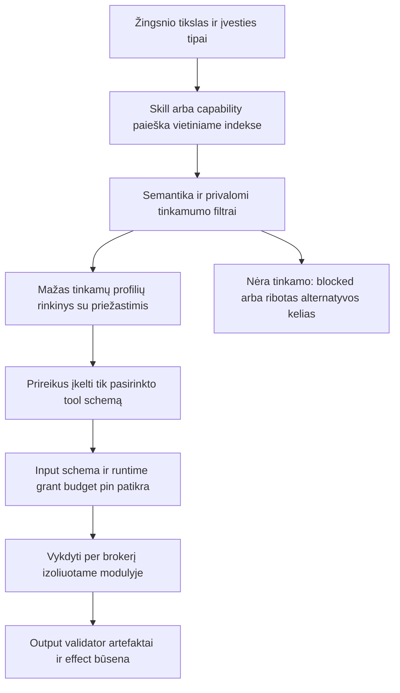

# Kaip agentai randa ir naudoja įrankius bei skills

Projekto V1 dokumentacijos papildymas, 2026-10-16. Tai konkretesnis jau sutarto CapabilityRegistry, modulių kontrakto ir darbo receptų veikimas. **Būsena: projektavimas, NOT_RUN.** Resolver API, skill schemas, indeksas ir runtime atrankos testai dar neįgyvendinti; vardai šiame dokumente žymi planuojamus kontraktus.

## 1. Sąvokos ir vienas autoritetas

| Sąvoka | Reikšmė | Pavyzdys, ne esama įdiegta funkcija |
|---|---|---|
| Tool | Viena konkreti operacija su įvesties/išvesties kontraktu | Gauti viešą OHLCV istoriją, ištraukti PDF lenteles |
| Capability | Kanoninis prasminis gebėjimas su versijuotu kontraktu | Rinkos duomenų skaitymas arba dokumentų lentelių išgavimas |
| Modulis / adapteris | Konkretus užrakintas įgyvendinimas, aplinka ir pateikiami tools | Vienas CLI/MCP/API ar worker adapteris tam gebėjimui |
| Skill | Versijuotas darbo receptas: kada tinka, žingsniai, reikalingi capabilities ir rezultato patikra | Parengti market-data → backtest → report testinį darbą |
| Resolver | Platformos tarnyba, surandanti šiai užduočiai tinkamus skills/capabilities/adapterius | Filtruoti pagal OS, schemas, trust, grants ir resursų profilį |

Skills ir specialistai nedubliuoja pagrindinio scheduler. Vienas branduolys vykdo užduoties būseną, lease/budgets/effects ir leidimų sprendimus. Skill aprašo darbo kelią; jo tekstas negali suteikti sau tinklo, paslapčių, mokėjimo ar publish teisių.

## 2. Dviejų sluoksnių katalogas

**Žmogui:** sritis/kategorija, užduotis, paieška, palyginimai ir parengties kortelės [įrankių kataloge](TOOL-DIRECTORY.md).

**Agentui:** mašininis indeksas su canonical IDs, vienareikšme semantika ir versijomis, input/output schemų nuorodomis, supported profiliu, readiness evidence, resursais, auth/grant poreikiu ir validator. Tie patys pagrindiniai faktai; nėra atskiros modelio fantazijos apie neegzistuojančius tool vardus.

Discovery/source-only baseinas atskirtas nuo vykdomo registry. Rastą repo galima pasiūlyti vertinti, bet jis netampa kviečiamu tool vien nuo to, kad resolver jį rado. Registry `verified` taip pat skiriasi nuo `installed/health_checked/authorized` konkrečioje instaliacijoje.

## 3. Tiksli atrankos eiga

1. **Žingsnio intent:** planas nurodo, kokio rezultato reikia, turimas input/artifact rūšis, projekto duomenų gavėjus, reikalaujamą profile/OS, time/resource/budget ir side-effect ribas. Agentas negali pats įrašyti „grant approved“ kaip įrodymo.
2. **Paieška:** resolver randa canonical capability/skill pagal ID, semantiką, žinomas sinonimų/category žymas ir indeksą. Tiesioginis ID tinka tik jei registruotas ir kontraktas atitinka; pavadinimo panašumas dar nėra pakeičiamumas.
3. **Privalomi filtrai:** input/output ir vienetų/prasmės atitiktis, reikalinga funkcija, supported versija/OS/hardware, trust/revocation, įdiegimo/readiness, leistinas data locality/account/destination, grant ir finansinis/resursų rezervas. Unknown nėra automatinis pass; greitis ar stars šių filtrų nekompensuoja.
4. **Prioritetas:** likę kandidatai vertinami tik konkrečiam workload profiliui pagal realų fit, kokybės/kainos/latency/resource bei priežiūros įrodymus. Rodo default ir prasmingas LT/CPU/offline/GPU/hosted/fallback alternatyvas; nėra vieno pasaulinio kokybės skaičiaus.
5. **Mažas atsakymas:** pilotinis default iki5 tinkamų variantų su ID, trumpa paskirtimi, profile/readiness, kodėl tinka ir kas dar reikalinga. Tai konteksto/kainos riba, ne viso katalogo ar alternatyvų skaičiaus lubos; galima filtruotai tęsti paiešką.
6. **Lazy schema:** tik pasirinktam variantui įkeliama tiksli input/output schema, pavyzdys, timeout/error/effect semantika ir naudojimo instrukcija. Agentui nereikia į prompt įkrauti visų katalogo įrankių ar pilnų README.
7. **Vykdymas:** patikimas brokeris iš naujo tikrina aktualų pin/schema/grant/budget/lease/fence. Resolver result reference yra nuoroda, ne bearer leidimas ar mokėjimo rezervas. Args validuojami, failai perduodami ArtifactRef, o secrets pridedami tik brokerio/provider riboje.
8. **Rezultatas:** schema ir domain validator tikrina faktinę išvestį/artefaktą. Tuščias ar formaliai sėkmingas API atsakymas dar nėra užduoties sėkmė. Klaidos klasė lemia ribotą read retry, blocked ar read-only effect reconciliation.

Routing sprendimas fiksuoja registry/policy/model/config/profile ir actual selected adapter. **Vietinis indeksas ir deterministiniai hard filters** nekviečia mokamo modelio; pasirinktas MVP Jev scoring yra atskiras realus modelio dispatch su savo ir bendru account/task budget. Jau pasirinktas užduoties modelis naudoja gautą mažą tool rinkinį. Papildomas rerank/embedding/helper call, jei toks įjungtas, taip pat nėra „nemokamas resolver“ – jis eina per savo ir globalų budget brokerį.

Galutinis naudotojo pasirinkimas **MVP – Jev per jo OpenRouter paskyrą**, Laya lieka vėlesnis local profilis; [šaltiniai ir patikros](ROUTER-EVALUATION.md). Deterministinis hard-filter/index baseline lieka būtinas ir veikia be jų. Kandidatų typed pasirinkimas tik iš pateiktų canonical IDs su abstain; confidence negali pakeisti grant ar benchmark įrodymo. Secret dar nepateiktas, P0 patvirtins actual model/endpoint/rates ir baigtinį cap. Viešų masinių submissions paid intake0 išlieka atskirai. Source-protokolo panašumas nėra mūsų patvirtintas modelių semantinis pakeičiamumas.

## 4. Ką turi deklaruoti įrankis ir skill

| Tool/capability įrašas | Skill įrašas |
|---|---|
| Canonical ID, contract/schema versijos ir semantika, input/output tipai bei vienetai | Stable skill ID/version, paskirtis, tinkamumo ir netinkamumo sąlygos |
| Modulio release/upstream/package pins, platforma ir readiness/verification evidence | Reikalingi capabilities ir jų suderinamos contract versijos, ne savavališkos install komandos |
| Auth/grant ir data/side-effect poreikis; jokių secret verčių | Input/artifact reikalavimai, žingsnių/branch/stop schema ir cap |
| Faktiniai arba unknown CPU/RAM/VRAM/disk/latency/cost, rate šaltinis | Expected outputs, nepriklausomi domain validators ir konkrečios failure/unknown sąlygos |
| Timeout/cancel/errors/idempotency/reconciliation ir validator nuoroda | Source/provenance, autorius, terms/license ir trusted review/acceptance statusas |
| Įrodymų laikas, revocation ir compatibility intervalas | Tinkamų OS/model/profile prielaidos, testiniai scenarijai ir regresijų istorija |

Tai suplanuoti papildomi kontraktai. Esama manifesto/schema v0.1 netampa automatiškai visa skill schema; naujas kanoninis variantas fiksuojamas P0 ir tikrinamas conformance. Keli adapteriai gali įgyvendinti tą patį canonical capability, bet vien jų JSON formos sutapimo neužtenka teigti, kad semantika vienoda.

Skill gali būti žmogaus parašytas arba agento pasiūlytas. Sugeneruotas skill pradeda nuo draft ir praeina tą pačią kilmės/kontrakto/permissions/testų procedūrą, kol tampa leistinu vykdymo receptu. Svetimas README, MCP description ar atsisiųstas `SKILL.md` nėra trusted policy. Jei skill pateikia script/code, jis priklauso review/izoliuoto modulių vykdymo ribai, ne importuojamas į control procesą kaip instrukcijų privilegija.

## 5. Pavyzdys: agentas kuria crypto boto testinį prototipą

Užduotis išskaidoma į viešų rinkos duomenų gavimą, strategijos/backtest atlikimą ir rezultatų ataskaitą. Resolver pirma ieško šių capabilities; gali parinkti jau priimtą testinį skill, jeigu jo prielaidos ir duomenys tinka.

Duomenų žingsnis gauna tik market-data read profilį ir tikrą įvesties schemą. Backtest žingsnis turi atskirą dataset/time/fees/slippage konfigūraciją ir domain testą. Ataskaita registruoja rezultato kilmę ir ribas. Jokio order-write ar withdrawal tool vien dėl žodžio „botas“ neįtraukiama; jų poreikis ir grant negali būti numanomi iš skaitymo recepto.

Jei testinio modulio nėra, resolver rodo missing capability ir galimą source-only kandidatą/queued vertinimą. Jis neįvykdo atsitiktinio GitHub repo ir neišgalvoja pelningumo ar „ready“ žymos. Tai hipotetinis jau sutarto katalogo naudojimo scenarijus, ne dabartinė veikianti prekybos funkcija.

## 6. Kas vyksta, kai tinkamo įrankio nėra

- Jei yra tinkamas verified modulis, bet neįdiegtas – galima leistina on-demand instaliacija tik esamame trust/OS/grant/resource apvalkale.
- Jei trūksta account ar teisės – blocked su aiškiu poreikiu; resolver neperjungia į svetimą paskyrą.
- Jei resursų/kainos profilyje telpa kita patikrinta alternatyva – ją galima pasiūlyti ar pasirinkti pagal politiką, išlaikant duomenų gavėjų ir effect ribas.
- Jei yra tik discovery kandidatas – pateikti į admission/evaluation eilę, atsižvelgiant į turimą budget/queue, arba parodyti ribotą rezultatą.
- Jei nerasta – aiškiai pasakyti ko trūksta, palikti task partial/blocked ar leistiną siauresnį kelią. Tool vardo ar „PASS“ išgalvojimas nėra fallback.

Failover po išorinio write/send/PR timeout nekartoja galbūt atlikto veiksmo vien todėl, kad kitas adapteris rastas. Du wrapperiai į tą patį backend/account gali turėti tą patį outage ar limitą; tikras fallback nepriklausomumas turi atskirą įrodymą.

## 7. Cache, versijos ir atšaukimas

Indeksas atnaujinamas iš versioned registry po admission/revoke/update; ne kiekvienas agentas skenuoja visą GitHub iš naujo. Resolve/schema cache rišamas prie registry generation, capability/contract, actual profile/pin, projekto grant revision ir policy/availability. Cached listing nėra amžina teisė vykdyti.

Prieš call tikrinama dabartinė schema fingerprint ir target statusas. MCP/Treg remote schema drift, pasikeitusi auth/permission reikšmė ar revoke invaliduoja netinkamą parinktį; reikalingas naujas validavimas, o ne tylus savavališkas platesnės funkcijos panaudojimas. Veikiančio darbo pins nekeičia revocation politikos: nesaugus target saugiai stabdomas pagal incident profilį.

Tools/skills instrukcijų turinys yra duomenys su savo review lygiu. Jie negali pakeisti acceptance, grant, cost ar globalių instrukcijų. Budget/governance valdikliai neturi būti tik dar vienas prompt tekstas.

Nested skill, child tool ar deleguotas agentas paveldi tik siauresnę leistiną darbų apimtį ir tą patį bendrą task/centro budget, o ne naują nepriklausomą kvotą. Jų bandymai, resolver helperiai ir retries apskaitomi brokerio; skill negali savęs pervadinti, kad apeitų cap ar revoke.

## 8. Kaip įrodysime paieškos tikslumą

| Testų grupė | Kas turi būti matoma |
|---|---|
| Intent/semantika | LT/EN ir sinonimų užklausos grąžina tinkamą capability, nesumaišydamos STT/TTS, read/write, PDF/HTML ir kitų prasmių |
| Hard filters | Netinkamas grant/data destination/schema/platform/budget ar revoked adapteris nepatenka į vykdymą apibrėžtame neigiamų testų rinkinyje |
| Recall ir missing | Matomas tinkamų kandidatų radimas top-k bei klaidingi praleidimai; jei kandidatų nėra, nėra išgalvoto tool |
| Lazy schema ir kaina | Atsakyme tik reikalingi metadata/schemas; paprastas resolve/search nėra papildomas mokamas LLM call |
| Skills | Draft/malicious instructions negali suteikti teisių, apeiti cap ar pakeisti trusted validator |
| Race/drift | Senas registry/grant/schema cache po revoke/change, netinkamas pin ir SDK retry teisingai atmetami arba persprendžiami |
| End-to-end | Pasirinktas tool realiai atlieka sutartą darbą; matomas validator, usage ir failure/effect statusas |

Duomenų rinkinys turi būti atskirtas nuo kūrimo pavyzdžių ir žymėti keletą teisėtų alternatyvų, ne vien vieną mėgstamą repo. Skelbiamos recall@k/precision/missing ir end-to-end metrikos su imtimi, modeliais, sąnaudomis ir neapibrėžtumu. Tikslios skaitinės tikslumo ribos nustatomos prieš bandymą pagal darbo profilį; šiame plane jų nevadiname pasiektomis.

Šis komponentas patikslina P0 kontraktus, P1.5 registrą/atranką, P1Q biudžeto brokerį ir P2 conformance, nekurdamas antro scheduler ar neribotos mokamos paieškos. [Roadmap](../ROADMAP.md) · [Įrankių katalogas](TOOL-DIRECTORY.md) · [Kontraktai](CONTRACTS.md).
