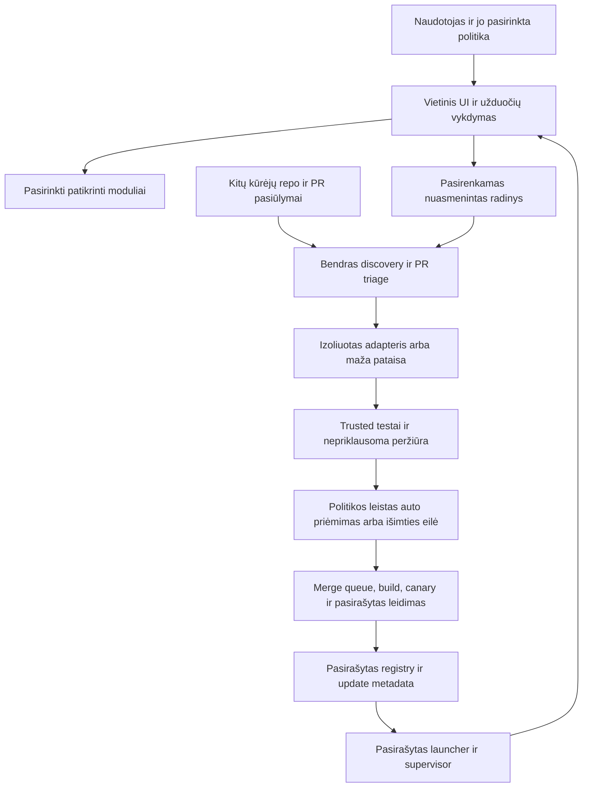

# Autonominis projektas, modulių priėmimas ir automatiniai atnaujinimai

> **Planuojama produkto specifikacija · peržiūrėta 2026-10-17.** Aprašo siekiamą elgesį; schemų pavyzdžiai ir maketai savaime nėra įgyvendintos funkcijos. Daliniai foundation komponentai nekeičia viso vartų statuso. Datuotos įgyvendinimo pastabos žemiau nėra atnaujinta būsenos suvestinė; senos kainų/auth/source prielaidos tikrinamos prieš realų profilį. Dabarties autoritetas: [būsena](IMPLEMENTATION.md), [priimta architektūra](DECISIONS.md), [roadmapas](../ROADMAP.md).

Plano papildymas **0.2, 2026-10-16, Europe/Kiev**. Būsena: **suprojektuota, NOT_RUN**. Tai dabartinė autonomijos ir platinimo specifikacija; ji patikslina ankstesnį rankiniu priėmimu pradėto MVP variantą. [Pagrindinis planas](../PLAN.md), [roadmap](../ROADMAP.md), [antro agento kritika](quarantine/2026-10-17/docs/reviews/autonomy-updates-review.md.snapshot.txt).

## 1. Koks bus naudotojo patyrimas

Papildymai: [naudojimo įrodymai ir upstream indėlis](COMMUNITY-QUALITY.md), [oficiali RepositoryZero agentų PR tapatybė](AGENT-IDENTITY.md), [Jev taikymas repo/konteksto/coding atrankai](JEV-APPLICATIONS.md). Tai suplanuoti bendro ciklo komponentai; jų būsenos atskirtos nuo realiai įgyvendinto pirmo pjūvio.

Naudotojas paleidžia produktą, pasirenka modelį arba prijungia jau turimą providerį, suteikia konkrečius failų/paskyrų/resursų leidimus ir pasirenka automatizavimo profilį. Toliau įprastos užduotys vykdomos, reikalingi patikrinti moduliai parenkami, o suderinami stabilūs atnaujinimai įdiegiami automatiškai to profilio ribose. Naujas mokamas provideris, platesnės teisės ar didelis modelio download nėra numanomas bendro „autonomija įjungta“ rezultatas.

Pirmas variantas pasiekiamas per `localhost` naršyklėje. Vėliau tas pats backend ir duomenys valdomi desktop programos: Windows diegiklis `.exe` arba pasirinktas `.msi`/MSIX, macOS `.app` su `.dmg`, Linux pasirinktas AppImage ir vėliau distro paketai. Tai vienas produkto branduolys su platforminiais paleidimo adapteriais.

Galutinis tikslas – kasdienis darbas be rankinių komandų, PR tikrinimo ar kiekvieno atnaujinimo tvirtinimo. Vieną kartą nustatoma politika, o išimtys pateikiamos aiškioje eilėje su priežastimi. Šiame darbe realūs diegikliai, agentai ir atnaujinimo tarnybos nekuriami ir neaktyvuojami.

## 2. Dvi vykdymo vietos

**Vietinis produktas** saugo naudotojo duomenis, vykdo užduotis ir valdo savo instaliaciją. **Bendra projekto infrastruktūra** tvarko PR, modulių kandidatūras, patikras ir leidimus per nuolatinį VPS koordinatorių bei atskirus CI / worker vykdymus. Pastarajai reikės veikiančios infrastruktūros ir nustatyto biudžeto; vietinis kompiuteris jai nebūtinas. GitHub `main` yra kodo šaka; VPS yra procesų vykdymo vieta, o ne atskira autoritetinga kodo kopija.

Išjungtas kompiuteris nevykdo vietinių agentų ir neįsidiegia atnaujinimo. Grįžus ryšiui ar paleidus produktą tęsiama iš patvarios būsenos. Nuolatinį vietinį darbą leidžia atskirai pasirenkamas foninis režimas ir OS autostart; uždarant langą UI aiškiai parodo, ar backend lieka veikti. Vienai instaliacijai vienas supervisor ir vienas autoritetingas scheduler.

### Centrinio VPS diegimo profilis

| Komponentas | Atsakomybė ir vykdymo vieta |
|---|---|
| VPS coordinator / API | Nuolatinis mažas servisas: GitHub webhook, schedule/reconcile, task/lease/budget eilė, kandidatų būsenos ir atestacijų nuorodos; ne LLM visą parą generuojantis tekstą |
| Centrinė PostgreSQL | Autoritetinga bendros infrastruktūros darbų / event / outbox / lease / budget būsena; atskira nuo kiekvienos vietinės instaliacijos DB. Pradiniame pilote gali būti tame VPS su backup už jo ribų |
| Trumpalaikiai agentų workeriai | Pradėti pagal eilę, gauti tik konkretaus darbo scope ir baigtinį modelio/CPU/laiko biudžetą; CPU testai atskiruose runneriuose, GPU / OS specifiniai darbai tik atitinkamuose profiliuose |
| Hostile build / evaluator | Svetimas source / PR vykdomas atskirame išmetamame worker / VM be coordinator DB, merge ar signing paslapčių; niekada tiesiai pagrindiniame VPS procese |
| Trusted merge / release | GitHub App su siauromis operacijomis. Source/package build ir SBOM kuriami be signing/GitHub write/coordinator DB paslapčių; atskiras signer priima užbaigto artifact digest+atestaciją, nevykdo repo kodo ar hooks ir tik tada gauna trumpalaikę signing tapatybę |
| Registry / release / evidence storage | GitHub Releases arba pasirinkta versioned object saugykla; pasirašyta vieša metadata, atskirtos privačios operacinės detalės ir vieši sintetiniai įrodymai |

P0 operatoriaus ADR parenka VPS regioną / tiekėją, DB ir artefaktų saugyklą bei pamatuoja apkrovą. Pradinis **bandymo rezervas**, ne produkto minimumas: 2–4 vCPU ir 4–8 GiB RAM koordinatoriui + mažai PostgreSQL bazei, atskiras ribotas diskas ir iki2 vienalaikių išorinių worker jobs. GPU modelių ir nepatikimų build kaštai į šį rezervą neįskaičiuojami ir išskiriami ataskaitoje. Tikrų VPS/API/CI/signing tarifų šioje sesijoje netvirtinome. Visam centrui būtinas operatoriaus daily/monthly cap ir concurrency limit; tuščias cap nesuteikia teisės mokamiems agentų kvietimams.

Viešas ingress turi TLS, GitHub webhook signature / delivery dedup ir namespace autorizaciją. Nei PR tekstas, nei repo URL nesuteikia serverio komandų ar savavališko vidinių URL fetch leidimo. Testų / artifact priėmimo tapatybės atskirtos nuo submitter tapatybės. Private client credentials niekada neperduodami bendram discovery / contribution darbui.

Vienas VPS pirmame pilote yra aiškus availability apribojimas. Reikia stebėsenos, paslaugų restart, disk/queue/budget signalų, off-host DB/metadata backup ir išbandyto restore į švarų serverį. Po crash lease fencing ir idempotency apsaugo nuo dubliuotų darbų, bet nesuteikia neįmanomos exactly-once išorės garantijos. HA ir keli scheduleriai nėra pradinės instaliacijos pažadas; prieš juos atskiri load/failover bandymai. Centro outage sustabdo naujų bendrų patobulinimų priėmimą, tačiau jau įdiegto vietinio produkto darbai su prieinamais vietiniais / pasirinktais provideriais tęsiami pagal grants ir galiojančią trust politiką.

## 3. Agentų rolės ir vykdymo kontrolė

| Rolė | Kada paleidžiama | Ką pateikia / kur sustoja |
|---|---|---|
| Discovery agentas | Kasdien trend signalai, kas savaitę gebėjimų spragos | Repo kandidatas ir konkreti užduotis; jokio automatinio source vykdymo |
| Pasiūlymų atrankos agentas | Naujas repo, issue ar PR | Dublių, licencijos, tinkamumo ir prioriteto suvestinė |
| Adapterio / pataisos agentas | Gavęs laikiną darbo rezervaciją | Mažas peržiūrimas diff, versijų pin ir atkūrimo pavyzdys |
| Peržiūros agentas | Naujas PR arba pakeistas jo HEAD | Argumentuota rekomendacija pagal patikimų taisyklių versiją |
| Nepriklausomas evaluator | Kandidato ir galutinio merge tree patikra | Pasirašytas report su task/data/grader/environment digest |
| Leidimų ir registro valdiklis | Pakankami įrodymai ir leista kategorija | Patikrintas merge/admission; išimtys perduodamos prižiūrėtojui |
| Release / canary valdiklis | Priimtas suderinamas pakeitimų rinkinys | Patikrintas OS/arch paketas ir staged rollout arba jo sustabdymas |
| Vietinis updater ir runtime watchdog | Paleidimas, periodinis laikmatis, sveikatos klaida | Suderinamas įdiegimas, atidėjimas, restart ar leistas rollback |

Tai loginės rolės ir atskiri prieigos kontekstai, ne aštuoni privalomi nuolat veikiantys modeliai. Deterministiniai valdikliai sprendžia leidimus, biudžetą, parašus ir priėmimo vartus. Modelio confidence ar dviejų modelių sutarimas šių įrodymų nepakeičia. Autoriaus kontekstas neturi evaluator, merge ar signing raktų.

Projekto augimo/public relations rolės yra atskiras [marketingo ir partnerystės lane](GROWTH-AND-OUTREACH.md), o ne techninių modulių priėmimo teisės. Jos gali rengti faktų santraukas, badge/creator paketus ir pagal pasirinktą outreach politiką atlikti konkrečius leidžiamus veiksmus. GitHub PR/email/social send turi atskiras tapatybes, grants, suppression, quotas ir external effect ledger. P3C auto-merge, produkto autonomijos ar Treg katalogo įjungimas šių teisių nesuteikia.

## 4. Konkreti darbo politika ir periodiškumas

Siūlomi pradiniai parametrai, dar neįgyvendinti ir keičiami pasirašyta operatoriaus politika:

| Įvykis | Darbas / limitas |
|---|---|
| Naujas ar papildytas PR | Triage iš karto; dedupe pagal repo+PR+HEAD+policy SHA; naujas HEAD panaikina seną acceptance |
| `merge_group` arba lygiavertė eilė | Iš naujo tikrinti faktinį jungiamą tree su naujausia baze; CI išvados pririštos prie to SHA |
| Kasdienis reconciler | Prarasti įvykiai, užstrigę PR, pasibaigusios leases, neveikiantys jobs ir nebaigti leidimai; jokių besąlyginių merge |
| Kasdienė discovery ir naujų repo/video intake peržiūra | Iki100 naujų kanoninių objektų metadata patikrų bendrai, iki10 gilesnių source apžiūrų, iki1 naujo adapterio darbo per24h; modelio triage atskirai iki10 faktinių dispatch attempts, visi vykdymai dar ribojami pinigais |
| Savaitinė peržiūra | Gebėjimų spragos ir alternatyvos; iki 50 tikslinių kandidatų; atnaujinti vieną bendrą registrą |
| Upstream stebėjimas | Kasdien patikrinti naudojamų leidimų saugumo/licencijų/ownership ir suderinamumo signalus; naują versiją į testų eilę |
| Vietinio produkto startas ir kas 6 h veikiant | Tikrinti update metadata su iki 15 min. jitter; network klaidoms backoff |
| Pasiektas limitas arba kartojasi gedimas | Circuit breaker: sustabdyti tą lane, išsaugoti būseną ir pateikti priežastį |

Contribution pilotui: 1 aktyvi pataisa vienam naudotojui, iki 30 min. ir 2 nesėkmingų bandymų, iki 1 PR per dieną. Viešų kandidatūrų ir gilesnių darbų eilė turi atskirus submitter/global limitus ir fair-share. Pinigų cap nustatomas operatoriaus / naudotojo prieš mokamą vykdymą; neapibrėžtas cap nesuteikia neriboto kredito. Visi limitai išlieka po restart.

Interaktyvios naudotojo užduotys turi atskirą resursų rezervą ir aukštesnį prioritetą už background tobulinimą. Po offline/sleep missed cron darbai sujungiami į vieną prasmingą patikrą. GitHub scheduled jobs gali vėluoti; authoritative darbų įrašas leidžia reconciliaciją, laikmatis nėra tikslaus įvykdymo garantija.

Dideliam submissions srautui norminė [intake ir biudžeto kaskada](INTAKE-AND-BUDGETS.md): pakopos be LLM, globalūs count/token/$/compute/concurrency rezervai prieš kiekvieną dispatch ir ribota aktyvi eilė. Iki10triage modelio attempts per24h yra bendras discovery/repo/video profilis, ne vieno workerio ar1000paraiškų dauginamas limitas; įskaitomi paslėpti SDK retries ir pagalbiniai modeliai. Periodiniai refresh/security/video-status metadata darbai turi atskirus baigtinius operatoriaus rezervus. Nėra neriboto „critical“ kelio iš submitter žymos. Be pasirinkto mokamo profilio išorinių mokamų kvietimų cap0; no-LLM portalas vis tiek gali veikti.

## 5. Autonominė PR atranka, merge ir release

1. Patikima ingress dalis užregistruoja įvykį, kanoninį repo/PR/HEAD ir biudžetą. Viešas PR, jo tekstas, komentarai ir artefaktai laikomi nepatikima įvestimi.
2. Triage tikrina realią užduoties naudą, dublius, dydį, licencijas, dependency ir permission skirtumą, bazės šviežumą. Vien etiketė ar populiarumas nesuteikia priėmimo.
3. Testai vykdo nepatikimą kodą izoliuotoje aplinkoje be paslapčių. `pull_request_target` nenaudojamas privilegijuotam svetimo HEAD vykdymui. Trusted workflow, suite ir policy imami iš patikimos bazės; ta pati PR negali jų sau pakeisti.
4. Evaluator ir peržiūros agentas pateikia atskirus įrodymus. Tokenai, CPU/laikas ir neaiškūs išoriniai efektai apskaitomi patvariai. Retry taikomas tik pagal klaidos klasę.
5. Po P3C pilotinių vartų leistos kategorijos automatiškai patenka į merge queue: mažas esamo adapterio bugfix su tuo pačiu dependency/permission apvalkalu, vykdymo ar politikos nekeičiančios dokumentacijos pataisos, nauji papildomi regresijų testai. Klasifikatorius neturi teisės vien savo išvada apeiti privalomų vartų.
6. Kitoje eilėje lieka pakeitimai, plečiantys teises, keičiantys trusted acceptance, raktus, updater/supervisor, įkainius/biudžeto kontrolę, esmines izoliacijos ribas ar negrįžtamas duomenų migracijas. Tai vienkartine politika neperduotos kategorijos; reikalingas atskiras savininko sprendimas. Įprastam leidžiamam PR žmogaus patvirtinimo nereikia.
7. Eilė pakartoja reikalingas patikras ant galutinio jungiamo tree. Jei GitHub merge queue nepasiekiama pasirinktam planui/repo, naudoti vieną serializuotą brokerį su base+HEAD pasikeitimo atmetimu; funkcijos prieinamumą patikrinti P0.
8. Priimti pataisymai grupuojami į leidimą, kad nebūtų restarto po kiekvieno PR. Automatinis preview leidimas pereina canary ir kokybės slenksčius; patvirtinta mažos rizikos versija pagal politiką automatiškai perkeliama į stable. Skubus hotfix kelias turi tas pačias kilmės/patikros ribas.
9. Paketų / SBOM builder užbaigia visus source build ir package hooks **be signing, GitHub write ar coordinator DB paslapčių**. Atskiras trusted signer gauna tik užbaigtų artifact digest ir galutinio SHA / build atestacijas, jas patikrina ir pasirašo target bei metadata su trumpalaike tapatybe. Signer nevykdo repo kodo, package install/build hooks ar modelio komandų; modeliui ir PR šių raktų nėra.

Shadow pilotas pirmiausia palygina automatines išvadas su trusted atskaitos sprendimais. Priėmimo kriterijai ir neigiami atvejai iš anksto fiksuojami. Vienas kritinės ribos apėjimas uždaro automatinį lane iki pataisymo. Siauras automatinis priėmimas planuojamas prieš platesnį modulių diegimą; platesnė autonomija leidžiama tik išplėtus atitinkamą įrodymų ir politikos paketą.

## 6. Kas gali siūlyti repo ir kaip prijungiamas modulis

Pasiūlyti viešą GitHub repo gali bet kuris naudotojas ar kūrėjas; autorius neprivalo būti repo savininkas. Viešai skelbti modulį svetimu namespace gali tik patikrinta tam namespace įgaliota tapatybė. Private repo prijungiamas tik į tam įgalioto naudotojo/projekto vietinį katalogą; jo source ir darbo duomenys automatiškai nepatenka į bendrą projektą.

Trendai ir stars yra discovery signalai. Atranka vertina konkrečią užduotį, naują gebėjimą, integravimo kelią, kodą, tests, priežiūrą, licenciją, tikrą dydį/kainą ir dubliavimą. Mažiau žinomas projektas gali būti stipresnis kandidatas už populiarų. Vienodo frameworko fork, naujas HEAD ar pasikeitęs savininkas nepaveldi patikimos būsenos.

Panašūs moduliai praeina [atskirą dublių ir alternatyvų procedūrą](MODULE-SELECTION.md): canonical tapatybė atskiriama nuo funkcinio panašumo, naujam kandidatui reikia delta ir konkretaus palyginimo. Vienas capability kontraktas gali turėti kelis pagrįstus adapterius; naujas repo savaime nekuria naujo gebėjimo. Kainos/greičio/LT/CPU ar tikro fallback pranašumas vertinamas tik po privalomų teisių, licencijos ir teisingumo vartų. P3C siauras lane pats nesuteikia teisės pakeisti default backend ar routing politikos.

| Etapas | Automatinis darbas | Perėjimo sąlyga |
|---|---|---|
| Pateikimas / atradimas | Normalizuoti adresą, patikrinti GitHub kilmę ir dublikatus, registruoti konkretų gebėjimą | Source skaitymo apimtis ir kvota; pateiktas URL dar nėra leidimas vykdyti |
| Source/licencijų triage | Skaityti manifesto/README/license/API šaltinius, rasti modelių ir enterprise scope | Nėra neišspręsto platinimo bloko; Inbox Zero tipo custom sąlygos → reference-only |
| Adapterio draft | Sukurti ploną kontrakto adapterį atskiroje ribotoje aplinkoje | Nekeičiamas core ir trusted policy; tikslus source/package pin bei provenance |
| Izoliuotas build | Užrakinti transityvines priklausomybes, peržiūrėti install hooks, sukurti SBOM | Patikrinti digests, leidimai, tinklo scope, licencijų inventorius ir builder atestacija |
| Conformance ir domeno testai | Tikrinti schemas, realias užduotis, timeout/cancel/restart, cap, neigiamus permission atvejus | Trusted corpus/grader ir measured resursai konkrečiai OS/arch |
| Experimental / canary | Paleisti operatoriaus testinėse arba aiškiai opt-in instaliacijose | Nėra policy pažeidimo, fiksuota kokybė ir ribotas rollout |
| Verified / recommended | Pasirašyti registro įrašą tiksliai release+platform+suite kombinacijai | Atitinkamos politikos slenksčiai, palaikymo atsakomybė ir atkūrimo receptas |
| Stebėjimas / pašalinimas | Aptikti regresiją, upstream/license/key pokytį; sustabdyti naujus įdiegimus | Quarantine/revocation ar rollback pagal pasirašytą politiką, išsaugant darbus |

Automatinis naujo modulio priėmimas pradžioje leidžiamas siauram profiliui: izoliuotas CPU worker, aiškus suderinamas licencijos scope, jokios naujos paskyrų paslaptys, host administravimas ar išoriniai write, ribotas tinklas ir pamatuoti kaštai. Platesni gebėjimai lieka experimental/išimties eilėje, kol patvirtinta jų kategorijos politika. Pačios projekto aprašytos tests nepakanka.

**Registry priėmimas ir vietinis įdiegimas yra atskiri sprendimai.** Vietinis agentas gali automatiškai įdiegti tik konkrečiai užduočiai reikalingą leidimą, kuris patenka į iš anksto pasirinktą OS/teisių/resursų/kainos apvalkalą ir turi reikiamą trust lygį.100 katalogo įrašų nereiškia100 įdiegtų repo. Didesnis weights download ar naujos teisės sustabdo tik tą funkciją ir parodo poreikį; agentas negali išplėsti savo leidimų.

## 7. Vietinis paleidimas ir desktop paketai

| Etapas / platforma | Platinimo forma ir reikalavimas |
|---|---|
| Pradinis Linux x86_64 localhost | Valdomas versijuotas leidimas ir launcher, loopback naršyklės UI; source checkout vystymui atskirai |
| Windows 11 x64 | Pasirašytas `.exe` diegiklis arba pagal packaging ADR `.msi`/MSIX; įprastas paleidimas be terminalo |
| macOS Apple Silicon | Pasirašyta/notarizuota `.app` per `.dmg`; Intel palaikymas tik atskirai praėjus matricą |
| Linux x86_64 | Tikrintas AppImage profilis; `.deb`/`.rpm` per patikimą package manager kelią pagal vėlesnę matricą |
| Kitos OS/arch kombinacijos | Aiškiai unsupported/preview, kol turime tikrą install/start/update/rollback įrodymą |

P0 packaging spike lygina Rakazo esamą Electron kelią su B varianto galimu mažu wrapper. Rakazo `.exe` pats neįrodo veikimo be Docker ar kitų servisų. Tikslas: core paleidimas be rankinio Python/Node konfigūravimo. Jei pasirinkta bazė reikalauja engine/VM/WSL, pirmo įdiegimo vedlys rodo tikrą būtinybę, dydį, licenciją ir OS leidimą. Jo negalima paslėpti2GB skaičiuje. Sunkių pasirenkamų modulių prerequisites diegiami pasirinkus profilį.

UI/API klauso tik `127.0.0.1`/leidžiamo `::1`; naudojama lokali autentifikacija, Origin/Host/CSRF kontrolė ir apribotas desktop IPC. Prievado konfliktas sprendžiamas automatiškai ir saugiai, su viena instaliacijos tapatybe. Naudotojo raktai saugomi platformos credential store, ne UI/PR/loguose. LAN/public endpoint yra atskiras pasirenkamas režimas.

Core duomenų, credential, modelių, cache ir artefaktų katalogai atskirti nuo versijuojamų app failų. Uninstall/update nekeičia naudotojo dokumentų. Vystymo checkout su savo pakeitimais niekada automatiškai neatstatomas ar neperrašomas: produktinis updater valdo savo release katalogą, ne `git pull` naudotojo darbo medyje.

## 8. Automatinio vietinio atnaujinimo eiga

Numatytas produkto profilis: **stable automatiniai atnaujinimai įjungti**, pasirinkimai pause/manual/preview. Atskiras pasirenkamas prisidėjimo režimas pagal nutylėjimą neskelbia privačių radinių. Šios nuostatos nėra dabartinio workspace konfigūracijos pakeitimas.

1. Mažas updater patikrina patikimą metadata periodiškai ir starto metu. Tam nereikia modelio kvietimo. Patikra/download neveikiant ryšiui atidedama su backoff; tinkamas esamas leidimas lieka naudojamas pagal jo politiką.
2. Pagal OS/arch, kanalą, core/module/API/DB schemų suderinamumą, teisių skirtumą ir revocation parenkamas tikslus target. Nepažįstami leidimai ar mokami įrankiai automatiškai nesuteikiami.
3. Atsisiunčiama į staging su byte cap, laisvos vietos rezervu ir turinio hash; patikrinami pasirašyti metadata/target, kilmė ir platforminis parašas. Klaida neleidžia vykdyti paketo.
4. Suskaičiuojamas **vienas suderinamų app/core/worker/modulių pakeitimų planas**. Modelių svoriai atnaujinami atskirai su jų licencija ir download apimtimi. Darbai turi tikslų core/module/model/config pin; veikiančio žingsnio interpretacija nepakeičiama jo viduryje.
5. Paketas parengiamas fone. Saugiame idle/maintenance taške scheduler nepriima naujų darbų, užbaigia arba checkpointina esamus, išsaugo outbox/budgets/leases/effects. Neaiškaus jau išsiųsto išorinio veiksmo aklas kill/retry draudžiamas; nesant saugaus taško aktyvavimas atidedamas su aiškia priežastimi.
6. Su sustabdytais rašytojais sukuriamas patikrintas backup/snapshot ir atnaujinimo žurnalas. Leidžiamos tik išbandytos duomenis išsaugančios suderinamos migracijos; destruktyvios/nesuderinamos patenka į išimties kelią. Vienas active writer išlieka ir per update.
7. Supervisor atominiu būdu pakeičia aktyvaus leidimo nuorodą ir paleidžia naują versiją. Išorinis watchdog tikrina backend/UI handshake, DB prieigą, vieną sintetinę užduotį ir vėlesnį heartbeat; siūlomas starto health deadline120s turi būti pamatuotas pagal profilį.
8. Nepasileidus programai ar nepasiekus health, supervisor gali atkurti paskutinį **dar patikimą ir duomenų schemai tinkantį** leidimą net neveikiant naujos app updater kodui. Po sėkmės atnaujinamas įdiegimo receipt ir saugiai tęsiami darbai.
9. Pirmo starto sėkmę papildo canary kokybės ir klaidų stebėsena. Nustačius regresiją atitinkamas target atšaukiamas, nauji diegimai sustabdomi ir įtraukiamas pataisos darbas. Naudotojas mato naudojamą versiją, atidėjimą, nesėkmę bei grįžimą.

Core, desktop shell ir supervisor turi atskiras pasirašytas versijas. Launcher atnaujinamas atskiru OS patikrintu keliu su išoriniu recovery mechanizmu; jo negali savavališkai pakeisti application agentas. Electron updater yra platforminis komponentas, ne viso mūsų multi-process/data update protokolo pakaitalas.

## 9. Rollback, pasitikėjimas ir OS skirtumai

TUF tipo root/targets/snapshot/timestamp politika ir target digests saugo kilmę, metadata senėjimą bei leidimų suderinamumą. Senos metadata replay atmetamas. Leistas binary rollback į senesnį saugų target skelbiamas **naujesne** pasirašyta metadata, ne priverstinai priimant seną snapshot. Atšauktas pažeidžiamas leidimas nenaudojamas kaip fallback; nesant saugaus varianto įjungiama recovery/maintenance būsena.

Binary rollback negarantuoja DB rollback. Po naujų naudotojo įrašų automatiškai uždėti seną volume snapshot reikštų jų praradimą. Reikia suderinamo schema kelio, repair-forward arba pasirinkto duomenis išsaugančio atkūrimo. Snapshot laikomas atskirai ir nenaikina naujesnių artefaktų.

Signing privatus raktas yra atskiroje release infrastruktūroje; client turi tik patikros šaknis. Raktų rotation, revocation ir pradinė root patikra projektuojami prieš unattended platinimą. Kompromituotai trust root atkurti reikia iš anksto nepriklausomo recovery kelio; naujas URL su tuo pačiu kompromituotu parašu problemos nesprendžia.

Native Electron `autoUpdater` dokumentacijoje aprašyti Windows/macOS keliai; Linux mechanizmo jis nesuteikia. AppImage atnaujinimas per `electron-updater` yra atskiras tikrintinas pasirinkimas. `.deb`/`.rpm` instaliacijos priklauso paketų valdytojui: app jų tyliai neperrašo ir neapeina OS admin patvirtinimo. Windows pasirinktas installer/update formatas ir macOS code signing/notarization tikrinami realiais runneriais. API versijos užrakinamos po packaging ADR; HEAD pavyzdžiai nelaikomi patikrintu dependency lock.

## 10. Autonomijos sustojimo ir savipriežiūros taisyklės

Lokalus crash gali sukelti iki3 eksponentinio backoff restart bandymų per10min.; po jų crash-loop stabdomas ir parodomas recovery režimas. Tai skiriasi nuo2 agentinio pataisos bandymų limito. Periodiniai darbai dedupinami; grant/budget būsena atkuriama prieš išorinį veiksmą. Finansinio, siuntimo ar publikavimo `unknown_after_timeout` sprendžiamas reconciler, ne dar vienu spėjamu bandymu.

Modulio revocation išjungia naujus jo darbus ir parenka patikimą alternatyvą, jei ji telpa į tą pačią užduoties politiką. Aktyviems darbams parenkamas saugus stop/checkpoint, išsaugomi jų failai. Watcher gali automatiškai parengti upstream suderinamumo pataisą, bet pats neperrašo versijų pin veikiančioje aplinkoje.

Canary pagal nutylėjimą naudoja operatoriaus sintetines testines instaliacijas. Naudotojų telemetrija, dokumentai, source, raw traces ir laiškai neskelbiami savaime. Pasirenkami nuasmeninti rodikliai turi aiškų sutikimą ir duomenų saugojimo ribą. Pagrindinės užduoties sėkmė išlieka svarbesnė už background PR skaičių.

## 11. Privalomi įrodymo etapai

P0 papildomi feasibility bandymai: cross-platform launcher/runtime prielaidos, package formatas, update bibliotekos ir keys/trust modelis. P3C patvirtina siaurą unattended PR/admission lane, P3D patvirtina managed-local update/rollback, P4D pateikia tikrai išbandytus desktop paketus. Šie etapai įrašyti [ROADMAP.md](../ROADMAP.md).

Privalomi neigiami bandymai: neteisingas parašas/hash/OS/arch, pasenusi/expired metadata, nuotolinis naujų teisių prašymas, sugadintas download, disk-full, power loss skirtingose update fazėse, naujos app launch failure, crash loop, nesuderinama migracija, revoke target, signing-key rotation/recovery, senas PR HEAD, bandymas pakeisti savo gate, neaiškus external effect, scope/cost viršijimas ir piktavališkas naujo modulio paketas. Visų būsena dabar NOT_RUN.

## 11A. Kai atsinaujina integruoto projekto upstream

Upstream watcher atskirtas nuo vietinio app updater. Jis stebi naudojamų paketų ir repo release / tag / security pranešimus; prenumeruoti įvykiai, jei prieinami, papildomi kasdieniu reconciler. Nereikia naudotojo PC, kad centrinė modulio versijos patikra įvyktų. Skenavimo biudžetas ir prioritizavimas neleidžia kiekvieną dieną perkurti viso kandidatų katalogo.

| Objektas | Versijų kontrolė | Automatinio atnaujinimo kelias |
|---|---|---|
| Biblioteka / CLI / konteineris | Tikslus package version + integrity / image digest + source kilmė | Naujas isolated build ir modulio acceptance; niekada mutable `latest` veikiant |
| Fork / adaptuotas produktas | Upstream base SHA, mūsų pakeitimų šaka ir minimalus diff | Atskiras upstream sync PR; merge konfliktai ir semantinis porting izoliuotai, netestuota main neperrašoma |
| Modelis / balsai / duomenys | Weights / data digest, tokenizer, config ir atskiros teisės | Atskirai kokybės ir resursų testai bei download / disk profilis; naujas kodas nereikalauja automatiškai naujų weights |
| Hosted modelis / Treg / kitas API | API versija, jei tiekėjas ją leidžia; schema fingerprint / sutarties snapshot | Sintetiniai conformance / schema-drift zondai; tiekėjas gali pakeisti backend be mūsų pin, todėl claim apie nekintamus weights nedaromas |

1. **Aptikti ir įvertinti:** prioritetas oficialiam stable release ir saugumo pataisai; arbitrary HEAD / prerelease tik atskirame preview profilyje. Nuo seno pin palyginami changelog ir tikras diff, license / notices / terms, dependencies / lifecycle hooks, schemas / teisių bei tinklo pokyčiai ir platformos reikalavimai. Dependabot / Renovate gali kurti pasiūlymus, bet nepatvirtina suderinamumo už mus.
2. **Sukurti kandidatą:** isolated workspace / builder, užrakinti transityviniai paketai, SBOM, source / package ryšys, prireikus plonas adapterio patch. Fork atveju išlaikomas upstream provenance ir sprendžiami konfliktai; agentas negali prastumti kito scheduler ar licencijos pakeitimo kaip paprasto version bump.
3. **Patikrinti:** trusted-base conformance ir domeno užduotys ant palaikomų OS, regression / crash / cancel / permissions testai, resursų ir kainos pokyčiai. Lyginama senoji ir naujoji kombinacija; autorinių benchmark skaičių neužtenka. Priėmimo taisyklių pakeitimas tame pačiame PR nepadaro bump tinkamu.
4. **Priimti pagal lane:** jau patikrinto modulio mažas suderinamas version bump gali gauti unattended priėmimą tik atskirai priimtame P5.11 profilyje, po supply-chain ir dependency diff taisyklių. Iki jo P3D bump demonstracija naudoja maintainer / exception acceptance. Nauja teisė, licencijos ribojimas, neįvertintas lifecycle hook, major / breaking API arba nesuderinama migracija siunčiami į atskirą review. Nėra automatinės taisyklės „patch semver visada saugus“.
5. **Išleisti ir pritaikyti:** pasirašytas naujas modulio leidimas su konkrečiais pins → sintetinės canary instaliacijos → registry rekomendacija konkrečiai platformai → klientai gauna pagal savo kanalą ir suderinamumo planą. Nauji darbai naudoja priimtą versiją; jau vykstantys išlaiko seną pin iki saugaus užbaigimo / checkpoint. Jei pin pažeidžiamas ir atšauktas, saugiai stabdoma pagal incident politiką, o ne tęsiama vien dėl senumo garantijos.
6. **Nepriimti arba atstatyti:** nesėkmė palieka paskutinę dar leistiną versiją, matomą priežastį ir adapterio pataisos užduotį. Kritinis pažeidžiamas leidimas quarantine / revoke; nesant saugaus pakaitalo modulis laikinai unavailable. „Naujas netinka“ nereiškia „senas leidžiamas amžinai“.

UI ir registry rodo bent `installed`, `verified latest`, `upstream latest`, paskutinį sėkmingą check laiką, versijų / laiko atsilikimą, pažeidžiamumo būseną ir blokavimo priežastį. Siūlomas darbo SLO: įprastą release aptikti per 24 h nuo sėkmingai pasiekiamo šaltinio; paskelbtam kritiniam pažeidžiamumui pirmas triage per 24 h ir, jei nėra patikimo sprendimo, modulio ribojimas pagal incident politiką. Tai planuojami tikslai, ne šiandien veikianti garantija; outage, tests ir operatoriaus pajėgumas matomi ataskaitoje. Failų / release retry dedupinami pagal upstream revision ir policy/suite versiją.

Nuotolinis API gali pasikeisti dar prieš watcher. Todėl tool įvestis / išvestis validuojama kiekviename kvietime, write metodams taikomas konservatyvus schema-drift blokas. Fingerprint fiksuoja kontraktą, ne serverio kodo nekintamumą. Įtartinas rezultatas ar timeout nereiškia automatinio write pakartojimo. Treg ir modelių adapterių specifika [modelių ir įrankių plane](MODELS-AND-TOOLS.md).

Priėmimo bandymas: tyčinis suderinamas upstream bump → automatinė patikra ir canary → nauja užduotis naudoja naują pin; lygiagretus senas darbas baigiasi sena kombinacija. Papildomai breaking schema, naujos teisės / licencija, malicious lifecycle hook, bloga release kilmė, security revoke, fork konfliktas ir hosted API drift turi parodyti teisingą sustojimą arba izoliuotą pataisą. Runtime būsena **NOT_RUN**.

## 12. Patikrinti šaltiniai ir likę sprendimai

- [Electron native auto-updater dokumentas, pinned SHA](https://github.com/electron/electron/blob/2766ef64b6593b647cc69a277e1555855a9de1e0/docs/api/auto-updater.md): platformų ribos ir pasirašymas; runtime netikrintas.
- [Atskiras AppImageUpdater source](https://github.com/electron-userland/electron-builder/blob/434f6e98b017c14176be9aaf06891f09624c88fc/packages/electron-updater/src/AppImageUpdater.ts): implementation buvimas neįrodo mūsų produkto palaikymo.
- [TUF specifikacija](https://github.com/theupdateframework/specification/blob/d4cb70582ba507b9265672792c0fc8a5f390b851/tuf-spec.md): root trust, expiry, freeze/rollback/mix-and-match atvejai.
- [GitHub workflow events](https://github.com/github/docs/blob/83119024f6fae13def06f07774686e4e91212f46/content/actions/reference/workflows-and-actions/events-that-trigger-workflows.md): `pull_request_target` ribos, `merge_group`, scheduled darbai.
- [GitHub merge queue](https://github.com/github/docs/blob/83119024f6fae13def06f07774686e4e91212f46/content/repositories/configuring-branches-and-merges-in-your-repository/configuring-pull-request-merges/managing-a-merge-queue.md): patikros galutiniam jungimo kontekstui; prieinamumas pagal planą dar nepatikrintas.

Vieši docs domenai šiame host grąžino proxy403; skaityti oficialių projektų GitHub source failai su nekintančiu SHA. Naujausią stable bibliotekų derinį, sertifikatų teikėją/kainą, minimalią OS matricą ir CI runnerių prieinamumą patvirtins įgyvendinimo spike. [Source patikrų metaduomenys](../catalog/autonomy-sources.json) atskiria source analizę nuo runtime įrodymų.
