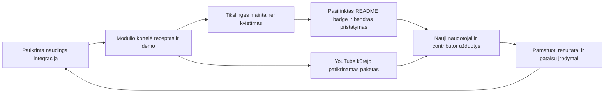

# RepositoryZero augimas: integracijų kūrėjai, ženkleliai ir YouTube

> **Planuojama produkto specifikacija · peržiūrėta 2026-10-17.** Aprašo siekiamą elgesį; schemų pavyzdžiai ir maketai savaime nėra įgyvendintos funkcijos. Daliniai foundation komponentai nekeičia viso vartų statuso. Datuotos įgyvendinimo pastabos žemiau nėra atnaujinta būsenos suvestinė; senos kainų/auth/source prielaidos tikrinamos prieš realų profilį. Dabarties autoritetas: [būsena](IMPLEMENTATION.md), [priimta architektūra](DECISIONS.md), [roadmapas](../ROADMAP.md).

Plano 0.2 papildymas, 2026-10-16. Naudotojo pageidaujamas viešas vardas šiame pasiūlyme – **RepositoryZero**; GitHub repo tebėra `superintelligence`, domeno/trademark sprendimas nepriimtas. **Būsena: planas ir parengti šablonai; joks laiškas, išorinis PR, social post, mokama reklama ar creator sandoris šiame darbe nesukurtas ir neišsiųstas.** [Žinučių šablonai](OUTREACH-TEMPLATES.md), [antro agento kritika](quarantine/2026-10-17/docs/reviews/growth-review.md.snapshot.txt).

## 1. Pagrindinė augimo idėja

Kiekviena **tikrai patikrinta integracija** turi tapti naudingu mažu pristatymu: konkreti užduotis → atkuriamas receptas → upstream autoriaus įrankis centre → vieši įrodymai → dalijimosi paketas. Kūrėjas gauna naują naudojimo kelią ir aiškią autorystę, naudotojas – užbaigiamą darbą, turinio kūrėjas – istoriją, kurią gali pats patikrinti. Ženklelis yra šio fakto nuoroda, o ne pasiūlymo pakaitalas.

Pagrindinė pozicija: **“One open core. A world of AI tools.”** Stiprumą rodome konkrečiu rezultatu ir jo apribojimais. Pavadinimas „galingiausia pasaulio ekosistema“ nėra patvirtintas šio projekto teiginys; prieš comparative claim reikėtų tinkamo nepriklausomo palyginimo. Laiško kabliukas – realiai atlikta gavėjui aktuali integracija, ne išgalvotas apdovanojimas, ribotas vietų skaičius ar tariamas didelis naudojimas.

Šis ciklas gali augti kartu su modulių skaičiumi, tačiau research katalogo757repo nėra mailing list ar757galiojančių integracijų. Kandidatų tyrimas, produkto palaikymas, partnerystė ir rinkodaros kontaktai turi atskiras būsenas bei biudžetus.

## 2. Keturios partnerystės būsenos

| Būsena | Kas tikra | Ką galima sakyti / siūlyti |
|---|---|---|
| Research candidate | Skaitytas šaltinis, nėra veikiančios patikrintos integracijos | Public candidate kortelė; prireikus siauras co-design kvietimas, be verified badge |
| Integration verified | Konkreti mūsų adapterio + upstream pin + OS + suite kombinacija praėjo paskelbtus vartus | „RepositoryZero integration verified“, testų/recepto nuoroda, kvietimas apžiūrėti |
| Maintainer confirmed | Tikrai patikrinta upstream įgalioto maintainer tapatybė ir aiškiai patvirtintas konkretus faktas | Atskirai pažymėti confirmation apimtį; ji nėra bendras mūsų produkto endorsement |
| Co-promotion agreed | Pasirinkti konkretūs tekstai, ženklai, kanalai ir paskelbimo apimtis | Pasirinktas README badge PR, partnerio post, demo/case study ar creator bendradarbiavimas |

Techninis registry statusas ir partnerystės būsena nesuplakami. Maintainer gali atsisakyti badge ar reklamos ir vis tiek likti tinkamu integracijos kandidatu pagal licenciją ir techninius kriterijus. Parama / pasidalijimas / žvaigždutė nesuteikia geresnio techninio balo. README badge merge nėra leidimas naudoti autoriaus vardą visose reklamose.

## 3. Ženklelis, kuriuo verta dalytis

**Pavadinimas:** `RepositoryZero · integration verified`. Klikas veda į konkrečios integracijos puslapį, ne bendrą reklamą. Ten matoma upstream/adapter pins, capability, platforma, suite/data/environment, faktiniai rezultatai ir limits, last verified data, licencijų scope ir dabartinis revocation/deprecation statusas. Tai mūsų integracijos patikra, ne viso svetimo repo saugumo ar absoliučios kokybės sertifikatas.

Siūlomi formatai: mažas įprasto README badge dydžio SVG, didesnė integracijos kortelė ir autoriaus pasirenkamas trumpas sakinys. Pirmoje vietoje laikomas repo pavadinimas ir jo kūrėjai; RepositoryZero yra papildomas naudojimo kelias. Ženklelio vietą, įskaitant README viršų, pasirenka maintainer pagal repo stilių. Preview parodo abi vietas; automatinis PR neperrašo jų hero/branding.

Badge endpoint grąžina ribotą saugiai sugeneruotą SVG be script ar stebėjimo pikselio. Nekintantis verification record saugo istorinį pasiekimą; aktualios būsenos puslapis rodo outdated/revoked/retest needed. Upstream nauja versija ar kritinis radinys neatnaujina verification automatiškai. GitHub / browser image cache gali rodyti senesnį SVG, todėl įrodymų puslapis yra aktualios būsenos šaltinis; badge vaizdo nelaikome enforcement mechanizmu.

Privalomas renewal susietas su nauju siūlomu palaikomu leidimu ir [upstream watcher](AUTONOMY-AND-UPDATES.md#11a-kai-atsinaujina-integruoto-projekto-upstream). Ženklelio grafika, aprašas ir kriterijai vieši. Community feedback / appeal gali pasiūlyti pataisą ar retest, tačiau nesuteikia teisės pačiam pakeisti statuso. Ankstyvų integracijų pripažinimas galimas kaip datuotas istorinis „early integration contributor“, jei faktas tikras, atskirai nuo dabartinės kokybės.

## 4. Repo kūrėjo kvietimo eiga

1. **Pasirinkti tinkamą momentą:** yra veikiantis gavėjo įrankio receptas, vieša parengta kortelė ir palaikymo pajėgumas. Research stadijoje galimas atskiras sąžiningas co-design kontaktas, ne badge apdovanojimas. PR/email nesiunčiami vien dėl discovery sąrašo papildymo.
2. **Parengti gavėjo vertę:** mažas veikiantis adapteris ar receptas, aiški jo repo nuoroda/autorystė,60–90s tikra demonstracija, išbandyta versija ir ką norime patvirtinti. Jei randama reali pataisa jų repo, naudingas upstream fix siunčiamas atskirai nuo reklaminio badge; jie nėra vienas mainų sandoris.
3. **Patikrinti kontaktavimo taisykles:** CONTRIBUTING/README ir projekto pasirinktas kelias, ankstesni atsisakymai, esamas partnerio kontaktas, organizacijos dublių būklė ir viešai šiam tikslui nurodytas kontaktas. Commit email ar privataus profilio duomenys nelaikomi automatiškai paskelbtu rinkodaros kontaktu.
4. **Vienas pirmas kontaktas:** jei repo aiškiai priima tokius documentation/integration PR, galima viena minimali badge/integration docs PR; kitu atveju trumpas pasiūlymas pasirinktu viešu projekto/business kanalu su preview. Issues nenaudojami kaip universalus reklamos kanalas. Jokio vienu metu PR+email+issue+DM į tą patį gavėją.
5. **PR ir email kartu – pasirinktam partneriui:** maintainer gali aiškiai pasirinkti README PR ir release/digest laiškus. PR atidarymas savaime nesuteikia email subscription, o atsakymas į email nesuteikia teisės atidaryti bet kokio repo pakeitimo. Pasirinkimas ir jo apimtis saugomi atskirai.
6. **Pagarbus sprendimas:** maintainer pasirenka badge/tekstą/vietą, kitą variantą arba atsisako. Uždarytas kaip nepageidaujamas PR, „neberašykite“, bounce ar opt-out uždaro tą seką; naujas release jos nepradeda iš naujo. Tyla nėra endorsement, subscription ar leidimas kitam kanalui.
7. **Bendras momentas:** tik sutartiems partneriams parengiame co-authored integration note, share card ir pasirinktą išleidimo laiką. Autorius gali naudoti parengtą tekstą arba savą. Jokio reikalavimo žvaigždutei, backlink ar pasidalijimui mainais už techninį statusą.

Pirmam neatsakytam kontaktui pilotinis default – **jokio automatinio follow-up**. Tolimesnis bendravimas vyksta atsakius arba aiškiai užsiprenumeravus. Tai produkto kampanijos pasirinkimas, ne pažadas, kad viena žinutė visur atitinka visas taisykles: prieš konkretaus kanalo aktyvavimą tikrinamos jo platformos, gavėjo ir taikomos teisinės sąlygos. Siuntėjo tapatybė, projekto adresas ir paprastas atsisakymo kelias aiškūs. Channel policy ir suppression tikrinami prieš pat send/PR, ne vien ruošiant draft.

## 5. YouTube kūrėjų programa

Tikslas – kūrėjui tinkamas ir savarankiškai patikrinamas epizodas. Pasidalijimo ar teigiamos apžvalgos nežadame. Kūrybinę kryptį ir vertinimą pasirenka pats kūrėjas.

| Auditorija | Siūlomas epizodo kampas | Reikalingas realus demonstracijos įrodymas |
|---|---|---|
| Agentinis coding / vibe coding | „Nuo užduoties iki pataisos ir patikrinto atnaujinimo kitoje instaliacijoje“ | Vienas pilnas SAI ciklas, diff, before/after ir rollback |
| Vietiniai modeliai / privatumas | „Ką galima užbaigti savo kompiuteryje ir kiek tai kainuoja“ | Švarus install, local/remote duomenų riba, įrangos ir visų kaštų matavimas |
| AI tools / kūrėjų produktyvumas | „Vienas darbas, keli specializuoti įrankiai, vienas patikrintas rezultatas“ | Browser/PDF/code ar kitas tikras sudėtinis receptas, parengties matrica |
| Voice / kino kūrimas | „Nuo scenarijaus iki balso, kameros ir eksportuojamo video“ | Tikras media pipeline, weights/asset teisės, kokybė/VRAM/API kaina ir žinomi failures |
| Open-source architektūra | „Kaip ekosistema priima kitų kūrėjų modulius ir nepasimeta tarp dublių“ | SDK, ModuleComparison, acceptance, public source ir pakartojami testai |

**Atranka:** tema ir aktualūs vieši darbai svarbiau už vien subscriber skaičių. Prospect agentas ieško kanalų pagal šiuos kampus, patikrina tikrą channel tapatybę ir kūrėjo nurodytą business contact / pasiūlymų kelią, parengia vieną sakinį apie konkretų viešą video ir jo datą. Naujų gavėjų neimame iš757repo sąrašo ar spėjamų email. Dabartiniame plane joks realus YouTube kanalų/contact sąrašas dar nesurinktas.

**Kiekvieno creator paketas:** vieno puslapio brief,30–60s savos medžiagos teaser,3–6min tikra nepertraukiama demonstracija, repo/quickstart su pinned receptu, input/expected output ir rezultatais, rights-cleared B-roll/screenshots, šaltiniai, dabartinių ribų lapas ir vienas projekto kontaktas. Video kadrai rodo iš tikro įvykdytą darbą; koncepcijos animacija aiškiai skiriama nuo produkto demonstracijos. Neveikiantis komponentas nėra montuojamas taip, kad atrodytų užbaigtas.

Galimos kūrėjo pasirinktos bendradarbiavimo formos: nepriklausomas bandymas, techninis pokalbis su demo, kartu kuriama tikra integracija, live „build with us“ su contributor arba aiškiai pažymėtas mokamas pristatymas. Ankstyvam projektui konkretus mažesnio specializuoto kanalo epizodas gali būti prasmingesnis už brangų platų placement; tai hipotezė, kurią tikrinsime pagal aktyvaciją, ne reach pažadą.

Jei reikalinga demo instaliacija, duodama atskira sintetinė aplinka su TTL, siaurais account grants ir spend cap. Creator negauna operatoriaus raktų ar privačių naudotojų duomenų. Nemokama prieiga, kelionė, pinigai ar kitas materialus ryšys aiškiai atskleidžiami pagal taikomas taisykles; compensation nereiškia privalomo teigiamo review. Sutartys, įkainiai, turinio pernaudojimo teisės, payout ir reklaminis biudžetas nėra autonomiškai išgalvojami ar didinami. Mokami placement/ads pradžioje išjungti, kol savininkas nėra pasirinkęs konkretaus paketo ir cap.

## 6. Autonominis turinio variklis

Tas pats trusted public facts srautas, kuris pildo [svetainę](PUBLIC-WEBSITE.md), inicijuoja turinio kandidatus:

- Patikrinta nauja integracija → capability page, autoriaus attribution, receptas, share card ir kvietimo draft pagal kontaktavimo būseną.
- Realus išmatuotas pagerėjimas → before/after paaiškinimas su sąlygomis; ne kiekvienas commit tampa reklama.
- Autoriaus sutikimu patvirtintas partneris → vienas sutartas bendro pristatymo paketas.
- Savaitė su pakankamai tikrų naujienų → trumpas digest ir vienas gilesnis developer straipsnis; tuščios savaitės nepripildome išgalvotais pasiekimais.
- Vartotojo aiškiai pateiktas ir patvirtintas sėkmės pavyzdys → redaguotas case study be privačių duomenų.

Vieši projekto kanalai: svetainės RSS/changelog, savo video/Shorts, release notes ir savininko prijungtos social paskyros. Communities/forumuose skelbiama tik tinkamame konkrečios bendruomenės kelyje su atskleidžiamu autoriaus ryšiu ir jų taisyklių apimtimi. Treg ar kitas įrankis gali būti transportas tik su konkrečiu social.publish/email.send/GitHub PR grant; modelio/provider login ar Treg katalogas nėra leidimas reklamai.

Share objektai turi tikras source/release nuorodas, upstream attribution ir datą. Jokio automatinio svetimų kūrėjų video kopijavimo, netikrų paskyrų/komentarų, dirbtinai generuojamų stars ar apsimetimo nepriklausoma apžvalga. Šablonai nevadina projekto „pasaulio nr.1“, jei tai neįrodyta; patikrinta konkreti nauda yra stipresnis kvietimo pagrindas.

## 7. Agentų darbai, tapatybės ir politika

| Rolė | Darbas | Leidimo riba |
|---|---|---|
| Partner prospect / research | Tinkamas repo ar kanalas, vieši signalai, contribution/contact taisyklės | Public read ir registravimo cap; nevykdo gavėjo kodo / nesiunčia |
| Evidence / story agentas | Tikrų rezultatų istorija, creator brief, attribution ir šablono užpildymas | Tik patvirtinti public facts; negali pakeisti techninio statuso |
| Editorial validator | Faktai, ženklelio scope, privatumas, aktualumas, recipient/channel policy ir claim patikra | Atskiras trusted kontekstas; nenustato sau naujos politikos |
| Outreach brokeris | Prieš send tikrina policy, allowlist, pasirinkimus, suppression, quotas ir delivery ledger | Tik suteiktas kanalas/gavėjas; atskira nuo produkto ir release tapatybė |
| Reply / partner coordinator | Nukreipia atsakymą, stop/opt-out, norimą badge vietą ir tikrą partnerio patvirtinimą | Gavėjo laiškas yra nepatikima įvestis, nesuteikia teisių mokėti ar keisti policy |
| Analytics agentas | Source-tag aggregate → activation/retention, hipotezių peržiūra | Tik leistini agregatai; nekeičia kokybės ar raw counters |

**Kampanijos gyvavimo eiga:** `draft → evidence_ready → policy_eligible → queued → dispatched → delivered/unknown/bounced → replied/declined/opted_out/closed_unanswered`. `maintainer_confirmed`, badge PR merge ir creator published turi atskirus patikrinamus įvykius; jų negalima išvesti iš „delivered“. Email delivery nėra opened, opened nėra trusted human view; open tracking nenaudojamas kaip pagrindinė sėkmė.

Outbound veiksmas naudoja EffectIntent, budget, lease ir stabilų idempotency raktą. Provider timeout po send/PR create → unknown + read-only reconciliation, ne automatinė antra žinutė. Eilė dedupinama pagal kanoninį gavėją/organizaciją, repo ar channel, kampanijos tikslą ir pasirinktą kanalą; vien release SHA atnaujinimas dedup neanuliuoja. Neaiški asmens/organizacijos tapatybė atidedama. Suppression peržiūri susijusius repo/kanalus tiek, kiek patikimai nustatomas tas pats gavėjas; nėra naujo kampanijos ID kaip atsisakymo apėjimo.

Pradžia – shadow/draft ir mažas konkrečiai peržiūrimas pilotas. Po jo routine outbound gali veikti be kiekvienos žinutės rankinio patvirtinimo **tik pasirinktos operatoriaus kampanijos politikos, leistinų gavėjų/kanalų ir apibrėžto biudžeto ribose**. Tai atskiras marketing/outreach lane, ne techninis P3C auto-merge. Įjungta autonomija nereiškia universalaus leidimo kontaktuoti bet kurį katalogo autorių.

## 8. Konkretus pirmo piloto profilis

Toliau – siūlomos konfigūracijos ribos ir hipotezės, ne įrodyti marketingo optimumai:

| Parametras | Pradinis pasirinkimas |
|---|---|
| Prep cohort | Iki10 repo kūrėjų su tikrais įrodymais ir5 tematiškai tinkamų YouTube kūrėjų; nebūtina išnaudoti kvotos |
| Outbound cap | Iki2 pirmų kontaktų per darbo dieną, iki10 per7dienas bendrai visiems kanalams; vienam gavėjui vienas pirmas pasirinktas kelias |
| Pending cap | Iki10 laukiančių kvietimų ir iki3 mūsų inicijuotų atvirų badge/docs PR; pasiekus limitą nauji kontaktai stabdomi |
| Reply priežiūra | Paskirtas žmogus/operacinis savininkas atsakymams, tikslas per2 darbo dienas; pasenusi neprižiūrėta eilė stabdo naują siuntimą |
| Neatsakytos eilės TTL | Po30dienų be atsakymo `closed_unanswered`, atlaisvinama pending vieta; jokio follow-up ar naujo kanalo, pakartotinio kvietimo teisė neatsiranda. Mūsų badge PR uždarymas, jei tokia politika pasirinkta, atskiras dedupintas veiksmas |
| Follow-up | Pirmam neatsakytam kontaktui automatiškai nesiųsti; užsiprenumeravusiems partneriams tik jų pasirinktas update profilis |
| Piloto laikas |4 savaitės po įrodymų, veikiančių public puslapių ir tikro sender/channel parengties; ne nuo šio plano parašymo datos |
| Mokami veiksmai | Default0; atskirai pasirinktas placement/ads/test-credit cap ir payout teisių kontrolė prieš bet kokį įsipareigojimą |
| Automatinis stop | Bet koks suppression/duplicate/false-claim/private-data kontrolės gedimas, kanalo įspėjimas arba neprižiūrimas reply backlog |

Vienas neigiamas atsakymas uždaro konkretaus gavėjo seką; jo neinterpretuojame kaip priežasties siųsti daugiau. Kohortos mastelis didinamas tik turint faktinę naudą, prižiūrimus atsakymus ir mažą nepageidaujamo kontakto lygį; dienos limitų negalima apeiti naujomis paskyromis ar workeriais. Platformos riba gali būti mažesnė už mūsų cap.

Contact/consent/suppression saugojimo ribas ir prieigas operatorius nustato prieš kampaniją: tik būtina viešo kontakto kilmė, pasirinkimas, veiksmo būsena ir minimalūs duomenys atsisakymui/dedup įgyvendinti, ne asmeninių profilių kaupimas. Pending TTL neužmiršta atsisakymo ar anksčiau išsiųsto kvietimo. Duomenų ištrynimo ir minimalios suppression istorijos tvarka turi aiškų taikomą pagrindą ir negali tapti pakartotinio kontakto spraga.

## 9. Matavimas: kelias iki realios vertės

Pagrindinis matas – **nauji naudotojai, užbaigę patikrintą darbą ir grįžę**, bei palaikomų contributor integracijų kokybė. Repo žvaigždutės, išsiųsti email ir creator peržiūros yra papildomi signalai.

| Kelias | Stebimi įvykiai ir vardikliai |
|---|---|
| Maintainer | Eligible → contacted → human reply → opted partner → optional badge PR accepted → faktiniai referalai; rejected/closed/bounced/suppressed matomi |
| Creator | Relevant prospect → contact → accepted briefing → independent test → published, jei kūrėjas pasirinko → leistini referalų agregatai |
| Produktas | Landing → quickstart/download → įrodytas first task → grįžimas pagal sutikimu pasirinktą aprėptį; download nėra aktyvus naudotojas |
| Ekosistema | Savanoriški repo pasiūlymai → acceptance → naudojamas verified modulis → patikrintas pagerėjimas; ne PR kiekybė |
| Kampanijos kokybė | Reply backlog, unsubscribe/negative response/complaint/duplicate, žmogaus minutės, faktinė kaina ir outcome coverage |

Paprasti pirmosios šalies source tags ir agreguotos landing/download metrikos galimi pagal paskelbtą privatumo politiką. Privačių local instaliacijų first-task/retention be atskiro dalijimosi nežinome: dashboard pateikia aprėptį, o nežinoma nėra0. Kampanijos šaltinio susiejimas su kliento telemetry reikalauja atskiro aiškaus pasirinkimo; email sekimo pikseliai, cross-site fingerprint ir slaptas lankytojo deanonymization nėra šio plano kelias.

Kohortos lentelėje saugoti vieną funnel apibrėžimą, laikotarpį ir versiją. Hipotezės pvz. „repro demo kvietimas geriau veikia už badge-only“ tikrinamos mažomis palyginamomis grupėmis, atsižvelgiant į mažą imtį; automatinio veiksmingumo ar viral augimo pažado nėra. Geras vieno kanalo rezultatas neįrodo priežastingumo visam augimui.

## 10. Parengtis ir pirmos90dienų seka

| Etapas | Konkretus rezultatas |
|---|---|
| Iki produkto demonstracijų | Brand/message, public research puslapis, verification kriterijai, partner/creator form, press kit skeletas ir draft templates; nėra veikiančių integracijų reklamos |
| Dienos1–30 nuo outreach readiness |2–3 stiprūs tikri integracijų receptai, palaikomas quickstart, scope badge,10+5 prospektų iki cap, mažas peržiūrimas pilotas ir tikra atsakymų priežiūra |
| Dienos31–60 | Pagal tikrus atsakymus pataisyti UX/brief; tik sutikusių partnerių bendri pristatymai, pirmi nepriklausomi creator bandymai, dokumentuotos failures |
| Dienos61–90 | Palyginti activation/retention ir operatoriaus sąnaudas, palikti veikiančius kanalus, saikingai plėsti politiką; mokamą eksperimentą svarstyti tik su konkrečiu cap ir parengtu produktu |

Dienos yra planavimo seka po readiness, ne pažadėtos publikavimo datos. Dideliam creator aktuali demonstracija gali atsirasti vėliau; svetainė ir savi kanalai neturi jos imituoti. Pasaulinį sklaidumą auginame lokalizuotais patikrintais receptais ir tikrais kūrėjų darbais, ne išgalvotu „visi iškart atidarys“ rodikliu.

Priėmimo vartai: evidence/status/claim validator, nepageidaujamo PR/email kanalų atmetimas, suppressed recipient ir kelių worker race, timeout reconciliacija, bogus endorsement, revoked/outdated badge, creator disclosure/rights, public private-data canary, išlaidos ir reply backlog stop. Visi runtime bandymai dabar **NOT_RUN**. Pasirinkta reali kampanijos konfigūracija ir paruošti gavėjams skirti draft yra peržiūrimas rezultatas prieš bet kokį jos aktyvavimą.
