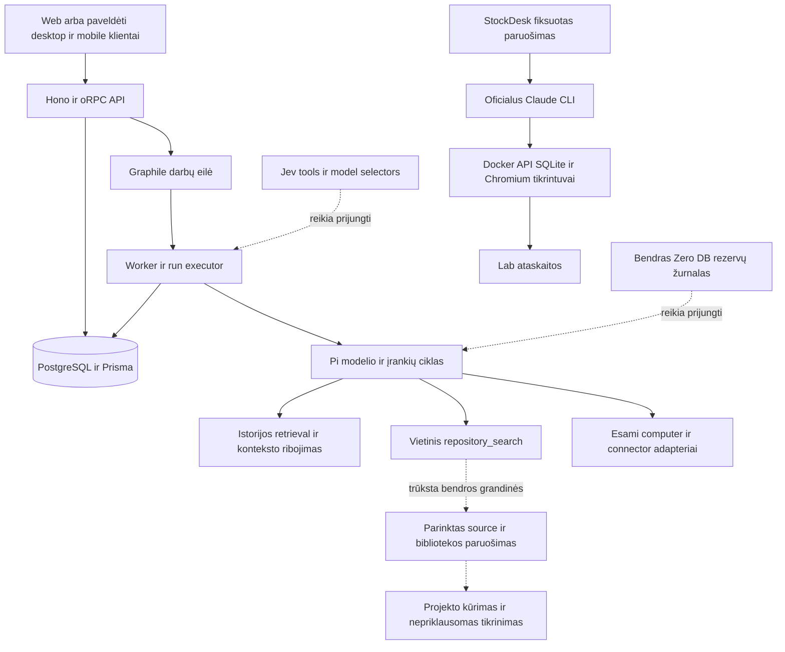

# RepositoryZero projekto analizė

2026-10-17. Analizuota `main` būsena `9728b797ae4a5b599d5b5c5a3486f06546961cf5`. [Patikrinti faktai, paieškos užklausos ir dokumentų aprėptis](../catalog/project-analysis-2026-10-17.json).

RepositoryZero turi tikrą pernaudotą agentų platformą, didelį šaltinių registrą ir veikiančią CLI eksperimentų laboratoriją. Pagrindinė produkto vertė priklauso nuo jų sujungimo: surasti tinkamą esamą sprendimą, pateikti modeliui reikalingą jo dalį, sukurti trūkstamą kodą ir patikrinti rezultatą. Ši bendra grandinė dar neužbaigta. Dabartiniai CLI rezultatai pagrindžia konkrečių konfigūracijų stebėjimus, o visos Zero sistemos pranašumą dar reikia išmatuoti.

## Produkto esmė

RepositoryZero kuriamas kaip viena darbo aplinka žmonių jau sukurtoms programoms, bibliotekoms, modeliams ir įrankiams panaudoti. Naudotojas aprašo rezultatą; sistema parenka vieną tinkamą pagrindą ir papildančius komponentus, sukuria trūkstamą dalį, pateikia veikiančius artefaktus ir jų patikras. Katalogas saugo nuorodas ir įrodymus, o reikalingas kodas gaunamas konkrečiam darbui. Visų katalogo repo atsisiųsti nereikia.

Antroji produkto dalis yra tęstinis bendras gerinimas: pasikartojanti klaida, atkūrimo pavyzdys, maža pataisa, patikra, priimtas leidimas ir kitos instaliacijos atnaujinimas. Vietinis naudotojo darbas, bendras projekto centras, vieši indėliai ir modelių mokymas turi atskiras duomenų bei teisių ribas. Bendro katalogo, receptų ir pataisų augimas savaime nekeičia modelio svorių.

Šią kryptį nuosekliai aprašo [PROJECT-V1](PROJECT-V1.md), [PROJECT-CREATION](PROJECT-CREATION.md), [SELF-REUSE](SELF-REUSE.md) ir [PLAN](../PLAN.md). Browser, PDF ir coding yra pirmi techninio MVP darbai. REA ir Treg išlieka numatyti privalomi platesnio produkto etapai. Media, CAD, cloud/Drive, bendruomenės portalas ir autonominė sklaida turi atskirus vėlesnius vartus.

## Esama architektūra

Pagrindas yra Rakazo `7d5e64c886da7d556673f99e4923b013315007a9` adaptacija kataloge `platform/`, su išsaugotais Apache-2.0 ir kilmės pranešimais. Joje yra šešios programos: web, API, worker, Electron desktop, Expo mobile ir Astro svetainė. Dvylika bendrų paketų apima kontraktus, duomenis, adapterius, UI ir testavimo priemones. Tai jau esantis platus produkto karkasas, kurio nereikia dar kartą kurti aplink CLI.

Ištisinės rodyklės rodo kode esančius kelius. Punktyrinės žymi dar reikalingą bendrą integraciją. Paveldėto kliento buvimas diagramoje nesuteikia RepositoryZero native OS priėmimo statuso.

Worker realiai sukuria `PiAgentRuntime`, Graphile publisher/host, executor ir reconciler. Executor prijungia `repository_search` ir reuse instrukciją, kai šis įrankis prieinamas. Run lease, fencing, ExternalEffect ir artefaktų versijos jau yra bazėje. Šias dalis reikia plėsti ir tikrinti viename vykdymo kelyje. [Worker](../platform/apps/worker/src/index.ts), [executor](../platform/packages/adapters/src/executor.ts), [eilė](../platform/packages/adapters/src/wakeup.ts), [duomenų modelis](../platform/packages/db/prisma/schema.prisma).

## Dalių parengtis

| Dalis | Kas jau yra | Kas dar nepriimta |
|---|---|---|
| Produkto bazė | Tikra Rakazo source adaptacija, bendri API/worker/DB/klientų sluoksniai | Pilnas RepositoryZero užduoties ciklas ir paskelbta palaikomo profilio matrica |
| Katalogas | Bendras app/site snapshot, read-only ekranas ir agento paieškos įrankis | Pilna capability taxonomy, sinonimai, tinkamumo filtrai ir užduočių radimo kokybė |
| Jev | SystemOne transportas, įrankių, modelių ir repo atrankos funkcijos ir jų offline patikros; atskiri gyvi Lab atsakymai | Šių selectors prijungimas prie produkto workerio ir jų naudos patvirtinimas |
| Modelio pasirinkimas | Esami provider/auth, vartotojo modelių ir fallback mechanizmai | Zero Jev Auto model kelias; dabartinės Haiku lenktynės modelio nekeičia |
| Biudžetai | Atominis DB account/lane rezervavimas ir atskiras konservatyvus Lab failo žurnalas | Visų realių modelio, retry, child ir kitų mokamų kvietimų sujungimas su bendra politika ir kvitais |
| Pernaudojimas | Rakazo bazė, įprastos dependencies, Hono paruošimo ir izoliuoto build pavyzdžiai | Bendras užduočiai pritaikomas source gavimo, bibliotekos paruošimo ir reuse plano kelias |
| Konteksto valdymas | Esamas Pi istorijos retrieval, ribojimas, struktūrinių rezultatų trumpinimas ir cache metaduomenys | Šio kelio nauda naujoms Zero coding užduotims; CLI bandymai jo nenaudoja |
| Testavimas | Reikšmingi offline testai ir tikri API/SQLite/Chromium Lab tikrintuvai | Kelių užduočių, nepriklausomo laikomo rinkinio ir viso produkto acceptance |
| Treg | Paveldėtas MCP preset ir bendras connector kelias | Konkretus Zero account/grant/budget profilis bei realaus scenarijaus acceptance |
| Svetainė | Septyni statiniai puslapiai, katalogas ir dokumentų eksportas susikompiliuoja | Viešas deploy, domain ir savarankiškas faktų publikavimo ciklas |
| Desktop ir mobile | Tikras paveldėtas kodas ir paketų mechanizmai | Zero release tapatybė, image/update kanalai, OS patikros ir pasirašyti leidimai |
| Bendruomenė ir centras | Portalų, kokybės, SAI, update, Video Hub ir sklaidos specifikacijos | Jų bendras produkcinis ciklas, VPS, priėmimas, signing ir rollout |

Tai parengties žemėlapis, todėl procentinis viso projekto užbaigtumas neskiriamas. Tūkstančio vienetinių testų buvimas ir vieno kritinio sujungimo nebuvimas nėra suderinami vienu prasmingu procentu.

## Katalogas ir Git repo paieška

Užfiksuotame indekse yra **796 įrašai, 757 pažymėti prieinamais tyrimo metu, 756 su 40 simbolių commit pin ir 67 kategorijos**. Tik **158 įrašai turi netuščią capability aprašą**, o 638 jo neturi. Tai 2026-10-16 šaltinių snapshot, o ne nauja visų adresų gyva patikra.

Dabartinis algoritmas normalizuoja užklausą, padalija ją pagal tarpus ir reikalauja, kad kiekvienas terminas būtų repo varde, kategorijoje, capability arba pastaboje. Rikiuojant daugiau svorio gauna vardo atitikimas, po to taikoma abėcėlė. Agentui grąžinami iki penkių kandidatų. Semantinių sinonimų, užduoties išskaidymo ir dokumentacijos fragmentų paieškos ši funkcija neturi. [Algoritmas](../platform/packages/core/src/zero-catalog.ts), [agento sąsaja](../platform/packages/adapters/src/zero-repository-tools.ts).

Tiesiogiai paleistos tos pačios funkcijos užklausos:

| Užklausa | Rezultatas |
|---|---|
| `csv`, `csv import`, `inventory`, `warehouse`, `sandėlio` | Nė vieno kandidato |
| `database`, `spreadsheet`, `tabular data`, `pdf tables` | Nė vieno kandidato |
| `sqlite` | sqlite-utils, SQLite ir sqlitebrowser |
| `agent platform` | Keturi kandidatai, tarp jų Rakazo |
| `docling`, `honojs/hono` | Atitinkamas žinomas repo |

Šie trylika diagnostinių pavyzdžių parodo konkrečias spragas; jie nėra pažymėtas recall benchmarkas. Katalogas gali rasti žinomą repo, tačiau žmogaus aprašyto darbo radimas dar silpnas. Jev negali atrinkti komponento, kuris nepateko į jo trumpą sąrašą.

Visų įrašų `runtimeTested` ir `licenseApproved` yra false. Tai saugus istorinio šaltinių registro statusas. Atskiros dabartinės Hono, produkto ir Lab patikros yra kituose ataskaitų failuose; šie nuliai nereiškia, kad visame projekte nebuvo testų. Jie rodo, kad bendro kokybės įrodymų prijungimo prie katalogo dar nėra.

## Kodėl StockDesk biblioteka neparodė pagrindinės idėjos

StockDesk paruošimas atlieka tris fiksuotas užklausas: `honojs/hono`, `sqlite`, `csv`. Pateikiamas patikrintas bendras Hono HTTP paketas ir trijų SQLite repo metadata. CSV kandidato nėra. Tai mažas vienkartinis paketas, kurį parengia bandymo skriptas. Claude CLI negauna gyvo Zero `repository_search` įrankio; jam nusiunčiamas paruoštas tekstas ir, pagal profilį, vendor failai. [Paruošimas](../platform/scripts/zero-stockdesk-prepare.mjs), [runneris](../platform/scripts/zero-stockdesk-run.mjs).

Jev prie 0,7 eksperimentinės ribos nieko neparinko. Deterministinio B varianto modelis Hono atsisakė ir panaudojo `node:http`. Pirmoje A/C poroje C neturėjo bibliotekos failų. Iš šių rezultatų negalima spręsti, kad repo kodas pagreitino kūrimą arba kad Jev netinka visiems kitiems atrankos darbams.

Pačioje produkto bazėje jau deklaruotas ir grafikų importui naudojamas **d3-dsv 3.0.1**. Jis nepateikiamas StockDesk variante. Tai konkretus turimo komponento atradimo ir paruošimo praleidimas. Vis dėlto tiesioginis `csvParseRows` bandymas priėmė tris StockDesk netaisyklingu laikomo CSV pavyzdžius: neužbaigtą kabutę, kabutę neapgaubtame lauke ir tekstą po uždarytos kabutės. Taigi ši biblioteka reikalautų papildomos validacijos arba kito parserio palyginimo prieš atitikdama griežtą importo kontraktą. [Esamas naudojimas](../platform/packages/core/src/plot/plot-spec.ts), [paketo pin](../platform/packages/core/package.json).

Naudingas naujas bandymas turėtų tikrinti bendro CSV komponento radimą, teisių ir versijos kilmę, jo tikrą paruošimą ir panaudojimą. Paruoštas komponentas turi likti bendros paskirties; StockDesk sprendimas ar jo tikrintuvo fixture neturi tapti paslėptu atsakymu kandidato pusėje.

## Jev ir jau turimas konteksto valdymas

`selectToolWithJev` ir `selectModelWithJev` už testų ribų rasti tik savo deklaracijose. `selectRepositoryWithJev` papildomai kviečiamas standalone patikros skripte. Produkto workeris jų nekomponuoja. Tai patikrintas kodo sujungimo faktas. Gyvi Lab paruošimai naudoja bendrą SystemOne transportą atskiru keliu. [Selectors ir jų kvietimo vietos](../catalog/project-analysis-2026-10-17.json).

Jev pagrįsta rolė yra siauras pasirinkimas iš jau tinkamo rinkinio: kelių repo, įrankių, dokumentų ištraukų arba leistinų modelių profilių. Vienas aiškus kandidatas gali būti parinktas be modelio. Confidence riba turi būti vertinama pagal klaidingus pasirinkimus ir praradimus, o ne derinama tam, kad Jev būtinai pasirinktų operatoriaus mėgstamą biblioteką.

Dviejų StockDesk Jev paruošimų provider pateikta bendra kaina yra 0,00030828 USD, o su ankstesne unikalia kalibravimo istorija — 0,000885234 USD. Tas pats leistas 1 USD žurnalas konservatyviai laiko rezervuotus 0,70 USD; rezervas nėra provider sąskaita ir neatkuriamas naujam bandymui. Šiuose bandymuose svarbiausias Jev klausimas yra tinkama atranka ir jos poveikis rezultatui. [Apskaita](../catalog/stockdesk-results-2026-10-17.json).

Rakazo bazėje jau yra svarbi optimizavimo dalis: `retrieval` yra bendras numatytasis konteksto profilis, o `runtime-context` ir `context-selection` riboja istoriją bei išlaiko struktūrinius įrankių rezultatus. Yra `ModelCallObserver.beforeCall/afterCall` sąsaja rezervui prieš kvietimą ir faktiniam naudojimui. Dabartinis workeris sukuria Pi be šio observerio. Šios esamos ribos tinkamos tolesniam bendram biudžeto sujungimui; naujo atskiro viso konteksto engine nereikia pradėti nuo nulio.

Šioje analizėje 49 konteksto patikros praėjo, įskaitant keturis tikro Pi ir lokalaus modelio emuliatoriaus scenarijus. Paveldėtuose istorijos dokumentuose yra ir mokamų eksperimentų bei nesėkmių, tačiau jų modeliai, užduotys ir source skiriasi nuo Zero Haiku lenktynių. Jų dolerių ir pagerėjimo skaičiai šiai užduočiai neperkeliami. [Konteksto tipai ir observeris](../platform/packages/adapter-kit/src/types.ts), [politika](../platform/packages/adapters/src/runtime-context.ts), [paveldėtų eksperimentų ribos](../platform/docs/evals/history-findings.md).

## Ką rodo dabartinės lenktynės

| Eksperimentas | Faktas | Leidžiama išvada |
|---|---|---|
| SprintDesk katalogo pakartojimai | 6/6 PASS; trial mediana −0,58 %, tokenai +10,09 % | Statinis katalogo priedas šioje kohortoje neparodė reikšmingo bendro pagreitėjimo |
| SprintDesk compact | Compact 2/3 PASS; viena UI nesėkmė ir laiko vientisumo problema | Mažesnis tokenų skaičius nesuteikia vienodos kokybės pergalės |
| SprintDesk lean-low | 6/6 PASS; trial sumos −61,61 %, API kainos ekvivalentas −68,69 % | Perspektyvi konkrečios užduoties CLI konfigūracija; kartu keisti effort, sisteminis promptas ir įrankiai, Jev ir biblioteka nenaudoti |
| StockDesk pirmas A/C | 2/2 PASS, vienoje poroje C kūrimas 11,84 % trumpesnis; C negavo bibliotekos | Vienas tiriamojo palyginimo stebėjimas; senesnio CLI kaina nevaliduota |
| StockDesk palaikomo CLI B/C v1 | B filtro grupė nepraėjo, C PASS; v1 reikalavimas buvo dviprasmis | Pora nelyginama kaip greičio ar kainos pergalė |
| StockDesk v2 | Patikslintas promptas ir semantinis CSV tikrintuvas; 18/18 kontrolinių regresijų PASS | Tikrintuvas paruoštas naujam eksperimentui; naujų v2 modelio programų dar nėra |

Keturių StockDesk programų apskaita yra 14 559 828 tokenai, iš jų 13 472 324 cache read ir 513 979 output. Šis skirtingų kohortų ir CLI versijų bendras kiekis yra apskaita, o ne vienas palyginimas. Cache read sudaro apie 92,53 % visų tokenų; bendra suma nėra tiek unikalių naujai išsiųsto teksto tokenų ar vienodo tarifo išlaidų. Faktinis Claude prenumeratos mokestis vienai užduočiai nežinomas. [SprintDesk rezultatai](CLAUDE-CALIBRATION.md), [StockDesk rezultatai](STOCKDESK-CALIBRATION.md).

Automatinis PASS apima deklaruotus API, SQLite ir dviejų viewport klaviatūros srautus. Pirmos StockDesk poros vaizdų peržiūra parodė mobile lentelių skaitomumo ribas. Palaikymas, kodo priežiūros patogumas, pilnas saugumas ir plati subjektyvi UX kokybė iš šio PASS neišvedami.

## Stiprios projekto dalys

Pasirinkta tikra esama produkto bazė. Joje jau yra būsenos tęstinumas, kompiuterių adapteriai, istorija, autentifikacijos ir artefaktų mechanizmai. Vieno vykdymo autoriteto taisyklė leidžia tuo pasinaudoti nesukuriant dviejų lygiagrečių produktų.

Lab turi naudingą discipliną: prieš bandymą užfiksuoti promptai ir source hash, atskiros kūrimo bei tikrinimo trukmės, išlaikytos nesėkmės, graderio kontrolės ir kainos unknown būsena. Šią metodiką verta perkelti į bendrą produkto kelią. Katalogo source-only statusai ir notices taip pat neapsimeta neišbandytomis integracijomis.

## Svarbiausios spragos ir prioritetai

| Eilė | Spraga ir poveikis | Konkretus kitas rezultatas |
|---|---|---|
| 1 | Užduoties paieška praleidžia tinkamų komponentų klases; Jev gauna silpną sąrašą | Mažas LT/EN užduočių rinkinys, source pagrįsti aprašai, sinonimai ir tinkamos alternatyvos arba aiškus missing |
| 2 | Nėra bendro reuse plano ir pasirinkto source paruošimo kelio | Vienas komponento pasirinkimas su pin/licencija, ribotu source gavimu, build ir patikros artefaktu |
| 3 | Produkto ir Lab keliai atsiskyrę, todėl matuojama tik dalis vertės | Bendras paruošimo ir tikrinimo servisas, kurį naudoja CLI ir esamas workeris; vienas scheduler |
| 4 | Jev ir bendras finansinis žurnalas nekomponuoti su produkto kvietimais | Prieš kiekvieną leistiną mokamą kvietimą tikras account/lane rezervas, usage receipt ir išlaikytas unknown |
| 5 | Root `.github/workflows` nėra; 12 workflow failų yra po `platform/` | Saugyklos šaknyje atskiras Zero CI su tinkamu working-directory, generavimu, tiksliniais testais ir builds |
| 6 | Native platinimas dar turi Rakazo tapatybę ir kanalus | Prieš Zero paketą nustatyti savo app/release/image kanalus ir realiai patikrinti pasirinktos OS kelią |
| 7 | Dokumentuose maišosi senų etapų dabarties teiginiai | Vienas aktualios būsenos įėjimas, datuoti istoriniai įrodymai ir tiesioginės nuorodos į naujausią etapą |
| 8 | Dvi coding užduotys ir maži pakartojimai neaprėpia bendro produkto naudos | Naujos užduotys, atskiras laikomas rinkinys, vienoda kokybės kartelė ir visos darbo eigos sąnaudos |

Paveldėtas `ci.yml` turi ir publikavimo bei produkcijos veiksmų. Jo paprastas perkėlimas į root būtų netinkamas trumpinys; Zero patikroms reikia atskiro siauro CI. GitHub combined-status užklausa analizuotam commit grąžino tuščią statusų sąrašą; tai papildoma siaura status API patikra. [Paveldėtas CI](../platform/.github/workflows/ci.yml).

Desktop `package.json` vis dar turi Rakazo produkto vardą, app ID ir upstream GitHub publish tikslą. Į paketą kopijuojama Compose konfigūracija pagal nutylėjimą nurodo upstream Rakazo images. Tai išleidimo paruošimo darbas prieš skelbiant Zero diegiklį. [Desktop manifestas](../platform/apps/desktop/package.json), [images Compose](../platform/infra/compose/docker-compose.images.yml).

Kodo priežiūrai svarbios didelės bendros vietos: executor turi 8 950, API router 7 086, Pi runtime 3 008 eilutes. Tai analizės apimties ir integravimo kainos signalas. Toliau verta pridėti plonas aiškias esamų sąsajų jungtis; viso vykdiklio perrašymas kartu su optimizavimo eksperimentu apsunkintų rezultatų paaiškinimą.

Dokumentacijos drift pavyzdžiai: `IMPLEMENTATION` pakartojimų eilutė dar nurodo NOT_RUN, `JEV-APPLICATIONS` aprašo ankstesnį tinklo bloką, o `ZERO-LAB` dalys teigia, kad gyvų Jev profilių dar nėra. Naujesni kalibravimo failai ir išsaugotos ataskaitos jau turi vėlesnius faktus. Istorinius bandymus reikia išlaikyti, o dabartinę būseną rodyti atskirai.

## Tolimesnė įgyvendinimo seka

Pirmiausia užbaigti vieną mažą tikrą reuse kelią. Tinkamas atvejis yra CSV importas į esamą programą: aiškus reikalavimas, paprastas esamo parserio radimas, realios suderinamumo problemos ir nepriklausomas teisingumo patikrinimas. Priėmimas apima radimą iš užduoties, pin ir notices, bendro komponento paruošimą, tikrą panaudojimą, griežtą validaciją ir patikrintą programos artefaktą. Nepanaudota pasiūlyta biblioteka lieka užfiksuotu atsisakymu, o jos buvimas kataloge netampa reuse sėkme.

Tada tą patį kelią prijungti prie esamo workerio ir bendrų rezervavimo bei usage sąsajų. Panaudoti turimą `repository_search`, Pi konteksto politiką, modelio observerį, DB rezervų primitives ir Lab tikrintuvus. Jev įjungti ten, kur liko prasmingas semantinis pasirinkimas. Privataus darbo turinys netampa bendro katalogo medžiaga be atskiro pasirinkimo.

Po šio sujungimo naujas palyginimas turėtų turėti tris aiškiai versijuotus profilius: tas pats Haiku 5.5/high; tas pats modelis su deterministiniu tinkamų komponentų retrieval; tas pats retrieval su Jev atranka. Modelis, effort, užduotis ir tikrintuvas išlieka vienodi. Matuoti pirmo source gavimo bei pakartotinio naudojimo laiką atskirai, įtraukti atranką, build, coding, tikrinimą ir taisymus. Atranką patvirtinti naujomis kaitaliojamomis poromis ir kitais darbais: nauja programa, pakeitimas esamoje programoje ir klaidos taisymas. Fiksuoto 50 % tikslo šiam etapui nėra.

Browser/PDF, REA ir Treg toliau tikrinami pagal savo MVP vartus. Viešas portalas, Video Hub, media, cloud/Drive ir plati autonomija gali augti remdamiesi veikiančia bendrąja grandine. Jų dokumentai išlaiko ilgalaikį tikslą, tačiau papildomos jų funkcijos nepakeičia trūkstamo pagrindinio reuse rezultato.

## Patikros ir analizės aprėptis

Inventorizuotas 2 221 sekamas failas ir 101 Markdown dokumentas, apie 1,76 MB Markdown. Išsamiai perskaityti 52 pagrindiniai produkto, architektūros, parinkimo, biudžetų ir kalibravimo dokumentai; keturi papildomi dokumentai peržiūrėti tikslinėse dalyse. Likę pažymėti kaip struktūros ir inventoriaus peržiūra. Istorinės TOP100 ir visos 757 išorinės saugyklos šioje analizėje iš naujo neaudituotos. Pagrindiniai vykdymo, atrankos, konteksto, UI ir platinimo kodo keliai susieti su dokumentų teiginiais. Tiksli failų klasifikacija ir SHA yra [JSON ataskaitoje](../catalog/project-analysis-2026-10-17.json).

| Šios analizės patikra | Rezultatas |
|---|---|
| Foundation | 98/98 testai, 10 failų |
| Dešimties CLI/Lab failų offline rinkinys | 119 PASS, 1 aiškiai praleista pasirenkama Docker kontrolė, 0 FAIL |
| Konteksto atranka ir tikras Pi su emuliatoriumi | 49/49 testai, 3 failai |
| Web ir adapters TypeScript | PASS |
| Web ir Astro build | PASS; web build įspėjo apie 770,86 kB pagrindinį JS chunk |
| Vietinių Markdown nuorodų failų taikiniai | 0 trūkstamų; išoriniai URL ir anchors nevertinti |
| Nauji mokami modelio/API kvietimai | 0 |

Pirma foundation užklausa turėjo 85 praėjusius testus ir vieną neužsikrovusį rinkinį dėl nesugeneruoto Prisma kliento. `npm run db:generate` paruošė klientą ir tas pats nepakeistas rinkinys praėjo 98/98. Švari aplinka turi šį paruošimo žingsnį įtraukti į atkūrimo kelią.

Anksčiau šiame darbo etape atliktos StockDesk v2 Docker kontrolės 18/18 išsaugotos atskirai. Istorinės keturios executor ir šešios biudžeto PostgreSQL patikros šiame architektūros perėjime nekartotos: šiame checkout nėra vietinio DB profilio. Testų grupių skaičiai nėra tiek sugeneruotų programų ar tiek bendro produkto acceptance užduočių.

Sekamų failų turinys užima 46 393 396 baitus. Dabartiniame vystymo checkout `platform/node_modules` užima apie 1,45 GB, `.cache` apie 115 MB, `.git` apie 24,7 MB. Tai vietinės vystymo aplinkos dydžiai. Produkto 2 GB cold-install, Docker/runtime, naršyklės, DB ir update piko vartui dar reikalingas švaraus host matavimas.
