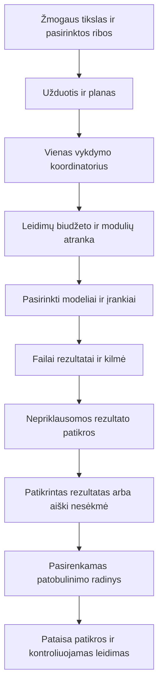

# RepositoryZero — projekto V1 dokumentacija

**Dokumentacijos versija 1.0 · 2026-10-16 · Europe/Kiev.** Tai pirmas bendras jau sutartos produkto vizijos ir veikimo paaiškinimas. Dokumentacijos numeris nėra išleistos programos versija. **MVP pradėtas: pirmas read-only katalogo, UI temos ir vietinės svetainės pjūvis įgyvendintas. Pilnas agento vykdymas, integracijų acceptance, public svetainė ir VPS dar nepaleisti.** [Aktuali įgyvendinimo būsena](IMPLEMENTATION.md). Toliau aprašomas numatytas produktas, o ne jau patikrintos runtime funkcijos.

> **One open core. A world of AI tools.**
>
> Vienas atviras branduolys, kuris padeda atrasti, pasirinkti, sujungti ir patikrinti tinkamus AI įrankius bei dalytis pagrįstais jų patobulinimais.

GitHub repo dabar vadinasi `superintelligence`. **RepositoryZero** – naudotojo pasirinkta darbinė viešo produkto pavadinimo kryptis. Domeno nuosavybė ir prekės ženklas dar netikrinti.

## 1. Kas tai yra

RepositoryZero kuriamas kaip bendra darbo aplinka programuotojams, vibe koderiams ir kitiems žmonėms, kurie nori gauti konkretų rezultatą panaudodami tinkamus esamus įrankius. Žmogus aprašo, ką nori padaryti. Sistema padeda rasti jau egzistuojančius sprendimus, palygina jų tinkamumą, sudaro darbą, paleidžia leistinus modulius ir patikrina rezultatą.

Svarbiausia produkto mintis: **AI pirmiausia panaudoja tai, ką žmonės jau sukūrė ir išbandė, tada kuria trūkstamą dalį.** Neaklai išradinėti dviratį, o atrasti tinkamą pagrindą ir komponentus, apie kurių egzistavimą gal net nežinojai.

[Projekto kūrimo eiga](PROJECT-CREATION.md): žmogaus tikslas → esamų sprendimų palyginimas → viena tinkama bazė ir ją papildantys komponentai → kūrimas → patikra. Bendruomenės realaus naudojimo/review/release įrodymai turi kilmę, datą ir scope; populiarumas vienas neįrodo tinkamumo, o mūsų konkrečią integraciją tikriname atskirai.

Todėl repo katalogas yra tik viena dalis. Tikslinis produktas sujungia tris darbus:

1. **Atradimas ir pasirinkimas:** kas egzistuoja, kuo skiriasi, ar tinka tavo užduočiai, įrangai ir biudžetui.
2. **Atlikimas ir patikra:** kaip saugiai prijungti pasirinktą įrankį, panaudoti jį tikram darbui ir įrodyti rezultatą.
3. **Bendras augimas:** kaip contributor pateikia gerą modulį ar pataisą, sistema jį patikrina ir naujas patikrintas leidimas pasiekia kitus.

Pasaulio AI įrankių branduolys yra ilgalaikė kryptis. Faktinę aprėptį rodys konkrečių versijų katalogas ir įrodymai. Universalios superintelekto architektūros ar visų GitHub projektų išsamios aprėpties šiame tyrime neįrodėme.

## 2. Kokias problemas sprendžiame

| Problema | Kaip padeda numatytas RepositoryZero | Nauda žmogui |
|---|---|---|
| Pradedi rašyti funkciją nuo nulio, nors yra tinkama biblioteka ar produktas | Ieško pagal norimą darbą, pateikia esamus kandidatus, jų skirtumus ir build-vs-adapt pagrindą | Mažiau dubliuojamo kūrimo ir greitesnis kelias iki veikiančio rezultato |
| Net nežinai, kad egzistuoja naudingas įrankis ar gebėjimas | Nuolat atnaujinamas discovery, užduočių/capability žemėlapis ir alternatyvos | Atsiranda pasirinkimų, kurių pats nebūtum ieškojęs tinkamais raktažodžiais |
| Daug stars ir gražus README nepasako, ar veiks tau | Rodo licenciją, parengtį, konkrečią versiją, OS/resursus ir realius testus, kai jie atlikti | Gali spręsti pagal savo situaciją ir matyti nežinomus dalykus |
| Keli panašūs įrankiai, sunku išrinkti | Vienas gebėjimas, keli pagrįsti adapteriai/profiliai ir palyginimo įrodymai | CPU/offline, LT, GPU ar hosted pasirinkimas pagal darbą |
| Integracijos reikalauja skirtingų API, config, auth ir aplinkų | Bendras modulių kontraktas, credentials/permissions brokeris, atskiros aplinkos ir vedlys | Mažiau atsitiktinio klijavimo ir lengviau pakartoti darbo eigą |
| AI sako „baigta“, bet programa neveikia ar rezultatas neteisingas | Domeno tikrintojai, testai, artefaktai ir aiški verified/failed/unknown būsena | Matomas faktinis rezultatas ir kur dar trūksta įrodymų |
| Upstream atnaujinimas sugadina anksčiau veikusią jungtį | Užfiksuotos versijos, watcher, isolated update testas, canary ir atkūrimas | Rutininė priežiūra mažiau gula ant kiekvieno naudotojo |
| Kiekvienas vibe koderis atskirai taiso panašią problemą | Savanoriška shared improvement eiga, dedup/leases, nepriklausoma patikra ir release | Vienas pagrįstas patobulinimas gali padėti daugeliui |
|1000pateiktų nuorodų gali išeikvoti tokenus | Pirmos pakopos be LLM, cache, ribotos eilės ir globalus mokamų kvietimų biudžetas | Augimas nepriverčia apmokėti kiekvienos paraiškos gilios AI analizės |

Tai vertės hipotezės, kurioms roadmape paskirti bandymai. Sutaupytų valandų, pinigų ar pranašumo procentų dabar neišgalvojame.

## 3. Kam skirta ir kokią vertę duoda

### Programuotojui

Gali pradėti nuo klausimo „kas jau tai sprendžia?“ ir gauti konkrečių įgyvendinimo variantų. Matytų kandidatų kilmę, API kelią, licencijos/duomenų/weights ribas, realų integracijos pavyzdį ir parengtį. Jei tinkama naudoti esamą sprendimą, gali koncentruotis į savo produkto išskirtinumą; jei trūksta funkcijos, kurti mažą adapterį ar pagrįstą pataisą.

Contributor gali pateikti savo repo, matyti vertinimo priežastį ir gauti kelią iki integracijos. Jo autorystė ir upstream attribution išlaikomi. Patikrintas modulis gauna savo viešą kortelę ir pasirinktiną integracijos ženklelį; populiarumas ar reklamos sutikimas nėra priėmimo sąlyga.

### Vibe koderiui

Gali aprašyti norimą veikiančią funkciją ar produktą, o sistema padėtų išskaidyti jį į užduotis ir parinkti jau egzistuojančius gebėjimus. Matytų, kuris darbas vykdomas, kur reikia jo pasirinkimo, kokie failai sukurti ir kas iš tikro patikrinta. Išmokti visų frameworkų iš anksto nebūtų būtina, tačiau svarbūs leidimų, duomenų ir kaštų pasirinkimai liktų aiškūs.

Svarbi nauda – ne vien sugeneruotas kodas. Tai atkuriamas rezultatas, kuris turi testą, versijas, paaiškintą klaidą ir tolesnės priežiūros kelią. Naudojantis galima savanoriškai pateikti tinkamai nuasmenintą radinį ar mažą pataisą bendram projektui; privatus darbas pats neviešinamas.

### Open-source kūrėjui

Jo įrankis gali tapti konkretaus darbo grandinės dalimi, turėti naudojimo receptą, contributor/test ataskaitą ir naują naudotojų kelią. Gali siūlyti integraciją, patikslinti jos aprašą, pataisyti adapterį ir pasirinkti partnerystę/README ženklelį. RepositoryZero nekeičia jo repo vien dėl to, kad jis prisijungė ar buvo atrastas.

### Kitiems naudotojams ir turinio kūrėjams

Tyrėjas ar analitikas galėtų gauti šaltiniais pagrįstą ataskaitą, dokumentų naudotojas – patikrintą CSV iš PDF, kūrėjas – pasirinkto voice/media pipeline rezultatą. YouTube kūrėjas turėtų atkuriamas demonstracijas ir viešą Video Hub, kur bendruomenė gali rasti pamokas, use cases, integracijų istorijas ir pagrįstą kritiką.

## 4. Kaip atrodytų kasdienis naudojimas

**Pavyzdys – nori sukurti lietuviškai kalbančią programą.**

1. Aprašai funkciją, platformą, savo įrangą, privatumo ribą ir biudžetą.
2. Sistema parodo, kad darbui reikia STT, TTS, programos sąsajos ir galbūt konkrečių kitų įrankių; pateikia esamus tinkamus kandidatus ir ko dar nepatikrino.
3. Pasirenkamas įrangai tinkamas patikrintas profilis arba pradedamas kandidato vertinimas. Nežinoma LT kokybė nėra paslepiama angliško benchmark balu.
4. Įdiegiami tik reikalingi leistini moduliai, ne visas katalogas. Pasirinktas modelis ir paskyros prijungiami atskirai.
5. Branduolys koordinuoja kūrimo ir bandymo žingsnius. Matomi failai, veiksmų istorija, sąnaudos ir užbaigimo įrodymai.
6. Jei randamas konkretus adapterio defektas, gali būti parengta izoliuota pataisa ir, pasirinkus contribution profilį, pateikta bendrai patikrai.

**Kitas pavyzdys – „padaryk man PDF lentelių analizę“.** Sistema pirmiausia įvertintų tinkamą parserį ir jau esamą receptą, išsaugotų originalą bei išgautą CSV/JSON, patikrintų skaičius ir parodytų šaltinio puslapius. Nesėkmingas išgavimas būtų parodytas kaip nesėkmė ar nepatikrintas rezultatas.

Darbo langas artimas naudotojo pateiktai Codex struktūrai: kairėje projektai/istorija, centre pokalbis ir progresas, dešinėje prireikus rezultato/diff/PDF/media peržiūra, apačioje užduotis/modelis/priedai. [Darbo erdvės maketai](UI-WORKSPACE.md) aprašo išdėstymą, juodą/salotinę default temą, vėlesnių temų pagrindą ir MVP ribą. [UI bazės sprendimas](UI-FOUNDATIONS.md): pirmiausia pernaudojamas Rakazo React workspace, OpenCode UX principai, vienas autoritetingas runtime.

**Pavyzdys „sukurk buhalterinę programą“:** išsiaiškinama šalis/apimtis, palyginamas esamas pagrindas, sąskaitų/PDF ir importo komponentai, tada kuriamas sutartas pjūvis. Centre pokalbis ir darbas, dešinėje kuriamos programos preview/testai; demonstracinis sąskaitų sąrašas nėra pilno apskaitos atitikimo įrodymas. [Konkreti eiga](PROJECT-CREATION.md).

Tai numatyti scenarijai. Dabartiniame repo jų runtime demonstracijų nėra; pirmi [užduočių receptai ir acceptance](SCENARIOS.md) dar laukia įgyvendinimo.

## 5. Katalogas, modulis ir modelis

**Kandidatas** – atrastas ar pateiktas projektas, kurį dar reikia įvertinti. Viešas GitHub repo savaime neįrodo open-source teisių ar tinkamumo.

**Modulis** – konkretus už bendro kontrakto prijungtas gebėjimo įgyvendinimas: biblioteka, CLI, atskiras worker/servisas ar API/MCP jungtis. Turi savo source/package pin, aplinką, permissions, kaštus, testus ir parengtį. Keli moduliai gali įgyvendinti tą patį gebėjimą skirtingiems profiliams.

**Modelis** – pasirenkamas teksto/kodo/garso/vaizdų ar kitos inferencijos variklis. Jis gali būti hosted provideris ar vietinis endpointas. Programa suteikia jam konkrečius darbo įrankius, o atskiras branduolys sprendžia leistinus veiksmus ir biudžetą. Modelių prijungimas ir įrankių prijungimas yra skirtingi sluoksniai.

**Verified integracija** – konkretus modulio leidimas su nurodyta upstream versija, platforma ir priėmimo įrodymais. Naujas upstream HEAD nepaveldi statuso. **Recommended** būtų papildoma pagrįsta rekomendacija tinkamam darbo profiliui. Nėra vieno amžinai „geriausio viskam“ įrankio.

## 6. Kaip atrandame tai, ko pats nebūtum radęs

Paieška remiasi norima užduotimi ir trūkstamu gebėjimu, ne vien konkretaus repo pavadinimu. Discovery ciklai apima populiarius, naujus ir nišinius projektus, alternatyvas, mokslinius/science/engineering įrankius, dokumentus, coding, kalbą, vaizdus/video ir kitus jau sutartus profilius.

Sukauptas pradinis baseinas: **806 adresų patikros,757 unikalūs prieinami repo**,796 registro įrašai įskaitant neišspręstus adresus; media registre197 įrašai. Tai source discovery apimtis, ne tiek integracijų ar pilnų kokybės auditų. Pradinė100 dokumentinė imtis išsaugota istorijai; naujiems kandidatams balų neišgalvojome. Katalogo skaičiaus lubų nėra, o kiekvieno tyrimo vykdymas turi resursų ribą.

Panašiems kandidatams reikia parodyti delta. Jei vienas geresnis LT, kitas CPU/offline, abu gali turėti savo vietą. Tą patį repo kitu URL sujungiame į kanoninį įrašą; skirtingų įrankių nesujungiame vien dėl panašaus aprašo. Neįrodytas skirtumas lieka experimental/inconclusive. Galutinis pasirinkimas remiasi licencijų/teisių vartais ir realių darbų palyginimu.

Nėra garantijos, kad viskas GitHub jau rasta. Tai nuolat plečiama ir peržiūrima žinių bei įgyvendinimų bazė. [Kandidatų registras](research/CANDIDATE-POOL.md), [atrankos taisyklės](MODULE-SELECTION.md), [media programa](research/MEDIA-CANDIDATES.md).

Žmogus galėtų naršyti **sritis → gebėjimas → darbo receptas** arba ieškoti savo žodžiais. Pavyzdžiui, „reikia crypto boto“ parodytų rinkos duomenis, strategijų/backtest ir paper trading įrankius, API jungtis bei stebėseną. Filtrai padėtų pasirinkti įrangai, kainai, licencijai ir leidimams tinkamą profilį. Matytųsi, kas tik kandidatas, o ką AI jau gali vykdyti konkrečioje instaliacijoje. „Geriausias“ reikštų pagrįstą fit šiam darbui; realūs finansiniai veiksmai turi atskirą grant. [Platus kategorijų karkasas ir paieška](TOOL-DIRECTORY.md).

## 7. Kas vyksta programos viduje

Vienas autoritetingas koordinatorius valdo užduoties žingsnius ir patvarią būseną. Specializuoti moduliai turi savo aplinkas ir aiškias įvesties/išvesties schemas. Failai ir rezultatai registruojami kaip versijuoti artefaktai su kilme. UI rodo tikrą progresą, atšaukimą ir klaidos priežastį.

Leidimų ir biudžeto brokeris prieš veiksmą tikrina konkrečias teises, paskyrą ir resursų rezervą. Modelio confidence ar kito agento sutikimas šių vartų nepakeičia. Timeout po galimo išorinio veiksmo nėra automatinis leidimas kartoti siuntimą/mokėjimą/PR. Toks atvejis turi atskirą faktų patikrą ir unknown būseną.

Pirma vertinama Rakazo adaptacija/fork kaip produkto bazė, alternatyva – mažas Python branduolys; galutinis pasirinkimas tik po P0 palyginimo. Nekuriame dviejų bendrų schedulerių ar UI vienu metu. [Architektūros planas](../PLAN.md), [kontraktai](CONTRACTS.md), [vertinimas](VALIDATION.md).

Kad agentas rastų reikiamą įrankį, jis kreiptųsi į bendrą **capability/tools/skills registrą**. Tool yra veiksmas, modulis – jo įgyvendinimas, skill – darbo receptas. Resolver atrenka mažą šiai užduočiai tinkamą rinkinį, įkelia tik reikalingą schemą ir per brokerį tikrina vykdymo teises bei kainą. Visų tūkstančių tools nededame į kiekvieną prompt; missing įrankio nepakeičiame išgalvotu pavadinimu. [Tiksli agentų atrankos sistema](AGENT-CAPABILITIES.md).

Greitam semantiniam pasirinkimui **MVP naudotojas pasirinko TypeSafe Jev per savo OpenRouter paskyrą**, su atskirai prijungtu secret ir baigtiniu spend cap. Deterministinis indeksas/rules lieka prieš jį ir palyginimo baseline; **Laya** – vėlesnis vietinis profilis. Tai keičiamas siauras selector, ne pagrindinis generuojantis modelis ar leidimų/biudžeto autoritetas. Laya kodo ir Jev SDK entrypoints rasti, tačiau tikslus OpenRouter actual account/model/rates, runtime kokybė ir Laya weights/resursai dar nepatikrinti. OpenCode gali būti vienas integravimo klientas; produkto neturi pririšti prie jo. [Routerių tyrimas ir P0 bandymas](ROUTER-EVALUATION.md).

## 8. Localhost programa ir nuolatinis projekto centras

**Naudotojo programa:** pirmiausia localhost, vėliau Windows/macOS/Linux paketai. Joje atliekami jo darbai, saugomi failai, credential bindings ir istorija. Įdiegti patikrinti moduliai parenkami pagal poreikį ir jo leidimus. Windows.exe ar Mac paketas savaime neatstoja pasirenkamam sunkiam moduliui reikalingos įrangos/VM.

**Bendras projekto centras:** numatytas nuolatinis VPS coordinator, centrinė PostgreSQL ir atskiri pagal poreikį paleidžiami izoliuoti workeriai/CI. Jis prižiūri kandidatūras, upstream, PR/testų/release eilę ir svetainės public faktus net tada, kai naudotojo kompiuteris išjungtas. LLM nekviečiamas vien dėl to, kad VPS veikia.

Išjungtas PC vietinių užduočių nevykdo ir tuo metu neatsinaujina. Paleidus galima tęsti iš patvarios būsenos; fono/autostart elgesys turi atskirą pasirinkimą. Centro outage nesuteikia naujų teisių ir savaime nesunaikina jau leistinų vietinių darbų. VPS ir infrastruktūra turi savo hosting/DB/backup kaštus; no-token režimas nereiškia visos infrastruktūros nemokamumo.

Debesyje kuriami projektai taip pat reikalavimas: remote runtime vykdo kodą/testus, Google Drive profilis saugo pasirinkto projekto snapshotus. [Cloud darbo vietos planas](CLOUD-WORKSPACES.md); tai atskiras dar neįgyvendintas etapas.

## 9. Kaip projektas auga ir atsinaujina

GitHub prisijungęs žmogus pateikia savo arba aiškiai community pažymėtą public repo. Sistema normalizuoja tapatybę, ieško dublių, vertina užduotį/delta/licenciją/permissions ir skiria ribotą tikslinį testą. Tik išbandytas adapterio release gali tapti patikrinta integracija. Login nėra automatinis write ar merge leidimas.

Norintis prisidėti naudotojas gali leisti mažą pataisos darbą ar PR pagal konkretų profilį ir biudžetą. Autorius, reviewer ir evaluator turi atskirus kontekstus; acceptance remiasi trusted taisyklėmis. Leistinos kategorijos po piloto galės būti priimamos ir išleidžiamos automatiškai, o teisių/raktų/politikos/esminių migracijų pakeitimai turi atskirą įgaliotą kelią.

Atnaujinus upstream repo, watcher siūlo naują kandidatą: tikras diff, licencijos/deps/hooks ir API skirtumai, isolated regression testas, canary, pasirašytas release. Įprastas user gauna priimtą suderinamą update; vykstanti užduotis išlaiko savo pin iki saugaus taško. Nepasileidus naujai app, nepriklausomas supervisor gali atkurti ankstesnį dar patikimą ir DB schemai tinkamą leidimą, išsaugodamas duomenis. Nesaugus revoked target nėra fallback.

Taip „autonomiškai auga“ reiškia kontroliuojamą darbų ir leidimų eigą, ne neribotą savavališką savęs perrašymą. [Autonomija ir atnaujinimai](AUTONOMY-AND-UPDATES.md), [repo portalas](CONTRIBUTOR-PORTAL.md).

## 10. Modeliai, Treg ir paskyros

Numatomas vienas modelių prijungimo vaizdas: OpenAI API, Anthropic API, OpenRouter, lokalūs ir kiti oficialiai palaikomi adapteriai. Konkretus providerio modelis, capabilities ir sąnaudos turi būti patikrinti. OAuth naudojamas tik ten, kur oficialiai leidžiamas mūsų klientui; ChatGPT ar Claude prenumerata nėra automatinis visų API modelių kreditas. OpenCode tirtas kaip agento/providerių modelio pavyzdys, ne mūsų produkto įgyvendinimas.

Treg yra privaloma planuojama MCP/HTTP įrankių jungtis. Agentas rastų ir įkeltų tik užduočiai reikalingų endpointų schemas, vykdytų tik leistinus veiksmus. Vartotojo minėtas2800+tools skaičius gyvai nepatvirtintas; perskaitytas skill mini apie2600endpointų. Katalogo dydis nesuteikia visų provider paskyrų, write teisių ar nemokamo API.

Website GitHub login skirtas contributor identity/repo/video/votes. Modelių inferencijos, Treg/downstream, el. pašto, GitHub PR ir kitų veiksmų teises prijungiame atskirai. Raktai lieka credential brokeriui, ne pokalbio tekstui, viešiems PR ar bendruomenės puslapiams. [Modelių ir įrankių specifikacija](MODELS-AND-TOOLS.md).

## 11. Oficiali svetainė ir bendruomenė

Svetainė numatyta nuo pradžios. Vizualinė kryptis – išZeroaugantis pasaulinis gyvas tinklas; dekoratyvūs mazgai neapsimeta tikromis privačių kompiuterių vietomis. Faktai ir skaitikliai iš tikrų datuotų duomenų.

Numatytas produkto ir svetainės pagrindinio MVP UI rinkinys – **anglų, rusų, ispanų, kinų supaprastinta, lietuvių, vokiečių, prancūzų ir portugalų Brazilijos**. Technical docs pradžioje EN/RU, kitoms trumpas quickstart su aiškia aprėptimi; nauji locale papildomi paketais. Stabilūs kodo/API/capability identifikatoriai anglų kalba; AI pokalbio kalba pasirenkama atskirai, o modelių ir TTS/STT realus kalbų palaikymas turi savo testus. [I18n ir kalbų apimtis](LANGUAGES.md).

Joje būtų: projekto paaiškinimas, architektūra/roadmap, visas viešų integruotų modulių katalogas, atskiras kandidatų explorer, version/upstream būsenos, įrodymai, changelog, contribution, paramos ir išlaidų skaidrumas, statistika, kūrėjų/press kit puslapiai ir Video Hub.

**Video Hub:** GitHub account pateikia YouTube URL, sistema be aklo keywords-only approval patikrina listing tinkamumą ir matytų duomenų apimtį, skelbia arba siunčia į review. Kategorijos use cases/tutorials/explained/integration stories/reviews. Prisijungę gali upvote/undo, reportuoti problemą; balsai nėra techninis modulio acceptance. GitHub login neįrodo YouTube kanalo ownership.

**Statistika:** vietinė usage apskaita rodo savo modulių/tool/model kvietimus, baigtis, laiką ir žinomą kainą. Bendra svetainės statistika remiasi atskirai pasirinktais agregatais ir operatoriaus/canary faktais. Public populiarumo rodikliai turi imtį/provenance, ne viso pasaulio naudojimo pažadą; prompts, failai, raktai ir asmeninės balsų istorijos neviešinami.

**Sklaida:** patikrinta integracija gauna atkuriamą receptą ir attribution; maintainer gali pasirinkti README badge ir bendrą pristatymą. YouTube kūrėjui siūlomas tikras jo auditorijai tinkamas bandymas. Realios siuntos vykdomos tik atskirame pasirinktame outreach profilyje; reklama ar parama nekeičia techninių vartų.

[Svetainė](PUBLIC-WEBSITE.md) · [Video Hub](VIDEO-HUB.md) · [Usage](USAGE-STATISTICS.md) · [Augimo planas](GROWTH-AND-OUTREACH.md).

## 12. Pradinis finansavimas ir atrankos limitai

**Naudotojo sąlyga: pradžioje nėra biudžeto mokamai masinei atrankai. Pradinis mokamos atrankos profilis yra 0.** Jis įjungiamas tik skyrus faktiškai turimų lėšų ir operatoriaus pasirinktą baigtinį cap. Veikia taisyklės, dedup/cache, riboti leistini metadata ir source-only/queued/deferred būsenos. Įprastas login, vote, URL normalizavimas ar statuso peržiūra nekviečia LLM. Žmogus gali pats pateikti geresnį įrodymą ar peržiūrėti mažą prioritetinį kandidatą.

Anksčiau siūlyti iki10 triage dispatch attempts/24h yra **viršutinė pilotinio profilio riba, ne privalomi dienos kvietimai ar dabartinis finansinis įsipareigojimas**. Repair/SDKretry/pagalbiniai modeliai įskaičiuojami; prieš kiekvieną call atominis global+lane count/token/$/compute rezervas. Kiti mokami darbai taip pat turi baigtinį bendrą cap. Nežinomos kainos ar timeout nekuria „nemokamo“ kelio. Atskirai pasirinktas mokamas MVP Jev/OpenRouter routing nekeičia viešos masinės atrankos0; jo secret ir cap bus konfigūruojami įgyvendinimo metu, raktas nededamas į repo ar šią dokumentaciją.

Gavus paramos galima skirti didesnį aiškų atrankos biudžetą ir matuojant kelti throughput. Operatorius pasirenka finansavimo politiką; pats naujos donorystės webhook neįjungia neriboto spending. Galima pradžioje didinti cap rankiniu pasirinkimu, o vėliau taikyti iš anksto aiškiai patvirtintą baigtinę politiką. Skaičiuojama faktiškai prieinama net suma ir kitos paskirtos projekto išlaidos, ne pažadėtos įplaukos.

Jei kasdien ateina2000 naujų nuorodų, tai nėra2000 AI call. Aktyvi eilė turi talpos/amžiaus ribą; neaptarnaujamam pertekliui sąžiningas deferred-capacity, o ne amžinas pažadas išanalizuoti visus. Katalogo neribojame dirbtiniu100 skaičiumi, bet vieno vykdymo resursai visada riboti. [Intake ir biudžetai](INTAKE-AND-BUDGETS.md).

## 13. Kas yra pirma beta, o kas platesnė vizija

| Stadija | Sutarta kryptis |
|---|---|
| Dabar | Research/planning dokumentai, katalogas ir source evidence; nėra vykdomo produkto, realaus login, website/VPS, paid calls ar public outreach |
| Ankstyvas pasirengimas | P0 build-vs-adapt, vertinimo/leidimų/budget/auth kontraktai; pradinis svetainės turinys ir preview |
| Pirmas veikiantis produktas | Vienas branduolys, localhost ir patvari būsena, browser/PDF/code vertikalūs scenarijai, GitHub portalas ir ribota intake infrastruktūra |
| Įrodoma beta/release eiga | Privalomas REA etapas, Treg/provider specifiniai testai, seeded klaidos pilnas SAI, siauras auto acceptance ir managed-local signed update/recovery |
| Svetainės bendruomenės darbai | Video Hub/votes ir partner/creator pilotas pagal savo readiness vartus, nelaukiant pažadėto svetimo pasidalijimo |
| Vėlesni etapai | Patikrinta desktop OS matrica, daugiau domain modulių/voice/media/science ir platesnė tik įrodymais pagrįsta autonomija |

Šio dokumento1.0 nėra pažadas visas šias stadijas sutalpinti į programos1.0 ar pirmą beta. Tikslūs darbai ir acceptance yra [checkbox roadmape](../ROADMAP.md). Beta orientyras buvo12–22 savaitės nuo realaus įgyvendinimo pradžios su nurodyta komandos prielaida; tai ne patvirtintas terminas, ne visas platesnis portfelis ir ne dabartinių finansinių resursų įrodymas. Nauji svetainės darbai turi savo įgyvendinimo bei pajėgumo vartus.

## 14. Kaip žinosime, kad projektas naudingas

Vertiname, ar naujas žmogus savarankiškai užbaigė tikrą darbą, ar rezultatas teisingas, ar gali jį atkurti ir ar grįžta naudoti. Matysime kiek kainavo/laiko užtruko, žmogaus intervencijas, klaidas, unknown ir resource aprėptį. Discovery naudą tikrinsime pagal konkrečius pasirinkimo/adaptavimo scenarijus; neskaičiuosime rasto repo kaip jau sutaupytos darbo savaitės.

Ekosistemai svarbūs prižiūrimi naudingi moduliai, atkuriami comparison/acceptance paketai ir realūs bendri patobulinimai. Stars, badges, peržiūros ir siuntų kiekis yra matomumo signalai; jie neįrodo užbaigto darbo ar aukštesnio intelekto.

Pirmas pagrindinis sistemos įrodymas: **užduotis → tikras rezultatas → atkuriama klaida → maža pataisa → atskiros patikros → priimtas leidimas → kitos instaliacijos atnaujinimas → patikrintas rezultatas**, su parodytu recovery ir duomenų išsaugojimu.

## 15. Kur skaityti toliau

| Reikia suprasti | Dokumentas |
|---|---|
| Bendrą įgyvendinimo architektūrą | [PLAN.md](../PLAN.md) |
| Darbų seką, checkbox ir vartus | [ROADMAP.md](../ROADMAP.md) |
| Pirmą mažą veikiantį techninį produktą | [MVP-ROADMAP.md](../MVP-ROADMAP.md) |
| Daugiakalbį MVP UI ir vertimų palaikymą | [LANGUAGES.md](LANGUAGES.md) |
| Codex pažįstamą project/chat/artifact darbo erdvę | [UI-WORKSPACE.md](UI-WORKSPACE.md) |
| Tikrus siūlomus naudojimo scenarijus | [SCENARIOS.md](SCENARIOS.md) |
| Source kandidatus ir metodą | [Research](research/README.md), [pool](research/CANDIDATE-POOL.md), [media](research/MEDIA-CANDIDATES.md) |
| Panašius modulius ir pasirinkimą | [MODULE-SELECTION.md](MODULE-SELECTION.md) |
| Kategorijas, paiešką ir agentų skills/tool atranką | [Katalogas](TOOL-DIRECTORY.md), [agentų registras](AGENT-CAPABILITIES.md) |
| Vietinį Laya ir mokamą Jev kaip selector kandidatus | [ROUTER-EVALUATION.md](ROUTER-EVALUATION.md) |
| GitHub pateikimą ir daug nuorodų | [Portalas](CONTRIBUTOR-PORTAL.md), [biudžetai](INTAKE-AND-BUDGETS.md) |
| Autonomiją, VPS, upstream ir update | [AUTONOMY-AND-UPDATES.md](AUTONOMY-AND-UPDATES.md) |
| Modelių/Treg/auth ribas | [MODELS-AND-TOOLS.md](MODELS-AND-TOOLS.md) |
| Public svetainę, creator programą ir statistiką | [Website](PUBLIC-WEBSITE.md), [growth](GROWTH-AND-OUTREACH.md), [videos](VIDEO-HUB.md), [usage](USAGE-STATISTICS.md) |
| Techninius duomenų ir vertinimo kontraktus | [CONTRACTS.md](CONTRACTS.md), [VALIDATION.md](VALIDATION.md) |
| Kodėl priimti sprendimai ir ką kritikavo abu agentai | [DECISIONS.md](DECISIONS.md), [architecture review](reviews/architecture-independent.md), [autonomy](reviews/autonomy-updates-review.md), [auth](reviews/provider-auth-review.md), [growth](reviews/growth-review.md), [portal/video/intake](reviews/video-hub-review.md) |

Šis dokumentas sujungia jau sutartą viziją. Naujos produkto funkcijos čia nepridedamos; kitas etapas – pagal roadmapą įrodyti pasirinktą mažą veikiantį pjūvį su turimais resursais.
