# Oficiali svetainė ir projekto parama nuo pradžios

> **Planuojama produkto specifikacija · peržiūrėta 2026-10-17.** Aprašo siekiamą elgesį; schemų pavyzdžiai ir maketai savaime nėra įgyvendintos funkcijos. Daliniai foundation komponentai nekeičia viso vartų statuso. Datuotos įgyvendinimo pastabos žemiau nėra atnaujinta būsenos suvestinė; senos kainų/auth/source prielaidos tikrinamos prieš realų profilį. Dabarties autoritetas: [būsena](IMPLEMENTATION.md), [priimta architektūra](DECISIONS.md), [roadmapas](../ROADMAP.md).

Plano 0.2 papildymas, 2026-10-16. Naudotojo reikalavimas: svetainė pradeda veikti ankstyvame projekto etape ir autonomiškai parodo, kas keičiasi. **Šiuo metu parengtas jos planas; domenas, hostingas, mokėjimų paskyra ir viešas deploy neaktyvuoti.** `repositionzero.com` buvo pasiūlytas, bet nėra pasirinktas ar nuosavybės patikrintas.

## 1. Pirmas viešas paviršius

Svetainė neprivalo laukti pilno produkto beta: jos pradinis variantas skelbia viziją, realų research/planning statusą, roadmapą, source katalogą ir prisidėjimo kelią. Vėliau tie patys puslapiai gauna pamatuotas demonstracijas, supported OS ir release download. Nedeklaruojame būsimos funkcijos kaip jau veikiančios. Svetainės publikavimo darbas atskiras nuo app runtime, todėl jos neveikimas nesustabdo vietinių užduočių.

### Vizitinė kortelė: iš Zero augantis pasaulinis tinklas

Naudotojo pageidaujama vizualinė kryptis – pasaulinio „viruso“ / plitimo metafora ir **visų pasaulio AI įrankių branduolio** ambicija. Siūlomas hero: tamsus erdvinis Žemės gaublys, vienas šviesus Zero branduolys, organiškai augančios atšakos ir mazgai, susiejami su naujais moduliais bei patikrintais projekto patobulinimais. Spalvų akcentas – ryški žalia arba žalsvai žydra, santūrus fonas ir aiškus tekstas. Pagrindinė angliška eilutė: **“One open core. A world of AI tools.”** Tai produkto pozicionavimo ir dizaino kryptis, ne pasirinktas prekės ženklas ar jau pasiektos visų pasaulio įrankių aprėpties teiginys.

Animacijos idėja: seed → mazgų augimas → tarpusavio jungtys → atnaujinimo impulsas. Paspaudus capability mazgą atsiveria tikra modulio kortelė, paspaudus naujo release impulsą – jo changelog ir patikros. Greta atskiri tikri skaitikliai: verified moduliai, leistinos imties naudojimas, patikrinti patobulinimai ir source nuorodos. Ankstyvoje stadijoje rodomas research/planning statusas; dekoratyvūs mazgai nėra statistinis instaliacijų ar šalių įrodymas.

Gaublys yra meninis globalios bendruomenės vaizdas. Geografinis aktyvumas rodomas kaip faktinis tik turint atskirai pasirinktus, pakankamai agreguotus leistinus duomenis; automatinės tikslios IP vietos / privačių kompiuterių vietos rinkimo šiam hero nereikia. Žodžiai ir skaitikliai nekuria išgalvotų „užkrėstų įrenginių“. Viešas pažadas apie autonomiją remiasi release/eval faktais.

Techninė dizaino riba: vienas lengvas canvas/WebGL arba SVG pasirinkimas po mobile/performance prototipo, statinis fallback, `prefers-reduced-motion`, keyboard prieinamos modulio nuorodos ir pauzė animacijai neaktyviame lange. Vizualas neturi užstoti paaiškinimo, roadmap, download/contribute/donate veiksmų ar priversti sunkiai krauti GPU. P0W kuriamas peržiūrimas hero prototipas, o ne vien tekstinė idėja.

| Puslapis | Turinio šaltinis ir paskirtis |
|---|---|
| Pradžia | Trumpas problemos ir produkto paaiškinimas, dabartinė stadija, tikros demonstracijos, GitHub / install / contribute nuorodos pagal parengtį |
| Roadmap ir architektūra | Versijuoti tikslai, checkbox būsena su įrodymais, pagrindiniai ADR ir aiškios atviros alternatyvos |
| Pakeitimai / changelog | Atskirai proposed / merged / released / installed / validated; commit/PR/release ir acceptance nuorodos, OS/modulio versijos |
| Gebėjimai / integracijos | Katalogo paieška, source-only / experimental / verified / recommended žymos, upstream/installed/verified version ir žinomos ribos; REA ir Treg parengtis be išgalvotų rezultatų |
| Tyrimai ir palyginimai | Atviras kandidatų baseinas, media programa, metodas, versijuoti benchmark artefaktai ir failures; autorių skaičiai atskirti nuo mūsų matavimų |
| Naudojimo statistika | Populiariausi mūsų platformos moduliai/tool endpointai pagal opted-in imtį, calls ir baigtis; laikotarpis, sample/provenance ir metodikos ribos; [stats specifikacija](USAGE-STATISTICS.md) |
| Prisidėjimas | Repo / task / bug report pasiūlymas, adapterio vedlio kelias, automatinės patikros, queue ir contributor attribution |
| Contributor portal | GitHub login, own/org public repo picker arba URL, delta/užduotis, AI/validator triage ir tikra paraiškos būsena; [portalo specifikacija](CONTRIBUTOR-PORTAL.md) |
| Partneriai / kūrėjai / press kit | Verified integration kriterijai/ženkleliai, atskirai maintainer confirmation, pasirenkamas badge PR/email profilis, YouTube brief ir tikros demonstracijos; [augimo planas](GROWTH-AND-OUTREACH.md) |
| Videos | GitHub paskyra teikia YouTube URL, automatinė/review temos atranka, public use-case/tutorial/integration/review katalogas ir upvote/undo; [Video Hub](VIDEO-HUB.md) |
| Donate / skaidrumas | Patvirtintas paramos gavėjas ir mokėjimo nuoroda, kam skiriamos lėšos, periodinė agreguota pajamų / išlaidų suvestinė |
| Būsena / pagalba | Svetainės, registry ir release kanalo būsena, incidentų santraukos be paslapčių, kontaktas, privatumas ir ištrynimo kelias |

Pirmas viešas UI kalbų rinkinys – **EN/RU/ES/zh-Hans/LT/DE/FR/pt-BR**, su vienodais faktais/parengtimi ir pagrindine navigacija/forms/statusais. Technical docs EN/RU, kitoms trumpas palaikomo profilio quickstart ir aiški aprėptis. Esamas lietuviškas planas lieka dokumentų šaltiniu; tai nėra jau paskelbtos svetainės vertimas. Turinio prieinamumas, mobilus vaizdas, sitemap/locale metadata, greitas puslapio įkėlimas ir veikiančios nuorodos yra pirmos versijos kriterijai. Branding/domain ADR sprendžiamas P0W. [Kalbų taisyklės](LANGUAGES.md).

### Visas viešas integruotų modulių katalogas

Rodomi **visi viešame registry esantys integruoti moduliai**, ne vien redaktoriaus atrinktas top sąrašas. Kiekvienas turi savo puslapį: kanoninis GitHub/upstream šaltinis ir mūsų adapterio source, paskirtis ir capabilities, code/model/data licencijų apimtis, mūsų verified/naudojamas pin ir upstream latest, OS/arch/core compatibility, permissions/auth, faktiniai resursai/kaina arba unknown, conformance/domain ataskaitos, release/changelog, naudojimo agregatai su imtimi, maintainer ir incident/revoke/deprecation būsena. Hosted Treg ar kitas API pažymimas kaip paslauga su adapterio source; jam neišgalvojamas atviras modelio repo.

Svetainės filtrai: sritis, parengtis, OS/hardware, local/API, licencijos profilis, naudojimas ir paskutinis verified update. Source-only kandidatai turi atskirą explorer ir aiškią nežinomų teisių / nepatikrintos parengties žymą. Visas registry/candidate viešas JSON/CSV ir žmogui skaitomos kortelės generuojami iš tų pačių versijuotų duomenų. Privatus custom modulis netampa viešas vien dėl vietinio prijungimo.

Capability puslapyje panašūs adapteriai grupuojami ir palyginami pagal profilius: kodėl default, kuo LT/CPU/offline/hosted alternatyva geresnė konkrečiam darbui, kur skirtumas neįrodytas. Rodomas datuotas palyginimo įrodymas ir aprėptis; nėra vieno absoliutaus balo visiems darbams. Atskirai skaičiuojami repo, integruoti moduliai, unikalūs capabilities ir gateway endpointai. [Atrankos taisyklės](MODULE-SELECTION.md).

Kiekvienai realiai patikrintai integracijai gali būti share card, public receptas, autoriaus attribution ir `RepositoryZero · integration verified` badge su tikslaus scope/versijos/statuso nuoroda. Badge nereikalauja autoriaus reklaminio palaikymo; maintainer confirmed/partner žymos atsiranda tik tikrai patvirtinus jų apimtį. Research candidate kortelė nėra verified ženklelio pagrindas. Statuso pasenimas/revocation matomi ir badge puslapyje; SVG cache nėra aktualios būsenos garantija.

Svetainė turi inbound formas „Submit an integration“ ir „Try a demo for your channel“, pasirenkant konkretų kontaktavimo profilį. Technical submission, partnerio reklama ir newsletter sutikimas atskiri. Press kit duoda source/release nuorodas, tikras nuotraukas/demo, parengtį, limitations, attribution ir leidžiamą ženklų/medžiagos naudojimą. Vieši paieškai skirti receptai atsiranda tik turint naudingą originalią atkuriamą užduotį; source-only baseino nereikia paversti šimtais tuščių reklaminių puslapių. Share ir RSS generuojami iš tų pačių patikrintų faktų.

Vienas website account **per GitHub** skirtas repo/video submissions ir balsams; public katalogų peržiūrai login nereikia. GitHub login nesuteikia repo write ar YouTube ownership, o modelių paskyros lieka atskiros. Video patvirtinimas reiškia listing tinkamumą su matyta įrodymų aprėptimi, ne techninę sertifikaciją. Viešas creator katalogas rodo naujausius/top laikotarpių įrašus, susijusias capability korteles, source kanalą ir report/appeal kelią.

Statistikos skiltis rodo visas **viešinimui tinkamas** apibendrintas metrikas ir metodiką, įskaitant failures/unknown/coverage. Ji nėra visų naudotojų raw logs ar privačių atskirų užduočių eksportas. Nesant pakankamos imties, modulio kortelė lieka kataloge, o usage rodiklis aiškiai „nepakanka duomenų“, ne išgalvotas nulis / sėkmė.

## 2. Kaip agentai prižiūri turinį

GitHub / registry / evaluator / release yra faktų šaltiniai. Svetainė yra jų vieša projekcija, ne vieta iš kurios agentas pats nusprendžia „darbas atliktas“.

Viešas `installed/validated` nurodo konkrečią operatoriaus / sintetinę canary instaliaciją arba aiškiai sutikimu gautą agregatą su aprėptimi. Iš release atsisiuntimų ar merge negalima išvesti, kad visos privačios naudotojų instaliacijos atsinaujino ar pagerėjo. Svetainės skaitikliai nereikalauja slaptos klientų telemetrijos.

```mermaid
flowchart LR
    E[PR release registry ir eval įvykiai] --> Q[Patvarus dedup ir public export]
    Q --> F[Struktūriniai faktai su SHA ir būsenomis]
    F --> A[Agentas parengia skaitomą santrauką]
    A --> V[Trusted schema links status ir privacy patikros]
    V --> B[Statinis svetainės build be deploy paslapčių]
    B --> P[Atskiras ribotos teisės publish valdiklis]
    P --> W[Oficiali svetainė ir ankstesnio build recovery]
```

Event ID ir source revision neleidžia dubliuoti įrašo. Patikimas exporter į viešą rinkinį perkelia tik leidžiamus laukus: projekto/modulio ID, būseną, public source nuorodą, išleidimo/metrikų faktą ir datą. Private prompts, credentials, vartotojų dokumentai, raw logs, uždarų issues tekstai ir nepublikuoti saugumo radiniai į šį kelią nepatenka. Agentui svetainės santraukai nereikia priėjimo prie jų.

Automatinis publikavimas po vienkartinės turinio politikos pasirinkimo leidžiamas rutininiams changelog, roadmap state, katalogo ir jau paskelbtų testų rezultatų pokyčiams. Modelis gali paaiškinti patikrintus faktus, bet negali išvesti `validated` iš PR merge, sugalvoti metrikų, pašalinti failures arba pakeisti paramos gavėjo. Citatos / source nuorodos, draudžiamos būsenų transformacijos ir privatumo canary tikrinami deterministiškai; neaiški santrauka paliekama draft arba publikuojami tik struktūriniai faktai.

PR tekstas ar repo README yra nepatikimas turinys; jo HTML/script nenaudojamas tiesiogiai. Statinis build su escapingu, schema ir nuorodų patikromis vyksta be publish / donation paslapčių. Atskiras publisher priima jau patikrintą build digest; jis nevykdo contributor repo hooks ar modelio komandų su deploy teise. CSP ir minimali trečiųjų šalių script politika išlaiko mažą viešą paviršių. Donate link priklauso apsaugotai konfiguracijai, kurios modelio santrauka negali pakeisti.

Siūlomas periodiškumas: release/registry įvykis nedelsiant įtraukia svetainės atnaujinimą; kelios smulkios žinutės grupuojamos, svetainės publish ne dažniau kaip kas15min., kasdienis reconciler atkuria praleistus įvykius. Tai atskira publish eilė, nepakeičianti app kas6h update grafiko. Sugedus generavimui lieka paskutinis patikrintas build su matoma atnaujinimo data; automatinis retry ribotas.

## 3. Pradinis hostingas

Pirmas kandidatas – statinis puslapis iš docs/JSON per vieną mažą generatorių ir GitHub Pages ar kitą savininko pasirinktą statinį hostingą; konkrečios paslaugos tinkamumas ir sąlygos tikrinami ADR. Nuolatinis VPS koordinuoja facts ir jobs, bet neprivalo aptarnauti kiekvienos svetainės užklausos. Vieši release failai / metadata turi savo patikrintą platinimo kanalą; svetainės HTML nekeičia updater trust root.

Account/repo paraiškų ir Video Hub/votes dalis – dinaminis papildymas su server API, sessions ir atskira logine DB sritimi. Public index/cards gali būti cached ar statinė projekcija; kiekvienas upvote nereikalauja visos svetainės deploy. Login/submit/vote teisės, moderation/publisher ir techniniai registry/release grant atskirti. [No-LLM filtrai, ribotas metadata/AI biudžetas ir talpos valdymas](INTAKE-AND-BUDGETS.md) galioja ir viral svetainės apkrovai;2000nuorodų nėra leidimas2000modelio kvietimų.

Deploy turi preview, link/accessibility/status/privacy testus, TLS/domain ownership patikrą, rollback į ankstesnį static build ir monitoring. DNS, domeno pirkimas ir hosting / mokėjimų account konfigūracija atliekami tik pasirinktoms realioms paskyroms; šis dokumentas jų nepakeičia. Kai realus domenas dar nepasirinktas, gali būti ankstyvas oficialus projekto subdomenas; jo nelaikome `repositionzero.com` nuosavybės įrodymu.

## 4. Donate ir lėšų naudojimas

Paramos tikslas – modelių/API bandymai, VPS/CI, OS signing/notarization, testavimo įranga ir nepriklausomų contributors darbo finansavimas pagal viešą projekto biudžetą.

Pirmas kelias – savininko patvirtintos organizacijos / asmens GitHub Sponsors, Open Collective, Ko-fi ar kito pasirinkto mokėjimų tiekėjo **hosted** paramos puslapis. Pasirinkimas priklauso nuo gavėjo šalies, juridinio statuso, platformos tinkamumo, fees, payout ir apskaitos sąlygų; dabar jų neatspėjame. Svetainė nekaupia kortelių duomenų ir agentai patys nekuria finansinės paskyros. Kol paskyra nepatvirtinta, donate skiltyje sąžiningai nurodomas ruošiamos paramos būdas; neveikiančios ar išgalvotos checkout nuorodos nėra.

Savininkas valdo gavėją, payout sąskaitą, refund ir mokėjimų paslaptis. Šių duomenų / finansinės politikos pakeitimai nepatenka į automatinį turinio lane. Agentai gali teikti išlaidų pasiūlymus ir vykdyti jau suteiktą baigtinį projekto compute/API biudžetą per atskirą brokerį; donorystė automatiškai nepadidina jų cap ar teisių.

Pradžioje galima patvirtinta tiesioginė hosted nuoroda be savo mokėjimų backend. Jei vėliau rodoma live pajamų suvestinė, sumos gaunamos iš patikrinto provider report arba pasirašyto/dedup webhook, ne iš sėkmės puslapio parametro. Gross / fees / refunds / net, valiuta ir ataskaitos laikotarpis atskiriami. Private mokėtojų informacija neviešinama; pavardės / avatars tik su jų pasirinktu viešumu. Mėnesinė vieša santrauka rodo gautą paramą, faktines sąnaudas ir likutį su duomenų data; nesuderinta suma žymima nesuderinta.

## 5. Priėmimo vartai

- [ ] P0W: branding/domain/hosting ADR ir visas pirmo puslapio turinys atitinka dabartinę parengtį; preview patikrintas ir gali būti viešinamas anksti.
- [ ] P0W/P1: home, roadmap, research, changes, contribute ir donate skiltys, source nuorodos, mobilus/accessibility patikrinimas; donation account arba aiškus pending status.
- [ ] P1W: sintetinis proposed → merged → released → validated įvykių ciklas automatiškai atnaujina teisingas būsenas ir nuorodas; rollback / revoke svetainėje irgi matomi.
- [ ] Public registry ↔ svetainės modulių sąrašas ↔ JSON/CSV atitinka vienas kitą; nėra praleisto integruoto modulio ar source-only kandidato, klaidingai rodomo kaip veikiantis.
- [ ] Duplicate / missed event, malicious Markdown/HTML, fake metric, private canary ir donation-link pakeitimo bandymai nepatenka į viešą build.
- [ ] Sugedęs naujas build / publish, VPS outage ir trūkstama finansinė ataskaita palieka paskutinę teisingą būseną su data, nesukuria melagingo release ar sumų.
- [ ] Publisher ir finansinių paskyrų teisės atskirtos nuo modelio ir untrusted source/build; patikrintas ankstesnio build atkūrimas.

Visi šie runtime vartai dabar **NOT_RUN**. Svetainės turinio politika ir automatinio publish scope ruošiami peržiūrai dabar; viešos svetainės buvimas bus teiginys tik po tikro deploy ir veikiančio URL patikros.
