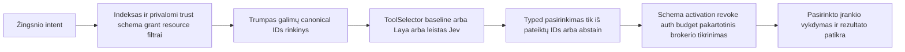

# MVP Jev/OpenRouter routeris ir vėlesnis Laya profilis

2026-10-16. Naudotojo papildymas: įvertinti Laya ir TypeSafe Jev kaip greitą agentų tools parinkimo sluoksnį, galimai prijungiamą ir prie OpenCode. **Šis failas fiksuoja source tyrimo pagrindą; dabar yra atskirai offline išbandytas OpenRouter selector adapteris, tačiau gyva mokama integracija dar nepatikrinta.** [Įgyvendinimo būsena](IMPLEMENTATION.md), [agentų registro architektūra](AGENT-CAPABILITIES.md), [antro agento Jev/source peržiūra](reviews/router-review.md). Naujesnis naudotojo reikalavimas išplečia vertinimą į repo, dokumentų ir coding atranką: [Jev pritaikymo auditas ir matavimo planas](JEV-APPLICATIONS.md).

## 1. Sprendimas šiame etape

**Galutinis naudotojo pasirinkimas: MVP nuo pradžių naudos Jev per jo OpenRouter paskyrą**, kai įgyvendinimo metu bus prijungtas tikras secret ir nustatytas baigtinis cap. API raktas dar nepateiktas ir jokio mokamo call šiame darbe nėra. P0 patvirtina tikslų tuo metu palaikomą Jev model ID, OpenRouter decision endpoint, auth/usage/terms/rates ir mūsų workload rezultatą; iš kito providerio neperimame endpointų ar kainų kaip lygiaverčių.

Deterministinis vietinis indeksas/rules yra pirmas hard-filter ir palyginimo baseline. **Laya lieka vėlesnis vietinis keičiamas profilis**, ne privaloma pradinio MVP sąlyga; jo weights teisės, resursai ir našumas vis tiek turi būti patikrinti prieš naudojimą. Mokamo Jev profilio įjungimas skirtas pasirinktam MVP routing darbui, ne viešų repo/video masinei atrankai: pastarosios pradinis paid budget lieka0. Vien API rakto buvimas nesukuria neriboto finansinio leidimo.

Tikslas – mažas keičiamas **ToolSelector** komponentas bendrame resolver, ne dar vienas pagrindinis agentas/scheduler ir ne modelis, kuriam deleguotos permission ar merge teisės. OpenCode yra galimas klientas / integravimo pavyzdys; produkto bazės Rakazo-vs-minimal sprendimo jis nepakeičia.

## 2. Ką tikrai radome Laya šaltiniuose

Kanoninis source: [NandhaKishorM/laya](https://github.com/NandhaKishorM/laya), skaitytas SHA **`4ac226d5ee88ed6df8db288a05c766d7a34ee682`**.

| Faktas | Perskaitytas pagrindas / riba |
|---|---|
| Kodo root LICENSE – Apache-2.0 | [LICENSE](https://github.com/NandhaKishorM/laya/blob/4ac226d5ee88ed6df8db288a05c766d7a34ee682/LICENSE); weights/duomenų ir transityvinės teisės atskirai |
| Package0.4.8, Python>=3.10; torch/transformers/safetensors/huggingface_hub/numpy | [pyproject.toml](https://github.com/NandhaKishorM/laya/blob/4ac226d5ee88ed6df8db288a05c766d7a34ee682/pyproject.toml); nėra mūsų lock ar patikrinta bendra aplinka |
| `Router` ir typed `choice` / `score` / `noul` darbo kelias | [router.py](https://github.com/NandhaKishorM/laya/blob/4ac226d5ee88ed6df8db288a05c766d7a34ee682/laya/router.py) ir [README](https://github.com/NandhaKishorM/laya/blob/4ac226d5ee88ed6df8db288a05c766d7a34ee682/README.md); typed atsakymas neužtikrina teisingo pasirinkimo |
| HTTP serveris `laya-serve`, `POST /v1/systemone` ir batch, optional Bearer | [serve.py](https://github.com/NandhaKishorM/laya/blob/4ac226d5ee88ed6df8db288a05c766d7a34ee682/laya/serve.py); ši sąsaja įgyvendinta upstream kode, mūsų conformance NOT_RUN |
| `LAYA_JEV_STRICT` griežtesniam response profiliui | Tame pačiame source `_project_jev_strict`; pilno Jev SDK/protokolo/modelio semantinio pakeičiamumo nepatvirtinome |
| Confidence reikšmės turi skirtingą semantiką | Source aprašo Laya normalized-entropy `confidence` ir atskirą `x_jev_confidence`; vieno engine slenksčio negalima aklai perkelti kitam |
| Inference gali atsisiųsti weights, atmintis priklauso nuo įkeltų checkpointų | Source/README nurodo lazy Router, `max_loaded`, preload ir kalbinius modelius; modelio failų šioje sesijoje nesiuntėme |
| HTTP defaults nėra mūsų localhost profilio defaults | Source `LAYA_HOST=0.0.0.0`, API key optional ir preload all; mūsų adapteriui būtinas loopback/private transport, aiškus auth, riboti checkpointai/concurrency ir byte/context cap |

Repo README skelbia English421M, multilingual322M ir typed-decisions421M checkpointus, įvairius context/latency/accuracy skaičius bei multilingual palaikymą. Tai **autoriaus teiginiai / matavimai, ne mūsų rezultatai**. LT router accuracy, mūsų CPU/VPS latency, realus install/peak RAM/disk ir visų modelių teisių scope dar nežinomi.

Pirmas weights šaltinis [convaiinnovations/laya](https://huggingface.co/convaiinnovations/laya); README taip pat nurodo multilingual ir typed-decisions variantus. Hugging Face model card/API/license/config iš šio host gavo proxy403. Todėl vien kodo Apache-2.0 nepakanka paskelbti weights patvirtintais ar įtraukti juos į distributable produktą. Būsimas testas turi gauti leistiną konkretų checkpoint revision, weights/tokenizer/config digests ir pilnas taikomas sąlygas.

Papildomi source-only kandidatai: receptron/laya (Node/ONNX wrapper, MIT), 1Panel-dev/laya-server (Apache-2.0), ollaya-dev/ollaya (Apache-2.0), mizorewww/laya-mlx (Apache-2.0; Apple profilis) ir wdobry/laya-playground (MIT). Jie turi atskirus SHA/source evidence [router kataloge](../catalog/router-candidates.json); jų nepridedame visų kaip privalomų servisų. Upstream jau turi HTTP profilį, todėl papildomo serverio poreikį būtina pagrįsti.

## 3. Jev: ką patvirtina SDK ir wrapper kodas

Oficialus [typesafe-ai/typesafe-sdk-js](https://github.com/typesafe-ai/typesafe-sdk-js), SHA **`b844cd1aca12855a5d24a2df52a1401c86e7d37a`**, SDK0.7.0, root MIT, Node>=22. Source-only peržiūra [router-review](reviews/router-review.md) fiksuoja tikrus TypeSafe client ir typed decision kontraktus. SDK kodo licencija nepakeičia Jev hosted API/modelio sąlygų ar kainodaros.

**Oficialus OpenRouter kelias patvirtintas jo SDK šaltinyje:** [OpenRouterTeam/typescript-sdk](https://github.com/OpenRouterTeam/typescript-sdk), SHA `4200d11265efd9e27916989f0ac013f64ef949d0`, SDK1.4.25, Apache-2.0. [config.ts](https://github.com/OpenRouterTeam/typescript-sdk/blob/4200d11265efd9e27916989f0ac013f64ef949d0/src/lib/config.ts) bazė `https://openrouter.ai/api/v1`, [systemOneCreate.ts](https://github.com/OpenRouterTeam/typescript-sdk/blob/4200d11265efd9e27916989f0ac013f64ef949d0/src/funcs/systemOneCreate.ts) kelias `/systemone`. [SystemOne dokumentas](https://github.com/OpenRouterTeam/typescript-sdk/blob/4200d11265efd9e27916989f0ac013f64ef949d0/docs/sdks/systemone/README.mdx) pateikia modelį `typesafe/jev-1.13` ir aprašo bare `jev-latest`/`jev-1.13` mapping į `typesafe/` namespace.

| Kliento kelias | Nustatoma bazė | SDK pridedamas kelias |
|---|---|---|
| Oficialus OpenRouter SDK | `https://openrouter.ai/api/v1` | `/systemone` |
| TypeSafe SDK su OpenRouter override | `https://openrouter.ai/api` | `/v1/systemone` |

Abu nurodo tą patį galutinį SystemOne URL; nekopijuoti vieno SDK bazės į kitą sukuriant dvigubą `/v1`. TypeSafe override nėra live conformance įrodymas.

**MVP pradinis protokolo kandidatas:** `POST https://openrouter.ai/api/v1/systemone`, dokumentuotas model ID `typesafe/jev-1.13`, naudotojo `OPENROUTER_API_KEY` tik serverio secret/brokeriui. Tai official source patikra, ne live account/model entitlement/rates/response įrodymas. Mutable alias `jev-latest` nenaudojamas tyliai vietoj užfiksuoto konfigūruoto ID; net versijos model ID savaime nėra nepriklausomai žinomas weights digest. P0 testas patvirtina aktualų account palaikymą ir pilną billing/input/output kontraktą prieš realų darbą.

`TheoOliveira/pi-jev` yra Pi extension: importuoja `@typesafe-ai/sdk`, kviečia `client.systemOne({state, questions, model})` ir leidžia custom base URL. Tai nėra savaime OpenCode inline pluginas. Tirtas wrapper dependency `^0.6.0` skiriasi nuo naujo SDK0.7.0; suderinamumas nebandytas.

`ini8labs/jev-mcp-router` source turi MCP gateway kelią ir tikrą `/v1/systemone` POST. Jo chunking/parallel ir iki5HTTPattempts/chunk parodo, kad vienas routing job gali sukelti daug requestų. Mūsų adapteris nepaveldi neriboto parallel/retry ar default gateway/provider be aiškaus pasirinkimo; kiekvienas dispatch per mūsų budget brokerį.

SDK HEAD jau aprašo eksperimentinį PNG/JPEG palaikymą per atskirą profilį/header/modelį. Todėl senesnis wrapper apibūdinimas „text-only“ nėra universali dabartinio Jev savybė. Mūsų pirmas selector testas išlieka **text-first**; iš šio source nedarome išvados apie visų modelių, video/audio ar transkriptų palaikymą.

Naudotojo [TypeSafe blog nuoroda](https://typesafe.ai/blog/introducing-system-one-models-and-jev) ir official docs domenas iš šios aplinkos neprieinami dėl proxy403. Tikslių dabartinių rate/kvotų, prenumeratos/free-credit, API teisinių sąlygų ir mūsų account prieigos nepatvirtinome. Nebuvo login/model call. Public GitHub source leidžia suplanuoti kontraktą, ne žadėti nemokamą ar neribotą Jev.

Community wrapperių provider skirtumų nesuplakame: `~typesafe/jev-latest` su alpha-decisions keliu ir Vercel AI Gateway `typesafe-ai/jev` nėra mūsų oficialaus SystemOne profilio pakaitalai. Kitas gateway/auth/endpoint pasirinkimas būtų atskiras provider profilis, ne paprastas modelio vardo pakeitimas. Šaltinių atšaka ir exact SHA išvardyti [review](reviews/router-review.md).

## 4. Kaip prijungtume vieną keičiamą selector

Resolver pirmiausia deterministiškai sumažina kandidatų skaičių, o ne siunčia2800tools modeliui. Selector state turi užduočiai būtinus leistinus faktus ir trumpus kandidatų aprašus; `choice` criteria – tik brokerio pateikti canonical IDs bei aiškus abstain/none kelias. Faktinis shortlist/dokumentų dydis apribotas pagal pasirinkto checkpoint/tokenizer context ir mūsų testus, ne pagal viso katalogo skaičių.

Pasirinktas ID tikrinamas pagal to konkretaus request kandidatų enum, schema/registry generation ir policy/profile snapshot. Confidence papildoma rekomendacija, ne grant. Laya/SDK modeliai gali klysti ar neteisingai kalibruotis; low-confidence, ties, missing ar invalid atsakymas grįžta į leistiną deterministinį/missing kelią. Mokamas eskalavimas į Jev ar didelį LLM nėra numanomas fallback, ypač cap0 režime.

Modelis nepateikia vykdomo shell, nemato credential verčių ir pats neįdiegia tool. Profile/pin/grant pasikeitimas ar revoke po resolve reikalauja dabartinės brokerio patikros. Keli nested skills ir agentai dalijasi tuo pačiu task/global budget; selector negali jų apeiti per SDK retries ar kitą base URL.

### OpenCode ir kiti klientai

Rekomenduojamas bendras pasirinkimas – izoliuotas resolver/selector adapteris už mūsų kontrakto, pasiekiamas ribotu RPC/HTTP/MCP pagal P0 ADR. OpenCode gali būti vienas klientas arba P0 demonstracijos harness; Rakazo/Pi ar minimalus core naudoja tą pačią semantiką be antro scheduler. Konkretus inline OpenCode pluginas turi būti patikrintas pagal to kliento versijos API ir lifecycle.

Vien MCP `route_tools` tool pridėjimas nereiškia, kad visi agento kvietimai automatiškai pereis filtrą. Jei klientas vis dar tiesiogiai mato ir gali kviesti visus originalius servers/tools, tai tik patariamas kelias. Enforcement reikia brokerio/gateway arba patikrinto harness hook, kuris tikrai kontroliuoja discovery/invoke; mūsų policy visada tikrinama galutinėje vykdymo riboje. Gateway ir client originalių jungčių konfigūracija yra conformance dalis.

## 5. P0 palyginimas ir priėmimas

1. MVP užrakinti pasirinktą OpenRouter SystemOne request/response/SDK profilį, actual Jev account/model/rates/cap ir secret. **Vėlesniam optional Laya testui** atskirai patvirtinti Linux CPU checkpoint/weights sąlygas; Mac/ONNX/GPU atskiri profiliai, jų nepreloadinti ir nepridėti į core be matavimo.
2. Užfiksuoti LT/EN intent rinkinį su ne viena teisėta alternatyva, painiais read/write, crypto/PDF/coding/voice, unknown/missing ir prompt-injection pavyzdžiais; domain/source labels atskirai nuo testinio holdout.
3. Pirmam MVP vienodas kandidatų rinkinys ir privalomi filtrai baseline bei pasirinktam Jev/OpenRouter profiliui, su realiu secret/rate ir cap; Laya vėlesnis atskiras palyginimas, ne blocker. Naudotojas pasirinko mokamą MVP kryptį, bet šiame darbe nepateikta paskyra ir nevykdomas mokamas testas.
4. Matuoti top-k/relevant selection, wrong/ineligible/missing/abstention, kalibraciją, end-to-end correctness, warm/cold p50/p95, CPU/RAM/disk/model load, token/requests/cost ir context truncation.
5. MVP tikrinti OpenRouter Jev cancellation/timeout/invalid fields/schema drift/confidence/concurrency ir tikrą dispatch-count/rate rezervavimą. Laya strict-response/per-checkpoint palyginimas vėlesnis optional; jo nebuvimas neblokuoja Jev MVP.
6. Matuoti praktinę vertę prieš baseline. Pasirinktas Jev privalomas jo MVP vartui: jei account/quality/latency/cost profilis netinka, rodyti blocked/nebaigtą Jev etapą arba priimti aiškų scope ADR. Baseline gali veikti kaip pažymėtas diagnostinis/degraded kelias, ne slapta paskelbti Jev integraciją baigta. Laya pasirinkimas vėliau priklausys nuo savo matavimų.

**Dabartinis rezultatas:** engine kryptis MVP pasirinkta – Jev per naudotojo OpenRouter. Rasti konkretūs source entrypoints; actual account/endpoint/model/rates, runtime ir kokybės patikra **NOT_RUN / pending**. Iki tikro secret+cap profilis nevykdomas; source tyrimas neprilyginamas veikiančiai integracijai. Laya weights ir vietinio profilio bandymai laukia vėlesnio etapo. Pilna naujų routerių source atšaka saugoma atskirai nuo ankstesnio806/757research snapshot, kad nekeistume istorinių skaičių į tariamai naujus benchmarkus.
