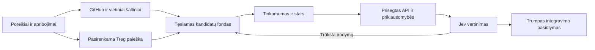

# GitHub ir Jev kandidatų paieškos atnaujinimo planas

2026-10-22. **Planas peržiūrai prieš kodo ir įdiegto papildinio atnaujinimą.** Dabartinė versija lieka 0.12.3 / schema 1.13.3; šiame etape keičiama dokumentacija. Tikslas — rasti tinkamus integruojamus komponentus, pateikti jų naudojimo planą ir pamatuoti visos užduoties naudą. Bendras kandidatų fondas neturi mažo fiksuoto top 3 ar top 5 limito. API, tinklo, saugojimo ir mokamų kvietimų apimtis valdoma aiškiu operatoriaus profiliu.

Autoritetas: [DECISIONS A02, A04–A09, A13–A16](DECISIONS.md), [ROADMAP NEED1 ir jo detalizavimas](../ROADMAP.md), [dabartinė būsena](IMPLEMENTATION.md). Vienas Rakazo produktas, esami API, PostgreSQL ir Graphile worker. Treg lieka pasirenkamas šaltinių paieškos kanalas; pagrindinis produktas veikia ir be hosted paslaugos. Bendri P2.11–P2.13 Treg priėmimo vartai lieka atviri.

## Kodėl dabartinis kelias nepakankamas

[StudioDesk B pakartojime](experiments/NATIVE-STUDIODESK-B-REPEAT-2026-10-22.md) tikras Jev gavo du silpnus vienetus ir pagrįstai susilaikė. Vienas buvo renderer testavimo scenarijus, kitas — AAC pagalbinės funkcijos. Tinkami bendro medijos variklio upstream į apžiūrėtą imtį nepateko. [Tikslinė Whisper kontrolė](experiments/WHISPER-MODULE-QUALIFICATION-2026-10-22.md) patvirtino siaurą žinomo vardo kelią; ji nepatvirtina bendrinio poreikio paieškos.

| Dabartinis kodas | Pasekmė | Reikalingas pakeitimas |
|---|---|---|
| Bendrinei frazei imami pirmi penki pradiniai žodžiai | Platformos ir veikimo būdo žodžiai išstumia funkcijos sąvokas | Funkcija, apribojimai ir paieškos formuluotės atskiriami |
| GitHub laukai `name,description` | README, temos ir API naudojimo vietos lieka už šio kanalo | Nepriklausomi metadata, README/topics, code ir upstream kanalai |
| Plėtimas tik po tuščio, nepilno ar nesėkmingo atsakymo | Vienas silpnas rezultatas sustabdo geresnių kandidatų paiešką | Plėtimas pagal poreikio padengimą ir įrodymų trūkumą |
| Rikiavimas pagal GitHub pozicijas, pasikartojimą ir tikslų vardą | Nėra pakankamo domeno ir integravimo tinkamumo patikrinimo | Paaiškinamas tinkamumo, downstream naudojimo, priežiūros ir stars rikiavimas |
| Iki 6 search užklausų po 10 rezultatų, iki 5 repo apžiūrai | Mažas profilio langas tampa visos paieškos aprėptimi | Tęsiamas kandidatų fondas ir apžiūra partijomis |
| GitHub 12 s / 32 GET, visas worker bandymas 30 s | Vien ribos padidinimas nesukuria tęsiamo darbo | Etapų checkpointai ir suderinti profilio, worker bei transporto deadline |
| Jev iki 5 vienetų / 22 KB; vieno dispatch apskaita | Didelis fondas nepasiekia vertinimo, keli dispatch nebūtų tinkamai apskaityti | Maži konteksto paketai su pilna visų etapų apskaita |
| Root failas `run_renderer_test.py` praeina kaip kviečiamas vienetas | Test harness painiojamas su biblioteka | Bibliotekos, programos, CLI, testo ir pavyzdžio klasifikacija |

Tai dabartinės globalios ZERO_* konstantos, dar ne operatoriaus profilio parametrai; v10 faktiškai apžiūrėti trys repo. GitHub pozicijų sujungimas jau yra kode, todėl vien naujas to paties rikiavimo pavadinimas problemos neišsprendžia.

## Viena tęsiama paieškos grandinė

Host perduoda vieno gebėjimo struktūrinį poreikį: paskirtį, įvestis/išvestis, privalomas platformas, režimą, turimą technologijų aplinką ir priėmimo kriterijus. Didelio projekto keli gebėjimai turi atskiras atrankas ir bendrą suderinamumo suvestinę. Esamas vieno poreikio `zero_discover` išlieka suderinamas; kelių poreikių koordinavimas dalijasi bendru scope ir rezervu, nekuria antro coding pokalbio.

Paieškos frazės ir modelio pasiūlyti pavadinimai yra hipotezės. Originalūs reikalavimai niekada neprarandami sutrumpinus užklausą. Į užklausas keliauja tik reikalingas funkcijos aprašas; privatūs projekto failai, prisijungimai ar visas pokalbis išorės paieškai nesiunčiami.

### Platus rinkimas ir priklausomybių sekimas

- Vietiniai source faktai ir jau kvalifikuoti profiliai tikrinami pirmiausia, išlaikant jų skirtingus statusus.
- GitHub kanalai: tikslios tapatybės/alias, funkciniai sinonimai, `in:readme`, topics, `best match`, atskiras `sort=stars&order=desc` kelias ir tikslinė kodo paieška. Originalūs žodžiai nekertami iki pirmų penkių. Code paieškos REST sintaksė ir aprėptis tikrinamos atskirai nuo naujesnės GitHub web paieškos.
- Kiekvienas kanalas puslapiuojamas; bendram fondui nenustatoma kelių repo kvota. Kandidatų gali būti šimtai ar tūkstančiai pagal realų poreikį ir profilį. Išsaugomi faktiniai kiekiai, kanalai, puslapiai, daliniai atsakymai ir neapžiūrėtas likutis.
- GitHub iki 1 000 rezultatų vienai užklausai riba sprendžiama skaidant prisotintas užklausas, pavyzdžiui, nesikertančiais sukūrimo datos intervalais. Tai mažina praradimus, tačiau neįrodo pilnos viso GitHub aprėpties. Veikiant rate limit darbą atidėti pagal antraštes; jo nepaversti no-fit.
- Aptikus veikiančią programą, statiniu būdu skaityti jos manifestus, lockfiles, CMake/Meson ir oficialias bibliotekų nuorodas. Pereiti į tikrą upstream ir jo API. Pavyzdys — Kdenlive priklausomybių deklaracijos nuveda į MLT, FFmpeg ir OpenTimelineIO; šie vardai lieka dokumento pavyzdžiu, ne StudioDesk atsakymų sąrašu runtime kode.
- Deduplikacija pagal patikrintą repo ID ir canonical upstream ryšį. Forkai, mirror ir wrappers lieka susieti su skirtumais; keli tos pačios šeimos rezultatai dirbtinai nedaugina populiarumo ar nepriklausomų įrodymų.

### Stars ir tikras tinkamumas

Stars naudojami dvejopai: atskiram populiarių kandidatų paieškos kanalui ir paaiškinamam prioritetui tarp funkcijai tinkamų alternatyvų. Saugoti skaičių, šaltinį ir stebėjimo laiką; trūkstamas skaičius nėra nulis. Mažai stars turinti biblioteka nepraranda teisės būti tikrinama.

Pradinis rikiavimas etapinis: patvirtinti privalomi apribojimai → gebėjimo ir integruojamos sąsajos atitikimas → faktinis downstream naudojimas / priežiūros įrodymai → adaptavimo našta ir populiarumas. Unknown apribojimas siunčia kandidatą papildomai apžiūrai; žinomas nesuderinamumas atskiriamas. Stars poveikį slopinti, pavyzdžiui, `log1p`, ir normalizuoti lyginamame gebėjimo kontekste. Vienam didžiuliam populiariam projektui neleidžiama užgožti visų specializuotų API.

Fiksuotų išgalvotų svorių ar „95 % tinkamas“ tikimybės nežadame. Rikiavimo versiją ir signalų indėlį saugoti; stars-only, dabartinis rank ir naujas derinys lyginami development rinkinyje prieš politikos užšaldymą.

### Integruojamas komponentas ir Jev

Atrankos vienetas: repo → biblioteka/build target → viešas API → realizacija ir reikalingų failų/priklausomybių rinkinys. Vienas header arba panašus failo vardas yra tik įrodymo pradžia. Prieš Jev atskirti biblioteką, CLI, visą programą, testą ir naudojimo pavyzdį; pavyzdžiai bei testai naudingi API naudojimui suprasti, tačiau automatiškai netampa siūloma biblioteka.

Apžiūrą vykdyti partijomis, išsaugant tęstinį prioritetų sąrašą. Kiekvienam vienetui reikia exact commit, kelių/content hash, deklaracijų, realizacijos sąsajos, build/manifesto ir naudojimo įrodymų, kiek jie prieinami. AST ar struktūrinę analizę pridėti tik palaikomiems profiliams; regex ištraukos nežymėti semantikos ar elgesio įrodymu. Kiekvienam poreikiui rodyti padengia / iš dalies / nepadengia / nežinoma ir likusias spragas.

Jev gauna trumpus įrodymų paketus, palyginamas alternatyvas ir užduoties apribojimus. Konteksto paketo dydis nėra viso fondo limitas. Nauja partija turi turėti naujų kandidatų arba naujų faktų; tie patys duomenys nepersiunčiami vien tikintis kitokio atsakymo. Paketų tvarka, ID ir sprendimai saugomi; baigiamojo palyginimo metu tikrinamos ir ankstesnės stiprios alternatyvos, kad pirmos partijos pasirinkimas netaptų automatiniu nugalėtoju.

Proposal helper palaiko package-api, process-adapter ir source-adapter, tačiau dabartinis selector renkasi tik package-api arba source-adapter. Atnaujinant klasifikaciją turi būti pagrįstai parenkama ir tikrinama strategija; CLI process-adapter pasiūlymas išlaiko atskirą leistiną vykdymo profilį, nėra pavadinamas bibliotekos API ar jau vykdytu komponentu. ką jis pakeičia, ploną adapterį, likusį darbą, versijų/platformų prielaidas ir actual-use patikros planą bei kriterijus. Keliems gebėjimams suvesti konfliktus bei bendras dependencies paprasta matrica. Universalus optimizatorius ar automatinis source vykdymas šiam atnaujinimui nereikalingas.

## Treg vaidmuo ir išlaidų apskaita

2026-10-22 host prijungtame Treg kataloge `github` paieška pateikė 14 endpointų: repo profilį, failus, issues, trending ir naudotojų duomenis. Bendri `web.search`, `web.search.broad` ir paketų informacijos įrankiai gali papildyti kandidatų rinkimą. Tai katalogo/schemų stebėjimas; Zero worker Treg adapteris ir jo mokamas source tyrimas dar nekvalifikuoti.

Treg perduodama tik autorizuota read-only funkcija per provider-neutral adapterio ribą. `catalog_search` → `catalog_get` → konkretus leistas endpoint/schema fingerprint. Repo profilių ar failų pirkimas nedubliuoja veikiančio tiesioginio GitHub skaitymo be aiškios priežasties. Trending padeda papildyti fondą, o funkcijos tinkamumą pagrindžia API. Paieškos nuorodos patvirtinamos originaliame public upstream per esamą fixed-origin/pin/hash kelią.

Kataloge patikrintas `treg.web.search` yra maršrutizuojamas, gali mėginti kelis apmokestinamus downstream ir turi numatytą 1 USD vieno maršruto ribą. Tai netinka tyliai paveldėti. Pirmam profiliui rinktis aiškų endpointą arba išjungtą waterfall su aiškiu per-call rezervu; prieš realų kvietimą patikrinti einamąją schemą, kainą, gavėją ir paskyrą. HTTP sėkmės statistika nėra kandidatų kokybės matas.

Kiekvienas Jev ir Treg bandymas gauna patvarų `invocationId`, etapo/partijos tapatybę ir rezervą prieš dispatch. Apskaitomi visi žinomi attempts, mokami misses, usage ir nežinomos baigtys; konservatyvūs unknown hold lieka iki reconciliacijos. Graphile pakartotinis pristatymas neturi pakartoti neaiškaus mokamo kvietimo. Jokio tylaus provider fallback, account pakeitimo ar cumulative ledger atstatymo. Jev skirtas leidimas nėra Treg išlaidų leidimas; atskiras Treg allocation būtinas prieš mokamą kvalifikaciją.

## Patvarumas, cache ir MCP atsakymas

Platus fondas, puslapių kursoriai, upstream ryšiai, apžiūros eilė ir vertinimo būsenos lieka backend. Pirmiausia naudoti esamus job metaduomenis ir versijuotus bounded artefaktų puslapius; kiekvienas puslapis turi hash. Discovery šiuo metu neturi etapinio resume/checkpoint/fence. Esami submit idempotency ir galutinio publish užraktai šio darbo neatstoja. Prieš implementuojant parinkti minimalų atominį etapų/checkpoint/CAS saugojimą ir, jei reikia, vieną persistence plėtrą su migracija. Naujas scheduler, atskira paieškos platforma ir lygiagrečios universalių lentelių šeimos neįvedamos.

Checkpoint po paieškos puslapio, apžiūros partijos ir prieš/po mokamo dispatch. Vienas aktyvus lease/fence konkrečiam etapui, grant recheck prieš išorinį veiksmą, bendras visų poreikių projekto limitas. Checkpoint susiejamas su request, profilio/connection digest, algoritmo ir policy versija; replay nepratęsia originalaus viso darbo deadline ir neperima pasikeitusių leidimų. Atskiri tinklo kvietimo, aktyvaus worker bandymo ir viso darbo deadline; suderinti dabartinius 12 s GitHub, 30 s worker ir 120 s užklausos galiojimo apribojimus. Atskirti viso darbo firstStartedAt ir attemptStartedAt; esamą publish 30 s elapsed guard peržiūrėti kartu su nauju etapų kontraktu. Ilgas tyrimas turi mokėti atsikurti, o trumpas MCP laukimas grąžinti esamą job ir retą ribotą laukimą. Senas terminal receipt nekeičiamas po naujo darbo ar politikos versijos. Scoped source cancel API/MCP operacija dar neįgyvendinta: ją pridėti su versijuota schema, grant/scope patikra ir patvariu sustojimu prieš kitą dispatch; MCP laukimo nutraukimas atskiriamas nuo darbo atšaukimo.

Source cache raktas apima repo/commit/path/content hash, extractor versiją ir įrodymo tipą. Fit sprendimo cache papildomai apima poreikio, policy/ranking, modelio ir aplinkos prielaidas. Dinaminiai stars/release/advisory faktai turi stebėjimo datą ir atnaujinimo taisyklę. „Perskaityta“, „statinis API“, „build“, „vykdyta“ ir „patikrinta integracija“ laikomi atskirai; SHA cache nesuteikia seno PASS naujai aplinkai.

MCP grąžina trumpą hash patikrintą suvestinę: kandidatų kiekį pagal kanalus ir būsenas, poreikių padengimą, sprendimą, stiprias alternatyvas, likusias spragas, visų dispatch kainą known/unknown ir artefaktų nuorodas. Visas fondas ir tūkstančiai schemų nekeliami į host promptą. Esamas 20 s laukimas gali likti kliento sąsaja, neprilyginant jo viso tyrimo deadline.

Sustojimo priežastys atskiros: poreikiai pakankamai pagrįsti ir prioritetinės alternatyvos palygintos; turimi kanalai išsemti; papildomos partijos nebeduoda naujų tinkamų kandidatų; operatorius sustabdė; resursai/biudžetas išnaudoti. Dalinė aprėptis ir sustojimo taisyklė pateikiamos visais atvejais. `budget_exhausted`, `partial`, `unavailable`, `abstained` ir apžiūrėtų kandidatų `no_fit` nepaverčiami globaliu „GitHub neturi tinkamo repo“.

## Įgyvendinimo seka ir priėmimas

Checkboxų autoritetas — [ROADMAP NEED1.1–NEED1.7](../ROADMAP.md); ši lentelė nustato darbų priklausomybes ir įrodymus.

| Etapas | Įgyvendinimo vieta | Priėmimas prieš kitą etapą |
|---|---|---|
| NEED1.1 Poreikiai ir platus GitHub rinkimas | `zero-github-contract.ts`, `zero-github-discovery.ts`; esamas core poreikių normalizavimas | Originalūs apribojimai išsaugoti; README/topics/stars/best-match kanalai, dedup, pagination ir dalinių rezultatų kontrolės; nėra žinomų benchmark repo sąrašo |
| NEED1.2 Etapų patvarumas ir apskaita | `zero-jev-worker.ts`, `zero-jev-limits.ts`, `zero-jev-profile.ts`, `zero-jev-application-client.ts`, esamas API/job/artifact ir account rezervavimas | Resume/replay/cancel/lease/grant; keli dispatch su visų usage suma; unknown hold; suderinti deadline; didelis fondas išlieka po proceso restart |
| NEED1.3 Tinkamumas ir modulio įrodymai | `zero-source-modules.ts`, `zero-source-module-selector.ts`; dabartinis proposal kelias | Atskirti biblioteką nuo root testo/CLI, API ir realizacijos spragos matomos; stars signalas nepakeičia privalomų sąlygų; naujų partijų tęstinumas |
| NEED1.4 Pasirenkamas Treg source kanalas | Esamo adapters paketo provider-neutral šaltinių riba ir bendras connection/grant/budget | Offline schema/cost/revoke/forbidden-write kontrolės; gyvas mokamas bandymas tik su konkrečiu Treg allocation; public upstream pin patikrintas |
| NEED1.5 Kompaktiškas MCP pasiūlymas | `zero-mcp-server.ts`, `zero-mcp-reuse-tools.ts`, klientas ir bendra skill | Tikri esami job ID, laukimas ir naujai kvalifikuotas scoped source cancel, vienas compact receipt, kiekvieno poreikio integravimo planas ir aiškus likutis; backward compatibility |
| NEED1.6 Nepriklausoma kvalifikacija | Versionuoti development/holdout fixtures ir esami adapterių/API/PG/package testai | Užšaldytos taisyklės, publikuoti neigiami atvejai ir visų išlaidų/latency/coverage matavimai; saugumo bei apskaitos kontrolės be regresijų |
| NEED1.7 Paketas ir tik B native planas | Dabartinis MCP packaging ir native planų protokolas | Naujos versijos Linux/Windows paketas, preflight, tas pats promptas/SPEC ir modelis; A nepaleisti; sustoti po B plano peržiūrai |

Įgyvendinimo failų vardai yra dabartinio kodo žemėlapis; prieš keitimą patikrinti konkrečias eksporto ir API priklausomybes. NEED1.2 checkpoint/apskaita būtina prieš kelių Jev partijų ar ilgo gyvo tyrimo įjungimą. Treg live vartas atskiras: jo negalima praleisti paskelbiant pilną GitHub + Treg + Jev kvalifikaciją. Darbinis paketas gali būti sukurtas atskirai, bet įdiegtas 0.12.3 nekeičiamas iki testų ir plano peržiūros.

### Kaip matuosime vertę

Esami StudioDesk/Whisper atvejai — development regresijos. Naujo rinkinio pradinis projektas yra 12 development ir 12 nepriklausomų holdout poreikių, kiekvienam po LT ir EN formuluotę, iš viso 48 užklausos: medija, STT/TTS, vaizdų apdorojimas, dokumentai/lentelės, paieška ir duomenų/developer įrankiai, su fit/no-fit, LT/EN, skirtingomis platformomis ir kelių gebėjimų užduotimis. Šis kiekis yra vertinimo plano pradžia, ne kandidatų kvota. Kalbinės to paties poreikio versijos, artimi poreikiai ir ta pati upstream šeima lieka vienoje skaidymo pusėje. Kelių gebėjimų projektų atvejai pridedami atskirai. Holdout parengia nepriklausomas vertintojas; implementuotojas jo atsakymų nemato iki kodo/policy užšaldymo, po atskleidimo rinkinys nebenaudojamas tuning.

Prieš vykdymą užfiksuoti promptus, schemas, corpus/source atsakymų snapshot, pins, modelį, cache politiką, vertintoją ir priėmimo taisykles. Etalonas gali turėti kelias tinkamas upstream šeimas; naujas tinkamas kandidatas vertinamas aklai pagal reikalavimus, neskelbiamas klaida vien dėl jo nebuvimo sąraše. Gyvas GitHub keičiasi, todėl atkuriamas snapshot palyginimas ir gyvos aprėpties patikra turi atskirus rezultatus.

Offline privalomos kontrolės: silpnas singleton ir nesusijęs populiarus repo; maža tinkama biblioteka; fork šeimos; README/API terminų neatitikimas; root test harness ir tikras usage pavyzdys; header be realizacijos; cache invalidation; daliniai/nukirpti atsakymai; platus kelių puslapių fondas; rate limit; grant/revoke; timeout ir unknown paid dispatch; concurrent resume ir dvigubo mokėjimo apsauga; injection turinys be vykdymo.

Lyginti užšaldytą 0.12.3 retrieval, stars-only, naują kelių kanalų GitHub kelią ir tą patį kelią su Treg. Mokamo Jev pridėtinę vertę atskirti nuo paties retrieval, laikant kandidatų įrodymų paketą palyginamą. Treg/semantinio reranker įtaka tiriama atskirais variantais, nekeičiant kelių dalykų ir nepriskiriant visos naudos vienam iš jų. Semantinį indeksą ar reranker pridėti tik jei šis matavimas parodo likusią spragą; didelio viso GitHub grafo ar naujos vektorinės paslaugos pirmam atnaujinimui nereikia.

Rodikliai: tinkamų upstream/API radimas ir poreikių padengimas, `recall@K`/MRR/nDCG pažymėtos imties ribose, kandidatų šeimų įvairovė, klaidingų pasiūlymų ir pagrįstų susilaikymų dalis, pirmo tinkamo API laikas, visa tyrimo trukmė p50/p95, requests/bytes/cache, Jev/Treg faktinė kaina ir unknown rezervai. `K` yra vertinimo pjūvis, ne runtime fondo lubos. Host atskirai input/cached/uncached/output/cycles, Jev input tik auditui, output ir USD atskirai; input nenaikinamas iš audito dėl jo neįtraukimo į vartotojo pagrindinį palyginimą.

Privalomų offline saugumo/apskaitos kontrolinių atvejų nesėkmė blokuoja įjungimą. Užšaldytuose teigiamuose fixtures turi būti rastas bent vienas sąlygas atitinkantis API vienetas, neigiamos kontrolės neturi sukurti nepagrįstos rekomendacijos. Holdout negali turėti naujų klaidingų privalomų apribojimų pasirinkimų; naujų tinkamų API radinių reikia daugiau nei vienoje srityje. Nepasiekus šių sąlygų pagerėjimas neskelbiamas ir naujas native B nepaleidžiamas. Prieš holdout iš anksto fiksuoti leidžiamas kokybės regresijas bei praktinio pagerėjimo slenkstį pagal development baseline; jų nekeisti pamačius holdout. Priėmimo ataskaitoje privalomi konkretūs teigiami multi-domain API radimo pavyzdžiai ir visos nesėkmės. Vien stars, repo kiekis ar visų atvejų abstain nėra atrankos pagerėjimo įrodymas.

Paskutinis native bandymas — tik naujas B su tuo pačiu natūraliu StudioDesk promptu, be užuominų, prieš išsaugotą A. Užfiksuoti visą B intervenciją, versiją ir originalius transcript/usage; istorinio A palyginimo nelaikyti nauja kontroliuota pora. Sustoti po plano. Programos kūrimas ir faktinio panaudojimo/kodo kokybės matavimas lieka atskiras žmogaus peržiūros etapas; source atrankos PASS neįrodo visos kūrimo naudos.

## Atšaukimas ir šaltiniai

Nauja politika ir schema versijuojamos; ankstesnis paketas, receipt ir nesėkmės išsaugomi. Išjungus naują profilį, nauji darbai gali naudoti ankstesnį leistiną kelią, o aktyvus darbas išlaiko užfiksuotą policy/pin. Aktualus grant revoke ir connection/profile galiojimo patikra turi viršenybę prieš snapshot; rollback nepanaikina atšaukimo. Rollback neatstato biudžeto ir nepervykdo unknown dispatch. Įdiegimas, source pasiūlymas, integracija, runtime ir nauda lieka atskiri statusai.

- [GitHub repository paieškos laukai](https://docs.github.com/en/search-github/searching-on-github/searching-for-repositories), [REST paieška, puslapiavimas ir ribos](https://docs.github.com/en/rest/search/search), [API rate limit](https://docs.github.com/en/rest/using-the-rest-api/rate-limits-for-the-rest-api).
- [GitHub dependency graph](https://docs.github.com/en/code-security/concepts/supply-chain-security/dependency-graph), [Kdenlive build priklausomybės](https://github.com/KDE/kdenlive/blob/master/CMakeLists.txt). Manifesto deklaracija yra paieškos įrodymas, ne mūsų integracijos PASS.
- [Treg dokumentacija](https://treg.to/llms.txt), [naudotojo nurodyta GitHub skiltis](https://treg.to/app#platform/github); endpointų ir kainodaros faktai papildomai tikrinti prijungto katalogo search/get, be endpointų vykdymo.
- [CrossCoder](https://arxiv.org/abs/2609.09987), [FeatLens](https://arxiv.org/abs/2609.26480) ir [CodeRAG-Bench](https://arxiv.org/abs/2406.14497) pagrindžia vertą tirti priklausomybių bei retrieval/generation atskyrimo kryptį. Tai kitų užduočių tyrimai; jų pagerėjimo procentai Zero nepriskiriami.
