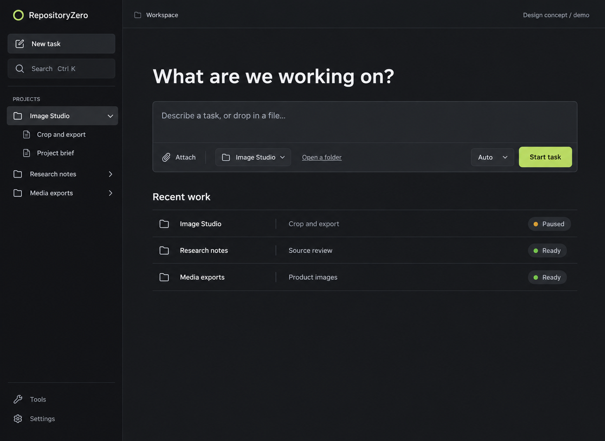
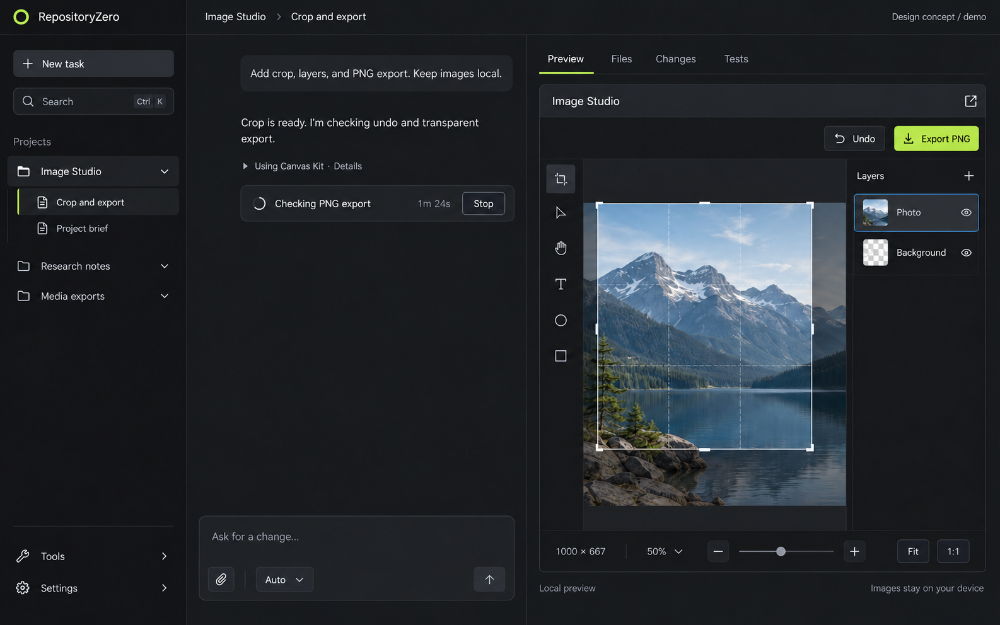
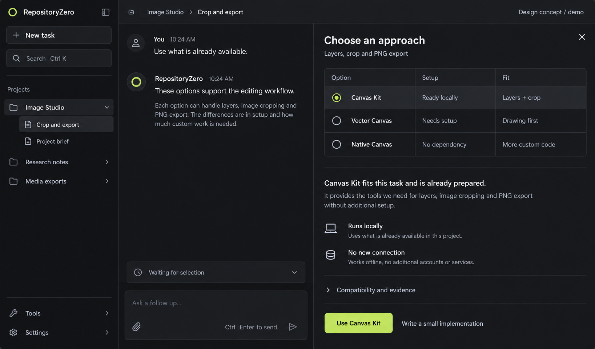
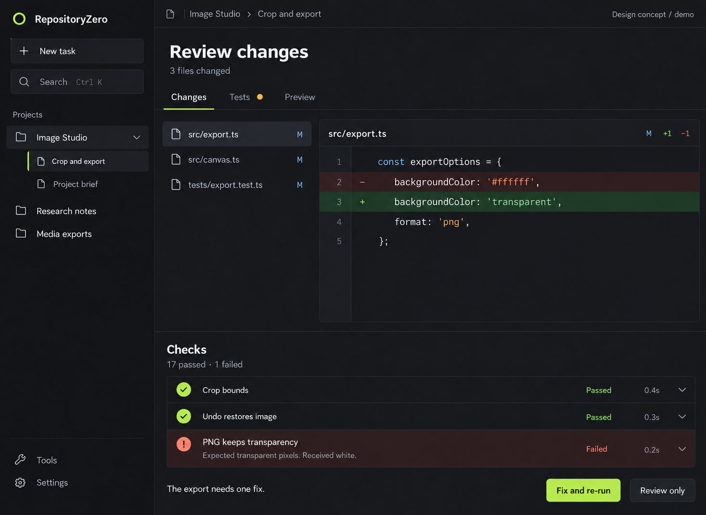
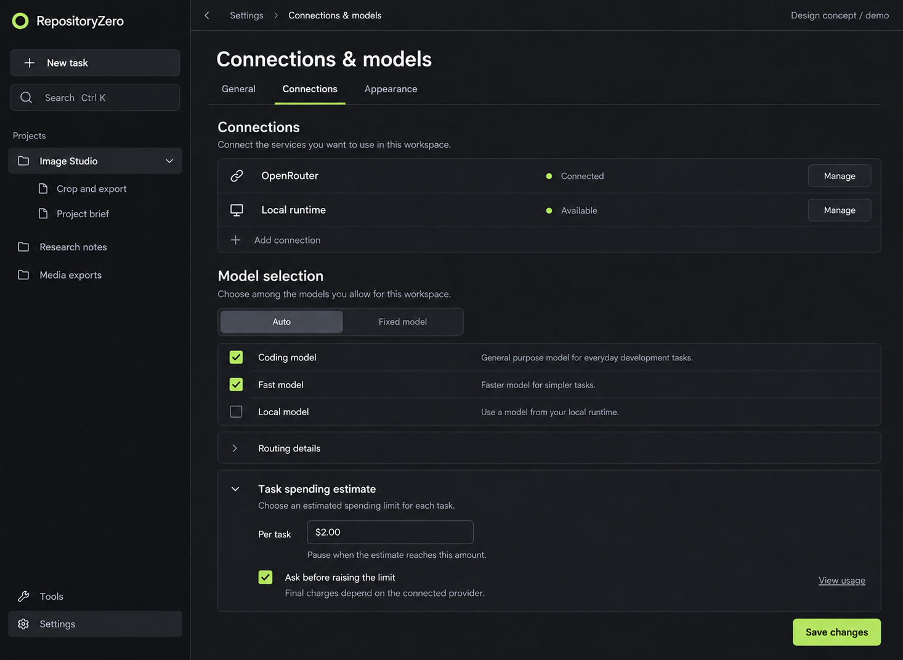
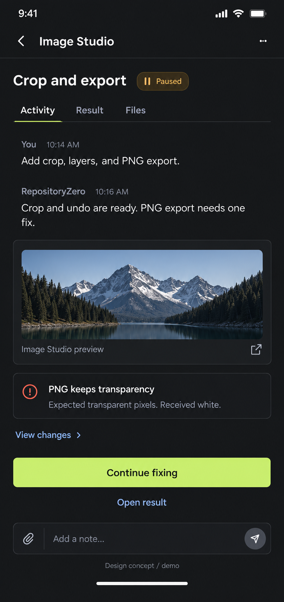
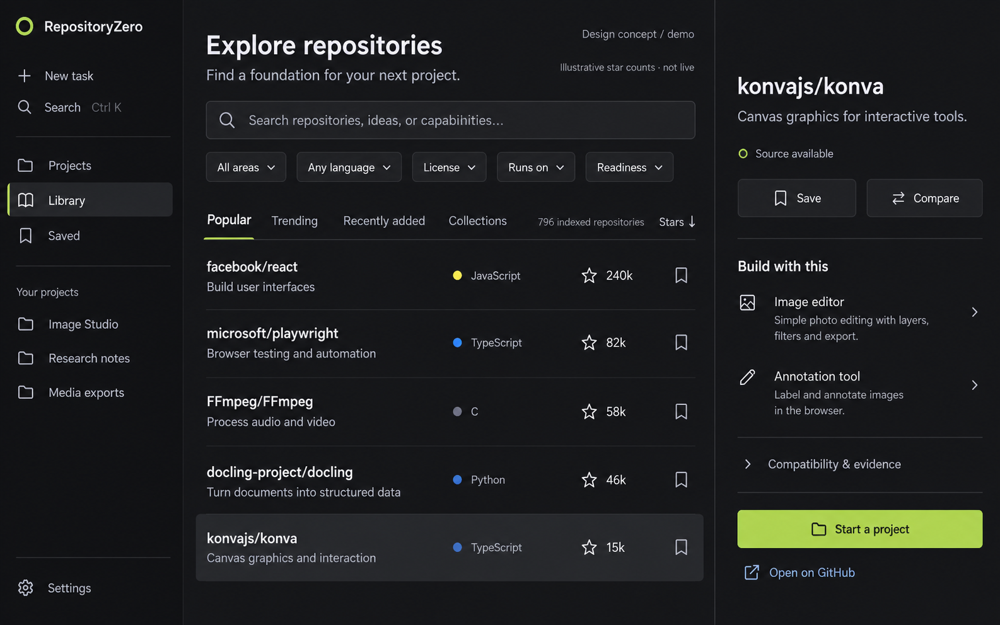

# RepositoryZero UI koncepcijos

**2026-10-17 · Design concept / demo.** Septyni hipotetiniai maketai; ne veikiančio produkto screenshot ir ne benchmark. Stars, testų rezultatai, kainos bei būsenos iliustraciniai. [UI/UX kryptis](UI-UX-DIRECTION.md), [failų hash](manifest.json), [įgyvendinimo būsena](../../IMPLEMENTATION.md).

Priimta kryptis: santūri profesionali darbo erdvė, užduotis ir rezultatas centre, atskira Library žmogui be AI pokalbio. Pirmų šešių ekranų „Tools“ navigacija įgyvendinant suvienodinama į „Library“. Compare/Trending/Collections nėra pirmo MVP pradžios priklausomybė. Dar reikia realių accessibility/responsive/interaction patikrų ir bendrų tokens įgyvendinimo; šie paveikslai to nepatvirtina.

## Projektai ir nauja užduotis

## Darbo erdvė ir rezultato peržiūra

## Komponentų palyginimas konkrečiam poreikiui

## Diff ir nepraėjusių patikrų peržiūra

## Jungtys ir modelių pasirinkimas

## Užduoties tęsinys telefone

## Savarankiška repo biblioteka

Senesni du konceptai išsaugoti [karantine](../../quarantine/README.md). Trys foundation screenshotai šiame aplanke yra ankstesnio tikro UI įrodymai ir palikti; jų nesupainioti su naujais generuotais maketais.
