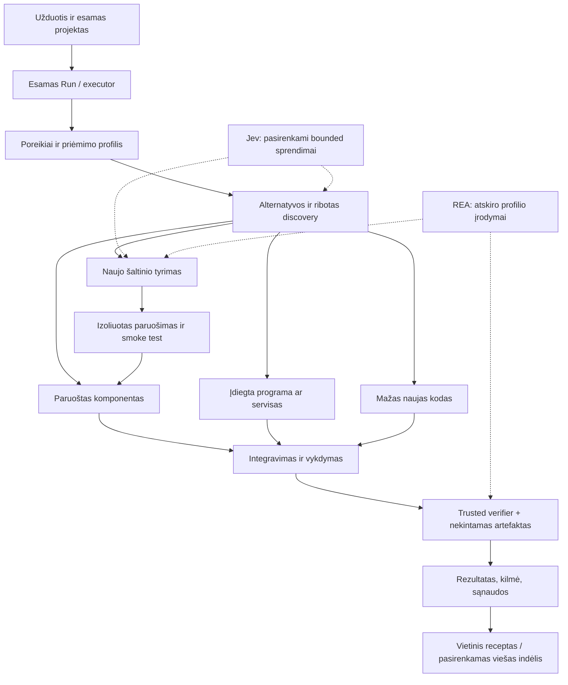

# RepositoryZero architektūros sprendimas ir įgyvendinimo planas

2026-10-17 · rekomendacija pagal `fe14bdd4fb9cd8805938e1169a4bd2d13961bb86` · įgyvendinimas šiame audite neatliktas.

## Sprendimas

Kurti **vieną produktą ant esamo Rakazo pagrindo**. Jo vykdymo kelyje pridėti mažą komponentų panaudojimo darbo vienetą: poreikiai → alternatyvos → ribotas tyrimas arba paruoštas profilis → paruošimas → integravimas/vykdymas → nepriklausoma patikra → išsaugoma bendroji patirtis.

Tai nėra reikalavimas kiekvienam darbui pereiti visus žingsnius ar būtinai naudoti išorinį komponentą. Paprastam pakeitimui galima iš karto rašyti trūkstamą kodą. Sudėtingai užduočiai galima sujungti biblioteką, programą, servisą ir naują kodą. Poreikiai ir priėmimo kriterijai išlieka atskirti nuo pasirinkto įgyvendinimo.

### Trijų alternatyvų palyginimas

| Alternatyva | Ką išsaugo | Esminė kaina / rizika | Sprendimas |
|---|---|---|---|
| A. Plonos reuse funkcijos esamame worker/executor, bendri adapteriai ir DB įrašai | Run/Attempt, leases, efektų kontrolę, scoped modelius, artefaktus, UI ir naudojimo istoriją | Reikia atsargiai integruoti į didelius failus ir išbandyti restart/concurrency ribas | **Rinktis**; mažiausias naujo autoriteto kiekis ir greičiausias produkto kelio įrodymas |
| B. CLI agentų brokeris kaip pagrindinis produktas | Greitą eksperimentavimą ir esamą CLI coding kokybę | Nevienodas auth/tool/runtime valdymas, ribota vidinių modelio kvietimų ir prenumeratos kainos observability, atskiras workflow gyvenimas | Palikti Lab/backend adapteriu su aiškiais apribojimais; ne daryti antru produkto centru |
| C. Naujas mažas engine arba mikroservisų platforma | Laisvę iš naujo suprojektuoti interfaces | Iš naujo reikėtų identity, permissions, durable jobs, artifact/version, recovery ir klientų integracijos; atitolintų reuse naudą | Atmesti dabar; atskirą servisą iškelti tik išmatuotam izoliacijos ar mastelio poreikiui |

Tai kokybinis palyginimas, ne išgalvoti žmogaus dienų ar našumo įverčiai. A remiasi realiais worker, executor ir DB primitives [E01–E08]. „Vienas autoritetas“ reiškia vieną Run/leidimų/būsenos modelį; tai nedraudžia kelių worker procesų, vietinių sandbox ar ateityje cloud vykdymo.

### Siūloma grandinė

Jev ir REA teikia įrodymus/sprendimo signalus. Jie negali pakeisti permissions, budget, trusted acceptance ar Run ownership.

## A. Du tinkamumo etapai ir vieno kandidato kelias

### Discovery ir execution sąlygos

| Faktas | Discovery / tyrimo kandidatas | Paruoštas vykdymo profilis |
|---|---|---|
| Tapatybė ir kilmė | Kanoninis source/package/tool ID, šaltinis ir evidence laikas; unresolved revision gali likti unknown | Tikslus source/package/binary/API-schema pin ir materializuotų baitų digest |
| Poreikio atitiktis | Įrodytas, tikėtinas arba nežinomas capability; žinomi prieštaravimai matomi | Konkretus entrypoint/kontraktas ir taikomų feature testų įrodymas |
| Platforma | Žinomas nesuderinamumas pašalina iš šios alternatyvos; unknown leidžia tyrimą | OS/arch/runtime/dependencies profilis faktiškai patikrintas |
| Licencija ir notices | Šaltinis, scope ir unknown; nėra bendro „visas repo leidžiamas“ | Pasirinktai install/use/distribution operacijai reikalinga policy išspręsta, notices išsaugoti |
| Auth / data / permissions | Nurodyti poreikiai, bet neatliekamas neleistinas fetch ar duomenų siuntimas | Konkretus naudotojas/space/connection, grant revision ir data scope galioja prieš dispatch |
| Biudžetas ir aplinka | Ribotas read-only tyrimo laikas/baitai/užklausos | Rezervas jei mokama; izoliuota aplinka, timeout/resource/output ribos |
| Parengtis | Neprivalo būti įdiegta ar išbandyta | Readiness receipt tinka būtent šiai revizijai ir aplinkai |

Read-only discovery irgi turi scope: viešo README skaitymas ir privataus repo gavimas nėra ta pati teisė. Nežinoma licencija gali leisti metaduomenų tyrimą, bet nesuteikia teisės materializuoti ar platinti kodą, kai to neleidžia konkreti produkto politika.

**Greitas kelias:** poreikio capability sutampa su jau patikrintu profiliu, manifestų apribojimai tenkinami, vietinis health/smoke įrodymas galioja, grants ir artefakto hash tikrinami. Jev nereikalingas vien todėl, kad liko vienas kandidatas.

**Tyrimo kelias:** paimti ribotą manifestą, API įėjimą ir reikšmingą testą/example; užpildyti trūkstamus faktus; paruošti tik jei tikėtina nauda pateisina laiką ir kaštą. Nekurti paslėpto visų repo install. Vieninteliam source be atitikties įrodymo grąžinti `inspect` arba `unknown`, o ne `recommended_ready`.

**Pigus vieno kandidato patikrinimas:** exact capability ID + supported options, runtime/version constraints, vietinis API symbol/manifest, jau turimo receipt atitiktis. Jei pigus deterministinis patikrinimas aiškiai atmeta — nebekviesti Jev. Jei klausimas tik semantinis ir jo atsakymas pakeistų brangesnį paruošimą — vienas bounded Jev arba pagrindinio modelio jau atliekamo plano vertinimas. Abejonė nėra priežastis automatiškai mokėti du kartus.

Archived status laikyti priežiūros faktu. Turimo saugaus, nekintamo profilio jis automatiškai nepanaikina; nepatikrintas archived source gali gauti mažesnį prioritetą ar konkrečios politikos draudimą. Tai atskira taisyklė nuo source pin patikros.

## Retrieval be per ankstyvos infrastruktūros

Pagrindinis modelis vieną kartą išskleidžia brief į kelis darbo poreikius ir apribojimus. „Photoshop tipo programa“ pradžioje reiškia atskirai pasirenkamus canvas/layers/crop/history/export ir UX tikslus, ne vieną paieškos žodį ar pažadą atkurti visą Photoshop. Mažam pataisymui tokio išskleidimo atskiru mokamu kvietimu nereikia.

Paieškos šaltinių prioritetas: esamo projekto lockfile ir kodas → instaliuoti/verified profiliai → vietiniai receptai → katalogo metaduomenys ir riboti source įrodymai → tik prireikus vieša išorinė paieška. Išorinė paieška siunčia minimalią gebėjimo užklausą, ne visą privatų brief.

Pirmas indeksas: normalizuoti capability, sąsajos tipą, entrypoint, runtime/OS, formato/support apribojimus, source evidence ir LT/EN sinonimus. Poreikių grupėse naudoti svertinę OR/phrase paiešką, o privalomus tikrus apribojimus taikyti atskirai. Viso brief žodžių AND nėra tinkamas būdas rasti dalinį komponentą. Unknown negalima paversti „atitinka“, bet discovery jis nebūtinai atmetamas.

Pirmam matavimui pakanka lokalaus lexical indekso arba esamos PostgreSQL full-text galimybės. Tik 796 įrašų skaičius savaime nepateisina vektorinės DB. Pradinis ribų pasiūlymas: iki 20 lengvų kandidatų vienam poreikiui, iki 3–5 gilesnių, bendras ribotas source bytes ir konteksto biudžetas. Tai konfigūruojama eksperimento riba, ne išmatuotas optimumas.

Offline rinkinys: 48 LT/EN poreikiai, 24 development ir 24 uždaras holdout. Įtraukti paraphrases, typo, daugiareikalavimį brief, tuščią tinkamų kandidatų aibę, unknown platform, klaidinantį vardą, prieštaringą README ir privatų canary. Žymėjimas turi leisti keletą tinkamų alternatyvų ir skirti source kandidatą nuo execution-ready. Matuoti recall@20, precision/ranking@5, no-fit atpažinimą, neteisingą hard-filter atmetimą, latency ir į modelį perduotus baitus/tokens.

Tik po lexical pagerinimo palyginti: lexical → lexical + precomputed embeddings → hybrid (pvz., rank fusion) → pasirinktas reranker/Jev. Visoms versijoms tas pats indekso snapshot, užklausos ir žymėjimas; indeksavimo/atnaujinimo kainą įtraukti. LLM query expansion leisti ribotai tik tais atvejais, kuriuose holdout rodo gryną naudą. Jev typed API negeneruoja savavališkų paieškos frazių: jis gali pasirinkti iš pasiūlytų arba įvertinti kandidatų atitiktį.

## B. Observer, tapatybė ir konkurencija

### Dviejų variantų palyginimas

| Variantas | Privalumas | Trūkumas |
|---|---|---|
| `AgentRunRequest.modelCallObserver` arba request observer factory | Esamas runtime lieka bendras; scope uždaromas konkretaus vykdymo closure; maža jungtis į executor | Vien run closure neišsprendžia tikro fallback/helper connection ir call ID atitikties |
| Vien išplėstas constructor `beforeCall` metaduomenų kontraktas | Visa atribucija matoma kiekviename kvietime | Daugiau perduodamų scope laukų ir galimybių pamiršti child/setup kelyje; vis tiek reikia trusted target resolution |

**Rinktis pirmą su mažu antro papildymu.** Executor, jau žinantis Run/Attempt ir tikrą connection, sukuria request-scoped observer/factory. Runtime nėra globalios mutable current-run būsenos. Tikro resolved model target turi nepaslaptinę, backend sukurtą connection/budget tapatybės nuorodą; jos negeneruoja LLM ir ji neatspėjama iš provider vardo. Prieš dispatch suteikiamas tas target observer arba jo identity įtraukiama į call.

Minimalūs call papildymai: esamas `callId`, operation kind/agent attribution ir patikima target nuoroda; run/attempt/account scope gaunamas iš closure. Neperduoti API key į finansinį žurnalą. `AgentRunModel.accountId` nelaikyti bendru biudžeto account, nes dabartinis laukas skirtas Gateway. Jei request observer nėra, fiksuoto biudžeto produkto režimas turi aiškiai atsisakyti mokamo kvietimo; developer testų neribotą profilį galima laikyti atskiru.

### Vieno kvietimo eiga

1. `observedPiStream` jau turi natūralią kvietimo vietą ir generuoja UUID. Tą patį ID perduoti `beforeCall`, `onUsage` ir settlement; nekurti konkuruojančio finansinio call ID.
2. Trusted resolver susieja tikrą credential/connection su finansiniu account/lane. Du run, naudojantys tą pačią sąskaitą, dalijasi tuo pačiu cap; vien tik skirtingi run ID nesukuria naujų pinigų.
3. DB transakcija rezervuoja pagal call ID, account/lane ir kainodaros snapshot, patikrina lease/fence/grant. Užfiksuojama `reserved`; prieš provider kvietimą — dispatch intent ir ribų recheck. DB/network negali tapti viena atomine transakcija, todėl crash prie šios ribos gali palikti unknown.
4. Provider kvietimas vyksta vieną adapterio bandymą. Dabartinis observed path su observer nustato `maxRetries: 0`; audited adapteriai turi gerbti šią sutartį. Išorinis fallback/retry gauna **naują** call ID ir rezervą, su parent/retry ryšiu. OAuth refresh/setup/compaction/helper turi būti inventorizuoti: nė vieno mokamo darbo negalima laikyti „nemokamu fonu“.
5. Producer `onUsage` išsaugo vieną `UsageRecord(callId)`. `accounted` ir unikalus DB call ID lieka. Observer užbaigia rezervą nuoroda į tą patį call/usage; jis nekuria dar vienos sumuojamos UsageRecord kopijos.
6. Jei usage įrašytas, o settlement nepavyko, reconciliation suranda tą patį call ir idempotentiškai užbaigia. Jei serveris galėjo priimti užklausą, bet receipt nėra — išlaikomas konservatyvus hold/unknown, o ne numanomas 0. Iki tinklo tikrai nepriimtas kvietimas gali turėti `not_dispatched` tik esant patikimam transporto įrodymui. „Paspaudžiau cancel“ to neįrodo.

Current budget primitives yra insert-only allocation, atomic reserve ir hold; saugaus settlement/refund/reconciliation dar negalima apsimesti turint. Pirma versija gali laikyti konservatyvius vienkartinius cap ir visus unknown hold, kol aiškiai įgyvendintas kainodara pagrįstas settlement. Tikslūs invoice cap nėra garantuojami vien apytiksliu token estimate ir galimai nepilnu tarifu.

Fallback: `resolveFallbackModel` jau sprendžia scoped credentials, o `onModelChange` fiksuoja switch prieš naują modelį. Pratęsti šį kelią target identity, ne perrašyti provider layer. Child model `resolveModel` turi perduoti jo tikrą connection scope, o child request paveldėti run scope ir atskirą agent ID. Callback uždarymas negali visiems children naudoti vien primary account.

Privalomos kontrolės: du concurrent run su skirtingais account; du run tuo pačiu account iki bendro cap; fallback į kitą connection; child kita sąskaita; retry naujas call; producer ir consumer duplicate delivery; cancellation po reserve/prieš dispatch/po response; usage commit ir settlement crash; worker restart; stale fence. Be globalios mutable tapatybės ir be dvigubo nurašymo. Esamus Pi usage/fallback testus plėsti ties šia konkrečia riba; nereikia bendro provider perrašymo.

CLI adapteris gali likti su `cost unknown` ir ribotu coarse cap, jei nemato vidinių dispatch. Jo negalima pavadinti tokiu pat tiksliu finansiniu keliu kaip audituoto provider adapterio.

## C. Reuse turi sutaupyti darbą

Kiekvienam poreikiui leisti keturias lygiavertes alternatyvas: jau paruoštas komponentas, naujai paruošiamas šaltinis, įdiegta programa/servisas, nedidelis naujas kodas. Kandidatų kiekis ir panaudotų bibliotekų procentas nėra produkto tikslas.

Praktinė politika: pradžioje pigiai patikrinti esamą projektą ir paruoštus profilius. Brangesnį discovery pradėti, jei darbo klasė žinoma kaip sudėtinga, turi daug edge cases, reikalauja formato/codec/protocol kompetencijos arba pakartotinis naudojimas tikėtinas. Ribotam paprastam UI/CRUD pakeitimui skirti trumpą tyrimo limitą ir pereiti prie kodo, jei nėra gero kandidato. Jei naujo komponento paruošimas užstringa, ne tęsti be galo „kad būtų reuse“, o išsaugoti nesėkmę ir rinktis kitą leistiną alternatyvą.

| Darbo klasė | Kodėl reuse galėtų laimėti | Ką būtina išmatuoti |
|---|---|---|
| Formatai, parsing, codecs, archyvai, dokumentų render/export | Brandūs komponentai apima daug klaidų ir platformų niuansų | Realų correctness, paruošimo kainą, priklausomybių ir output kokybę |
| Esamo repo plėtra | Jau įdiegtas tinkamas paketas ir konvencijos mažina setup bei integravimo kainą | Ar panaudojama esama struktūra, ar nedubliuojama funkcija |
| Keli pasikartojantys data/office/media darbai | Vienas paruošimas gali būti amortizuotas | Cold ir warm rezultatus, naują input, maintainer laiką |
| Išorinės programos funkcijos per CLI/API | Galima panaudoti visą brandžią funkciją jos nekuriant | Patikimą adapterį, input/output kontraktą ir native host apribojimus |
| Mažas vienkartinis glue ar paprastas UI pakeitimas | Reuse pranašumas dažnai mažas arba neigiamas | „Rašyti tiesiogiai“ pasirinkimo kokybę ir išvengtą paieškos kainą |

Šios klasės yra pagrįstos hipotezės, ne benchmark rezultatai. Reuse kokybinę vertę būtina skirti nuo greičio: biblioteka gali būti verta kainos dėl teisingumo, net jei nepagreitina pirmos užduoties.

## Minimalūs kontraktai ir autoritetas

Nekurti vieno `UniversalIntegrationContract` su visu transkriptu. Pirmam vertikaliam keliui reikia šių mažų loginių įrašų; jų nebūtina iš karto versti šešiomis naujomis DB lentelėmis.

| Įrašas | Mažiausia reikalinga informacija | Kas turi teisę patvirtinti |
|---|---|---|
| Need / acceptance revision | Run, normalizuoti reikalavimai, input refs, trusted profile ID/version/digest, scope | Backend iš naudotojo užduoties ir trusted policy; modelis tik siūlo |
| Reuse decision | Need ID, alternatyvos, chosen/rejected/unknown, reason ir evidence refs; Jev receipt jei buvo | Planner pasiūlymas + backend validacija; nesuteikia execution grant |
| Component preparation receipt | Kanoninis ID, source ir package/binary pin, lock/hash, environment digest, entrypoint, capability/profile, notices, test receipt, adapter version | Trusted preparer ir jo atskiras smoke verifier |
| Invocation receipt | Run/Attempt/fence, component receipt, actual tool/entrypoint, input digest/refs, effect/dispatch ID, start/end/exit/unknown, output refs | Executor/adapteris; ne sugeneruotas programos JSON |
| Artifact revision | Esamas Artifact ID/version/hash, input/output ryšys, immutable snapshot | Artifact store/backend |
| Verification report | Artifact digest, suite/profile/policy/verifier version, input fixture digest, patikrintos dimensijos, failure/unknown, evidence refs | Atskiras trusted verifier, susietas su tiksliais baitais |

DB Run/Attempt/Artifact/Usage lieka tapatybės pagrindas. Receipts galima pradžioje saugoti kaip versijuotą bounded JSON artefaktą su DB ryšiais ir unikalumo ribomis. Vėliau iškelti laukus, kurių reikia query/transaction invariants. Content hash be patikimo producer ir scope neįrodo kilmės; signature patvirtina producer, ne teisingumą.

Būsenas išvesti iš patikimų faktų: `not_run`, `running`, `failed`, `cancelled`, `unknown`, `verified`. Funkcinis PASS nesuteikia automatinio saugumo/UX/reuse PASS. Retry limit aiškiai vadinti `maxAttempts` arba skirti initial attempt ir `maxRetries`. Ankstesnių bandymų nekeisti; nauja plano/artefakto revizija sukuria naują patikros poreikį.

Kodo kūrimas gali likti lankstus: modelis gauna ribotą vykdymo aplinką ir gali keisti integravimo kodą, kol nepažeidžia grants, budget ir acceptance. Nereikia iš anksto patvirtinti kiekvienos kodo eilutės ar įvesti bendros DAG kalbos. Tik nauja teisių, komponento ar priėmimo apimtis turi pakeisti atitinkamą plan revision ir būti pervertinta.

### Kaip įrodyti panaudojimą

Library atveju turi sutapti build/resolution kilmė, įtraukto komponento digest ir užduoties kelio vykdymo įrodymas. AST importas vienas nepakanka. Kontroliuojamame adapterio/testo profilyje naudoti instrumentation arba aiškų wrapper ir komponento gedimo/pašalinimo kontrolę. Bundled/inlined kodui remtis build manifest + atitinkamo kelio testu ir provenance, ne reikalauti nebeegzistuojančio runtime importo. CLI/programos atveju trusted process runner fiksuoja executable digest, args/input refs, exit ir output. API atveju trusted connector fiksuoja exact tool/schema revision, dispatch/receipt ir output scope.

Pašalinimo kontrolė turi rodyti deklaruotos capability priklausomybę nuo komponento, o ne vien tai, kad bet koks pakeitimas sugadina startą. Kai tokio įrodymo nėra, palikti `reuse_unverified`, net jei visas rezultatas funkciškai geras. Nepanaudota biblioteka yra normali pasirinkimo baigtis, ne pretekstas jos failų buvimą paskelbti reuse sėkme.

## Nepriklausoma patikra, saugumas ir UX

Generatoriaus workspace negali keisti trusted validator/suite ar skaityti laikomų atsakymų. Kandidato testai naudingi kaip papildoma informacija, bet ne vienintelis priėmimo autoritetas. Tikrinti nekintamą artefakto snapshot; report susieti su jo hash, o ne mutable keliu. Verifier outputs saugomi atskirai nuo generatoriaus rašomos vietos.

Atskiri patikros laukai: funkcionalumas, duomenų vientisumas, realus reuse, scope/izoliacija, priklausomybių/licencijų policy, UX ir prieinamumas, visos sąnaudos, cleanup/recovery. Kiekviena dimensija turi turėti `passed/failed/not_run/unknown` ir aprėptį. Vien screenshot, MIME, watermark ar vienas LLM teisėjas jų nesujungia.

Public source yra nepatikimas input. Fetch/read fazę atskirti nuo build su hooks/install scripts. Kuo įmanoma naudoti lock ir deklaruotus package artefaktus, o ne visą repo. Build ir candidate vykdymas turi turėti CPU/RAM/disk/time/network ribas, be host Docker socket ir be produkto/provider paslapčių. Vien du katalogai tuo pačiu OS naudotoju nėra tarpusavio izoliacija. Svetimam vykdomam kodui pasirinkti realiai tinkamą izoliuotą profilį; container ir VM profilį įvardyti pagal grėsmių prielaidą.

Pirminis saugumo rinkinys turi įtraukti path traversal/symlink, install hook, neleistiną network, private canary, suklastotą verifier report, pakeistą artefaktą po tikrinimo ir stale lease. Tai tik konkrečių ribų įrodymai, ne universalaus saugumo sertifikatas.

UX vertinti realiomis užduotimis: keyboard workflow, validation/error recovery, responsive duomenų skaitomumas, užduoties užbaigimas. Akli žmogaus palyginimai tinka ten, kur mechaninis testas neatsako apie skaitomumą ar aiškumą. Vertintojui nerodyti A/B/C etiketės. Ilgesniam darbui rodyti tikrą etapą ir sustojimo priežastį, ne išgalvotą completion procentą.

## Jev įtraukimo eksperimentai

Pradėti nuo vieno sprendimo: ar konkretus kandidatas padeda konkrečiam poreikiui ir verta jį tyrinėti/paruošti. Mažas evidence packet: poreikis, apribojimai, kandidatų source facts, prieštaravimai, kito veiksmo kaina ir abstain alternatyva. Repo tekstas lieka untrusted data.

Viename `state` galima sugrupuoti nepriklausomus klausimus, ne siųsti visą repo į kiekvieną. `choice` tinka tarpusavyje nesuderinamoms alternatyvoms; `noul` — kelių kartu naudingų komponentų atitikčiai; `score` — iš anksto apibrėžtam ordinaliam kriterijui, ne universaliam kokybės procentui. Pagrindinis modelis kuria atvirą planą ir kodą.

Saugoti model/provider/request ID, adapter schema version, state/question/candidate digest, input/output/cost/latency, visus gautus probability/confidence, pasirinktą veiksmą ir vėlesnį faktinį outcome. Nežinoma kainos ar usage dalis lieka unknown. Privataus state nelaikyti public receipt; dalijamai statistikai pakanka ribotų agregatų ir aiškios opt-in apimties.

Kalibravimas turi būti per darbų klasę ir profilio versiją: reliability bins, Brier score, ECE su bin taisyklės ir imties dydžio aprašymu, abstain coverage ir klaidos rizika tarp priimtų sprendimų. Dabartinis 0.7 slenkstis nėra universalus pagrįstas cutoff. Slenkstį rinktis development rinkinyje pagal klaidingo paruošimo/atmetimo kainą ir užšaldyti prieš holdout. Mažoje imtyje parodyti skaičius bei neapibrėžtumą, ne deklaruoti „kalibruotas“.

Tik po šio bandymo verta tirti dokumentų atranką ir žinomų klaidų klasifikavimą. Model routing reikalauja realių modelių kokybės/laiko/kainos profilių; Jev negali iš metadata atspėti dar neišmatuoto modelio pranašumo. Hard permissions, budgets, license ir verifier rezultatai niekada neperduodami tikimybiniam balsavimui.

Jei naudojamas upstream SDK vietoj dabartinio transporto, aiškiai suvaldyti retries: skaityti SDK turi default retry elgesį [W04, W05]. Vienas logiškas sprendimas su trimis paslėptais HTTP bandymais nėra vieno dispatch rezervas.

## REA ir įdiegtos programos

Pirmas profilis — read-only statinė kontroliuojamo JS/Electron artefakto analizė su pin, input hash, evidence refs ir coverage. Antras — browser observation: reference scenarijaus DOM/accessibility/network metadata/screenshots ir elgesio palyginimas. Browser/CUA specialistas atlieka veiksmus, REA renka savo palaikomus stebėjimus. Tik tada atskiras native/process profilis pagal OS ir realiai įdiegtus engines.

Uždaros programos elgesys gali padėti specifikuoti norimą savybę. Tai neįrodo originalaus source atkūrimo, neteikia visų assets teisių ir neleidžia žadėti visos programos lygiavertiškumo. Užduoties acceptance turi būti konkretus scenarijus su residual unknown, ne „toks pats kaip Photoshop“.

REA process capture nepakeičia Zero sandbox; šio snapshot Windows ribos aprašytos audite [W11]. Nediegti visų reverse engineering engines pirmam profiliui. Jų išlaidos, leidimai ir dependency dydis priklauso pasirinktam profiliui.

## Trys vertikalūs įrodymai

Tai trys tos pačios mechanikos specimen, ne produkto susiaurinimas iki trijų domenų. Pirmame sukurti minimalias bendras jungtis, antrame ir trečiame tikrinti, ar jos iš tiesų perkeliamos.

| Vertikalė | Reali užduotis | Ką įrodo | Priėmimas |
|---|---|---|---|
| 1. Esamos programos pakeitimas | Į nedidelę esamą programą pridėti strict CSV preview/import su quoted fields, newline, invalid rows ir atominiu commit | Užduoties poreikio retrieval, esamo repo priklausomybių panaudojimą arba naujos bibliotekos paruošimą, tikrą integravimą | Independent valid/invalid CSV ir rollback/replay testai, realus pasirinktų entrypoints kelias, UI klaidos, notices, restart ir visas cost; natyvus sprendimas leidžiamas, bet nevadinamas external reuse |
| 2. Ne programos kūrimas | Iš valdomų PDF ataskaitų ištraukti lenteles į redaguojamą workbook su šaltinių nuorodomis ir išsaugotais reikšmingais skaičiais | Python/CLI ar kitos programos profilį, darbo su failais/artifacts grandinę, naują input formatą | Holdout cells/totals/provenance, MIME/open test, render/layout patikra ir aiškus OCR/ambiguous unknown; nėra fixture atsakymų kandidato aplinkoje |
| 3. Reference programos savybė | Pagal kontroliuojamą atviro reference JS/Electron image editor scenarijų pridėti crop → undo → PNG export savybę kitame projekte | REA/source + browser observation įrodymų panaudojimą, išorinės programos/bibliotekos integraciją, sąveikos perkėlimą | Užfiksuoti input, koordinačių ir undo kontraktai, nepriklausomas pixel/dimensions/alpha eksportų tikrinimas, keyboard/interaction flow; jokių pilnos Photoshop lygybės teiginių |

Pirmam etapui pasirinkti vieną palaikomą Linux/WSL profilį. Trečios vertikalės native Windows/CUA plėtra yra atskira kvalifikacija. Hosted API/MCP read-only profilis būtų kitas išplėtimas, kai yra konkreti užduotis; nereikia vienu metu įdiegti viso Treg katalogo ar pilno app marketplace.

## Naujas holdout ir palyginimo protokolas

**Klausimas:** ar sistema dažniau ir su mažesne bendra sąnauda užbaigia naują darbą ta pačia kokybės kartele; ar Jev prideda vertės prie deterministinio reuse?

Trys arm: A tas pats modelis su įprastais leistinais tools, be papildomos Zero reuse pagalbos; B tas pats modelis + deterministinis retrieval/prepared components; C tas pats B + Jev konkrečioje užšaldytoje sprendimo vietoje. A drausti bendrą įprastą programavimo bibliotekų naudojimą būtų nesąžininga: jam palikti tas pačias pagrindines prieigas. B/C vertina automatizuotos pagalbos naudą, ne specialiai nusilpnintą konkurentą.

Visiems vienodi modelis/effort, užduotis, bazinis system prompt, workspace pradžia, runtime, tools/network/permissions, max bandymų ribos ir nepriklausomas grader. Tik intervencijai būtinas context ir staged komponentas skiriasi. Faktinį modelį ir CLI/provider versiją fiksuoti receipt; model change nesumaišyti su reuse rezultatu.

Pradinis naujas screen: trys anksčiau nenaudotos užduotys iš trijų skirtingų darbo klasių, kiekvienai trys kartojimai ir A/B/C, iš viso **27 generacijos**, jei bus atskirai patvirtintas gyvas bandymas ir jo bendras cap. Tai siūlomas būsimas eksperimentas, ne šiame audite suteiktas leidimas jį paleisti. Kaitalioti arm tvarką per blokus; sekti provider cache ir service load kaip nekontroliuotas aplinkybes. Po screen tęsti tik naujomis užduotimis, kurių nebuvo naudojama algoritmui ar slenksčiui taisyti.

Specialus „reuse netinka“ holdout: nedidelis esamo UI formos validation pataisymas su jau pakankama native API. Sistema turi greitai pasirinkti mažą kodą ir neįdiegti didelės bibliotekos. Tai tikrina bendrą optimizavimą, o ne priverstinį reuse. Atskirai įtraukti formatų darbą, kuriame pasiruošimas sunkus, bet komponento correctness nauda tikėtina, ir warm pakartojimą su naujais input.

Metrikos: independent pass pagal kiekvieną dimensiją; pilnas wall time iki patikrinto rezultato ir human intervention; discovery/planning/preparation/build/generation/verification/repair/cleanup trukmės; modelių/API/compute/storage kaštai, nežinomi kaštai, setup ir priežiūra. Visos nesėkmės ir sustojimai lieka vardiklyje. Rodyti success rate ir time/cost-to-verified outcome kartu; greitas failed bandymas nelaimi. Mažai imčiai p95 ir priežastiniai teiginiai nepatikimi — pateikti visus bandymus, medianą ir neapibrėžtumą.

Cold: nauja aplinka be komponentų/cache, visa paruošimo kaina. Warm: tas pats komponento profilis, bet nauja užduotis/input, tiksliai pažymėtas cache. Recepto paruošimą skaičiuoti kartą realioje apskaitoje; kiekvienai eksperimentinei arm pateikti jos counterfactual pilną workflow kainą. Nesudėti abiejų į vieną faktinę sąskaitą. Amortizacijos lūžis `N > setup / (baseline_per_task - reuse_per_task)` prasmingas tik jei vardiklis teigiamas ir kokybės kartelė ta pati. Taip pat įtraukti invalidation/update priežiūrą.

Priėmimo slenksčius ir quality non-inferiority taisyklę sutarti iki holdout. Nėra fiksuoto 50 % laiko tikslo. Jev įjungti pagal klasę tik jei neprarandama priimtina kokybė ir gerėja pilna sąnauda arba kitas iš anksto nurodytas tikslas. Jei B toks pat ar geresnis už C, palikti B default.

## D. Dalijimasis ir produkto pranašumas

### Savarankiška žmonėms skirta repo biblioteka

Naudotojas patikslino, kad repo katalogas turi būti savarankiška atradimų vieta: žmonės patys ieško įdomių ir populiarių projektų, filtruoja, išsisaugo ir pasirenka pagrindą savo projektui. **Library yra pirmos klasės produkto įėjimas greta New task**, prieinamas ir be aktyvios AI užduoties. Kontekstinis komponentų selector jos nepakeičia.

Numatyti Popular/Trending/Recently added/Collections, stars ir jų atnaujinimo datą, kalbą, kategoriją, OS/runtime, licencijos šaltinį, source/verified/local-ready ir archyvo filtrus; Saved ir kelių repo Compare. Start a project perduoda pasirinktą repo į esamą užduoties kūrimo kelią kaip foundation/component/reference kandidatą. Browse/save savaime nieko neinstaliuoja. Įprastai paieškai, filtrams ir rūšiavimui mokamo modelio nereikia; AI paaiškinimas ir palyginimas pasirenkami.

Reikia papildyti dabartinį katalogo data projection: jame dabar nėra stars/language/popularity laukų. Viešas metadata refresh, jo cache ir snapshot laikas atskiri nuo execution pin ir evidence. Trending reikalauja laikotarpio pokyčio duomenų; stars yra populiarumas, ne universalus kokybės balas. Rodyti visą indeksuotą source katalogą, neuždarant žmogaus discovery tik į paruoštus komponentus. Šį UI/metadata kelią galima įgyvendinti lygiagrečiai su pirmąja runtime vertikale. Detalės ir septintas maketas — `ui-concepts/UI-UX-DIRECTION.md`.

| Objektas | Pagrindinė vertė | Ko nepažada |
|---|---|---|
| Katalogo įrašas | Padeda rasti ir palyginti | Kad įdiegta, integruota ar veikia |
| Skeleton/template | Greita pažįstamo projekto pradžia | Kad padės esamo projekto pakeitimui ar konkrečiam naujam input |
| Paruoštas komponentas/adapteris | Pakartojamas install/entrypoint/runtime, mažesnė integravimo trintis | Kad tinka kiekvienai užduočiai ar išlaiko grant po update |
| Patikrintas receptas | Perkeliamas poreikių → komponentų → patikros kelias su žinomais failure cases | Kad ankstesnis PASS yra naujo darbo PASS |

Minimalus receptas: schema version, capability ir input/output kontraktai, runtime/OS/prerequisites, komponentų/adapterio pins, parametrizuoti žingsniai arba transformacija, trusted verifier nuoroda, notices, viešas sintetinis pavyzdys, žinomos ribos ir evidence digest. Pradžioje curated Git PR ir CI pakanka registry versijavimui. Jokių savavališkų install hooks vien paspaudus kortelę. Signed release kanalas reikalingas platesniam platinimui, ne naujas central SaaS kiekvienam receipt.

Vietiniai/private/public scope turi būti atskiri. Public promotion — aiškiai atrinktas eksportas: pašalinti duomenis/paslaptis/private paths, pakeisti pavyzdį sintetiniu, paleisti canary ir secret scan, peržiūrėti provenance/teises. Hash nėra automatinis anonymization, ypač mažos entropijos duomenims. Raw prompts, generated private source, pilni logs ir evaluator answers neviešinami pagal nutylėjimą.

Receptą verta vadinti perkeliamu tik po antros skirtingos užduoties ar aplinkos įrodymo. Version/pin/schema/runtime/policy pakeitimai invaliduoja atitinkamą evidence; išsaugoti seną receipt ir jo aprėptį. Netinkami receptai deprecate/revoke; installed versijai parodyti veiksmą, o ne tyliai pakeisti kodą. Open-source core gali turėti optional hosted Jev adapterį; produkto pagrindinė veikla negali reikalauti vieno uždaro modelio.

Pirmo naudojimo tikslas: žmogus įveda savo užduotį, gauna veikiantį/redaguojamą rezultatą su tikra patikra ir paprastu replay, o kitame darbe gali pernaudoti pasirengimą. Adoption metrikos: time-to-first-verified-result, sėkmė naujoje instaliacijoje, antras užbaigtas darbas, reikalingos žmogaus intervencijos, receptų perkeliamumas ir jų priežiūros kaštas. Instaliacijų, stars ir katalogo įrašų skaičiai yra antriniai.

Pradėti nuo aiškiai deklaruoto techninio preview ir vieno palaikomo install profilio. Prieš masinį native platinimą būtini nuosavi release/image kanalai, išmatuotas cold install ir update/rollback. Šis planas nesuteikia leidimo outreach, publikavimui ar automatiniam privataus darbo įkėlimui.

## Pirmi penki įgyvendinimo rezultatai

Šie darbai siūlomi nuosekliai, bet retrieval žymėjimą ir offline adapterio prototipą galima ruošti lygiagrečiai su pirmu. Kiekvienas pateikiamas atskiru peržiūrimu pakeitimu. Nepasirinktas naujas framework, vector DB ar schema generatorius nėra priklausomybė pradėti.

| Eilė | Konkretus rezultatas ir vieta | Priėmimo kriterijus |
|---|---|---|
| 1 | Mažas root Zero CI; request-scoped model observer ir trusted target tapatybės jungtis `adapter-kit` / `pi-runtime` / `pi-usage` / executor; esamas budget primitive | Offline ir tikslinės DB concurrency/failure kontrolės; vienas call → vienas usage; jokio mokamo dispatch be reikiamo rezervo; fallback/child atitinka tikrą account; upstream publish/deploy neaktyvuojami |
| 2 | Poreikio/discovery duomenys ir lexical benchmark, atskiri `inspect`/`ready` rezultatai; lygiagrečiai žmogaus Library paieška/filtrai/stars/saved/compare | 48 užklausų rinkinys ir užšaldytas holdout; vieno irrelevant source nebepakelti į fit; unknown leidžia tyrimą; Library galima naudoti be AI užduoties; stars turi snapshot datą, browse neinstaliuoja |
| 3 | Vienas tikras bibliotekos paruošėjas ir minimalūs receipt ryšiai, pradedant esamo HTTP preparer pamokomis | Source/package/lock/entrypoint/env/digest ryšys; izoliuotas smoke; neigiamas pin/symlink/hook/drift testas; jokių task solution ar grader answers pakete |
| 4 | Pirmoji CSV vertikalė **per esamą worker**, su realiu panaudojimu, Artifact ir atskiru verifier | Nuo brief iki patikrinto rezultato; sustabdymas/restart nesudvigubina efektų; kodas negali pakeisti grader; neįrodytas reuse rodomas sąžiningai; išlaikomos nesėkmės |
| 5 | Naujas A/B/C cold/warm bandymas ir vienas recepto perkėlimo atvejis; po jo antra/trečia vertikalė | Ta pati kokybė/modelis/effort, visos sąnaudos, jokių sumaišytų senų v1 rezultatų; Jev default tik pagal įrodytą naudą; kitame darbe panaudotas receptas be privataus turinio nutekėjimo |

1 darbas neturi virsti visos billing platformos projektu: pirmiausia teisingas scope, vienas dispatch ID ir konservatyvus unknown. 3 darbas neturi virsti universaliu visų paketų installer: viena library sąsaja, antrai vertikalei kitas profilis. 4 darbas neturi laukti platinimo visoms OS ar visų 796 šaltinių anotavimo.

Pirmam įgyvendinimui siūlomos naujos funkcijos/modules esamuose `core`/`adapters`, o ne naujas globalus runtime paketas. Konkrečius public tipus iškelti į `contracts`/`adapter-kit` tada, kai yra tikras jų vartotojas. API/UI pirmiausia rodo esamą Run, pasirinktą komponentą, etapus, artefaktą ir patikrą. Savarankiška Library yra aiški produkto dalis; komercinio marketplace, atsiskaitymų ar automatinio visų paketų diegimo sistema jai nebūtina.

## Ko dar nežinome ir kada persvarstyti

- Nežinoma, kuri klasė turės pakartojamą Jev naudą. Jei deterministinis B laimi, Jev lieka pasirenkamas specialistas.
- Nežinoma, ar geresni aprašai/lexical jau duos pakankamą recall. Vektorinę infrastruktūrą pridėti tik su išmatuota spraga.
- Nežinomas tikras clean-host install/update footprint ir palaikomų OS runtime paritetas. Dev `node_modules` dydis to neatsako.
- Nei šiame audite, nei prototype schema nėra universalios nepriklausomos kokybės ar saugumo patikros. Reikia profilių ir aiškiai deklaruotos aprėpties.
- Dabartinė 53/54 išsaugota history kvalifikacijos nesėkmė reikalauja atskiro sprendimo prieš jos final-source gate paskelbimą praėjusiu; šio audito 49 offline testai jos neuždaro.
- Jei du ar daugiau tikrų profilių nebetelpa mažoje adapterio sąsajoje, tik tada pagrįsti jos išplėtimą ar serviso atskyrimą. Vien būsima universali vizija nėra pakankamas pagrindas perrašyti platformą.

Dokumentacijos darbui po architektūros pasirinkimo: vienas trumpas aktualus ADR, aiškus dabartinės būsenos įėjimas ir nuorodos į datuotus įrodymus. Senų planų ir nesėkmingų eksperimentų neperrašyti taip, tarsi naujas sprendimas galiojo nuo pradžių. Šiame audite tie failai nekeisti.
