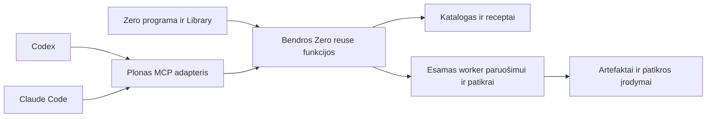

# RepositoryZero integravimas į Codex ir Claude Code

2026-10-17. Oficialios dokumentacijos ir tikslinių source vietų tyrimas. RepositoryZero source atskaita `01645b085ed6f592cd450ee06537dfb958cc9c94`. Integracijų galimybės dokumentuotos; RepositoryZero MCP serverio, papildinių ir kliento bandymų šis tyrimas dar nepatvirtina.

Pirmą įėjimą į RepositoryZero verta pateikti žmogaus jau naudojamame Codex ar Claude Code. Gimtoji programa valdytų pokalbį ir kodo kūrimą, o Zero pateiktų komponentų atranką, paruošimo receptus ir atskirą rezultato patikrą. Mažesnė perėjimo į naują programą trintis yra produkto hipotezė; žmonių norą naudoti ir praktinę naudą reikia išmatuoti.

## Nauda jau naudojančiam coding agentą

| Žmogaus darbas | Ką turėtų pridėti Zero | Kaip tikrinti vertę |
|---|---|---|
| Ieškoti tinkamos bibliotekos ir vertinti alternatyvas | Trumpas poreikį atitinkantis rinkinys su versijos, licencijos ir palaikomo profilio faktais | Paieškos tikslumas, klaidingi pasirinkimai ir visas sugaištas laikas |
| Iš naujo aiškintis diegimą ir sujungimą | Pakartotinai veikiantis komponento paruošimo receptas | Švaraus ir pakartotinio paruošimo rezultatai bei sąnaudos |
| Suprasti, ar agentas iš tiesų panaudojo komponentą | Runner patvirtintas panaudojimas ir source/lock provenance | Tikras build/resolution arba nuo komponento priklausantis testas |
| Patikrinti, ar programa veikia | Atskirai vykdomas tikrintuvas konkrečiam artefakto revision | Kokybė, failures, restart ir domeno kriterijai |

Papildinys yra pateikimo forma. Jo vertę turi sukurti patikimi duomenys, receptai ir rezultatai. Palyginimo baseline leidžiama naudoti įprastas bibliotekas ir natyvius įrankius. Vien didesnis repo sąrašas ar papildomas reuse promptas neįrodo sutaupymo.

## Oficialios prijungimo galimybės

Codex vietiniai klientai dokumentuoja STDIO bei Streamable HTTP MCP, serverio instrukcijas ir bendrą host konfigūraciją. Tai leidžia Zero pateikti įrankius jau veikiančiai Codex sesijai, neperkeliant jos modelio prisijungimo į mūsų backend. Naujo serverio įkėlimą reikia patikrinti realiame kliente; dokumentuotas setup gali reikalauti restart. [Codex MCP](https://learn.chatgpt.com/docs/extend/mcp?surface=cli).

OpenAI papildinys gali supakuoti skills, MCP ir pasirenkamą UI. Instrukcijos aprašo darbo eigą, serveris vykdo savo funkcijas ir tikrina jų teises. [Plugin architecture](https://developers.openai.com/plugins/concepts/plugins).

Claude Code papildiniai taip pat apjungia skills ir MCP. Jie turi savo manifestą ir platinimo kelią; komponentai gali veikti ir be papildinio paketo. [Claude Code plugins](https://code.claude.com/docs/en/plugins). Vietiniam procesui tinka STDIO, nuotoliniam serveriui dokumentuojamas HTTP. [Claude Code MCP](https://code.claude.com/docs/en/mcp).

| Įėjimas | Pirmo bandymo paskirtis | Sąlyga |
|---|---|---|
| Tiesioginis vietinis MCP | Patikrinti serverį ir tikrą tool call Codex host | Įdiegtas serverio runtime, tikras kliento ryšys ir scope |
| Codex papildinys | Patogiai pristatyti tą patį MCP bei trumpą darbo instrukciją | Atskirai kvalifikuotas paketas, konfigūracija ir įkėlimas |
| Claude Code papildinys | Tas pats backend kitame coding kliente | Plonas Claude manifestas ir atskiras host testas |
| Nuotolinis HTTP | Bendras viešas discovery arba pasirenkama paslauga | Reachability, autentifikacija ir atskira failų perdavimo/vykdymo riba |

## Svetainės prijungimo mygtukai

Codex turi dokumentuotą `codex://plugins/install/<plugin-name>?marketplace=<marketplace-name>` install flow nuorodą. Ji skirta klientui jau žinomam marketplace; vien URL negalima laikyti naujo marketplace registravimu. Nežinomas įrašas gali atverti bendrą Plugins puslapį. [Codex commands](https://learn.chatgpt.com/docs/reference/commands).

Codex taip pat dokumentuoja codex://new su URI-encoded promptu ir tikru plugin mention: tai paruošia composer, prompto automatiškai nesiunčia. Šis Try with Zero kelias atskiras nuo formalios identiško prompto A/B poros. [Commands](https://learn.chatgpt.com/docs/reference/commands).

Todėl svetainės „Prijungti prie Codex“ turi pasirinkti tikrą palaikomą kelią: esamo listing install nuorodą arba trumpą patikrinto marketplace/direct MCP paruošimo vedlį. Vietinio marketplace ir universalios viešos direktorijos publikavimas yra skirtingi keliai. [Package your plugin](https://developers.openai.com/plugins/build/plugins).

Claude Code dokumentuoja vietinio papildinio ir jo ZIP/URL bandymą bei marketplace diegimą. Šiame tyrime nepatvirtinta universali svetainės URL schema, kuri savavališkai sukonfigūruotų Claude Code. Pirmam palaikomam keliui tinka patikrinta kopijuojama komanda arba oficialaus listing eiga, kai toks listing iš tikrųjų yra. [Create a Claude Code plugin](https://code.claude.com/docs/en/plugins/create).

Mygtukas pradeda diegimo eigą. Būsena „Prijungta“ turi remtis tikru kliento kvietimu su tinkama protokolo versija ir scope, o ne paspaudimu, app atsidarymu ar vien įrašytu config. Pirmoje versijoje naršyklė gali patikimai parodyti setup veiksmus ir naudotojo kliente vykdomos patikros rezultatą. Automatinis statuso grąžinimas į svetainę yra atskira įgyvendinama funkcija, ne numanoma deep link savybė.

OpenAI viešos direktorijos vietinių MCP pateikimas šiuo metu ribotas approved partners ir allowlist. Tai ne tas pats kaip tiesioginis vietinis MCP bandymas ar repo marketplace. [Desktop-only submission](https://developers.openai.com/plugins/deploy/desktop-only). Claude papildinio patvirtinimas automatiškai nepersikelia į OpenAI; viešos konversijos hooks ir auth reikalavimai skiriasi. [Claude plugin conversion](https://developers.openai.com/plugins/guides/submit-claude-plugin).

## Bendras backend ir skirtingi klientai

Gimtoji programa išlaiko pagrindinio modelio, pokalbio ir projekto redagavimo autoritetą. Zero valdo tik savo užsakytus darbus ir jų būsenas; dubliuoto viso pokalbio scheduler nekuriame. Source paiešką galima teikti tiesiogiai iš bendrų funkcijų; sunkesniam paruošimui ir tikrinimui taikoma esama worker grandinė. Zero negali garantuoti visų Codex modelio ar shell veiksmų biudžeto kontrolės.

Pirmas serverio profilis gali būti discovery preview su search/details/status, be credential ar modelio API. Tikram MVP dar reikalingi paruošimas, scoped vykdymas, panaudojimo ir nepriklausomos patikros įrodymai. Modelio prenumerata lieka jo kliente; atskiri Jev ar kitų paslaugų API kvietimai turi savo iš anksto suteiktą baigtinį biudžetą. Šis įėjimas nepanaikina pasirinkto MVP Jev J1/J2 ar kitų produkto vartų.

Dabartiniame source `zero-repository-tools.ts` jau teikia read-only paiešką ir daugiausia penkis source kandidatus. `zero-catalog.ts` yra leksinė paieška su žinomomis užklausų spragomis. `mcp-transport.ts` importuoja kliento transportus: jo buvimas neįrodo mūsų MCP serverio. Paruoštų receptų ir išorinio host conformance negalima deklaruoti vien apgaubus šias funkcijas MCP protokolu.

## Gyvas Codex palyginimas

Reikia atskirų naujų projektų iš to paties seed commit ir naujų pokalbių, be ankstesnės RepositoryZero diskusijos. A aplinkoje Zero MCP, papildinio skills ir jų automatiškai įkeliamas kontekstas turi būti iš tiesų išjungti. B aplinkoje užfiksuotas Zero paketas, katalogas ir receptai. Pagrindinio modelio ir effort actual reikšmės, kiti įrankiai, leidimai, priklausomybių ir CPU/network ribos registruojami abiem.

Užduoties prompto tekstas ir nepriklausomas grader turi būti identiški; integracijos skirtumai fiksuojami profilyje. Pridėti frazę „naudok RepoZero“ tik B užduotyje reiškia pakeisti ir promptą. Pirmas explicit tool smoke gali taip veikti, bet jis nelaikomas tuo pačiu kontroliuotu palyginimu. A turi teisę ieškoti ir naudoti įprastas bibliotekas. Papildoma skill-only kontrolė gali atskirti geresnių instrukcijų poveikį nuo mūsų duomenų/receptų.

Pirmas tinkamas scenarijus: CSV peržiūra ir importas į SQLite, su quoted/newline laukais, klaidingais duomenimis ir atominiu rollback. B turi faktiškai panaudoti paruoštą CSV komponentą. Vien source rekomendacijos ar tuščias Jev pasirinkimas nepatvirtina visos grandinės. Pirmą porą vadinti exploratory; kartojimuose kaitalioti AB/BA eilę ir įtraukti kitas užduotis.

Vertinti galutinę kokybę, žmogaus taisymus, kūrimo/tikrinimo/viso workflow laikus, MCP startup, retrieval ir preparation, tikrus modelio usage/cache įrašus ir atskiras API sąnaudas. Cache ir prenumeratos mokestis neapibendrinami vien total tokens. Neišgaunama metrika yra unknown. Failures ir tool nepanaudojimas neišmetami; warm/cold ir vieno host bendrų resursų poveikis nurodomi. Naudotojui matomi abu native darbo procesai, o ne jų imitacija Zero lange.

## Priimta tolesnė kryptis

Po Astra peržiūros priimtas [MCP įgyvendinimo planas](../MCP-INTEGRATION.md) ir atskiras [native Codex piloto metodas](../NATIVE-CODEX-BENCHMARK.md). Šio datuoto tyrimo faktai nepakeičia runtime būsenos; serveris ir papildiniai dar neįgyvendinti.

## Dabartinė išvada

Techninis MCP ir papildinių kelias yra pagrįstas oficialiomis sąsajomis. Pradėti vietiniu bendro backend adapteriu, kvalifikuoti protokolą ir native host, tada vieną tikrą komponento panaudojimo vertikalę. Svetainės patogus prijungimas yra atskiras priėmimo darbas. Pilno MVP ir pakartojamos naudos vartai lieka bendrame roadmape; žmogaus pageidaujamas Codex palyginimas tampa atskiru natyvaus kliento eksperimentu.
