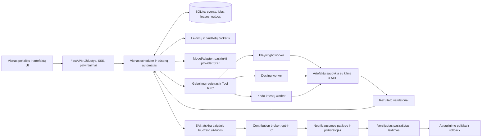

# Nepriklausomas architektūros pasiūlymas ir kritinė peržiūra

**0.2 aktualumo pastaba:** ši peržiūra išsaugo pradinės architektūros argumentų ir šaltinių istoriją. Vėlyvos autonomijos / iki100 katalogo rekomendacijas patikslina dabartiniai [planas](../../PLAN.md), [roadmap](../../ROADMAP.md), [autonomijos/VPS/upstream/update specifikacija](../AUTONOMY-AND-UPDATES.md) ir [nauja bendra kritika](autonomy-updates-review.md). Katalogo dydžio lubų nėra; siauras auto priėmimas perkeltas įP3C. Provider/auth/Treg aktualumas [atskirame review](provider-auth-review.md).

Tyrimo data: **2026-10-16, Europe/Kiev**. Būsena: **planas ir šaltinių analizė, sistemos vykdymas NEBANDYTAS**. Parengė antras lygiagrečiai dirbęs agentas; pagrindinis agentas pateikė priešpriešinę kritiką, žemiau užfiksuoti pakeisti sprendimai. Tai dviejų agentų architektūros peržiūra; nepriklausomas saugumo auditas ir našumo bandymai dar neatlikti.

**C5 architektūros atnaujinimas:** §19 pagrindu Rakazo tapo pirmu ADAPT/FORK pretendentu. Ankstesnis Python/FastAPI/SQLite variantas yra alternatyva iki privalomo P0.0 build-vs-adapt vertinimo; galutinė technologinė bazė dar nepasirinkta. Bendri leidimų, patvarumo, SAI ir vertinimo kontraktai lieka reikalavimai abiem variantams.

Žymos:

- **PATIKRINTA ŠALTINYJE** – skaitytas oficialaus repo tekstas arba tikras kodo įėjimo taškas; tai ne patvirtinimas, kad biblioteka įdiegta ar veikia mūsų sistemoje.
- **AUTORIŲ TEIGINYS** – repo autoriai nurodo galimybę, rezultatą arba platformų palaikymą; šiame darbe jos nevykdėme.
- **SIŪLOMAS SPRENDIMAS** – mūsų architektūros, ribų arba priėmimo kriterijų pasirinkimas.
- **NEBANDYTA** – integracija, scenarijus, dydis, veikimo trukmė, kainos arba pasiekiama kokybė dar nepamatuoti. Šiame dokumente jokiam sistemos scenarijui neteikiamas PASS.

## 1. Rekomendacija ir ribos

**SIŪLOMAS SPRENDIMAS.** Pirmas produktas turi patikimai užbaigti mažą, išmatuojamą užduočių rinkinį ir vieną visą bendro tobulinimo ciklą su **trimis pasirenkamais gebėjimų moduliais**. Šimtas repo yra katalogas, o ne pradinis priklausomybių rinkinys. „Superintelektas“ šiame etape yra ambicija; šaltiniai nepateikia įrodytos architektūros, kuri garantuotų tokį rezultatą. Projektą vertinsime pagal užbaigtas užduotis, kokybę, kainą ir žmogaus įsikišimą.

Pradinis variantas:

1. **Kontrolės plokštuma:** Python 3.12, FastAPI, Pydantic, mažas aiškus būsenų automatas, SQLite WAL vietiniame diske ir vienas autoritetingas scheduler writer.
2. **UI:** TypeScript/React, peržiūrėti assistant-ui komponentai, iš anksto sukompiliuoti statiniai failai. UI nerengia vykdymo ar leidimų politikos. Kitas pokalbio komponentas nėra priežastis perimti kitą agentų vykdymo branduolį.
3. **Darbininkai:** atskiri procesai / izoliuotos aplinkos, bendra versijuota Tool RPC sąsaja; specializuotų modulių priklausomybės nepatenka į kontrolės proceso importus.
4. **Trys MVP moduliai:** `web.browser` per Playwright; `documents.pdf` per Docling; `code.workspace` per ribotą Git/pytest/Ruff komandų adapterį. Modelis planuoja, adapteriai vykdo, nepriklausomi tikrintojai tikrina.
5. **SAI:** pradžioje išjungtas; vartotojas pasirenka B vietinei pataisai ir biudžetą. C pateikimas į GitHub įjungiamas atskirai. Priėmimas ir leidimas lieka prižiūrėtojui. D nėra MVP.

10–15 pradinių projektų rinkinyje gali būti UI, kontraktų validavimas, stebėsena, testavimo ir išleidimo įrankiai. Tai nereiškia 10–15 aktyvių vartotojo gebėjimų modulių ar nuolat veikiančių servisų.

## 2. Du tikri kritikos raundai ir sutarti sprendimai

| Klausimas | Nepriklausomas pradinis siūlymas | Pagrindinio agento kritika | Pakeistas bendras sprendimas ir priežastis |
|---|---|---|---|
| Kontrolės kalba | TypeScript kontrolė, Python moduliai | Docling ir duomenų ekosistema pridėtų perteklinę RPC ir dvigubą kontraktų priežiūrą | Python kontrolė, TS UI; vienas kanoninis JSON Schema kontraktas. Specializuotas workerio procesas vis tiek išlaiko izoliaciją. |
| Patvari būsena | PostgreSQL nuo pirmo MVP | Apsunkina local-first, atskiras servisas konkuruoja su ≤2 GB tikslu | SQLite vietiniame diske, vienas scheduler writer; PostgreSQL prieš multi-scheduler, nuotolinius bendrus workerius, multi-tenant arba HA. |
| Kiek agentų reikalauja PostgreSQL? | Pradinis atsakas galėtų riboti iki vieno | Pagrindinio agento pirmas slenkstis „2+ agentai“ buvo per grubus | **Du workeriai arba du pataisų autoriai nėra du scheduleriai.** Vienas coordinator gali atominiu būdu išdalinti dviem workeriams darbą, ir to pakanka MVP lease lenktynių testui. |
| Ilgų užduočių frameworkas | Temporal svarstyti vėliau | Pritarta mažam deterministiniam branduoliui | Tik vienas darbo eigos savininkas. DBOS ir Temporal lyginami tada, kai įrodytas poreikis; nepridedami kartu su nuosavu konkuruojančiu orchestratoriumi. |
| Izoliacija | Atskirti workeriai / konteineriai | Konteineris nėra pakankama riba hostile shell | Vietiniam trusted-code lane rootless konteineris; nepatikimam shell ir svetimam PR – disposable VM/microVM lane be paslapčių. |
| MVP mastas | Trys capability moduliai | Suderinti su 10–15 repo pasirinkimų reikalavimu | 3 moduliai + bendri build/runtime enableriai; iki 30/100 plėsti tik įrodžius visą ciklą. |

Šis apsikeitimas kritika pakeitė pasirinkimus; suderinimas nėra bandymų rezultatas ar nepriklausomo žmogaus patvirtinimas.

## 3. Vienas branduolys, aiškūs moduliai



### Branduolyje lieka tik bendros prievolės

| Funkcija | Kodėl bendra | Kas lieka moduliuose |
|---|---|---|
| Užduotis, planas, bandymas, būsena, events | Vartotojas turi matyti tęsiamą darbą po proceso ar UI gedimo | Specializuotas PDF, CAD ar browser algoritmas |
| Capability registras ir parinkimas | Vienodi leidimų, schemų ir resursų sprendimai | Konkretūs API, CLI ir bibliotekų adapteriai |
| Leidimų / resursų brokeris | Modelis negali pats padidinti savo leidimų | Moduliai tik deklaruoja poreikį |
| Artefaktų registras ir provenance | Rezultatas turi savininką, kilmę ir patikros būseną | Failų formatų eksportas, preview renderiai |
| Rezultato / klaidos / cancellation kontraktai | UI ir scheduler neturi spėlioti pagal natūralią kalbą | Domeno validatorius ir klaidų klasifikatorius |
| Modulio lifecycle ir suderinamumas | Vienas diegimo, health, atnaujinimo ir pašalinimo kelias | Kiekvieno modulio atskira, užfiksuota aplinka |
| SAI radiniai, politika, leidimo taikymas | Bendras patikimumo ir audito modelis | Pataisų rengimo įrankiai; upstream projektų ypatumai |

Šios funkcijos yra to paties produkto komponentai, o ne septyni būtini tinklo mikroservisai. MVP neįveda Kubernetes, Redis, vektorinės DB, P2P tinklo ar kelių agentų frameworkų.

### Trys moduliai ir jų aiškios užbaigiamos užduotys

| Modulis | Įėjimas ir išėjimas | Apribotas pirmas darbas | Patikra |
|---|---|---|---|
| `web.browser` | URL + veiksmų tikslas → šaltiniai, screenshot, HAR/trace pagal pasirinktą politiką | Viešos bandomosios svetainės paieška ir vienos formos užpildymas testų sistemoje | DOM assertions + serverio testinio įrašo būsena; publikavimui atskiras grant |
| `documents.pdf` | ArtifactRef → struktūrinis JSON, CSV, Markdown su puslapio koordinatėmis | Sintetinio kelių puslapių PDF lentelė | Schemos, eilučių/skaičių kontrolinės sumos, ranka parengtas etalonas |
| `code.workspace` | Repo revision + užduotis → patch, test report, preview artefaktas | Nedidelė lokali programa su testais izoliuotame workspace | Testai, paleidimo smoke, diff peržiūra, apribotos tinklo ir failų teisės |

**PATIKRINTA ŠALTINYJE:** Docling `DocumentConverter.convert()` ir Playwright `BrowserType.launch()` yra tikri įėjimo taškai. **AUTORIŲ TEIGINYS:** formatų ir naršyklių palaikymo apimtis aprašyta README. **NEBANDYTA:** mūsų adapterių tikslumas, greitis, pirmas modelių atsisiuntimas ir galutiniai dydžiai.

### Biblioteka, CLI, RPC arba servisas

- Į kontrolės procesą kaip bibliotekos patenka mažos bendros priklausomybės, pavyzdžiui, Pydantic. Specializuota biblioteka importuojama savo workeryje.
- CLI tinkamas stabilesniam procesui su struktūriniu išėjimu ir aiškiais exit codes; nenaudoti shell interpoliacijos iš modelio teksto.
- Python aplinka yra atskira kiekvienai nesuderinamai lockfile grupei. Node, Rust ir Go įrankiai naudoja tą patį Tool RPC išorinį kontraktą, o ne bendrą Python importą.
- Ilgai šylantis modelis ar bendras naršyklės servisas paleidžiamas pagal poreikį; resursai apskaitomi ir idle metu, po TTL sustabdomi.
- MCP yra importo/eksporto adapteris. MCP serverio deklaruotos read-only ar idempotency annotations nėra patikimas leidimas: platformos politika sprendžia savarankiškai.
- Nuotolinį servisą verta bendrinti tik tada, kai žinomos tenantų ribos, sutartis dėl jautrių duomenų ir aiškus operatorius. Jis nėra automatinis patikimo vietinio modulio pakaitalas.

## 4. Patvari būsena, lease ir išoriniai šalutiniai veiksmai

### Minimalios įrašų rūšys

`projects`, `tasks`, `steps`, `attempts`, `task_events`, `artifacts`, `capabilities`, `module_versions`, `permission_grants`, `budget_reservations`, `effect_intents`, `outbox`, `leases`, `findings`, `proposals`, `installed_releases`.

Kiekvienas naudotojo objektas turi `project_id` ir būsimam kelių tenantų režimui `tenant_id`. Vien ID žinojimas nesuteikia prieigos; tikrinama kiekviename read/write, download ir worker staging kelyje. Single-user režimo negalima paskelbti saugiu multi-tenant vien pridėjus duomenų bazės stulpelį.

Scheduler transakcija pakeičia dabartinę būseną, įrašo append-only event ir outbox įrašą kartu. UI gauna monotonišką `event_seq`, po ryšio nutrūkimo prašo tęsti nuo paskutinio ID. „Vykdoma 73 %“ nerodoma, jeigu procentas nesusietas su pamatuotais baigtais vienetais.

SQLite nustatymai ir ribos: vietinis diskas; vienas writer; trumpos transakcijos; WAL; `foreign_keys=ON`; kritiniams state commits konservatyvus `synchronous=FULL`; užfiksuotas `busy_timeout`; periodinis checkpoint, backup/restore ir disko pilnumo testas. DB ir `-wal` failas priklauso tam pačiam patvariam volume. NFS ir panaši bendra filesystem nėra palaikomas MVP variantas. **PATIKRINTA ŠALTINYJE:** SQLite `src/wal.c` pažymi, kad tuo pat metu leidžiamas vienas writer ir grąžinamas `SQLITE_BUSY`, jei užraktas negaunamas. **NEBANDYTA:** mūsų parinktų nustatymų pralaidumas, OS fsync semantika ir atsparumas maitinimo praradimui.

### Užduočių ir vykdymo būsenos

`queued → planning → waiting_permission | ready → running → verifying → succeeded | failed | canceled | blocked`.

`attempt_id` identifikuoja konkretų bandymą; `step_id` yra loginis darbas; `idempotency_key` identifikuoja tą patį loginį išorinį veiksmą per kelis bandymus. Visų trijų sutapatinti negalima.

Praradus workerį, read-only arba iš tiesų idempotentiškas žingsnis gali būti kartojamas pagal limitą. Išorinio efekto timeout neduoda teisės kartoti aklai.

### Tikslus išorinių efektų protokolas

1. Vienoje DB transakcijoje sukuriamas `effect_intent(status=pending, payload_digest, idempotency_key, permission_grant_id)` ir rezervuojamas biudžetas. Tas pats raktas su kitu payload atmetamas.
2. Coordinator skiria lease su didėjančiu `fencing_token`, `lease_owner`, `expires_at`. Workeriai neturi tiesioginės teisės keisti coordinator DB ar gauti plačių išorinių paskyrų raktų.
3. Efektų brokeris prieš vykdymą patikrina aktyvų grant, galiojantį lease/fence, terminą ir rezervą; pažymi `dispatching`. Jis pats turi ribotą credential ir perduoda stabilų idempotency raktą, jei išorinė sistema jį palaiko.
4. Patikimas atsakymas su operation ID ir receiptu leidžia `confirmed`; artefaktai ir receipt užregistruojami transakcijoje. Išorinis sėkmės atsakymas dar nėra galutinio vartotojo rezultato patikra.
5. Timeout, connection reset ar procesas, žuvęs po išsiuntimo, reiškia `unknown_after_timeout`, o ne `failed_without_effect`. Susijęs biudžetas laikomas potencialiai išleistu iki reconciliacijos.
6. Reconciler atlieka read-only užklausą pagal idempotency key / operation ID. Patvirtinamas faktinis efektas arba patikimai nustatoma, kad jo nebuvo. Tik pastaruoju atveju leidžiamas naujas bandymas; išorinei sistemai patikimai palaikant dedupe galima pakartoti tą patį raktą pagal jos sutartį.
7. Jei paslauga neturi patikimo reconciliation ar idempotency mechanizmo, užduotis sustabdoma konkrečiam žmogaus sprendimui. Neapibrėžto apmokėjimo, laiško ar publikavimo automatiškai nekartoti.
8. Pasibaigus lease, senas workeris negali commitinti rezultato ar inicijuoti naujo efekto. Vėlyvas receipt išsaugomas kaip įrodymas ir reconciliation įvestis; tik aktyvus coordinator gali pakeisti autoritetingą būseną.

Tai **at-least-once bandymų sistema su dedupe ir reconciliation**, o ne universalus exactly-once pažadas. Fencing token savaime nesustabdo jau išsiųsto išorinio HTTP veiksmo; todėl galutinis brokeris privalo vykdyti fence/grant patikrą, o išorinei sistemai nepalaikant fencing/idempotency lieka dokumentuotas neapibrėžtumas. Kompensacinis veiksmas yra atskira domeno operacija, ne garantuotas išorinio pasaulio rollback.

### Lease modelis ir dubliuojamas darbas

Siūlomi pradiniai parametrai, **NEBANDYTA**: 15 min. lease, heartbeat kas 2 min., vienas aktyvus pataisos autorius vienam tiksliam finding fingerprint; lease gali būti pratęstas tik neviršijant bendro darbo termino. Autoritetingas laikas imamas iš coordinator, workerių laikrodžiai nenaudojami sprendžiant nuosavybę. Vietiniai deadline matuojami monotonišku laikrodžiu.

Fingerprint apima modulį, upstream/adapterio versiją, normalizuotą klaidos tipą ir atkūrimo testo digest. Privačios klaidos turinys ar naudotojo dokumento hash neturi tapti viešu identifikatoriumi. Semantinis panašumas siūlo galimą dublikatą, bet automatiškai nesujungia skirtingų klaidų.

Lease perėmimas atominiu būdu padidina fencing token. Stale workerio publish atmetamas. Nauja bazinė versija verčia pakartoti reproducer ir rebase/merge patikras; failų ownership yra konsultacinis konfliktų signalas, o ne visam laikui užrakinantis globalus failų lock.

## 5. Kontraktų pavyzdžiai

Toliau – **SIŪLOMAS SPRENDIMAS**, validus JSON pavyzdys, bet dar neįgyvendinta schema. Tikras upstream SHA patikrintas; paketų lockfile, atsisiuntimų digest, resursai ir runtime testai dar neužfiksuoti. Todėl įdiegimas aiškiai užblokuotas. Pavyzdyje nėra išgalvoto konteinerio digest, paslapties ar teiginio, kad modulį galima aktyvuoti.

```json
{
  "manifest_version": "0.1",
  "id": "documents.docling",
  "version": "0.1.0-plan.1",
  "status": "candidate",
  "upstream": {
    "repository": "https://github.com/docling-project/docling",
    "revision": "6fadbae317b09c4dd4051c0f1fc1746c6baf04bc"
  },
  "license": {
    "code_spdx": "MIT",
    "model_licenses_verified": false,
    "third_party_notices_verified": false
  },
  "core_compatibility": ">=0.1.0 <0.2.0",
  "platforms": ["linux-x86_64"],
  "capabilities": [{
    "id": "document.extract_tables",
    "contract_version": "1",
    "input_schema": "schemas/document.extract_tables.input.v1.json",
    "output_schema": "schemas/document.extract_tables.output.v1.json"
  }],
  "runtime": {
    "kind": "python_worker",
    "python": "3.12",
    "entrypoint": "platform_adapter.docling_worker:main",
    "dependency_lock": null,
    "artifact_digests": []
  },
  "permissions": {
    "network": [],
    "files_read": ["input_artifact"],
    "files_write": ["staging_artifacts"],
    "secrets": [],
    "external_side_effects": []
  },
  "authentication": {"required": false},
  "resources": {
    "cpu_limit": 2,
    "ram_limit_mb": 4096,
    "gpu": "optional",
    "installed_bytes_measured": null,
    "model_bytes_measured": null,
    "cache_limit_mb": 1024,
    "estimates_are_measured": false
  },
  "execution": {
    "timeout_seconds": 180,
    "max_attempts": 2,
    "cancellation": "cooperative_then_terminate_process_tree",
    "idempotency": "canonical_input_digest",
    "healthcheck": "synthetic_one_page_fixture",
    "error_contract": "tool_error.v1"
  },
  "tests": {
    "acceptance_suite": "pdf_tables_v1",
    "requires": ["golden_cells", "page_provenance", "timeout", "oom", "no_network"]
  },
  "lifecycle": {
    "install": "reviewed_adapter_installer_only",
    "update": "stage_verify_then_atomic_activate",
    "uninstall": "remove_runtime_and_unreferenced_cache_preserve_user_artifacts"
  },
  "activation": {
    "allowed": false,
    "blocking_checks": ["lockfile_and_digests", "model_license_review", "runtime_acceptance", "resource_measurement"]
  }
}
```

`entrypoint` yra būsimo adapterio vardas, kurio repo dar nėra; jis pažymėtas planu ir niekur nebuvo paleistas. Manifestas negali būti naudojamas kaip savavališko shell scenarijaus vykdymo teisė. Įdiegimas atskirai reikalauja patikimo adapterio leidimo ir patvirtintos politikos.

### Įrankio užklausos apvalkalas

```json
{
  "protocol_version": "1",
  "task_id": "task_example",
  "step_id": "step_example",
  "attempt_id": "attempt_example_1",
  "capability_id": "document.extract_tables",
  "capability_version": "1",
  "module_release": "0.1.0-plan.1",
  "idempotency_key": "example-only-input-digest",
  "lease": {"lease_id": "lease_example", "fencing_token": 17},
  "permission_grant_id": "grant_scoped_to_input_and_staging",
  "budget_reservation_id": "reservation_example",
  "deadline": "2026-10-16T15:00:00Z",
  "input": {"document": {"artifact_id": "artifact_synthetic_pdf"}, "include_page_provenance": true}
}
```

Pavyzdžių ID ir data nėra realaus vykdymo įrašai. Tikras grąžinimas turės `status`, `result`, `artifacts`, `provenance`, `usage`, `validation` ir struktūrinį `error`, pavyzdžiui, `code=RESOURCE_EXHAUSTED`, `retryability=after_resource_change`, `side_effect_state=none`. Sėkmingai parsintas failas negrąžina `validation=verified`, kol nepriklausomas validatorius jo nepatikrino.

### Schemos ir suderinamumas

- Kanoninis viešas formatas – JSON Schema 2020-12; schema turi versiją ir savo digest. Pydantic yra Python validavimo realizacija, ne antras lygiagretus duomenų kontraktas.
- Ribojami objekto dydis, gylis, failų ir masyvų skaičius; `additionalProperties=false` kritiniams apvalkalams; normalizuojami keliai ir tikrinami symlink/path traversal atvejai.
- Runtime turi validuoti įvestį ir išvestį. Providerio tool schema gali palaikyti tik poaibį; modelio atsakymas vis tiek perleidžiamas per kanoninę schemą.
- Testuoti round-trip Python ↔ TS, semver suderinamumą ir schema downgrades. Nauji nepažįstami leidimai nesuteikiami automatiškai.
- Capability būsena: `candidate → experimental → verified → recommended → deprecated`. `verified` priskiriamas konkrečiam module release + platform + test suite, ne amžinai upstream repo.

## 6. Atmintis, kilmė, modeliai ir izoliacija

**Atmintis.** Pradžioje projektų pastabos, pasirinkti faktai ir artefaktų metaduomenys SQLite + failų saugykloje; pilno teksto paieška prieš dedikuotą vektorinį servisą. Retrieval rezultatas turi `source_artifact_id`, `source_version`, puslapį/span, gavimo laiką ir teisių filtrą. „Modelis taip pasakė“ nėra informacijos šaltinis. Vektoriniai indeksai yra atkuriami iš leidžiamų šaltinių; naudotojų prisiminimai atskiri nuo bendro kodo ir modelio mokymo.

**Model routing.** Vienas `ModelAdapter` su provider SDK: `generate`, `stream`, `tool_call`, `usage`, `cancel`, `health`. Konfigūruojami konkretūs modelio ID ir provider; jokio tylaus jautrių duomenų persiuntimo kitam provider po klaidos. Router sprendžia pagal gebėjimą, kontekstą, privatumo klasę, registruotą kokybės profilį ir likusį biudžetą; pats agentas negali padidinti limito. Tokenų ir kainos apskaita užfiksuoja taikytą kainoraščio versiją bei skiria įvertį nuo tikros provider ataskaitos. Vietiniai modeliai – pasirenkamas servisas, svoriai atskirai. LiteLLM alternatyva svarstoma, kai daug provider reikalauja realios naudos, po SDK/proxy licencijų bei observability nutekėjimo patikros.

**Izoliacija.** Vietinis trusted-code lane tinka vartotojo kontroliuojamiems projektams, nesuteikiant host socket, host filesystem ar plačių secrets. Nepatikimas kodas, svetimi PR, parsavimo įėjimai ir priešiškas shell naudoja atskirą disposable VM/microVM, ribotą tinklą, read-only inputs ir švarų image. Konteinerių engine, nsjail, bubblewrap ar gVisor gali sustiprinti ribą, tačiau nepadaro bet kokios konfigūracijos saugia ir nėra VM sinonimai. MVP be tinkamo hostile lane tokių darbų nepalaiko, užuot nuleidęs izoliacijos lygį tyliai.

**Artefaktai.** Turinys adresuojamas digest + per-tenant index; digest nėra teisė pasiekti failą ar vienas bendras viešas dedupe oracle. Browser cookies, raw HAR, console logs ir PDF turinys pagal nutylėjimą nėra viešas SAI įrodymas. Preview vykdomas izoliuotame origin su ribota CSP; aktyvaus HTML/Office turinio negalima laikyti nekaltu vaizdu.

**Paslaptys.** Trumpalaikiai siauri grant/token, brokeris už workerio ribų, redacted logs; privačių raktų vardai ir būsenos gali būti matomi nustatymuose, jų reikšmės neperkeliamos į užduoties prompt ar PR. Prompt injection tekstas iš puslapio, repo ar issue negali pakeisti politikos. Modelio prašymas nėra vartotojo autorizacija.

## 7. SAI lifecycle nuo radinio iki patvirtinto rezultato

**SIŪLOMAS SPRENDIMAS.** Toliau aprašyta būsima sistema. Šiame tyrime nekuriami PR, nepaleidžiami modeliai ir nepublikuojami leidimai.

| Etapas | Atsakingas komponentas ir teisė | Privalomi įrodymai / perėjimo sąlyga | Gedimas, atšaukimas ir kita būsena |
|---|---|---|---|
| 1. Aptikti | Užduoties validatorius; tik vietinis read | Faktinė klaida arba palyginamas pagerinimas; modulio ir bazės versijos | Neatkuriamas teiginys lieka `finding_unconfirmed`, pagrindinė užduotis tęsiama |
| 2. Patikrinti naujumą | Local index; C režime contribution coordinator read | Dabartinė release, upstream fixed issues, dublių fingerprint | Jei jau pataisyta – siūlyti atnaujinti, nerengti naujo PR |
| 3. Minimalus atkūrimas | Reproducer worker; izoliuotas compute | Sintetinis/nuasmenintas fixture, baseline komanda, expected/actual | Jei reikia privataus turinio – neskelbti, palikti lokalų; A/B gali sustoti |
| 4. Rezervuoti | Autoritetingas coordinator; scoped lease write | `finding_id`, TTL, owner, fence, base revision, biudžeto rezervas | Antras autorius stebi; pasibaigęs TTL perimamas atominiu būdu |
| 5. Izoliuota darbo vieta | Patch worker; tik savo sandbox write | Švari bazė, užfiksuotas lockfile ir aplinkos digest; nėra secrets | Timeout/OOM/atšaukimas sunaikina compute, išsaugo leistinus įrodymus |
| 6. Maža pataisa | Patch worker; tik leisti failai | Viena klaida, aiški diff apimtis; adapterio ar upstream nuosavybė | Viršytas scope, policy failai ar refactor – `needs_maintainer` |
| 7. Patikrinti | Test runner; izoliuotas run | Baseline reproducer rodo gedimą, pataisa pašalina, trusted regresijos ir integracija praeina | Regresija ar gate pakeitimas – atmesti; agentas negali susilpninti slenksčio |
| 8. Parengti PR | Contribution broker; tik aiškiai įjungtas C, tikslinis repo write | Nuasmenintas įrodymų paketas, base SHA, diff, sąnaudų ir rizikos santrauka | Be C ar credentials – vietinė pataisa lieka užbaigtu B rezultatu |
| 9. Nepriklausoma peržiūra | Prižiūrėtojas + trusted-base CI; be autoriaus veto | Fiksuota policy/runner versija iš patikimos bazės, atkuriami logai | Prašomi pataisymai, rate-limit ar review backlog; lease neužrakina review amžinai |
| 10. Sujungti | Prižiūrėtojas, protected branch | Naujausia bazė, peržiūra po reikšmingo diff, būtini checks | Pasikeitus bazei tikrinama iš naujo; autoriaus testų rezultatas nėra merge teisė |
| 11. Išleisti | Atskiras release runner/token | Versija, artifact digest, SBOM, kilmė, pasirašytas manifestas, migration plan | Nepasirašytas ar netinkamos identity leidimas nepublikuojamas / neįdiegiamas |
| 12. Įdiegti | Naudotojo update agent; jo pasirinktas kanalas | Suderinamumas, laisva vieta, verifikacija, staged healthcheck, grįžimo kelias | Nesėkmė grąžina ankstesnį active pointer; darbai ir dokumentai išsaugomi |
| 13. Stebėti rezultatą | Vietinis quality monitor; opt-in agregatai | Ta pati versija realiai naudota; užduočių, kokybės, kainos, error metrikos | Regresijos signalas stabdo rollout / rollback; raw privatūs logai nesiunčiami |
| 14. Patvirtinti pagerėjimą | Nepriklausomas eval + naudojimo evidence | Palyginamas baseline, etalonai, paklaidos ir neigiami rezultatai | „Merged“ ar „installed“ savaime nereiškia „pagerino“ |

Adapterio pataisa teikiama platformai. Upstream klaida turi atskirą upstream PR, jo contributor taisykles ir licenciją. Laikinas adapterio workaround turi susietą issue, testą, dokumentuotą ribą ir pašalinimo sąlygą. SAI negali apsimesti, kad platformos fork priėmimas reiškia originalaus projekto pataisymą.

### Tobulinimo pasiūlymo struktūra

```json
{
  "proposal_version": "1",
  "finding_id": "example_synthetic_pdf_header",
  "scope": "platform_adapter",
  "base_revision": "not_yet_implemented",
  "module_id": "documents.docling",
  "classification": "reproducible_bug",
  "autonomy_level": "B",
  "lease_id": "example_lease",
  "fencing_token": 17,
  "evidence": {
    "fixture_class": "synthetic",
    "private_data_exported": false,
    "baseline_run": null,
    "candidate_run": null,
    "trusted_suite_revision": null,
    "environment_digest": null,
    "before_metrics": null,
    "after_metrics": null,
    "known_regressions": []
  },
  "state": "planned_not_run",
  "risk": "unassessed_until_execution",
  "required_review": ["module_owner"],
  "rollback": {"strategy": "previous_adapter_release", "migration_required": false}
}
```

Tokio plano negalima pateikti kaip patikrinto PR. Tik vykdymo įrodymai užpildo null laukus ir leidžia pereiti į testavimo/peržiūros būseną.

### Autonomijos modelis

| Režimas | Leidžiama tik vartotojui pasirinkus | Draudžiama | MVP |
|---|---|---|---|
| A | Vietoje aptikti, paaiškinti ir parodyti atkūrimą | Kodo pakeitimas, publikavimas, atnaujinimų priverstinis taikymas | Taip |
| B | A + savo izoliuotoje aplinkoje parengti mažą vietinę pataisą | PR publikavimas, merge, release | **Rekomenduojamas pirmas prisidėjimo režimas**, bet ne numatytasis slaptas opt-in |
| C | B + per atskirą brokerį pateikti PR į nustatytą repo su turima teise | Savęs patvirtinimas, privilegijų plėtimas, branch protection apeiga | Atskiras opt-in, testinis repo per pilotą |
| D | Tik iš anksto aprašytos mažos rizikos kategorijos po sukauptų įrodymų | Leidimai, policy, CI, release, autentifikavimas, privatumas, priklausomybės ir jų kilmė; AGENTS/SKILL instrukcijų automatinis keitimas | Ne |

D ateityje galėtų apimti aiškiai neinterpretuojamo vartotojo dokumento rašybą arba semantiškai tikrintą formatavimą. „Mažai eilučių“, „tik prompt“ ar „tik dokumentacija“ nėra savaiminiai saugumo kriterijai. D kategorijos ir aktyvavimo slenksčiai priklauso prižiūrėtojų politikai, kurios autorius savo PR pakeisti negali.

### Biudžetai ir prioriteto taisyklės

Vartotojas pasirenka `max_cost`, `max_wall_time`, `max_cpu_seconds`, `max_disk_bytes`, `max_model_tokens`, `max_attempts`, `max_parallel_patches` ir `max_prs_per_day`. Suderintas pilotinis profilis: 1 aktyvi pataisa vienu metu, iki 30 min. vienam darbui ir 2 nesėkmingų pataisos bandymų limitas; C režime iki 1 PR per naudotoją per dieną. Pasiekus nesėkmių ar kitą limitą darbas sustabdomas, biudžetas automatiškai nepapildomas; piniginio limito privalomą reikšmę nustato pats vartotojas prieš naudodamas mokamus API. Šie planavimo parametrai suderinti su PLAN.md; jie dar nėra įgyvendinta ar išbandyta politika.

Pagrindinė naudotojo užduotis gauna aukštesnį prioritetą; SAI paleidžiamas po jos arba tik iš aiškiai rezervuotos laisvos kvotos. Išlaidų rezervavimas transakcinis, kad du workeriai neišleistų vieno likučio. Pasiekus ribą darbas saugiai sustoja ir išsaugo vietinį patch/evidence. PR priėmimo eilė ir žmogaus review pajėgumas riboja pateikimų skaičių; didinant agentų kiekį nedidinamas automatinis PR srautas.

### Anti-gaming ir pasitikėjimo ribos

- Trusted CI pipeline, vertinimo rinkinio ir priėmimo slenksčio versija pasirenkama iš patikimos bazės, o ne iš tikrinamo PR.
- Autoriaus pridėtas testas vertingas reproducer, bet ne vienintelis priėmimo arbitras. Atkuriamas baseline ir paslėptas / nepriklausomai prižiūrimas holdout rinkinys.
- Pataisa negali pakeisti score skaičiavimo, išjungti testų, slėpti timeout kaip sėkmės, sumažinti fixture apimties arba savęs pažymėti recommended.
- Ne vien LLM teisėjas: pirmenybė faktinei galutinei būsenai, parsintiems artefaktams, deterministiniams tikrintojams ir aklai žmogaus rubrikai.
- Review, test execution ir release raktai atskiri. Nepatikimas PR negali pasiekti release secrets. Nevykdyti jo kodo privileged `pull_request_target` kontekste su secrets; trečiųjų šalių Actions pininti nekintančiu SHA.
- Kodo parašas įrodo leidėjo identity ir artefakto vientisumą pagal pasirinktą trust policy, o ne pakeitimo kokybę. Cosign verify turi fiksuoti leidėjo identity/issuer ar patikimą raktą, ne vien „yra bet koks parašas“.
- Sėkmės metrika nėra PR skaičius, pakeistos eilutės, agentų kiekis ar modelio pasitikėjimo tekstas.

## 8. Privatumas, leidimas, atnaujinimas ir rollback

Prisidėjimas nesuteikia teisės dalintis naudotojo dokumentais, privataus kodo fragmentais, klientų informacija, cookies ar neapdorotais darbo žurnalais. Viešam paketui generuojamas sintetinis fixture arba žmogaus patvirtintas nuasmenintas minimalus atkūrimas. Automatinio redact filtro sėkmė nelaikoma garantija; neaiškus turinys lieka lokalus. Originalūs failai ir jų atmintis nepatenka į bendrą repo ar bendrą mokymo rinkinį.

Leidimo manifestas fiksuoja core/module versijas, OS/arch, lockfile, konteinerių ir svorių digests, licencijų notices, SBOM, patikros runner versiją ir migracijų planą. Nauja versija atsisiunčiama į staging, patikrinama identity+digest, paleidžiama su sintetiniu healthcheck, ir atominiu pointer pakeitimu aktyvuojama tik sėkmės atveju. Įdiegta, aktyvi ir naujausia versija UI atskiriamos.

Nustatyti kanalai `pinned`, `stable`, `preview`; `pinned` neliečiamas be vartotojo pasirinkimo. Svarstoma anti-rollback/metadata expiry politika ir raktų rotacija: senas pažeidžiamas pasirašytas leidimas negali tapti tyliu „saugiu naujinimu“. Offline leidimų kelias turi atskirą patikimų raktų ir revocation dokumentaciją.

Kiekvieno atnaujinimo metu paliekama ankstesnė veikianti versija ir jos lockfile. Automatinis rollback galimas tik suderinamiems duomenims. Duomenų bazės migracijoms pirmenybė expand/contract ir išbandytam backup/restore. Negrįžtama migracija reikalauja atskiro operatoriaus sprendimo; vien seno binary paleidimas neanuliuoja DB pokyčių ar išsiųstų laiškų.

Realus P2P kol kas nenaudojamas. Galima būsima nauda – didelių **jau patvirtintų, pasirašytų ir turiniu adresuojamų** paketų platinimas. Papildoma kaina: NAT, discovery, užkrėstų peer reputacija, metaduomenų privatumas, licenciniai platinimo apribojimai, seed prieinamumas ir teisių tikrinimas. Paprastas registry/CDN+digest pradžioje aiškiau. Torrent analogija paaiškina bendrą dalyvavimą; ji netapatina PR su modelio mokymu ar saugiu programų vykdymu.

## 9. Aštuoni privalomi SAI gedimo scenarijai

Visi scenarijai **PROJEKTUOJAMI, NEBANDYTI**. Kiekvienam įgyvendinant reikia išsaugoti versijas, komandas, events ir rezultatų artefaktus.

| Scenarijus | Numatyta eiga ir įrodymai | Gedimas ir atkūrimas | Priėmimo kriterijus |
|---|---|---|---|
| 1. PDF lentelės klaida | Sintetinis kelių puslapių PDF; pradžioje sąmoningai įterptas test-only adapterio defektas, ne tariamai rasta Docling upstream klaida; agentas parengia mažą pataisą | Trūkstant OCR modelio klaida `dependency_missing`, ne klaidingas lentelės fix; privatus PDF neiškeliauja | Baseline tikrai atkuria gedimą; candidate sutampa su rankiniu golden; trusted PDF regresijos; C tik opt-in; maintainer priima ir leidimas pritaikomas |
| 2. Du agentai taiso tą patį | Du workeriai vienu metu prašo vieno fingerprint lease; coordinator vienoje transakcijoje parenka savininką | Pirmas sustoja, TTL baigiasi, antras perima su didesniu fence; seno autoriaus publish atmetamas | Vienas aktyvus lease; jokių dvigubų PR; stale rezultatas negali commitinti; įrodymai neprarandami |
| 3. Upstream sugadina adapterį | Lockfile palieka seną veikiančią versiją; nauja upstream versija testuojama staging per contract ir compatibility suite | Nesuderinama versija karantinuojama; optional workaround ar upstream PR; jokio tylaus `latest` | Veikianti instaliacija nepakeičiama; naujas module release tik su green patikromis ir užfiksuotu digest |
| 4. Viena užduotis greitesnė, kita blogesnė | Porinis baseline/candidate testas su ta pačia aplinka ir nepriklausomu PDF/kodo/browser regresijos rinkiniu | Speed improvement neatperka kritinės correctness regresijos; pataisa atmesta arba skaidoma | Nulis kritinių regresijų; visi nuokrypiai paskelbti; kokybės kainos tradeoff tik aiškiai prižiūrėtojui pasirinkus |
| 5. Naudotojas prideda repo | Vedlys read-only gauna URL, revision, LICENSE, API kandidatus, generuoja adapterio ruošinį ir trūkstamų patikrų sąrašą | Nepatikimas install script nepaleidžiamas; licencija arba API neaiški – candidate būsena | Jokių core pakeitimų; aiški `unverified` būsena; tik po izoliuotų patikrų galima experimental |
| 6. Moduliui reikia didelio modelio | Vedlys rodo atskirai wheel/container, modelį, cache, RAM/VRAM ir first-run network; siūlo CPU/API alternatyvas, jei patikrintos | Nepakankama vieta/RAM – prieš atsisiuntimą sustabdo; partial download saugiai pašalinamas, dokumentai lieka | Bazinė instaliacija nepadidėja; vartotojas sąmoningai pasirenka ir skiria limitą; faktiniai dydžiai įrašyti |
| 7. Pasiūlymas keičia gate taisykles | PR keičia trusted tests / policy / CI arba siūlo mažesnį slenkstį | Trusted-base runner tokio pakeitimo neperima; reikalaujama atskira maintainer/security peržiūra; C autorius neturi admin teisių | Pataisa negali įvertinti savęs nauju silpnesniu gate; žurnalai rodo taikytą policy SHA |
| 8. Priimtas update regresuoja | Canary / vietinis healthcheck ir pirmos realios užduotys aptinka blogėjimą; konkreti release susiejama su įrodymais | Rollout sustabdomas; atominiu pointer grįžtama; suderinama DB lieka, nesuderinama atkuriama pagal patikrintą planą | Ankstesnė užduotis vėl atkuriama; darbai ir dokumentai išlieka; bloga versija nebesiūloma; atskiras incident review |

Papildomos ankstyvos fault-injection patikros: procesas žūsta prieš ir po išorinio efekto išsiuntimo; workeris sustoja po lease perėmimo; diskas pilnas; failas pernelyg didelis; atšaukiamas modelio stream; neteisingas parašas; dependency hash nesutampa; aktyvus HTML preview bando pasiekti sesiją; aptinkamas galimas privataus teksto eksportas.

## 10. Roadmap su išmatuojamais vartais

Visi checkbox'ai reiškia ateities įgyvendinimą, ne šiame tyrime atliktą veiksmą.

### G0: specifikacija ir grėsmių modelis

- [ ] Užfiksuoti v0.1 Tool RPC, manifest, error, artifact ir event schemas, suderinamumo taisykles.
- [ ] Dokumentuoti leidimų / projektų / sandbox / modelio provider ribas; atmesti unsupported hostile vykdymą.
- [ ] Sukurti 20 paprastų deterministinių fixtures ir vieną tikrai atkuriamą seeded adapter defect demonstracijai.
- [ ] Užfiksuoti pradinį provider/SDK pasirinkimą, kainos matavimo būdą ir žmogaus vertinimo rubriką.
- [ ] Užfiksuoti `<100 MB` Git ir `≤2 GB` bazinio diegimo matavimo metodą, atskiriant host prerequisites ir optional modules.

**Gate:** kontraktus patvirtina prižiūrėtojas; kiekviena critical rizika turi testą arba aiškią unsupported ribą. Modelio pažadas nėra gate įrodymas.

### G1: minimalus užduoties vertikalus pjūvis

- [ ] Pokalbis → task → vienas workeris → artifact → validatorius → UI, su resumable event srautu.
- [ ] SQLite transakcijos, outbox, cancellation, riboti retries ir budgets; pagrindinė užduotis išgyvena scheduler restart.
- [ ] Izoliuoti staging outputs ir failų quota; privatus preview atskirame origin.
- [ ] Išmatuoti bazinį diegimą švariame supported Linux host; distribucijoje neturi būti viso Node build chain ar ML svorių.

**Gate:** 20/20 deterministinių API ir saugojimo fixtures; fault-injection nepraranda patvirtintų events/artefaktų; privalomas base dydžio report. Tai nėra universalios agentų sėkmės procentas.

### G2: trys moduliai ir patikimas atkūrimas

- [ ] Playwright, Docling ir code.workspace atskiri lockfiles/workeriai; install-on-demand, health ir uninstall.
- [ ] Du workeriai, vienas coordinator: lease race, fence ir biudžeto rezervavimo testai.
- [ ] Išorinių efektų brokeris įgyvendina `pending → dispatching → confirmed | unknown_after_timeout → reconciled`.
- [ ] Oficialus supported platform matrix; CPU-only kelias pirmas, GPU ne privalomas.
- [ ] 30 užduočių rinkinys trijose MVP srityse, įskaitant gedimus; baseline ir candidate atskiri, riboti modelio bandymai.

**Gate:** nulis duplicate simulated external effects gedimo rinkinyje; stale workeris negali commitinti; nulis cross-project skaitymo/rašymo ACL teste; visos išlaidos ir pamatuoti dydžiai ataskaitoje. „Testuose nerasta“ nėra neribota izoliacijos garantija.

### G3: vienas pilnas SAI ciklas

- [ ] Naudotojo matomi A/B nustatymai, aiškus C opt-in ir baigtinis biudžetas; default nėra viešo indėlio.
- [ ] Sintetinė problema → reproducible baseline → lease → izoliuota maža pataisa → trusted regresijos.
- [ ] Leidžiamame testiniame repo tikras C PR → nepriklausomas review → maintainer merge → pasirašytas release → kitas švarus klientas įsidiegia.
- [ ] Atskiras blogo release eksperimentas → faktinis rollback; taip pat testas, kuriame pataisa bando susilpninti savo gate.
- [ ] Viešam evidence paketui nėra raw naudotojų dokumentų ar secrets; tuščias/užblokuotas patikros rezultatas negali tapti sėkme.

**Gate:** vienas atkuriamas visas ciklas su realiais artefaktais ir tiksliomis versijomis, įskaitant dublikatą ir rollback. Mock GitHub adapteris tinka protokolo testui, bet nepakeičia tikro PR/release integracijos gate. Šiandien šis gate **NEVYKDYTAS**.

### G4: iki maždaug 30 pasirenkamų galimybių

- [ ] Pirmiausia tikslingos spragos: struktūrinis kodo search, patikimas web extraction, duomenų analizė, dokumentų eksportas ir headless CAD; atskiri trukmės/dydžio reportai.
- [ ] Inspect ar analogas nepriklausomam agentų eval; neprivalomas didelis eval frameworkas kasdieniam runtime.
- [ ] Kiekvienas modulis bent vieną naują vartotojo užduotį užbaigia geriau už esamą priemonę; dubliuojantis modulis lieka alternatyva.
- [ ] Prieš multi-scheduler/remote shared workers/multi-tenant/HA įgyvendinti PostgreSQL ir pakartoti concurrency, ACL, migration bei fault-injection rinkinį.
- [ ] DBOS ir Temporal sprendimas priimamas su prototipo dydžio/ops/recovery matavimu; vienas authoritative workflow engine.

**Gate:** 100 versijuotų užduočių, bent 20 laikomų atskiram nepriklausomam vertinimui; aiški kiekvieno modulio `verified` platforma; nulis nekontroliuojamų permissions upgrades. Paslėpto rinkinio dydis nėra statistinės galios garantija.

### G5: iki 100 katalogo įrašų ir ekosistema

- [ ] Kiekvienas recommended release turi license/dependency audit, exact revision, contract tests, resursų matavimą, savininką ir deprecation kelią.
- [ ] Viešas palyginimas su tinkamais sričių baseline naudojant vienodą modelį, resursų limitą, leidimus ir užduotis; paskelbiamos nesėkmės.
- [ ] Nepriklausomas saugumo review ir viešai atkuriami reference scenarijai prieš multi-tenant/hostile vykdymo plėtrą.
- [ ] D autonomija svarstoma tik po ilgalaikio kokybės, review apkrovos ir realių regresijų stebėjimo; ne pagal PR skaičių.
- [ ] P2P arba modelių mokymas vertinami kaip atskiri projektai su atskiru duomenų sutikimu ir įrodyta nauda.

**Gate:** 100 yra kokybiškai palaikomas katalogas arba sąžiningai mažesnė rekomenduojama aibė. Skaičius negali priversti priimti silpnų ar dubliuojančių projektų.

## 11. Didžiausios rizikos ir ankstyvi falsifikavimo bandymai

| Rizika | Ankstyviausias konkretus bandymas | Sprendimas, jei nepavyksta |
|---|---|---|
| Agentas daug planuoja, bet neužbaigia darbo | Mažas užduočių rinkinys su nepriklausoma galutinės būsenos patikra ir ribotu bandymų skaičiumi | Mažinti užduočių sritį; nepridėti modulių užmaskuojant nesėkmę |
| Nuosavas state machine tampa neišbaigtu Temporal | Kill/restart kiekviename kritiniame žingsnyje, užduotys su laukimu ir išoriniu neapibrėžtumu | Matuotas DBOS/Temporal prototipas; pakeisti vieną engine, o ne pridėti kitą virš jo |
| Schema „suderinama“ tik vienam provider | JSON Schema round-trip, unsupported keywords ir canonical output validation testai | Riboti provider palaikymą, aiški transformacija ir atmetimas |
| Konteinerio/rakto nutekėjimas | Unauthorized file/network/socket/secret aksesų testai, nepriklausoma sandbox peržiūra | Hostile lane išjungtas iki tinkamos VM ir ops kontrolės |
| SQLite konkurencija/duomenų praradimas | Du workeriai, vienas writer; busy, checkpoint, disk-full, restart ir restore testai | Mažinti writer trukmę; pagal realų poreikį migruoti PostgreSQL |
| Dvigubas išorinis veiksmas | Crash po dispatch, timeout, uždelstas receipt, stale lease | No-retry-on-unknown; provider-specific reconciler arba žmogaus sprendimas |
| ML priklausomybės sulaužo ≤2 GB | Švarus CPU-only base ir atskiri first-run modulių matavimai | ML tik optional; mažas bazinis paketavimas; publikuoti tikrą viršijimą |
| Benchmark overfitting / gate gaming | Trusted-base runner, nepriklausomas holdout, PR keičiantis policy, porinis baseline | Atmesti pakeitimą; atskirai peržiūrėti eval/policy atnaujinimą |
| Module/weights licencijos supainiojimas | Tikrinti modelio kortelę, dependency graph ir distribution notices atskirai | Modulis lieka candidate arba pasirenkamas kitas modelis |
| Review pajėgumas mažesnis už PR srautą | Ribotas pilotas su pamatuota žmogaus review trukme ir reject priežastimis | Backpressure ir submission kvotos; ne automatiškas merge |
| Rollback neveikia po migracijos | Blogas leidimas su tikrais duomenimis sintetiniame pilotiniame state, restore drill | Expand/contract, versijų overlap; negrįžtamai migracijai atskiras operatorius |
| Privatus pavyzdys prasprūsta į evidence | Sintetinis slaptas canary į raw logus/fixture, export scanner ir review | SAI export fail-closed, vietinis radinys išlieka |

### Matuojama kokybė ir sąžiningi palyginimai

Matuoti `verified_task_success`, kokybės rubriką, visą trukmę, cold/warm trukmę atskirai, tikrą ir įvertintą kainą, RAM pikas, papildomą diską, žmogaus intervencijų skaičių ir pobūdį. Nurodyti bandymų skaičių, paklaidos intervalus, modelio ir evaluator versijas, provider, kontekstą, token/timeout/retry limitus, machine/OS ir seed, kai jis palaikomas. Vien seed negarantuoja išorinio modelio deterministiškumo.

Performance pataisos gate: correctness neturi kritiškai regresuoti; pagerėjimas vertinamas poriniais bandymais ir pakankamu kartojimų skaičiumi. Konkretaus procento negalima garantuoti be baseline sklaidos; mažas pilotas pagrindžia tik to piloto išvadą. Palyginimui rinktis tinkamą srities baseline, pavyzdžiui, kodo sistemą kodo užduotims, o ne deklaruoti universalų pranašumą iš vienos lentelės.

## 12. Dydžiai, cache ir pašalinimas

**SIŪLOMI TIKSLAI, NE MATAVIMAI.** Git ≤100 MB ir bazinė instaliacija ≤2 GB (decimal bytes). Bazė apima išplatintą runtime, būtinas priklausomybes ir sukompiliuotą UI; neįtrauktų host prerequisites (OS, engine, virtualizacija) vieta ir resursai vis tiek nurodomi atskirai. Kūrimo Node toolchain negali būti paslėptas, jei jis būtinas vartotojui paleisti produktą.

| Profilis | Turinys | Planavimo intervalas, ne pažadas |
|---|---|---|
| Minimalus | Python core + statinė UI + SQLite, 0 ML svorių, 0 browsers | Tikslas ≤2 GB; faktinis matavimas būtinas G1 |
| Vidutinis | Trys MVP moduliai, vienas browser, CPU-only Docling paketai/modeliai, nedidelės cache | Apytikris talpos planavimas 6–15 GB; priklausomybės gali pakeisti intervalą |
| Platus pasirenkamas | Media/CAD/desktop, keli konteineriai ir vietiniai modeliai | 30–200+ GB; dideli modeliai gali viršyti ir šį intervalą; „100 įrašų“ nėra tokio profilio reikalavimas |

Šie intervalai tik rezervų planavimui. Tikrinti `unique stored bytes`, atsisiuntimo bytes, išpakuotą dydį, image sluoksnius, svorius, cache ir workspaces atskirai; RAM/VRAM pikas yra kita metrika. Vien `du` viename venv neapima visos kainos.

Suderinamus nekintamus blobs ir aplinkas galima bendrinti pagal digest; nesuderinamos versijos izoliuojamos. Cache turi LRU ir kvotą, bet naudotojų dokumentai bei galutiniai darbai niekada automatiškai neklasifikuojami kaip cache. Uninstall panaikina modulio runtime, jo nebenaudojamas priklausomybes ir leistiną cache, palieka artefaktų registrą bei vartotojo darbą. Disko pilnumas sustabdo naujus darbus, o ne tyliai ištrina dokumentus.

## 13. UI ir kūrėjo kelias

Viename pokalbyje matyti užduoties tikslas, planas, tikri žingsnių events, laukimo priežastis, likęs rezervas ir atšaukimas. Artefaktai turi preview/download, provenance, validation status ir version. „Vykdymas baigtas“ atskiriamas nuo „rezultatas patikrintas“.

Modulių katalogas rodo tikrą įdiegtą dydį, pirmo paleidimo downloads, licenciją ir atskiras modelių sąlygas, CPU/GPU/OS, leidimus, numatomus išorinius mokesčius, health ir supported release. Nepamatuoti laukeliai taip ir pažymėti.

Repo prijungimo vedlys yra read-only analizė → kontraktų/adapterio ruošinys → trūkstamų checks sąrašas → isolated verification → explicit install. Įvestas GitHub URL neautorizuoja jo scripts ar AGENTS/SKILL instrukcijų vykdymo. Core kodo nereikia keisti kiekvienam naujam CLI ar bibliotekos adapteriui.

Prisidėjimo skydelyje: opt-in A/B/C, biudžetas, radiniai, lease/queue būsena, vietinės pataisos, PR, merged, released, installed, naudojimo patvirtinimas. Atnaujinimo kortelėje matyti kanalą, dabartinę ir siūlomą versiją, leidimų/dydžio pokytį, rollback galimybę ir DB migracijos apribojimą.

## 14. Populiarių pasirinkimų kritika ir dubliavimo taisyklės

- LangGraph, PydanticAI, AutoGen, CrewAI, OpenHands ir panašių sistemų įdiegimas kartu nėra universalus „stipresnis branduolys“. Jos gali konkuruoti dėl agent loop, atminties, retry, tool schema ir stebėsenos. Konkretus jų komponentas arba visas specializuotas agentas gali veikti kaip modulis, kai įrodomas papildomas gebėjimas; platformos scheduler išlaiko autoritetą.
- Temporal yra stiprus kandidatas tikram distributed workflow poreikiui; jo serveris/ops ir istorijų/migracijų taisyklės nėra nemokamos. DBOS gali išvengti atskiro orchestrator serverio, bet tikrintame README remiasi Postgres ir nesprendžia išorinių API exactly-once universaliai.
- LiteLLM nėra privalomas, kol 1–2 tiesioginiai provider adapteriai pakankami. Gateway nauda turi atpirkti papildomą valdymo, privacy ir dependency paviršių. Viso repo license nėra vien MIT be enterprise išimties.
- Open WebUI ar visos pokalbio platformos perėmimas gali padubliuoti session/auth/DB/task modelį. Pirmiausia patikrinti komponentų lygio UI; assistant-ui irgi ne automatinė pilna mūsų artefaktų, užduočių ir policy UI.
- Playwright, browser-use ir computer-use frameworkai dažnai persidengia. Pradžioje vienas deterministinis browser adapteris; agentic browser ar desktop modulis pridedamas tik pagal papildomą užduoties sėkmę.
- Vektorinė DB, RAG frameworkas, keli crawleriai, keli PDF varikliai ir kelios CAD GUI nuo pirmos dienos didina priežiūrą. Vienas pasirinkimas kiekvienam MVP keliui; stipriausia alternatyva laikoma kataloge ir patikrinama failover tik kai to reikia.
- Auto-PR be backpressure sukuria prižiūrėtojų problemą. Automatinis merge netampa geresniu vien dėl įspūdingo agentų kiekio.
- „Autonominis tobulėjimas“ šiame plane reiškia versijuojamą kodo kūrimo ir patikros procesą. Tai nėra nekontroliuojamas self-modification, bendros vartotojų atminties dalijimasis ar modelio svorių treniravimas.

## 15. Tyrimo ciklas C3: tikslinė spragų paieška

Po pirmo branduolio pasiūlymo atskirai ieškota mažiau akivaizdžių gebėjimų ir alternatyvų. **PATIKRINTA ŠALTINYJE** septynių repo README, LICENSE/COPYING ir tikri kodo įėjimo taškai; žemiau esančiame šaltinių registre yra tikslūs SHA. Tai šaltinių peržiūra, ne jų runtime demonstracija.

| Projektas | Ką šaltiniuose patikrinau | Kokią spragą sprendžia | Ar pakeičia sprendimą? |
|---|---|---|---|
| DBOS Transact Python | README: durable workflows ir queues su Postgres; `dbos/__init__.py` eksportuoja `DBOS`, `DBOSClient`, `Queue`; MIT | Mažesnis recovery engine nei atskiras orkestravimo serveris | SQLite MVP nekeičia. G4 privalomas palyginimo kandidatas su Temporal; rinktis vieną. |
| NsJail | Namespaces, seccomp-bpf, cgroups, config.proto; realus C++ vykdymo kelias; Apache-2.0 | Apriboto proceso vykdymo adapteris Linux | Hostile VM ribos nekeičia. Atkreipti dėmesį, kad README Docker pavyzdyje yra privileged; jo nekopijuoti į mūsų saugumo profilį. |
| bubblewrap | README tiesiogiai perspėja, kad tai nėra paruošta pilna sandbox policy; `bubblewrap.c`; COPYING LGPL-2.1 tekstas | Plonas Linux sandbox statybos įrankis | Trusted local lane alternatyva; policy ir papildomų ribių atsakomybė mūsų. LGPL sąlygos peržiūrimos platinant. |
| Inspect AI | `Task`, `eval`, `eval_async` ir susiję public eksportai; built-in tool/multi-turn/model eval aprašas; MIT | Python agentų vertinimo harness | Pakelia Python eval plėtros prioritetą; nereikia privalomai įdiegti antro Node eval stack. Pirma deterministiniai validatoriai, tada eval harness. |
| ast-grep | AST pattern CLI ir rewrite; Rust entrypoint `execute_main`; MIT | JS/TS struktūrinis search, saugiai analizuojamo source reverse engineering ir codemods | Tikslinis G4 modulis, stipresnis už regex šiai užduočiai. Nėra runtime deobfuscation ar viso binary reverse sprendimas. |
| build123d | Python BREP CAD virš Open Cascade; public API ir export pavyzdžiai; Apache-2.0 | Parametrinis headless CAD-as-code | Pirmesnis CAD kandidatas už privalomą GUI/desktop; Open Cascade/OCP ir kitų priklausomybių sąlygos tikrinamos atskirai. |
| tau2-bench | README dabar aprašo τ³; v1.0.1 grading pasikeitimas ir rezultatų nepalyginamumas iki/po atnaujinimo; tikras `tau2.run` facade; MIT | Įrankių, vartotojo, policy ir kelių žingsnių verslo agentų eval | Ne runtime priklausomybė. Sustiprina reikalavimą versionuoti fixtures ir grader kartu su modeliu/agentu; API bandymai gali kainuoti. |

C3 rezultatas: naujas recovery engine nereikalingas vien dėl jo egzistavimo; naujas eval ir headless CAD pasirinkimas pakeičia plėtros eilę. Tai argumentuota korekcija, o ne katalogo pildymas vien dėl skaičiaus.

## 16. Šaltinių aktualumas ir ribos

Tyrimo metu oficialios GitHub saugyklos patikrintos read-only HTTPS; HEAD SHA gauti per `git ls-remote`, tada README, licencijos ir kodas perskaityti nekintančiu SHA. GitHub REST užklausos nebuvo reikalingos patvirtinimui. Šiame snapshot nėra išleidimų sertifikavimo: **HEAD SHA nėra mūsų rekomendacija naudoti neleistą prerelease**. Įgyvendinimo pradžioje pasirinkti konkretų stabilų leidimą, patikrinti jo changelog, lockfile ir saugumo būseną, tada fiksuoti package hashes / image digests.

Nepatikrinti visi projekto issues, CVE, pilnas dependency graph, visos transitive licenses, visos palaikomos OS ir patys testų rezultatai. README badge ar testų failo egzistavimas nėra green CI įrodymas. Tiesioginis sqlite.org ir build123d docs domenų skaitymas šiame aplinkos tinkle buvo neprieinamas, todėl ten esančių aktualių tekstų nepateikiu kaip perskaitytų; išvados remiasi prieinamu oficialiu repo turiniu.

Svarbiausios korekcijos iš tikro kodo: MCP Python SDK dabartiniame snapshot naudoja `MCPServer`, ne seną FastMCP kelią; Docling MIT netaikoma automatiškai modeliams; LiteLLM root LICENSE turi enterprise išimtį; bubblewrap autorius saugumo ribą aiškiai priskiria konkrečiai policy; tau2-bench evaluator versijos gali pakeisti skaičių palyginamumą.

### Šaltinių registras: 15 pagrindinių kandidatų

Toliau kiekvienoje eilutėje nurodytas skaitytas README, licencija ir realus entrypoint. Licencijos santrauka nepakeičia pilno teisinio vertinimo. Tyrimo data visoms eilutėms – 2026-10-16.

| Projektas ir tikslus snapshot SHA | Licencija | Patikrintas įėjimas ir išvada | Skaityti šaltiniai |
|---|---|---|---|
| [fastapi/fastapi](https://github.com/fastapi/fastapi)<br>`0b919816378eaa773df7ce4204414c712c9fdbea` | MIT | `FastAPI`, `add_api_route`, `include_router`, `websocket`. HTTP kontrolės plokštuma, ne agentų frameworkas. | [readme](https://github.com/fastapi/fastapi/blob/0b919816378eaa773df7ce4204414c712c9fdbea/README.md) · [license](https://github.com/fastapi/fastapi/blob/0b919816378eaa773df7ce4204414c712c9fdbea/LICENSE) · [entrypoint](https://github.com/fastapi/fastapi/blob/0b919816378eaa773df7ce4204414c712c9fdbea/fastapi/applications.py) |
| [pydantic/pydantic](https://github.com/pydantic/pydantic)<br>`5adfeaaaea947f81f0f01868604f219084ec151a` | MIT | `BaseModel.model_validate`, `model_json_schema`. Vienas canonical kontraktas; provider poaibiai tikrinami atskirai. | [readme](https://github.com/pydantic/pydantic/blob/5adfeaaaea947f81f0f01868604f219084ec151a/README.md) · [license](https://github.com/pydantic/pydantic/blob/5adfeaaaea947f81f0f01868604f219084ec151a/LICENSE) · [entrypoint](https://github.com/pydantic/pydantic/blob/5adfeaaaea947f81f0f01868604f219084ec151a/pydantic/main.py) |
| [sqlite/sqlite](https://github.com/sqlite/sqlite)<br>`14913b9e281d8fad7ec6a3e76e3d59c411caa06e` | Public domain pagrindiniam SQLite kodui; žr. išimtis LICENSE.md | `sqlite3_open`, `sqlite3_open_v2`. Vienas vietinis scheduler writer. Oficialus GitHub mirror nėra jų pagrindinė Fossil vystymo sistema. | [readme](https://github.com/sqlite/sqlite/blob/14913b9e281d8fad7ec6a3e76e3d59c411caa06e/README.md) · [license](https://github.com/sqlite/sqlite/blob/14913b9e281d8fad7ec6a3e76e3d59c411caa06e/LICENSE.md) · [entrypoint](https://github.com/sqlite/sqlite/blob/14913b9e281d8fad7ec6a3e76e3d59c411caa06e/src/main.c) |
| [microsoft/playwright](https://github.com/microsoft/playwright)<br>`e139b837c20440925dafe0ca91735a003517a3bc` | Apache-2.0 | `BrowserType.launch`, `launchPersistentContext`, `connect`. Browser modulio pagrindas; Python binding API papildomai perskaitytas, tačiau šioje eilutėje fiksuotas core SHA. | [readme](https://github.com/microsoft/playwright/blob/e139b837c20440925dafe0ca91735a003517a3bc/README.md) · [license](https://github.com/microsoft/playwright/blob/e139b837c20440925dafe0ca91735a003517a3bc/LICENSE) · [entrypoint](https://github.com/microsoft/playwright/blob/e139b837c20440925dafe0ca91735a003517a3bc/packages/playwright-core/src/client/browserType.ts) |
| [docling-project/docling](https://github.com/docling-project/docling)<br>`6fadbae317b09c4dd4051c0f1fc1746c6baf04bc` | MIT kodui; modelių licencijos atskiros | `DocumentConverter.convert`, `convert_all`. Pasirenkamas PDF modulis. README reikalauja Python ≥3.10. | [readme](https://github.com/docling-project/docling/blob/6fadbae317b09c4dd4051c0f1fc1746c6baf04bc/README.md) · [license](https://github.com/docling-project/docling/blob/6fadbae317b09c4dd4051c0f1fc1746c6baf04bc/LICENSE) · [entrypoint](https://github.com/docling-project/docling/blob/6fadbae317b09c4dd4051c0f1fc1746c6baf04bc/docling/document_converter.py) |
| [modelcontextprotocol/python-sdk](https://github.com/modelcontextprotocol/python-sdk)<br>`754254c08fe1c3eda18b69da3d336106fe8d72d6` | MIT | `MCPServer.tool`, `run`, `streamable_http_app`. README v2 API ir Python ≥3.11; senas FastMCP server.py kelias šiame SHA nebegalioja. | [readme](https://github.com/modelcontextprotocol/python-sdk/blob/754254c08fe1c3eda18b69da3d336106fe8d72d6/README.md) · [license](https://github.com/modelcontextprotocol/python-sdk/blob/754254c08fe1c3eda18b69da3d336106fe8d72d6/LICENSE) · [entrypoint](https://github.com/modelcontextprotocol/python-sdk/blob/754254c08fe1c3eda18b69da3d336106fe8d72d6/src/mcp/server/mcpserver/server.py) |
| [assistant-ui/assistant-ui](https://github.com/assistant-ui/assistant-ui)<br>`a46d6634e7a75eddd85d51415b1a615886d4ad0e` | MIT | `useExternalStoreRuntime`, `useLocalRuntime` eksportai. Komponentų/UI kandidatas; ne task, permission ar scheduler sistema. | [readme](https://github.com/assistant-ui/assistant-ui/blob/a46d6634e7a75eddd85d51415b1a615886d4ad0e/README.md) · [license](https://github.com/assistant-ui/assistant-ui/blob/a46d6634e7a75eddd85d51415b1a615886d4ad0e/LICENSE) · [entrypoint](https://github.com/assistant-ui/assistant-ui/blob/a46d6634e7a75eddd85d51415b1a615886d4ad0e/packages/react/src/index.ts) |
| [containers/podman](https://github.com/containers/podman)<br>`aa8f8452ab7eaa0f367319cac87d87f1f5577ded` | Apache-2.0 | CLI `cmd/podman/main.go`. Rootless local lane pasirinkimas; host/OS reikalavimai lieka atskiri. | [readme](https://github.com/containers/podman/blob/aa8f8452ab7eaa0f367319cac87d87f1f5577ded/README.md) · [license](https://github.com/containers/podman/blob/aa8f8452ab7eaa0f367319cac87d87f1f5577ded/LICENSE) · [entrypoint](https://github.com/containers/podman/blob/aa8f8452ab7eaa0f367319cac87d87f1f5577ded/cmd/podman/main.go) |
| [google/gvisor](https://github.com/google/gvisor)<br>`c6112880b448df3cd3c939dbbcf65e8d78836eb2` | Apache-2.0 + LICENSE pateiktos papildomos notices | `runsc` → `maincli.Main()`. Papildomas sandbox runtime kandidatas; ne VM ir ne visų syscall suderinamumo garantija. | [readme](https://github.com/google/gvisor/blob/c6112880b448df3cd3c939dbbcf65e8d78836eb2/README.md) · [license](https://github.com/google/gvisor/blob/c6112880b448df3cd3c939dbbcf65e8d78836eb2/LICENSE) · [entrypoint](https://github.com/google/gvisor/blob/c6112880b448df3cd3c939dbbcf65e8d78836eb2/runsc/main.go) |
| [sigstore/cosign](https://github.com/sigstore/cosign)<br>`63d9aa14a70c03e73c7b2a2a9a6501566194f5f4` | Apache-2.0 | CLI `cli.New().Execute()`. Leidimo identity/digest verifikavimo kandidatas; ne pakeitimo kokybės auditorius. | [readme](https://github.com/sigstore/cosign/blob/63d9aa14a70c03e73c7b2a2a9a6501566194f5f4/README.md) · [license](https://github.com/sigstore/cosign/blob/63d9aa14a70c03e73c7b2a2a9a6501566194f5f4/LICENSE) · [entrypoint](https://github.com/sigstore/cosign/blob/63d9aa14a70c03e73c7b2a2a9a6501566194f5f4/cmd/cosign/main.go) |
| [open-telemetry/opentelemetry-python](https://github.com/open-telemetry/opentelemetry-python)<br>`c9777ab5ffac09f92a9fdc7f4de146fff2adaec6` | Apache-2.0 | `TracerProvider`, `get_tracer`, `SpanProcessor`. Nepriklausoma traces API; konkretus eksportas ir signalų stabilumas tikrinami atskirai. | [readme](https://github.com/open-telemetry/opentelemetry-python/blob/c9777ab5ffac09f92a9fdc7f4de146fff2adaec6/README.md) · [license](https://github.com/open-telemetry/opentelemetry-python/blob/c9777ab5ffac09f92a9fdc7f4de146fff2adaec6/LICENSE) · [entrypoint](https://github.com/open-telemetry/opentelemetry-python/blob/c9777ab5ffac09f92a9fdc7f4de146fff2adaec6/opentelemetry-sdk/src/opentelemetry/sdk/trace/__init__.py) |
| [temporalio/sdk-python](https://github.com/temporalio/sdk-python)<br>`875dc24c940fd3558a8642d611961e6f73de564c` | MIT | `Worker.run`, `Worker.shutdown`. Distributed workflow alternatyva G4; serverio ir veikimo išlaidos atskiros. | [readme](https://github.com/temporalio/sdk-python/blob/875dc24c940fd3558a8642d611961e6f73de564c/README.md) · [license](https://github.com/temporalio/sdk-python/blob/875dc24c940fd3558a8642d611961e6f73de564c/LICENSE) · [entrypoint](https://github.com/temporalio/sdk-python/blob/875dc24c940fd3558a8642d611961e6f73de564c/temporalio/worker/_worker.py) |
| [BerriAI/litellm](https://github.com/BerriAI/litellm)<br>`46913be92b785f7cb3cbc0cdc9dde354572cbb2f` | MIT už enterprise/ ribų; enterprise/ atskira licencija | `completion`, `acompletion`. Pasirenkamas SDK/proxy; ne privalomas MVP. Root README mini overlapping litellm/litellm-core failus, jų kartu neįdiegti. | [readme](https://github.com/BerriAI/litellm/blob/46913be92b785f7cb3cbc0cdc9dde354572cbb2f/README.md) · [license](https://github.com/BerriAI/litellm/blob/46913be92b785f7cb3cbc0cdc9dde354572cbb2f/LICENSE) · [entrypoint](https://github.com/BerriAI/litellm/blob/46913be92b785f7cb3cbc0cdc9dde354572cbb2f/litellm/main.py) |
| [promptfoo/promptfoo](https://github.com/promptfoo/promptfoo)<br>`132a2d38b1b0adc953b0db650f950d573bc113c4` | MIT tikrintame root LICENSE | Public `evaluate` eksportas. Atskiras eval įrankis; dažnai reikia provider API. README marketingo/ownership teiginių čia neaudituojame. | [readme](https://github.com/promptfoo/promptfoo/blob/132a2d38b1b0adc953b0db650f950d573bc113c4/README.md) · [license](https://github.com/promptfoo/promptfoo/blob/132a2d38b1b0adc953b0db650f950d573bc113c4/LICENSE) · [entrypoint](https://github.com/promptfoo/promptfoo/blob/132a2d38b1b0adc953b0db650f950d573bc113c4/src/index.ts) |
| [astral-sh/ruff](https://github.com/astral-sh/ruff)<br>`c79af4610339a3acd37c94c938f5546bb39fffe4` | MIT + LICENSE surašytų kitų komponentų notices | CLI `main` → `ruff::run`. Code modulio linteris, ne kodo semantinės kokybės įrodymas. | [readme](https://github.com/astral-sh/ruff/blob/c79af4610339a3acd37c94c938f5546bb39fffe4/README.md) · [license](https://github.com/astral-sh/ruff/blob/c79af4610339a3acd37c94c938f5546bb39fffe4/LICENSE) · [entrypoint](https://github.com/astral-sh/ruff/blob/c79af4610339a3acd37c94c938f5546bb39fffe4/crates/ruff/src/main.rs) |

### Šaltinių registras: C3 septyni papildomi kandidatai

| Projektas ir tikslus snapshot SHA | Skaityti šaltiniai |
|---|---|
| [dbos-inc/dbos-transact-py](https://github.com/dbos-inc/dbos-transact-py)<br>`61426cb95bcd749dd18137b4eb483d02b9975d7d` | [readme](https://github.com/dbos-inc/dbos-transact-py/blob/61426cb95bcd749dd18137b4eb483d02b9975d7d/README.md) · [license](https://github.com/dbos-inc/dbos-transact-py/blob/61426cb95bcd749dd18137b4eb483d02b9975d7d/LICENSE) · [entrypoint](https://github.com/dbos-inc/dbos-transact-py/blob/61426cb95bcd749dd18137b4eb483d02b9975d7d/dbos/__init__.py) |
| [google/nsjail](https://github.com/google/nsjail)<br>`4ff54a6e0d5b65a0e1633d6e2fd1425ba6c882ce` | [readme](https://github.com/google/nsjail/blob/4ff54a6e0d5b65a0e1633d6e2fd1425ba6c882ce/README.md) · [license](https://github.com/google/nsjail/blob/4ff54a6e0d5b65a0e1633d6e2fd1425ba6c882ce/LICENSE) · [entrypoint](https://github.com/google/nsjail/blob/4ff54a6e0d5b65a0e1633d6e2fd1425ba6c882ce/nsjail.cc) |
| [containers/bubblewrap](https://github.com/containers/bubblewrap)<br>`1fb0aa26d3eb66254f7742e704add7f82f41a582` | [readme](https://github.com/containers/bubblewrap/blob/1fb0aa26d3eb66254f7742e704add7f82f41a582/README.md) · [license](https://github.com/containers/bubblewrap/blob/1fb0aa26d3eb66254f7742e704add7f82f41a582/COPYING) · [entrypoint](https://github.com/containers/bubblewrap/blob/1fb0aa26d3eb66254f7742e704add7f82f41a582/bubblewrap.c) |
| [UKGovernmentBEIS/inspect_ai](https://github.com/UKGovernmentBEIS/inspect_ai)<br>`65447aa49aaae4aa36755ea4b9fe7fa798bed518` | [readme](https://github.com/UKGovernmentBEIS/inspect_ai/blob/65447aa49aaae4aa36755ea4b9fe7fa798bed518/README.md) · [license](https://github.com/UKGovernmentBEIS/inspect_ai/blob/65447aa49aaae4aa36755ea4b9fe7fa798bed518/LICENSE) · [entrypoint](https://github.com/UKGovernmentBEIS/inspect_ai/blob/65447aa49aaae4aa36755ea4b9fe7fa798bed518/src/inspect_ai/__init__.py) |
| [ast-grep/ast-grep](https://github.com/ast-grep/ast-grep)<br>`14934d690a547abce8576baff9a1856a10ae7da8` | [readme](https://github.com/ast-grep/ast-grep/blob/14934d690a547abce8576baff9a1856a10ae7da8/README.md) · [license](https://github.com/ast-grep/ast-grep/blob/14934d690a547abce8576baff9a1856a10ae7da8/LICENSE) · [entrypoint](https://github.com/ast-grep/ast-grep/blob/14934d690a547abce8576baff9a1856a10ae7da8/crates/cli/src/main.rs) |
| [sierra-research/tau2-bench](https://github.com/sierra-research/tau2-bench)<br>`5ade54e282a4555e4d6c52d6b9b861ea8872afa6` | [readme](https://github.com/sierra-research/tau2-bench/blob/5ade54e282a4555e4d6c52d6b9b861ea8872afa6/README.md) · [license](https://github.com/sierra-research/tau2-bench/blob/5ade54e282a4555e4d6c52d6b9b861ea8872afa6/LICENSE) · [entrypoint](https://github.com/sierra-research/tau2-bench/blob/5ade54e282a4555e4d6c52d6b9b861ea8872afa6/src/tau2/run.py) |
| [gumyr/build123d](https://github.com/gumyr/build123d)<br>`c117675ba4c178d46aa044148ad4d27061299024` | [readme](https://github.com/gumyr/build123d/blob/c117675ba4c178d46aa044148ad4d27061299024/README.md) · [license](https://github.com/gumyr/build123d/blob/c117675ba4c178d46aa044148ad4d27061299024/LICENSE) · [entrypoint](https://github.com/gumyr/build123d/blob/c117675ba4c178d46aa044148ad4d27061299024/src/build123d/__init__.py) |

Papildoma SQLite WAL įėjimo vieta: [src/wal.c](https://github.com/sqlite/sqlite/blob/14913b9e281d8fad7ec6a3e76e3d59c411caa06e/src/wal.c); skaitytas vieno writer užrakto komentaras ir `SQLITE_BUSY` grąžinimo kelias.

Papildomas oficialus Playwright Python binding: [playwright/async_api/_generated.py](https://github.com/microsoft/playwright-python/blob/main/playwright/async_api/_generated.py), skaityti `BrowserType`, `launch`, `new_context`, `goto`; šis papildomas main link yra judantis, todėl iš jo neformuojamas užfiksuotas dependency pin.

## 17. REA: privalomas planuojamas reverse engineering modulis

**Vartotojo sprendimas:** `morluto/rea` turi būti projekte. Todėl jis yra **REQUIRED katalogo ir įgyvendinimo plano modulis**, o ne vien alternatyva. Tai nepanaikina versijų, licencijų, sandbox ir priėmimo patikrų. **Šiandien REA neįdiegtas ir nebandytas mūsų platformoje.**

### Patikrinta tiksli integracijos sąsaja

Oficialaus repo snapshot: **`0e1f0bf2d06943e59253b8a66923a1ae6005e81e`**. Perskaitytame `package.json` nurodyta `rea-agents` **6.5.0** ir `mcpName=io.github.morluto/rea`. Tai šio repo metaduomenys; npm artefakto publikavimas, vientisumas ir visų šio HEAD funkcijų buvimas paskelbtame pakete šiame tyrime nepatikrinti.

- Tikras vykdomasis įėjimas: `bin.rea` ir `bin.rea-agents` → **`scripts/rea.mjs`**.
- Dispatcher kode `mcp` arba `--mcp` pasirenka **`dist/mcp/main.js`** ir kviečia **`runEntrypoint()`**; tai MCP stdio kelias. Pats sukompiliuotas `dist` artefaktas šiame darbe nebuvo atsisiųstas ar paleistas.
- Oficiali rankinė konfigūracija dokumente: `command="npx"`, `args=["-y", "rea-agents@6.5.0", "mcp"]`. Mūsų platformos runtime pasirinks iš anksto verifikuotą, izoliuotai įdiegtą paketą; nevykdys `npx latest` kiekvienai užduočiai ir nepaleis bendro `setup`, kuris keičia kitų agentų konfigūraciją.
- Pirma allowlist: **`analyze_javascript_application`**, **`inspect_analysis_view`**, **`trace_application_feature`**, **`compare_application_versions`**. Pirmo read-only profilio sėkmingas rezultatas mapinamas iš `structuredContent.normalized_result`, saugomas `structuredContent.evidence_id`, `analysis_profile`, `limitations`, `coverage`, target digest ir upstream versija.
- REA retained Evidence yra jo sesijos būsena. Mūsų užduoties ir artefaktų patvarumas neturi priklausyti vien nuo gyvo REA proceso: reikiamas bundle eksportuojamas per dokumentuotą evidence kelią ir užregistruojamas prieš užbaigiant žingsnį. Import/export ir restart semantika turi atskirą testą; jos neįrodytos vien README.

### OS, priklausomybės ir mokami įrankiai

| Profilis | Patikrinta repo dokumentuose / manifestuose | Mūsų pasirinkimas |
|---|---|---|
| Statinis JS / Electron | Node `^22.19.0 || ^24.11.0 || >=26.0.0`; npm; Linux procps-compatible `ps` ownership check; native decompiler nereikia | Pirmas REA vertikalus pjūvis po MVP pagrindo, Linux; atskiras Node modulis, core lieka Python |
| Statinis .NET | README nurodo, kad nereikia papildomo native engine, statinė analizė | Antras priėmimo fixture, tik jei realus paskelbtas paketas tai palaiko |
| Deep native | Esama Ghidra, Hopper arba IDA instaliacija; docs aprašo Ghidra12.1.4 ir host-arch atitinkantį pilną JDK21+ | Pirmas nemokamas native kelias – Ghidra atskirame pasirenkamame profilyje; atskirai patikrinti būtent jo upstream LICENSE/NOTICE ir binaries |
| Frida | `optionalDependencies.frida=17.23.2`; `allowScripts` leidžia jos lifecycle script | Statiniam profiliui optional deps neprivalomos; patikrinti install be jų. Runtime instrumentaciją įjungti tik po atskiro gate |
| objdump / Rizin / GDB | `docs/reverse-engineering-tools.md` nurodo caller-supplied įrankius, jų REA neįdiegia ir neatnaujina; GDB persistent workflow Linux | Pasirenkami provideriai, ne privalomos bazinės priklausomybės; radare2 nėra pirmo REA kelio reikalavimas |
| Hopper / IDA / JEB | README ir notices aiškiai sako, kad MIT nesuteikia komercinių įrankių licencijos ar aktyvavimo teisės | Jokio pirkimo ar privalomos mokamos priklausomybės pirmam moduliui. BYO tik turint tinkamą naudojimo/automatikos licenciją |
| Pasyvus browser reverse | Chrome šeimos CDP; dokumentas apibrėžia pasyvią stebėseną, ne bendrą browser valdymą | Papildo Playwright, jo nepakeičia. Atskiras švarus browser profilis ir scoped loopback endpoint |
| Runtime / process capture | Procesas paveldi vartotojo teises ir aplinką; stebimos filesystem vietos **neriboja** proceso prieigos | Neleistinas trusted static profiliui; tik atskiras disposable VM/microVM be secrets ir su aiškiai pasirinktu tikslu |

REA-authored kodas MIT; `THIRD_PARTY_NOTICES.md` išvardija atskiras komponentų ir išorinių įrankių sąlygas. LGPL/kitų licencijų Frida ar išorinių analizatorių vertinimas nėra uždengiamas root MIT. Platinimo paketas turi išsaugoti aktualias notices; pilnas transitive auditas dar neatliktas.

„REA analizuoja lokaliai“ nereiškia, kad duomenų negaus modelio provider: agentui grąžintos assembly, source ir network ištraukos gali patekti į jo modelio kontekstą. Tam galioja projekto duomenų klasė, provider pasirinkimas ir export politika. Be to, analizatoriaus parsavimas pats turi atakos paviršių; nepatikimus archyvus/binarus apdoroti izoliuotai, su failų skaičiaus, išpakavimo, CPU/RAM ir symlink ribomis.

### REA įgyvendinimo mini-planas

- [ ] `reverse.rea` manifestas: REQUIRED planui, `candidate` kol nėra bandymų; tikslus repo/release, paketo integrity, MIT ir third-party notices, Node runtime ir `ps` health.
- [ ] Plonas MCP adapteris su allowlist ir JSON Schema validavimu; nei viso tool katalogo, nei runtime debug komandų automatiškai neperimti.
- [ ] Izoliuotas statinis JS profilis be Frida ir be komercinių provider; minimali aiškiai sudaryta proceso aplinka, tik read-only input artifact ir write staging.
- [ ] Sintetinis mūsų pačių JS/Electron fixture su žinomais imports, IPC ir feature route; užklausa: „Parodyk šios funkcijos kelią iki duomenų įrašymo, pagrįsk failų/spans nuorodomis ir įvardyk nežinomus ryšius.“
- [ ] Išsaugoti graph/evidence bundle ir Markdown analizę; validatorius tikrina iš anksto žinomus mazgus/kraštines ir provenance; inference pažymima kaip inference, ne įrodytas runtime elgesys.
- [ ] Tas pats fixture su pakeista viena funkcija → `compare_application_versions`; dublikatas, truncated output, response budget, neteisingas evidence digest, cancellation ir REA proceso restart testai.
- [ ] SAI adapterio regresija: pasikeitęs upstream rezultatų laukas aptinkamas contract suite, naujas release lieka staging, dabartinis išlieka veikiantis; pataisa, review ir rollback ta pati bendra SAI eiga.
- [ ] Pasirenkama Ghidra/native juosta po statinės: mažas mūsų pačių sukompiliuotas testinis binary, žinomos functions/strings ir etaloninis rezultatas; atskiras JDK, startup deadline, provider health ir resource report.
- [ ] Tik po aukščiau esančių įrodymų runtime instrumentation / Frida / debugger profilis; atskiri leidimai ir VM, niekada tylus static profilio išplėtimas.

**REA gate:** bent vienas realiai baigtas JS uždavinys su gold graph, įrodymais ir apribojimais; nėra target app vykdymo read-only profilyje, nėra neleistino tinklo/failų pasiekimo, veikia timeout/cancel ir patvarus evidence atkūrimas; išmatuoti diskas/RAM/laikas; nurodyta tiksli paskelbto paketo ir provider versija. Iki to vartotojui matoma **„privalomas plane, integracija dar nepatikrinta“**.

### REA tiesioginiai perskaityti šaltiniai

- [readme](https://github.com/morluto/rea/blob/0e1f0bf2d06943e59253b8a66923a1ae6005e81e/README.md) – perskaityta 2026-10-16.
- [license](https://github.com/morluto/rea/blob/0e1f0bf2d06943e59253b8a66923a1ae6005e81e/LICENSE) – perskaityta 2026-10-16.
- [package](https://github.com/morluto/rea/blob/0e1f0bf2d06943e59253b8a66923a1ae6005e81e/package.json) – perskaityta 2026-10-16.
- [scripts/rea.mjs](https://github.com/morluto/rea/blob/0e1f0bf2d06943e59253b8a66923a1ae6005e81e/scripts/rea.mjs) – perskaityta 2026-10-16.
- [docs/installation.md](https://github.com/morluto/rea/blob/0e1f0bf2d06943e59253b8a66923a1ae6005e81e/docs/installation.md) – perskaityta 2026-10-16.
- [docs/mcp-contracts.md](https://github.com/morluto/rea/blob/0e1f0bf2d06943e59253b8a66923a1ae6005e81e/docs/mcp-contracts.md) – perskaityta 2026-10-16.
- [docs/javascript-application-workflows.md](https://github.com/morluto/rea/blob/0e1f0bf2d06943e59253b8a66923a1ae6005e81e/docs/javascript-application-workflows.md) – perskaityta 2026-10-16.
- [docs/reverse-engineering-tools.md](https://github.com/morluto/rea/blob/0e1f0bf2d06943e59253b8a66923a1ae6005e81e/docs/reverse-engineering-tools.md) – perskaityta 2026-10-16.
- [docs/browser-observation.md](https://github.com/morluto/rea/blob/0e1f0bf2d06943e59253b8a66923a1ae6005e81e/docs/browser-observation.md) – perskaityta 2026-10-16.
- [docs/process-capture.md](https://github.com/morluto/rea/blob/0e1f0bf2d06943e59253b8a66923a1ae6005e81e/docs/process-capture.md) – perskaityta 2026-10-16.
- [THIRD_PARTY_NOTICES.md](https://github.com/morluto/rea/blob/0e1f0bf2d06943e59253b8a66923a1ae6005e81e/THIRD_PARTY_NOTICES.md) – perskaityta 2026-10-16.


## 18. Antras kritikos raundas: PLAN ir ROADMAP nuoseklumas

**2026-10-16.** Antras agentas perskaitė parengtus `PLAN.md` ir `ROADMAP.md`, palygino su šiuo pasiūlymu ir vartotojo papildymais. Pagrindinis agentas priėmė toliau pateiktas konkrečias pastabas. Tai dokumentų ir architektūros tarpusavio peržiūra; **ne nepriklausomas saugumo auditas, statistinis produkto vertinimas ar runtime bandymas**. Šiame raunde kandidatų programos nepaleistos.

| Kritika | Bendras priimtas patikslinimas |
|---|---|
| GitHub issues/PR nepateikia atominių lease garantijų tarp skirtingų vietinių coordinator | GitHub naudojamas radinių discovery ir review. MVP lease/fence garantijos galioja vienam autoritetingam vietiniam coordinator, aptarnaujančiam du workerius. Prieš viešą paskirstytą SAI reikalingas bendras contribution coordinator su PostgreSQL ir atomine rezervacija; atskiri vietiniai SQLite negali garantuoti vienintelio globalaus pataisos autoriaus. |
| Kūrimas ir gate su tais pačiais 30 fixtures nėra nepriklausomas efektyvumo įrodymas | Atskirti development rinkinį ir nepriklausomai prižiūrimą, versijuotą holdout; iš anksto fiksuoti palyginimo protokolą, modelį, baseline ir biudžetus. 24/30 bei 7/10 yra preliminarūs produkto priėmimo slenksčiai. Net reprezentatyvios imties atveju jų 95 % Wilson intervalai būtų apytikriai 62,7–90,5 % ir 39,7–89,2 %; konkretūs fixture rezultatai savaime nepagrindžia generalizavimo į visas užduotis. |
| Kitas agentas ar evaluator procesas savaime nepadaro patikros nepriklausomos | Policy ir suite SHA pasirenkami iš patikimos bazės; evaluator image digest užfiksuojamas; pataisos autorius negali pakeisti savo gate. Atskirai saugomi kandidatų ir nepriklausomos patikros įrodymai. |
| Dydžio tikslai gali būti interpretuojami skirtingais vienetais ar nutylint laikiną vietą | Git tikslas 100 000 000 baitų, bazė 2 000 000 000 baitų; atskirai nuolatinio švaraus diegimo delta, atsisiuntimai, shared/exclusive baitai ir laikino disko pikas. Host, image ir browser kaštai atskleidžiami net kai nepriskiriami minimaliai bazei. |
| Frida praleidimas neaprėpia visų REA instaliavimo scripts | Inventorizuoti ir transityvinius lifecycle hooks, įskaitant production native priklausomybes, pavyzdžiui, `@lydell/node-pty`. `--omit=optional` neišjungia kitų scripts; aklas `--ignore-scripts` gali sugadinti reikalingą paketą. Leisti tik peržiūrėtus užfiksuotus hooks izoliuotame builder ir patikrinti static profilį. |
| `package.json` versija neįrodo paskelbto tarball atitikties HEAD | REA gate turi nustatyti tikrą tarball ↔ source/tag mapping ir integrity. Jei 6.5.0 artefaktas neatitinka tikrinto HEAD, pasirinkti teisingą release/source porą; neatitikimo neslėpti atnaujinimu į `latest`. |
| Skirtinguose dokumentuose pilotiniai SAI limitai išsiskyrė | Norminis sutartas profilis: 1 aktyvi pataisa, iki 30 min., 2 nesėkmingų pataisos bandymų limitas, C režime iki 1 PR per naudotoją per dieną; 15 min. lease su heartbeat ir be automatinio pinigų papildymo. §7 atnaujintas. |
| Dviejų agentų peržiūrą galima klaidingai perskaityti kaip išorinį auditą | Aiškiai įvardyti įrodymų ribą. C1–C4 tyrimų ciklai, stars ir Trending padeda atrasti kandidatus; jie neįrodo funkcijos kokybės ar saugumo. REA lieka REQUIRED plane ir NOT_RUN iki savo gate. |

Sutarti esminiai pasirinkimai išlieka: Python kontrolė ir TS UI; vienas SQLite scheduler vietiniam MVP; PostgreSQL pagal paskirstymo/tenant/HA poreikį; trys pirmi gebėjimų moduliai; REA privalomas po bendro pagrindo; pasirenkamas B ir atskirai įjungiamas C; hostile kodui atskira VM/microVM; vienas autoritetingas darbo eigos vykdiklis. Pagrindinis agentas įtraukia šiuos patikslinimus į bendrą planą ir roadmapą bei atlieka baigiamą dokumentų validaciją.


## 19. C5: Rakazo ir iš naujo atvertas build-vs-adapt sprendimas

**2026-10-16.** Naudotojas pateikė anksčiau į registrą nepatekusį `elie222/rakazo`. Atliktas naujas source/code tyrimo ciklas. Tikslus HEAD snapshot **`7d5e64c886da7d556673f99e4923b013315007a9`**, root `package.json` versija **0.1.0**. Šiame cikle tik skaityti šaltiniai; projektas neįdiegtas, nepaleistas, paskyros neprijungtos ir mokami veiksmai neatlikti.

### Ką realiai suteikia ir kodėl tai keičia pasirinkimą

**PATIKRINTA ŠALTINYJE.** Tai visas persistent AI teammates produktas: web React, Electron, Expo klientai; Hono/oRPC API, PostgreSQL/Prisma, Graphile Worker, Pi agentų runtime; botų pokalbiai, atmintis, routines, tarpusavio delegavimas, computer provider adapteriai ir artefaktų duomenų modelis. **AUTORIŲ TEIGINYS.** README nurodo beta stadiją, palaikomus modelius/integracijas ir galimybę visą stack vykdyti lokaliai. Jo patikimumas, faktinis įdiegimo dydis ir mūsų užduočių kokybė **NEBANDYTI**.

Tai daugiau nei coding-agent langas arba pavienė biblioteka. Jo galima papildoma vertė mūsų vizijai – jau sukurtas bendras produkto karkasas nuo paskyros ir pokalbio iki botų, kompiuterių, įvykių ir klientų, kurį kitaip turėtume kurti patys. Jei pasirenkame šį pagrindą, perimame produkto ir vykdymo architektūrą; jo nereikia vadinti vien plonu nauju moduliu.

### Patikrinti tikri įėjimo taškai

| Sritis | Perskaitytas tikras kelias | Ką tai įrodo ir ko neįrodo |
|---|---|---|
| Source launch | Root `package.json`: `pnpm dev` → Turbo API, worker, web, sandbox-supervisor | Tai kelių procesų/servisų produktas; ne vienas statinis React puslapis |
| API | `apps/api/src/index.ts` → `createApp()` → Hono `serve`; `app.ts` kuria `RPCHandler(router)` su `/rpc`, auth maršrutai `/api/auth/*` | Reali HTTP/oRPC sąsaja; bendro mūsų Tool RPC suderinamumas dar nepatikrintas |
| Agentas | `packages/adapters/src/pi-runtime.ts`: `PiAgentRuntime`, `new Agent` iš `@earendil-works/pi-agent-core`; `@earendil-works/pi-ai` modeliai | Adapterių manifestas fiksuoja abu Pi paketus 0.87.1; tai nėra privalomas Claude Agent SDK ar Codex SDK runtime |
| Worker ir recovery | `apps/worker/src/index.ts`: Graphile host, executor, job reconciler; `job-reconciler.ts`: Postgres advisory leadership lock | Yra reali patvarių darbų/reconciliation realizacija, kurios nereikėtų ignoruoti ar dubliuoti; crash semantika dar netestuota |
| Duomenys ir artefaktai | `schema.prisma`: `Run`, `ExternalEffect(idempotencyKey,status,request,result)`, `ComputerExecutionLease(fence,expiresAt)`, `Artifact(rootArtifactId,version,hash)` | Artefaktų versijavimas, lease ir external effects nėra vien README pažadai; pilnos jų garantijos reikalauja bandymų |
| Computer provider | `createRunSandbox`, `SandboxProvider`, provider factory ir computer-workspace/home adapteriai | Pasirenkamos vykdymo aplinkos ir workspace import/export; konkretus provider nėra automatinė hostile VM garantija |
| Publikuotas paleidimas | `infra/compose/install-images.sh` ir `docker-compose.images.yml` | Default image tag `edge`; source deployment turi būti užfiksuotas stabiliu digest ir nepriklausomai verifikuotas, ne automatiškai perimtas iš quickstart |

### Modelių kredencialai ir išorinių API sąnaudos

`PiRuntimeCredentialStore` yra request-scoped store vienam jau autorizuotam provider; OAuth refresh serializuojamas ir perduodamas atgal šifruotam išsaugojimui. In-app OAuth kode yra ChatGPT/Codex, Claude, Copilot ir SuperGrok prisijungimo keliai. Tai atskiras vartotojo prisijungimas; šis source radinys **neįrodo**, kad Rakazo automatiškai gali naudoti dabartinio Codex pokalbio kredencialus arba kad konkretus prenumeratos kelias dabar veikia ir suteikia neribotą naudojimą.

`resolveDeploymentModel()` palaiko deployment-wide API raktą arba aiškiai įjungtą host auth (`PI_DEFAULT_CREDENTIALS=host` ir konkretus modelis): AWS IAM/Bedrock, pagal galimybes Vertex credentials. Modelių, voice, E2B/Daytona/CreateOS/Box/Railway, Composio/Pipedream ir Treg sąnaudos bei paskyros lieka atskiros nuo atviro kodo licencijos. Rakazo core nereikalauja visų šių paslaugų; Docker ir pasirinktas lokalus modelio endpoint yra dokumentuojami savarankiško kelio kandidatai, tačiau šiame tyrime nebandyti.

### Workspace, leidimų ir approval semantika

- **PATIKRINTA ŠALTINYJE:** Team Computer botai turi `bots/<bot-id>/` ir `shared/`, bet dokumentacija aiškiai sako, kad šie katalogai nėra security boundaries: Team botai gali pasiekti visą Team workspace. Atskiri browser profiliai nėra vienas nuo kito nepasitikinčių procesų izoliacija. Private Computer suteikia kitą priskyrimo lygį, kurį mūsų grėsmių modeliui dar reikia patikrinti.
- Peržiūrėti workspace/home/runtime keliai remiasi patvariu kompiuterio workspace, o ne automatiniais izoliuotais Git worktree kiekvienam SAI autoriui. SAI pataisai tebėra reikalingas atskiras švarios bazės checkout/branch ir compute saugumo profilis; dokumentų katalogų negalima pavadinti tokia izoliacija.
- `action-approval.ts` turi taisykles, connector veiksmų klasifikavimą, explicit approval ir webhook ribas. Kartu `APPROVAL_EXEMPT_TOOLS` apima `shell`, `write_file`, `browser_act`, `computer_act`; `planActionGate` numatytu keliu be matching rules ir neįjungus auto-review gali leisti veiksmą. Executor turi atitinkamą `bypassApproval` kelią. Tai patikrinta funkcijų semantika, **ne įrodytas pažeidžiamumas**; jos negalima sutapatinti su mūsų planuotu nepriklausomu scoped grant brokeriu be conformance testų.
- `auto-review.ts` yra pasirenkamas modelinis / Jev / scripted checker. Modelinis approval sprendimas nėra SAI kodo priėmimo, security review ar patikimos release politikos pakaitalas.
- Trusted host-computer kelias egzistuoja, o host-aware adapteris gali naudoti namų katalogo šaknis. SAI svetimam kodui šis profilis netinka: atskira VM/microVM, minimalios teisės ir jokių maintainer/release secrets lieka mūsų reikalavimas.
- `LocalAgentHomeStore` dokumentuojamas kaip **latest-only**, ne immutable workspace istorijos archyvas. Tai skiriasi nuo jau versijuojamų `Artifact` įrašų: vienos rūšies versijavimo negalima priskirti kitai.

### Konkrečios kritinės tinkamumo patikros

1. `pi-runtime.ts` `MAX_TOOL_CALLS_PER_TURN` default yra 0, reiškiantis unlimited; counter laikomas proceso Map, source komentaras nurodo, kad continue kitame workeryje pradeda nuo nulio. Šis fuse neįrodo mūsų patvaraus, tarp procesų rezervuojamo SAI pinigų/laiko/tokenų biudžeto. Reikia patikrinti arba įgyvendinti jį bendroje DB, išnaudojant esamą UsageRecord, o ne pasikliauti vien env limitu.
2. Modelių atsarginis routing ir plačios įrankių teisės turi būti sulyginti su projekto privatumo/grant taisyklėmis; provider nesėkmė negali savaime autorizuoti jautrių duomenų perdavimo kitam gavėjui.
3. Hostile kodo, parsavimo ir svetimų PR izoliacijai nepakanka Team Computer folder ar screen lease. Provider adapterių ribos ir atskiras execution lane turi būti įrodyti.
4. Patvarumas, effect dedupe ir lease jau egzistuoja. Vertinti faktinę jų crash/timeout/reconciliation semantiką; nereikalauti vienodų laukų pavadinimų ar rašyti antro ledger vien todėl, kad mūsų plane vadinosi kitaip.
5. Pi JSONL sesijos yra opt-in (`PI_SESSION_RECORDING=true`), kode įvardytos kaip nešifruotos. Tai neatstoja apgalvotos privačių duomenų retention/eksporto politikos; šifruojami credential įrašai nepadaro visų transcript failų šifruotais.
6. SAI trusted-base patikrų, nepriklausomo maintainer review, pasirašyto modulio registry ir rollout/rollback ciklo atitiktis dar neįrodyta. Esamas app/computer update kelias savaime nėra visas Shared Autonomous Improvement mechanizmas.
7. Visas web/API/worker/Postgres/engine/computer stack turi būti pamatuotas. Iš source failų negalima teigti nei kad Rakazo telpa į 2 GB bazę, nei kad to neįmanoma pasiekti. Optional computer image atskiriamas, jo kaina vis tiek atskleidžiama; Electron/Expo build chain neturi tapti privaloma web-only runtime dalimi.

### Licencijos ir išimčių ribos

**PATIKRINTA ŠALTINYJE:** root `LICENSE` yra Apache-2.0, root ir skaityti API/worker/core/adapters manifestai tą patį patvirtina. Perskaitytuose nuosavo kodo licencijos šaltiniuose atskiros enterprise ar nekomercinės apimties išimties neradau. Tai ne viso monorepo ir visų transityvinių paketų license inventory: SDK, UI, modelių, image ir brand assets sąlygos tikrinamos atskirai, išsaugomi reikalaujami pranešimai ir pakeitimų žymos.

README atskirai nurodo Treg naudojimo apskaitą ir rašytinio susitarimo poreikį hosted resale. Tai išorinės paslaugos sąlyga, ne Apache licencijos visam Rakazo perrašymas. Mokamų tiekėjų paskyros nepridedamos prie mūsų produkto automatiškai.

### Bendras naujas sprendimas: privalomas P0.0 ADR

Pagrindinis agentas pasiūlė persvarstyti greenfield pasirinkimą; antras agentas, perskaitęs tikrą kodą, **pritarė**. Ankstesnis Python sprendimas neginamas vien dėl to, kad pasirinktas pirmas.

- **A – pirmas ADAPT/FORK pretendentas:** Rakazo Hono/Pi/Postgres/UI pagrindas, specialistų Python/Node/CLI workeriai ir reikiami mūsų verifikavimo, modulių registry bei SAI papildymai. Reuse turi sumažinti realiai kuriamą kodą, o ne palikti tokį patį greenfield planą šalia fork.
- **B – minimalaus branduolio alternatyva:** ankstesnis Python/FastAPI/Pydantic/SQLite variantas su TS UI; pasirinkti, jei Rakazo reikalaujamų ribų/priklausomybių korekcijos ir tolesnio fork palaikymo kaina didesnė už parodytą reuse naudą.
- **Viena galutinė bazė.** Pasirinkus A, nepaliekame konkuruojančio Python scheduler/UI virš Rakazo. Pasirinkus B, Rakazo lieka produkto baseline, ne būtina runtime priklausomybė.

P0.0 darbas šiandien yra planas. Būsimame ribotame spike lyginti tą patį web-only profilį, tą patį modelį ir užduotis; įrašyti jau veikiančių modulių reuse, reikalingų pakeitimų sąrašą, integration surface, upstream rebase riziką, faktinį footprint, setup laiką ir palaikymo kainą. Privalomi gates abiem: task/events/artifact patvarumas, scoped permissions ir hostile lane, baigtinis durable budget, projekto izoliacija, REA static ir PDF/coding adapters, source/package/license kilmė, bazės 2 000 000 000 baitų matavimas ir visas vienas SAI ciklas. Maža demo ar žvaigždutės jų nepakeičia.

**TOP100 sprendimas:** Rakazo vertas įtraukimo kaip P0 produkto bazės pretendentas / alternatyva. Pirminis antro agento siūlymas – iškelti dubliuojantį `huggingface/chat-ui` pokalbio prototipą į platesnį registrą. Pagrindinis agentas pasirinko keisti `LibreChat` pilno pokalbio produkto alternatyvą; priimtas portfolio tikslas tas pats: neužimti kelių vietų tuo pačiu silpniau su užduotimis susietu vaidmeniu. Tai nėra įrodytas Rakazo kokybės pranašumas prieš minėtus projektus.

### C5 tiesioginiai perskaityti šaltiniai

- [README.md](https://github.com/elie222/rakazo/blob/7d5e64c886da7d556673f99e4923b013315007a9/README.md) – perskaityta 2026-10-16.
- [LICENSE](https://github.com/elie222/rakazo/blob/7d5e64c886da7d556673f99e4923b013315007a9/LICENSE) – perskaityta 2026-10-16.
- [package.json](https://github.com/elie222/rakazo/blob/7d5e64c886da7d556673f99e4923b013315007a9/package.json) – perskaityta 2026-10-16.
- [apps/api/src/index.ts](https://github.com/elie222/rakazo/blob/7d5e64c886da7d556673f99e4923b013315007a9/apps/api/src/index.ts) – perskaityta 2026-10-16.
- [apps/api/src/app.ts](https://github.com/elie222/rakazo/blob/7d5e64c886da7d556673f99e4923b013315007a9/apps/api/src/app.ts) – perskaityta 2026-10-16.
- [apps/api/src/router.ts](https://github.com/elie222/rakazo/blob/7d5e64c886da7d556673f99e4923b013315007a9/apps/api/src/router.ts) – perskaityta 2026-10-16.
- [apps/worker/src/index.ts](https://github.com/elie222/rakazo/blob/7d5e64c886da7d556673f99e4923b013315007a9/apps/worker/src/index.ts) – perskaityta 2026-10-16.
- [packages/adapters/package.json](https://github.com/elie222/rakazo/blob/7d5e64c886da7d556673f99e4923b013315007a9/packages/adapters/package.json) – perskaityta 2026-10-16.
- [packages/adapters/src/pi-runtime.ts](https://github.com/elie222/rakazo/blob/7d5e64c886da7d556673f99e4923b013315007a9/packages/adapters/src/pi-runtime.ts) – perskaityta 2026-10-16.
- [packages/adapters/src/pi-credentials.ts](https://github.com/elie222/rakazo/blob/7d5e64c886da7d556673f99e4923b013315007a9/packages/adapters/src/pi-credentials.ts) – perskaityta 2026-10-16.
- [packages/adapters/src/pi-oauth.ts](https://github.com/elie222/rakazo/blob/7d5e64c886da7d556673f99e4923b013315007a9/packages/adapters/src/pi-oauth.ts) – perskaityta 2026-10-16.
- [packages/adapters/src/deployment-model.ts](https://github.com/elie222/rakazo/blob/7d5e64c886da7d556673f99e4923b013315007a9/packages/adapters/src/deployment-model.ts) – perskaityta 2026-10-16.
- [packages/core/src/action-approval.ts](https://github.com/elie222/rakazo/blob/7d5e64c886da7d556673f99e4923b013315007a9/packages/core/src/action-approval.ts) – perskaityta 2026-10-16.
- [packages/adapters/src/auto-review.ts](https://github.com/elie222/rakazo/blob/7d5e64c886da7d556673f99e4923b013315007a9/packages/adapters/src/auto-review.ts) – perskaityta 2026-10-16.
- [packages/adapters/src/executor.ts](https://github.com/elie222/rakazo/blob/7d5e64c886da7d556673f99e4923b013315007a9/packages/adapters/src/executor.ts) – perskaityta 2026-10-16.
- [packages/adapters/src/approval-effect.ts](https://github.com/elie222/rakazo/blob/7d5e64c886da7d556673f99e4923b013315007a9/packages/adapters/src/approval-effect.ts) – perskaityta 2026-10-16.
- [packages/adapters/src/job-reconciler.ts](https://github.com/elie222/rakazo/blob/7d5e64c886da7d556673f99e4923b013315007a9/packages/adapters/src/job-reconciler.ts) – perskaityta 2026-10-16.
- [packages/adapters/src/home.ts](https://github.com/elie222/rakazo/blob/7d5e64c886da7d556673f99e4923b013315007a9/packages/adapters/src/home.ts) – perskaityta 2026-10-16.
- [packages/adapters/src/computer-workspace.ts](https://github.com/elie222/rakazo/blob/7d5e64c886da7d556673f99e4923b013315007a9/packages/adapters/src/computer-workspace.ts) – perskaityta 2026-10-16.
- [packages/adapters/src/host-aware-sandbox.ts](https://github.com/elie222/rakazo/blob/7d5e64c886da7d556673f99e4923b013315007a9/packages/adapters/src/host-aware-sandbox.ts) – perskaityta 2026-10-16.
- [packages/db/prisma/schema.prisma](https://github.com/elie222/rakazo/blob/7d5e64c886da7d556673f99e4923b013315007a9/packages/db/prisma/schema.prisma) – perskaityta 2026-10-16.
- [docs/computer-runtime.md](https://github.com/elie222/rakazo/blob/7d5e64c886da7d556673f99e4923b013315007a9/docs/computer-runtime.md) – perskaityta 2026-10-16.
- [docs/self-host.md](https://github.com/elie222/rakazo/blob/7d5e64c886da7d556673f99e4923b013315007a9/docs/self-host.md) – perskaityta 2026-10-16.
- [docs/self-host-secrets.md](https://github.com/elie222/rakazo/blob/7d5e64c886da7d556673f99e4923b013315007a9/docs/self-host-secrets.md) – perskaityta 2026-10-16.
- [infra/compose/docker-compose.images.yml](https://github.com/elie222/rakazo/blob/7d5e64c886da7d556673f99e4923b013315007a9/infra/compose/docker-compose.images.yml) – perskaityta 2026-10-16.
- [infra/compose/install-images.sh](https://github.com/elie222/rakazo/blob/7d5e64c886da7d556673f99e4923b013315007a9/infra/compose/install-images.sh) – perskaityta 2026-10-16.

## 20. Inbox Zero: elektroninio pašto gebėjimai ir licencijos blokas

**2026-10-16.** Po vartotojo pateikto `elie222/inbox-zero` atliktas papildomas source/code ciklas. Tikslus HEAD **`f482190a12aa5708f67d64a4f088b96d7029741f`**. Tai šaltinių peržiūra: projektas neįdiegtas, emulatoriai nepaleisti, jokios Google/Microsoft/paslaugų paskyros neprijungtos, laiškai neskaityti, juodraščiai nekurti ir laiškai nesiųsti.

### Pirma išvada: vertingas domeno reference, licencija nesutampa su paprastu AGPL moduliu

**PATIKRINTA ŠALTINYJE:** visas root LICENSE apima AGPLv3 tekstą, pradžioje pridėtus **ADDITIONAL TERMS FOR INBOX ZERO**, o pabaigoje pakartotą nuorodą į papildomas komercinio ir enterprise naudojimo sąlygas. Tai nėra vien AGPL badge arba tik atskiro `ee/` katalogo išimtis.

Root sąlygose nurodyta:

- **Commercial monetization restriction:** negalima monetizuoti paties Program / derivative, parduoti prieigos, siūlyti kaip mokamos paslaugos arba įtraukti į pelnui parduodamą/licencijuojamą komercinį produktą be aiškaus rašytinio Inbox Zero Inc. leidimo.
- **Enterprise use limitation:** organizacijai su penkiais ar daugiau darbuotojų, contractors ar users, kurie naudos Program verslo tikslais, nurodytas enterprise licencijos poreikis.
- **Exemptions:** asmeninis, švietimo, tyrimų naudojimas ir mažiau nei penkis verslo naudotojus turinčios organizacijos tekste išskiriamos atskirai. Komercinio pardavimo ir šių išimčių tarpusavio apimtis negali būti savavališkai išspręsta mūsų katalogo žyma.

**MŪSŲ KATALOGAVIMO IŠVADA:** šiame snapshot klasifikuoti **source-available / custom restricted**, pavyzdžiui, mūsų vidiniu identifikatoriumi `LicenseRef-Inbox-Zero-custom`, **ne ordinary OSI AGPL-only open-source**. Tai šaltinio sąlygų klasifikavimas mūsų platinimo planui, ne teisinė išvada apie jų vykdytinumą. Vien iš README žodžių „open source“ priešingo teiginio nedarome.

Inbox Zero **nepatenka į core ir nėra automatiškai diegiamas rekomenduojamas modulis**. Galima palikti pilną reference kortelę TOP100 tyrimo rinkinyje tik aiškiai pažymėjus `reference_only`, `license_blocked`, platinimo tinkamumą 0/10 numatytam besąlyginiam bendram produktui ir tai, kad jo negalima skaičiuoti kaip paruoštos laisvai integruojamos galimybės. Jei TOP100 apibrėžtas vien integruoti tinkamais projektais, šis kandidatas lieka platesniame registre; vien dėl skaičiaus kriterijai nešvelninami.

Išorinis HTTP/MCP procesas savaime nepanaikina šaltinio naudojimo apribojimų. Būsimas kelias: atskirai gautas tinkamas leidimas/licencija **arba** savarankiškas plonas Gmail/Graph connector pagal jų viešus API kontraktus, nekopijuojant riboto kodo. Šiame etape leidimų neprašome ir licencijų neperkame.

### Koks tikras naujas gebėjimas

**PATIKRINTA ŠALTINYJE:** yra bendras `EmailProvider` kontraktas ir Gmail/Outlook realizacijos; search/read, tikri mailbox drafts, send/reply/forward, labels/archive/trash, attachments, sync ir automation sąsajos. Next.js email klientas ir foninis AI asistentas sudaro visą domeno produktą. **AUTORIŲ TEIGINYS:** organizavimas, balso/stiliaus juodraščiai, reply tracking, meeting briefs ir smart filing pagerina kasdienį el. pašto darbą. Mūsų aplinkoje jų kokybė nebandyta.

Unikali portfelio vertė – pilna elektroninio pašto užduoties semantika: thread ir reply header teisingumas, keli account/provider, išorinio siuntimo būsenos, juodraštis prieš siuntimą, priedai ir veiksmo patvirtinimas. Tai daugiau nei generic SMTP „send“ įrankis arba Composio katalogo įrašas. Viso Next.js produkto perėmimas nėra būtinas mūsų būsimo email modulio tikslas; reuse ribą pirmiausia lemia licencija ir paskui techninis kontraktas.

### Patikrinti paleidimo ir API/įrankių įėjimo taškai

| Sritis | Tikras perskaitytas įėjimas | Ribos |
|---|---|---|
| CLI ir self-host | `packages/cli/src/main.ts`: Commander `setup`, `start`, `setup-google`, pasirinktiniai AWS/Terraform/Vercel keliai; root `pnpm setup` nukreipia į jį | Tai setup/deploy CLI, ne vieno laiško analizės biblioteka. Kai kurios komandos gali provisioninti mokamą infrastruktūrą; niekas nepaleista. |
| Vietinė demonstracija | `pnpm local:start` → `apps/web/scripts/local-dev.ts`, README aprašo izoliuotus DB/Redis ir provider/LLM emulatorius | README aiškiai sako canned AI atsakymus; tai app flow, ne tikros modelio kokybės ar realaus OAuth įrodymas. |
| Email abstrakcija | `utils/email/provider.ts` `createEmailProvider()` → `GmailProvider` / `OutlookProvider`; `types.ts` tikras `EmailProvider` | Bibliotekos kontraktas apima skaitymą ir keitimą; jį atiduoti visą modeliui nėra mūsų least-privilege pasirinkimas. |
| MCP HTTP | `app/mcp/route.ts` POST → `utils/mcp/http.ts` → Bearer/JWKS verifikavimas → `handleMcpServerRequest()` | `/mcp` Streamable HTTP; įjungimo ir naudotojo access check, HTTPS arba loopback prieinamumas; ne įrodytas visas auth auditas. |
| MCP read/draft | `server.ts`: `list_email_accounts`, `search_inbox`, `read_thread`, `create_draft`; draft per `email-tools.ts` kviečia provider `createDraft` | Šis draft saugo tikrą mailbox juodraštį ir nesiunčia. `mcp:write` apima ir kitus write įrankius, todėl draft-only wrapper dar turi riboti allowlist. |
| MCP programėlės send | `mail-client-ui.ts` papildomai registruoja app-only `send_mail`, reikalaujantį **`mcp:send`**; `mail-client.ts` kviečia `executeDurableEmailSend()` | Negalima teigti, kad Inbox Zero MCP visai neturi siuntimo. `app-only` yra UI metadata, ne pakaitalas serverio scope ir mūsų patvirtinimui. |
| Agent chat pasiūlymas | `chat-inbox-tools.ts`: `sendEmailTool`, `replyEmailTool`, `forwardEmailTool` grąžina `requiresConfirmation=true`, `confirmationState=pending` | Tai **app-side pending action**, ne provider Drafts-folder juodraštis ir dar ne išsiųstas laiškas. |
| Faktinis siuntimas | `actions/mail.ts` `sendEmailAction`; Gmail `users.messages.send` / `users.drafts.send`; Graph `/me/messages/{id}/send` | Autentifikuota server action tikrina paskyros nuosavybę per `safe-action.ts`; mūsų būsimas grant turi papildomai fiksuoti konkretų turinį ir gavėjus. |
| Durable send | `durable-email-send.ts`: mutation ID, payload hash, `SENT/already_applied`, `PROCESSING`, `UNCERTAIN` ir duplicate atpažinimas | Yra realus neapibrėžto siuntimo / dedupe dizainas. Tikro provider timeout/reconciliation ir konkurencijos garantijos nebandytos. |

### OAuth: read, draft ir send nėra tas pats leidimas

**PATIKRINTA ŠALTINYJE**, `gmail/scopes.ts`:

- Privalomi `userinfo.profile`, `userinfo.email`, **`gmail.modify`**, **`gmail.settings.basic`**. Tai platesnis bazinis OAuth nei tik skaitymas; mūsų `email.read` profilis negali jo pateikti kaip minimalios read-only provider privilegijos.
- Contacts ir Other Contacts sąlygiškai pridedami pagal feature flags; Calendar jungtis turi atskirą scope rinkinį. Šie scope neturi automatiškai patekti į pirmą email modulį.

**PATIKRINTA ŠALTINYJE**, `outlook/scopes.ts`:

- `openid`, `profile`, `email`, `User.Read`, `offline_access`, **`Mail.ReadWrite`**, **`MailboxSettings.ReadWrite`**.
- **`Mail.Send`** įtraukiamas tik kai įjungtas `NEXT_PUBLIC_EMAIL_SEND_ENABLED`; contacts/calendar turi atskirus rinkinius.

**PATIKRINTA ŠALTINYJE**, MCP konfigūracija palaiko `mcp:read`, `mcp:write`, `mcp:send`, `offline_access`; įrankiai tikrina reikiamą scope. Programos OAuth permission, jos MCP scope, mūsų tool capability ir konkretus žmogaus patvirtintas išorinis veiksmas yra **keturi skirtingi lygiai**. Pavyzdžiui, `mcp:read` gali būti suteiktas klientui, kai pats email serveris turi platesnį Gmail token. Skirtumą reikia rodyti UI, patikrinti serverio allowlist ir neužtikrinti neįrodyto upstream least privilege.

Provider jungtims reikia vartotojo paskyros ir OAuth app/client konfigūracijos; Gmail/People ir Microsoft Graph API yra realios išorinės priklausomybės, o Calendar/Drive ir kitų paslaugų poreikis priklauso nuo pasirinktos funkcijos. Modelio API arba lokalus modelis – atskira sąnauda. Public rollout provider consent/verification ir deployment sąlygos dar nepatikrintos. Esamas prisijungimas kitame produkte savaime nesuteikia šio produkto OAuth teisių.

### Ateities read/draft/send gates

Visi checkbox'ai yra **NEĮGYVENDINTI**, šiandien niekas neskaito ar nekeičia naudotojo pašto.

- [ ] **License gate pirmas:** nustatyti konkretaus naudojimo ir platinimo teises arba pasirinkti savarankišką connector realizaciją. Kol neišspręsta, `license_blocked`, install ir integracija užblokuoti; reference tyrimas gali likti.
- [ ] **Read gate:** atskira capability ir įrankių allowlist; tik savininko account, leistinas laiko/žinučių/priedų limitas; neteisingas account ID atmetamas; nėra labels/archive/draft/send pokyčių. Naudotojui atskleidžiama faktinė upstream OAuth apimtis.
- [ ] **Injection/privacy gate:** laiško ir priedo tekstas laikomas duomenimis; jų nurodymai negali išplėsti grant, išsiųsti laiško ar viešinti radinio. Pasirinktas modelio gavėjas ir retention, jokio raw private email SAI PR.
- [ ] **Draft gate:** aiškiai pasirinkti `local_proposal`, `mailbox_draft` arba `pending_send_confirmation`. Patikrinti teisingus To/CC/BCC, from, subject, reply/thread headers, priedus, rašymo scope ir version/etag; nulis siuntimų bei išorinio kontakto su gavėjais.
- [ ] **Send gate:** atskiras opt-in, tikslūs gavėjai, paskyra, turinio/priedų digest ir galiojimo terminas patvirtinami prieš brokerio dispatch; pasikeitęs turinys reikalauja naujo grant. Draft ar read užduotis neautorizuoja send; `mcp:write` negali tapti `mcp:send`.
- [ ] **Neapibrėžtumo gate:** patvarus mutation/idempotency ID ir payload; dvigubo click, dviejų workerių ir crash po provider call testas; timeout → uncertain → read-only Sent reconciliation arba žmogaus sprendimas, ne automatinis naujas laiškas. Panaudoti arba atkartojamai sulyginti esamo durable-send semantiką, neteigiant universalios exactly-once garantijos.
- [ ] **Tikros kokybės gate:** pirmiausia deterministiniai sintetiniai inbox/Graph/Gmail emulatoriai, tada atskirai autorizuotos bandomosios paskyros ir realūs modeliai. Canned emulator sėkmė nėra modelio, OAuth ar deliverability rezultatas; realiai nepatikrintam keliui PASS neteikti.
- [ ] **Automation gate vėliau:** rules, unsubscribe, archive/trash, calendar ir attachment filing – atskiros capabilities ir side effects, su preview, biudžetu ir recovery. Jų neįjungti vien todėl, kad priimtas read/draft profilis.

Šie gate kriterijai nusako mūsų integracijos reikalavimus. Jie nėra pareiškimas, kad šaltinyje aptiktas įrodytas auth, siuntimo ar privatumo pažeidžiamumas. Tokio bandymo šiame tyrime neatlikome.

### Papildomo Inbox Zero ciklo tiesioginiai šaltiniai

- [README.md](https://github.com/elie222/inbox-zero/blob/f482190a12aa5708f67d64a4f088b96d7029741f/README.md) – perskaityta 2026-10-16.
- [LICENSE](https://github.com/elie222/inbox-zero/blob/f482190a12aa5708f67d64a4f088b96d7029741f/LICENSE) – perskaityta 2026-10-16.
- [package.json](https://github.com/elie222/inbox-zero/blob/f482190a12aa5708f67d64a4f088b96d7029741f/package.json) – perskaityta 2026-10-16.
- [apps/web/package.json](https://github.com/elie222/inbox-zero/blob/f482190a12aa5708f67d64a4f088b96d7029741f/apps/web/package.json) – perskaityta 2026-10-16.
- [packages/cli/src/main.ts](https://github.com/elie222/inbox-zero/blob/f482190a12aa5708f67d64a4f088b96d7029741f/packages/cli/src/main.ts) – perskaityta 2026-10-16.
- [apps/web/utils/email/provider.ts](https://github.com/elie222/inbox-zero/blob/f482190a12aa5708f67d64a4f088b96d7029741f/apps/web/utils/email/provider.ts) – perskaityta 2026-10-16.
- [apps/web/utils/email/types.ts](https://github.com/elie222/inbox-zero/blob/f482190a12aa5708f67d64a4f088b96d7029741f/apps/web/utils/email/types.ts) – perskaityta 2026-10-16.
- [apps/web/utils/email/google.ts](https://github.com/elie222/inbox-zero/blob/f482190a12aa5708f67d64a4f088b96d7029741f/apps/web/utils/email/google.ts) – perskaityta 2026-10-16.
- [apps/web/utils/email/microsoft.ts](https://github.com/elie222/inbox-zero/blob/f482190a12aa5708f67d64a4f088b96d7029741f/apps/web/utils/email/microsoft.ts) – perskaityta 2026-10-16.
- [apps/web/utils/gmail/scopes.ts](https://github.com/elie222/inbox-zero/blob/f482190a12aa5708f67d64a4f088b96d7029741f/apps/web/utils/gmail/scopes.ts) – perskaityta 2026-10-16.
- [apps/web/utils/outlook/scopes.ts](https://github.com/elie222/inbox-zero/blob/f482190a12aa5708f67d64a4f088b96d7029741f/apps/web/utils/outlook/scopes.ts) – perskaityta 2026-10-16.
- [apps/web/utils/auth.ts](https://github.com/elie222/inbox-zero/blob/f482190a12aa5708f67d64a4f088b96d7029741f/apps/web/utils/auth.ts) – perskaityta 2026-10-16.
- [apps/web/app/mcp/route.ts](https://github.com/elie222/inbox-zero/blob/f482190a12aa5708f67d64a4f088b96d7029741f/apps/web/app/mcp/route.ts) – perskaityta 2026-10-16.
- [apps/web/utils/mcp/config.ts](https://github.com/elie222/inbox-zero/blob/f482190a12aa5708f67d64a4f088b96d7029741f/apps/web/utils/mcp/config.ts) – perskaityta 2026-10-16.
- [apps/web/utils/mcp/http.ts](https://github.com/elie222/inbox-zero/blob/f482190a12aa5708f67d64a4f088b96d7029741f/apps/web/utils/mcp/http.ts) – perskaityta 2026-10-16.
- [apps/web/utils/mcp/server.ts](https://github.com/elie222/inbox-zero/blob/f482190a12aa5708f67d64a4f088b96d7029741f/apps/web/utils/mcp/server.ts) – perskaityta 2026-10-16.
- [apps/web/utils/mcp/email-tools.ts](https://github.com/elie222/inbox-zero/blob/f482190a12aa5708f67d64a4f088b96d7029741f/apps/web/utils/mcp/email-tools.ts) – perskaityta 2026-10-16.
- [apps/web/utils/mcp/mail-client-ui.ts](https://github.com/elie222/inbox-zero/blob/f482190a12aa5708f67d64a4f088b96d7029741f/apps/web/utils/mcp/mail-client-ui.ts) – perskaityta 2026-10-16.
- [apps/web/utils/mcp/mail-client.ts](https://github.com/elie222/inbox-zero/blob/f482190a12aa5708f67d64a4f088b96d7029741f/apps/web/utils/mcp/mail-client.ts) – perskaityta 2026-10-16.
- [apps/web/utils/email/durable-email-send.ts](https://github.com/elie222/inbox-zero/blob/f482190a12aa5708f67d64a4f088b96d7029741f/apps/web/utils/email/durable-email-send.ts) – perskaityta 2026-10-16.
- [apps/web/utils/ai/assistant/chat.ts](https://github.com/elie222/inbox-zero/blob/f482190a12aa5708f67d64a4f088b96d7029741f/apps/web/utils/ai/assistant/chat.ts) – perskaityta 2026-10-16.
- [apps/web/utils/ai/assistant/chat-inbox-tools.ts](https://github.com/elie222/inbox-zero/blob/f482190a12aa5708f67d64a4f088b96d7029741f/apps/web/utils/ai/assistant/chat-inbox-tools.ts) – perskaityta 2026-10-16.
- [apps/web/utils/actions/mail.ts](https://github.com/elie222/inbox-zero/blob/f482190a12aa5708f67d64a4f088b96d7029741f/apps/web/utils/actions/mail.ts) – perskaityta 2026-10-16.
- [apps/web/utils/actions/safe-action.ts](https://github.com/elie222/inbox-zero/blob/f482190a12aa5708f67d64a4f088b96d7029741f/apps/web/utils/actions/safe-action.ts) – perskaityta 2026-10-16.
- [apps/web/utils/gmail/mail.ts](https://github.com/elie222/inbox-zero/blob/f482190a12aa5708f67d64a4f088b96d7029741f/apps/web/utils/gmail/mail.ts) – perskaityta 2026-10-16.
- [apps/web/utils/outlook/mail.ts](https://github.com/elie222/inbox-zero/blob/f482190a12aa5708f67d64a4f088b96d7029741f/apps/web/utils/outlook/mail.ts) – perskaityta 2026-10-16.
